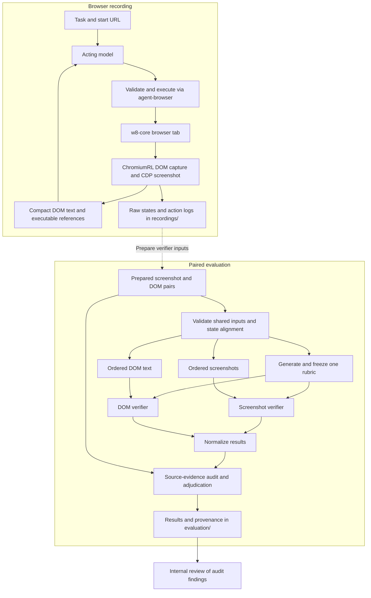

# `w8-domdiff-bench`: Browser Evidence Infrastructure for Agent Development

## Abstract

`w8-domdiff-bench` records browser-agent runs in Wootzapp Browser, powered by
the Chromium-based `w8-core` engine, and compares screenshot evidence with
DOM-diff Optimized, a compact text representation of each captured page
state. The recorder, paired verifiers, and evidence audit make it possible
to inspect what a browser agent observed and which required information each
representation preserved.

The collection contains **100 recorded browser tasks** and **92 evaluated task pairs**. Validated evidence audits cover **92 tasks and 589 criteria**, identifying **41 screenshot losses (6.96%)** and **10 DOM losses (1.70%)**. Observed URLs in the shared formatted history count for both verifiers. Seven remaining screenshot losses concern URL details unavailable in that shared evidence; excluding the primary URL category leaves 34 screenshot losses and 10 DOM losses, with all 589 criteria retained. These measurements describe evidence availability, not task success or acting-agent improvement.

Of 100 recorded tasks, 92 had usable, aligned evidence for evaluation; 8 were excluded because captures were missing/incomplete or failed URL alignment. All 92 evaluated tasks have validated evidence audits covering 589 criteria.

The [technical report](docs/technical-report.md) contains the full method and
all criterion-level findings. This README keeps the headline results,
architecture, mathematical definitions, and complete operating instructions
in one place.

Jump to [results](#evaluation-results),
[mathematical definitions](#mathematical-definitions),
[architecture](#how-the-system-works), or
[running instructions](#run-the-benchmark).

## 1 Introduction

Browser-agent verification is limited by the evidence retained during
execution. A required value may appear only after scrolling, a control state
may be visually unclear, or an exact URL may be outside a screenshot. If the
recorded trajectory omits that information, a downstream verifier cannot
recover it.

The repository addresses this problem with three connected components:

- Wootzapp Browser captures screenshots, structured page state, and
  action-tool observations through `w8-core` and the ChromiumRL CDP domain.
- DOM-diff Optimized turns each captured state into compact structured text
  while preserving content, controls, relationships, and scroll context.
- `w8-domdiff-bench` aligns screenshot and DOM evidence from the same
  trajectory, scores both against one frozen rubric, and audits whether the
  required source evidence was available.

The acting agent receives text observations rather than screenshots.
Screenshots remain recorded artifacts for the screenshot verifier and for
human inspection. This separation lets the benchmark compare evidence
representations without changing the executed action history or final answer.

## 2 Foundations and Baselines

Screenshot evidence preserves the rendered page and is useful for visual
properties such as layout, styling, images, and spatial relationships. Its
limits are viewport coverage and the difficulty of reading exact values,
long tables, URLs, and small text from pixels alone.

Structured browser observations preserve machine-readable text, roles,
controls, relationships, and page identity. Their limits include visual
notation, canvas or image content, and any source content that the browser
capture itself does not expose. Screenshot and DOM evidence are therefore
complementary rather than interchangeable.

The screenshot verifier provides the visual baseline. The DOM verifier is
the structured-evidence adaptation. Both use the same task inputs, action
history, final answer, frozen rubric, and scoring controls. The comparison
measures source-evidence availability separately from verifier reasoning and
task success. Background and related systems are documented in the
[technical report](docs/technical-report.md#foundations-and-baselines).

## 3 Inside the Wootzapp Browser Stack

### 3.1 Building DOM-diff Optimized

The browser evidence pipeline developed in stages. Detailed DOM capture made
page state inspectable; action-relative DOM diffing showed what changed; the
current optimized representation removes repeated before/after content and
describes each captured state directly.

| Stage | Limitation addressed | Result |
| --- | --- | --- |
| Detailed DOM capture | Screenshots did not preserve enough structured page state for inspection. | Captured text, attributes, relationships, accessibility data, styles, and layout geometry. |
| DOM diff | Detailed snapshots did not directly show the effect of an action. | Compared pre-action and post-action states to identify changed content and controls. |
| DOM-diff Optimized | Before/after files repeated large amounts of unchanged content. | Organized each state into content, tables, media, actions, and scroll regions without requiring separate diff files. |
| Browser-native processing | Re-reading the live page could differ from the snapshot that had been recorded. | Moved model-DOM selection and grouping into Chromium so structured JSON and rendered text describe the same captured state. |
| Preservation refinements | Nested text, context, author labels, control state, and long content could be omitted. | Refined selection and removed the former subtree-text limit while retaining viewport-based capture. |

The model-facing `dom_model.txt` observations average **5.16 KiB**. Across the same 853 recorded states, readable `dom_full.txt` averages **47.56 KiB** and structured `dom.json` averages **207.97 KiB**. A KiB is 1,024 bytes; a decimal kB is 1,000 bytes. These size measurements are descriptive and separate from evidence-loss rates and token usage.

### 3.2 From Agent Actions to Recorded Evidence

At each step, the acting model receives compact DOM text, executable
`agent-browser` references, task memory, and recent action outcomes. The
Python harness validates the proposed action and executes it through
`agent-browser` in the same browser tab. Wootzapp Browser then captures the
resulting state through ChromiumRL and CDP.

Each state keeps its screenshot, structured DOM, readable full-DOM text,
model-facing DOM, and action-tool observations. Rejected model proposals are
recorded separately and do not create executed-action states. Browser node
identifiers and executable `agent-browser` references remain separate
namespaces.

<a id="evaluation-results"></a>

## 4 Evaluation results

A source-evidence loss means a required item is absent from one representation together with its shared history and present in the other. Inventory uses `gpt-5.6-sol`; final adjudication uses `gpt-5.6-terra`. The counts measure evidence availability, not task success, answer correctness or acting-agent improvement.

Of 100 recorded tasks, 92 had usable, aligned evidence for evaluation; 8 were excluded because captures were missing/incomplete or failed URL alignment. All 92 evaluated tasks have validated evidence audits covering 589 criteria.

| Analysis | Tasks | Audited criteria | Screenshot losses | DOM losses |
| --- | ---: | ---: | ---: | ---: |
| All source-evidence loss categories | 92 | 589 | **41 (6.96%)** | **10 (1.70%)** |
| URL loss category excluded | 92 | 589 | **34 (5.77%)** | **10 (1.70%)** |
| Listed access-blocked task IDs excluded | 83 | 536 | **41 (7.65%)** | **9 (1.68%)** |
| Listed access-blocked task IDs and URL loss category excluded | 83 | 536 | **34 (6.34%)** | **9 (1.68%)** |

Excluding the primary URL category removes those losses from the numerator and retains every audited criterion. Excluding the nine cited blocker-task IDs removes their 53 criteria. The [report defines both exclusions](docs/technical-report.md#analysis-excluding-the-listed-access-blocked-tasks), and separately gives alternatives that remove entire criteria with primary URL findings.


The 95% intervals resample whole tasks, preserving correlation among criteria within a task. They assume independent tasks and do not measure annotation error. Counts, intervals and paired outcomes are in the [technical report](docs/technical-report.md#url-sensitivity-and-paired-comparison).

### Why URL sensitivity matters

Screenshot capture omits the browser’s address bar, but observed URLs in the
formatted action history are available to both verifiers. A URL absent from
screenshot pixels alone is not a loss when that shared context establishes it.
The formatter removes query strings and fragments and can shorten long URLs.
An intended navigation target is not proof of the observed destination.

URLs are the primary category for **7 of 41 screenshot losses (17.07%)**.
For example, task_50 retains `date=2020:2026` only in the DOM URL. The remaining
losses concern information unavailable in the shared history, not URLs already
supplied to both verifiers.

DOM has **75.61% fewer losses** across all categories and **70.59% fewer non-URL
losses**. The URL-excluded view recalculates saved findings; it is not an
experiment that changes screenshots, rubrics or verifier scores.

### What the findings show

The audits identify **50 affected criteria across 28 tasks**. One criterion has losses in both representations, so the 41 screenshot and 10 DOM losses overlap. Each affected representation receives one primary [category](docs/evidence-categories.md), with its assignment and rationale in [evidence_categories.tsv](results/evidence_categories.tsv).

| Category | Screenshots | DOM |
|---|---:|---:|
| Exact text and values | 18 | 2 |
| URLs | 7 | 0 |
| Control states | 0 | 2 |
| Table entries | 9 | 0 |
| Label–value links | 3 | 4 |
| Capture omissions | 4 | 2 |
| **All categories** | **41** | **10** |
| **Non-URL subtotal** | **34** | **10** |

Examples show the practical differences:

- **Exact values:** [task_08 C2](https://huggingface.co/datasets/WootzappLab/browser-agent-tasks/blob/main/evaluation/task_08/20261029T212045Z/evidence_audit.json) preserves an absolute publication date in DOM; screenshots show a relative age.
- **Capture coverage:** [task_19 C2](https://huggingface.co/datasets/WootzappLab/browser-agent-tasks/blob/main/evaluation/task_19/20261029T212045Z/evidence_audit.json) preserves three complete highlight rows in DOM; screenshots stop at the heading.
- **Visual form:** [task_37 C4](https://huggingface.co/datasets/WootzappLab/browser-agent-tasks/blob/main/evaluation/task_37/20261029T212045Z/evidence_audit.json) preserves availability checkmarks in DOM but the displayed release-label capitalization in screenshots.
- **Relationships and controls:** DOM losses include a disconnected publisher label/value in [task_02 C2](https://huggingface.co/datasets/WootzappLab/browser-agent-tasks/blob/main/evaluation/task_02/20261029T212045Z/evidence_audit.json) and missing World radio selection in [task_44 C2](https://huggingface.co/datasets/WootzappLab/browser-agent-tasks/blob/main/evaluation/task_44/20261029T212045Z/evidence_audit.json).

The detailed findings and evidence links are in the [report’s six-column criterion table](docs/technical-report.md#source-evidence-gaps-by-task-and-criterion). Category annotations summarize the saved findings; they do not change verifier scores or audit decisions.


Each bar counts criterion-level losses in one representation. The panels retain all 589 and 536 criteria, respectively; URL losses are omitted so the smaller categories remain readable. PNG and SVG versions are in [evaluation figures](docs/assets/evaluations/).

Website blockers, execution errors and source-evidence gaps are different events. The report lists nine cited blocker-task IDs and separately records 12 execution errors in the 100 recordings. Some blocked tasks later completed; the sets overlap and must not be added into a single failure rate.

<a id="mathematical-definitions"></a>

## 5 Mathematical definitions

### Rubric scores and task success

For task $`t`$, let $`s_{t,j}`$ be the points awarded to criterion $`j`$ after
scoring and rescoring, and $`p_{t,j}`$ its maximum points. For each
representation separately, the total and normalized score are

```math
S_t=\sum_j s_{t,j},\qquad S_t^{\max}=\sum_j p_{t,j},\qquad
r_t=\begin{cases}
S_t/S_t^{\max} & S_t^{\max}>0,\\
0 & S_t^{\max}=0.
\end{cases}
```

The indicator function equals 1 when its condition holds and 0 otherwise.
The process flag $`P_t`$ applies a rubric threshold $`\tau`$; the outcome flag
$`O_t`$ records the outcome judge's Boolean decision:

```math
P_t=\mathbf{1}\{r_t\ge\tau\},\qquad
O_t=\mathbf{1}\{\texttt{output\_success}_t=\mathrm{true}\}.
```

The standalone verifier runners support three `--success` rules:

```math
\mathrm{Success}_{\mathrm{outcome}}(t)=O_t,\qquad
\mathrm{Success}_{\mathrm{process}}(t)=P_t,\qquad
\mathrm{Success}_{\mathrm{both}}(t)=P_t O_t.
```

The paired workflow fixes **`--success outcome`** and the threshold $`\tau=0.8`$.
Its binary `score` follows $`O_t`$, while `rubric_is_success` records $`P_t`$.
A strict full-score success instead requires $`S_t=S_t^{\max}`$ for a
positive maximum total. The [shared controls](w8bench/verifier/common.py)
and [success rules](docs/evaluation-protocol.md#success-rules) document these
choices. Task success and source-evidence loss are separate measurements.

### Paired source-evidence loss

Let $`\mathcal{C}`$ contain the audited criteria, $`M=|\mathcal{C}|`$, and
$`\mathcal{I}_c`$ contain the concrete required items reviewed for criterion
$`c`$. Let $`a_{c,i,S}`$ and $`a_{c,i,D}`$ be binary indicators of item $`i`$'s
availability in the eligible ordered screenshot ($`S`$) and DOM ($`D`$) states together with their shared formatted action history.
Using the same requirements and review scope for both representations:

```math
\ell_{c,S}=\mathbf{1}\!\left\{\exists i\in\mathcal{I}_c:
a_{c,i,S}=0\ \land\ a_{c,i,D}=1\right\},
```

```math
\ell_{c,D}=\mathbf{1}\!\left\{\exists i\in\mathcal{I}_c:
a_{c,i,D}=0\ \land\ a_{c,i,S}=1\right\}.
```

A criterion contributes at most one loss per representation. Different
missing items can produce losses in both representations; items absent
from both are undetected by this paired metric. A verifier overlooking
available evidence is an interpretation error, rather than source loss.
The count and percentage rate are

```math
L_m=\sum_{c\in\mathcal{C}}\ell_{c,m},\qquad
\mathrm{ELR}_m=100\frac{L_m}{M},\qquad m\in\{S,D\}.
```

For the saved findings, $`M=589`$, $`L_S=41`$, and $`L_D=10`$, giving **6.96%** and **1.70%**. One overlapping criterion yields $`41+10-1=50`$ distinct affected criteria. With a shared denominator and $`L_S>0`$, the relative reduction is

```math
\mathrm{Reduction}=100\frac{L_S-L_D}{L_S}=100\frac{41-10}{41}\approx75.61\%.
```

Excluding the seven primary URL-category losses keeps $`M=589`$ and gives $`L_S=34`$, $`L_D=10`$: **5.77%** and **1.70%**, with **70.59% fewer losses**. Excluding the nine cited blocker-task IDs removes 53 criteria, leaving $`M=536`$. These are descriptive sensitivity calculations on the saved findings.

### Confidence intervals in the graph

Intervals resample whole tasks, keeping each task's criteria and both
representations together. For task $`t`$, let $`n_t`$ be its criterion count
and $`l_{t,m}`$ its loss count in representation $`m`$. For each bootstrap
draw, sample $`T`$ task indices $`I_1,\ldots,I_T`$ with replacement:

```math
\hat p_m^*=\frac{\sum_{b=1}^{T}l_{I_b,m}}{\sum_{b=1}^{T}n_{I_b}},\qquad
\mathrm{CI}_{95\%}=\left[Q_{0.025}(\hat p_m^*),Q_{0.975}(\hat p_m^*)\right].
```

The calculation uses 20,000 draws and seed 0. The paired screenshot-minus-DOM
difference uses the same draws. Rates remain criterion-weighted rather than
averages of task percentages. [summary.json](results/summary.json) stores the
intervals as fractions. They assume independent tasks and hold the automated
audit labels fixed; they do not measure annotation error or establish human
verification. See the [full method](docs/evaluation-protocol.md#evidence-loss-audit).

<a id="how-the-system-works"></a>

## 6 System architecture and boundaries

The acting model, `gpt-5.6`, generates browser actions from DOM-based text
observations and executable `agent-browser` references. The recorder saves
an initial browser state and one state after each executed action, including
screenshots and structured DOM evidence. DOM-diff Optimized describes individual captured states;
it does not require separate before/after diff files.
The model-facing `dom_model.txt` observations average **5.16 KiB**; see
[representation sizes](docs/technical-report.md#current-representation-size).



An execution with $`N`$ actions normally produces $`N+1`$ states: the initial
state and one after each executed action. Raw states start at
`steps/step_001/`; prepared evidence starts at `screenshot0.png` and
`dom_model0.txt`. Rejected proposals do not add executed actions.

| Component | Role and artifacts | Implementation | Verification |
| --- | --- | --- | --- |
| Browser runtime and recorder | Runs the action loop; saves snapshots, screenshots, decisions, and executed actions. | [task_recorder](w8bench/task_recorder/) · [ChromiumRL protocol](protocol/ChromiumRL.pdl) | Browser `status`; inspect `manifest.json` and `trajectory.jsonl`. |
| DOM rendering | Renders browser-generated model DOM as compact `dom_model.txt`; retains detailed capture alongside it. | [capture.py](w8bench/task_recorder/capture.py) · [renderers](w8bench/task_recorder/renderers/) | Compare each state's DOM text, structured snapshot, and screenshot. |
| Dataset and shared controls | Loads prepared pairs, checks alignment, and freezes one rubric with shared scoring settings. | [dataset_sync.py](w8bench/verifier/dataset_sync.py) · [validate_inputs.py](w8bench/verifier/validate_inputs.py) · [common.py](w8bench/verifier/common.py) | Check matching task inputs, action counts, and frozen rubric hashes. |
| Paired verifiers | Scores image and text evidence against the same rubric. | [screenshot_verifier](w8bench/screenshot_verifier/) · [dom_model](w8bench/dom_model/) | Inspect per-criterion results and scoring controls in run receipts. |
| Orchestration and audit | Normalizes results, audits source availability, and saves comparison provenance. | [run_full_comparison.py](w8bench/verifier/run_full_comparison.py) · [evidence_audit.py](w8bench/verifier/evidence_audit.py) | Inspect `evidence_audit.json` and its source citations. |

Both verifiers use the same scoring controls. Current evaluations use `gpt-5.2`
for rubric generation and evidence judgments, `gpt-5.6-terra` for action/validity
judgments, and `gpt-5.6-sol` for evidence inventory and `gpt-5.6-terra` for adjudication. Recordings use
`gpt-5.6` for browser-action generation. Internal WootzApp review is a separate verification step; its completion is not recorded in the saved model outputs.
See [model provenance](docs/technical-report.md#models-and-evaluation-provenance).

The screenshot baseline follows the Universal Verifier's rubric-based
design; WootzApp adds the DOM adaptation, browser-native evidence pipeline,
paired comparison, and source-aware audit. See the report's
[background and attribution](docs/technical-report.md#foundations-and-baselines)
and [references](docs/technical-report.md#references).

Screenshots and DOM remain complementary: visual form, control state,
label/value associations, viewport coverage, and sequential capture can
produce gaps in either representation. Items missing from both are outside
the paired source-loss metric. The [architecture guide](docs/architecture.md)
explains the capture pipeline and its boundaries.

These contracts are established by the implementation and saved artifacts.
Preflight checks establish input consistency; live replay and downstream
agent improvements require separate evaluation. DOM and screenshots are
captured sequentially, so rapidly changing pages can differ between captures.

<a id="run-the-benchmark"></a>

## 7 Run the benchmark

The complete recording workflow begins with a clean Chromium build, applies
the Wootzapp Browser source overlay, builds the local browser image, and then
installs this benchmark. Evaluation-only users can skip the browser build and
begin at [Clone and install the benchmark](#6-clone-and-install-the-benchmark).
The [runbook](docs/runbook.md) contains additional troubleshooting and
artifact details.

### Repository layout

- `w8bench/task_recorder/` contains task loading, browser capture, action
  execution, model prompts, text renderers, and trajectory export.
- `w8bench/dom_model/` contains the structured-evidence verifier.
- `w8bench/screenshot_verifier/` contains the screenshot-evidence verifier.
- `w8bench/verifier/` contains dataset retrieval, rubric freezing, paired
  execution, result normalization, and evidence auditing.
- `protocol/ChromiumRL.pdl` is the pinned browser protocol definition.
- `scripts/` contains the supported recording, image-build, and evaluation
  commands.
- `data/samples/` contains small examples. Complete paired task data is
  downloaded into the ignored `dataset/` directory.
- `results/` contains the published aggregate results and supporting notes.

### Requirements

Prepared-pair evaluation requires:

- 64-bit Linux or WSL 2
- Python 3.10 or newer
- Git and network access for dependencies and prepared data
- An OpenAI API key for executed model calls

Recording additionally requires:

- Docker Engine with Compose and Buildx
- `rsync`
- Approximately 32 GiB of RAM
- Approximately 200 GiB of free disk space for Chromium

Keep the Chromium workspace on a Linux filesystem. Building under `/mnt/c`
in WSL is considerably slower and can cause filesystem compatibility issues.

### Build Wootzapp Browser for recording

#### 1. Create the build workspace and install `depot_tools`

Create a workspace for the browser source and install Chromium's build tools:

```bash
mkdir -p w8-browser-build
cd w8-browser-build
git clone https://chromium.googlesource.com/chromium/tools/depot_tools.git
export PATH="$PATH:$(pwd)/depot_tools"
```

Run the `export` command again in each new terminal used for the Chromium
build.

#### 2. Fetch the pinned Chromium source

```bash
mkdir -p chromium
cd chromium
fetch --nohooks --no-history chromium
gclient sync --nohooks \
  --revision src@refs/tags/152.0.7948.0 \
  --reset --upstream -D --force --no-history --shallow
```

The first download can take more than an hour. If it is interrupted, restore
the `depot_tools` path, return to the `chromium` directory, and run the same
`gclient sync` command again.

#### 3. Build the pinned Chromium revision

```bash
cd src
./build/install-build-deps.sh
gclient runhooks
gn gen out/Release --args='is_debug=false
is_component_build=false
symbol_level=0
blink_symbol_level=0
v8_symbol_level=0
proprietary_codecs=true
ffmpeg_branding="Chrome"'
autoninja -C out/Release chrome
./out/Release/chrome --version
```

Do not continue unless this initial build succeeds.

#### 4. Fetch the Wootzapp Browser source overlay

Return to the directory containing `w8-browser-build`, then clone the public
browser repository:

```bash
cd ../../..
git clone https://github.com/wootzapp/wootzapp-browser.git
git -C wootzapp-browser checkout --detach 02bf5a35c5a7d02371deb6afa6adb57cc73aae72
```

The overlay revision is pinned in `protocol/browser-build.json`.

#### 5. Apply the overlay and rebuild

Copy the maintained overlay into Chromium:

```bash
sudo chmod -R u+w w8-browser-build/chromium/src
cp -r wootzapp-browser/src/. w8-browser-build/chromium/src/
```

Only files under `wootzapp-browser/src/` are applied.

```bash
cd w8-browser-build/chromium
gclient runhooks
cd src
gn gen out/Release
autoninja -C out/Release chrome
./out/Release/chrome --version
cd ../../..
```

The existing `out/Release` directory retains the build arguments from the
initial Chromium build. The final command returns to the shared workspace.

#### 6. Clone and install the benchmark

The browser-build flow is now back in the shared workspace containing
`w8-browser-build`. Evaluation-only users can run the following commands from
the directory where they want to keep the benchmark:

```bash
git clone https://github.com/wootzapp/w8-domdiff-bench.git
cd w8-domdiff-bench
```

Create the Python environment:

```bash
python3 -m venv .venv
source .venv/bin/activate
python -m pip install -e ".[test]"
```

The `scripts/` wrappers use this checkout's `.venv/bin/python`.

#### 7. Create the local browser image

Copy the rebuilt browser and its runtime dependencies into the benchmark:

```bash
rm -rf build
mkdir build
cd ../w8-browser-build/chromium/src
gn desc out/Release //chrome:chrome runtime_deps | \
  rsync -aR --files-from=- out/Release/ ../../../w8-domdiff-bench/build/
test -x ../../../w8-domdiff-bench/build/chrome
cd ../../../w8-domdiff-bench
```

Build and inspect the local image:

```bash
./scripts/build-browser-image
docker image inspect w8-core:domdiff-bench
```

The build checks the pinned overlay, applied source files, protocol and copied
Release binary. It includes a `browser-build.json` receipt and image labels for
the source revisions. For other source locations, pass the Chromium source
directory and browser-overlay directory as the script's two arguments.

The image remains in the local Docker engine after the terminal closes. It
only needs to be rebuilt when Chromium, the Wootzapp Browser overlay, or the
image runtime files change.

### Configure and start the browser runtime

From the repository root with the Python environment active, create a
conflict-free local runtime configuration:

```bash
python -m w8bench.task_recorder.browser_runtime configure
```

This command creates `w8-domdiff-bench/.env`, chooses available host ports,
and assigns a checkout-specific container name. Open that file and set:

```text
OPENAI_API_KEY=your-api-key
OPENAI_MODEL=your-supported-model
```

Use `OPENAI_MODEL=gpt-5.6` to match the benchmark's recording model. Other
supported models are allowed; the selected model is saved in `task.json`.
The recorder reads this setting from the environment, with `--model` as an
explicit override. It does not supply a fixed acting model.

Recording requires both values. Evaluation requires `OPENAI_API_KEY`; its
model settings are read from [config/](config/). The API account must have
access to the configured models.

Start the browser and verify the container, CDP endpoint, noVNC page, and
bundled `agent-browser`:

```bash
docker compose --env-file .env up -d --wait w8-core
python -m w8bench.task_recorder.browser_runtime status
```

The status command prints the noVNC port selected for this checkout.

### View a browser running on a remote server

The URL printed by `status` uses `127.0.0.1`, so it is local to the machine
running Docker. When Docker is running on a remote server, first note the
printed noVNC port. From the computer where the browser window should be
opened, create an SSH tunnel:

```bash
ssh -o ExitOnForwardFailure=yes -N \
  -L 39084:127.0.0.1:16191 \
  username@server-address
```

Replace `16191` with the port printed by `status`. Then open this address on
the local computer:

```text
http://127.0.0.1:39084/vnc.html?resize=scale&autoconnect=1&path=websockify
```

If local port `39084` is already occupied, choose another local port in both
the SSH command and browser URL. The Docker ports stay bound to server
loopback and do not need to be exposed publicly.

### Run a catalog task

Catalog tasks are loaded from the configured task catalog by task ID. Run one
from the repository root:

```bash
mkdir -p recordings
./scripts/run-task task8 --output-dir recordings
```

The task runner prints the selected task name, start URL, output directory,
and intervention policy before execution.

### Run a custom task

```bash
./scripts/run-task local-check "Example page inspection" \
  --task "Report the visible heading on the page." \
  --start-url "https://example.com/" \
  --output-dir recordings
```

Human intervention is disabled by default. Use `--allow-human-intervention`
only to permit assistance with a CAPTCHA or similar access challenge.
Requests, timestamps and resume/abort status are logged and counted in the
manifest; individual human clicks are not exported as agent actions.
Keep assistance disabled for autonomous benchmark recordings.

Each recording is written under `recordings/<run-id>/`:

```text
recordings/<run-id>/
  task.json
  manifest.json
  decisions.jsonl
  final.json
  trajectory.jsonl
  web_surfer.log
  steps/
    step_001/
      dom.json
      dom_full.txt
      dom_model.json
      dom_model.txt
      screenshot.png
      agent_browser.txt
      agent_browser_actions.txt
      action.json
```

The first step is the initial browser state. Each later step is the state
after an executed action, and the final step can have no `action.json`.
Prepare these recordings before scoring them, as described below.

Stop this checkout's browser when it is no longer needed:

```bash
docker compose --env-file .env down
```

### Compare screenshot and DOM evidence

For a full comparison, choose one input source:

- **Your recordings:** prepare local trajectories, then evaluate them.
- **Published trajectories:** fetch them from Hugging Face and evaluate directly;
  no browser build or task recording is needed.

#### Use your recordings

Prepare paired inputs without model calls:

```bash
python -m w8bench.task_recorder.prepare_verifier_data recordings trajectories
```

The command preserves recordings and existing pairs, adds missing usable pairs,
and reports exclusions in `trajectories/preparation_report.json`. Failed tasks
are included when their captured evidence is usable; exclusions return exit code 1.

Validate the inputs, then run the full comparison:

```bash
./scripts/run-comparison --all --data-source local
```

```bash
./scripts/run-comparison --all --data-source local --execute
```

#### Use published trajectories

Download and validate the published pairs, then evaluate them:

```bash
./scripts/run-comparison --all --data-source huggingface
```

```bash
./scripts/run-comparison --all --data-source huggingface --execute
```

Local inputs stay under `trajectories/`; downloaded inputs stay under `dataset/`.
The selected source is used without falling back to the other. Replace `--all`
with `--task task_01` for one task, or use `--data-root PATH` for a different
local input folder.

Both paths freeze one rubric per task, run both verifiers, and audit evidence
loss. `--execute` makes paid model calls; fresh judgments can vary. Results go
to `evaluation/<task>/<run-id>/`, with batch summaries in `evaluation/batches/`.

`run-id` groups outputs. The run manifest records the source task ID and UTC
scoring/audit times; batch summaries record batch times. Use manifests and
logs for execution dates.
See the [runbook](docs/runbook.md#score-a-prepared-task) for operational details.

### Run tests

The offline test suite runs with:

```bash
python -m pytest
```

## 8 Documentation and data

| Resource | Contents |
| --- | --- |
| [Technical report](docs/technical-report.md) | Full evaluation findings, mathematical definitions, success rules, current observation sizes, references, and all 50 affected criteria. |
| [Results](results/README.md) · [JSON summary](results/summary.json) | Published aggregate counts and analysis definitions. |
| [Evaluation protocol](docs/evaluation-protocol.md) | Shared inputs, scoring controls, source-loss definition, and counting rules. |
| [Architecture](docs/architecture.md) | Browser capture, DOM-diff Optimized, verifier components, and boundaries. |
| [Runbook](docs/runbook.md) | Installation, browser build, recording, scoring, and troubleshooting. |
| [Dataset card](docs/datacard.md) | Paired data layout, local samples, collection policy, and limitations. |
| [Recordings](docs/recordings.md) | Raw collection artifacts, action/state alignment, and provenance. |
| [Evidence categories](docs/evidence-categories.md) | Six category definitions, boundary rules, and annotated examples. |
| [Published dataset](https://huggingface.co/datasets/WootzappLab/browser-agent-tasks) | All paired trajectories, task catalog, recordings, and saved evaluations. |

Implementation lives in `w8bench/task_recorder/`, `w8bench/dom_model/`,
`w8bench/screenshot_verifier/`, and `w8bench/verifier/`. The pinned browser
protocol is [protocol/ChromiumRL.pdl](protocol/ChromiumRL.pdl); small example
pairs are in [data/samples/](data/samples/).

## License

Licensed under the Apache License, Version 2.0. See [LICENSE](LICENSE).
