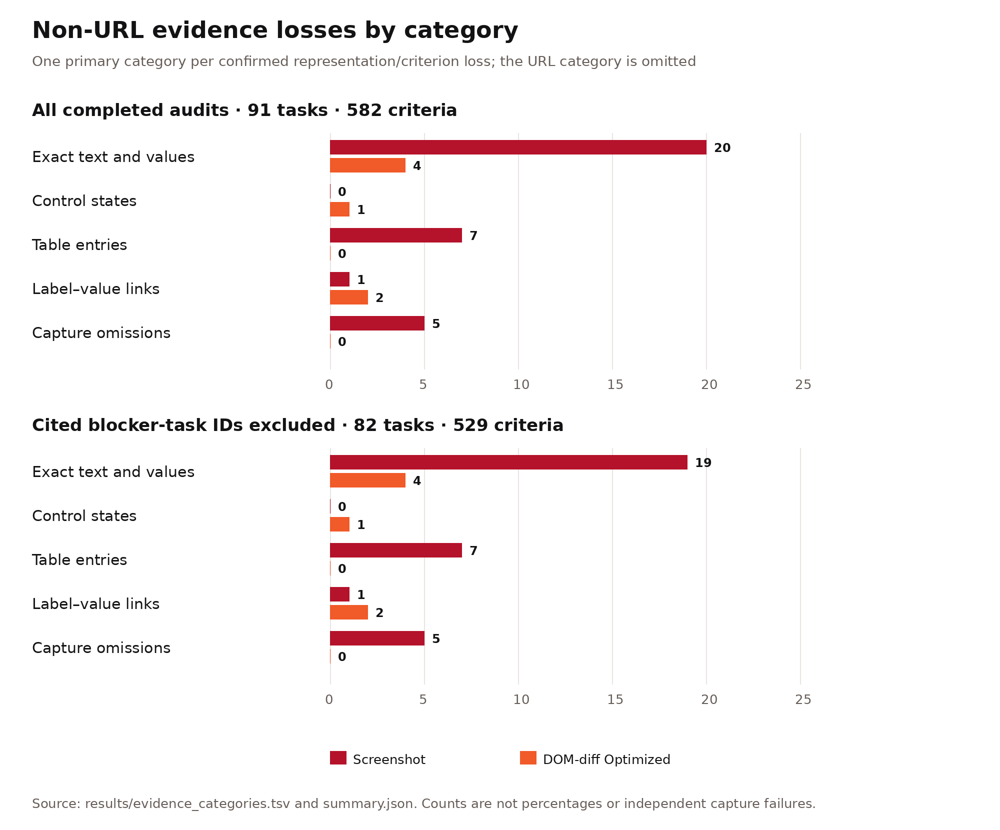
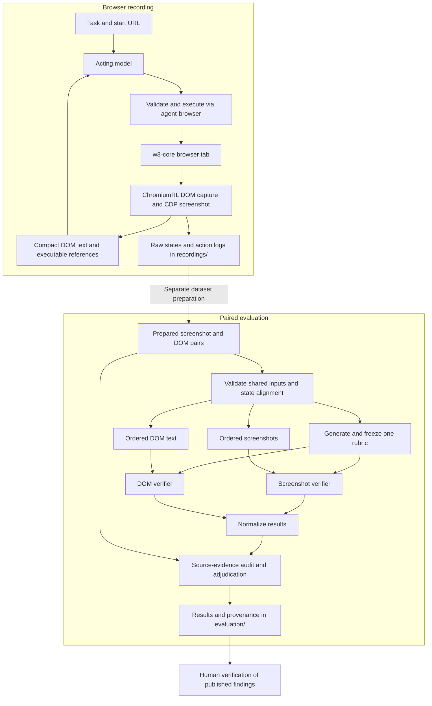

# w8-domdiff-bench

`w8-domdiff-bench` records browser-agent runs in WootzApp’s Chromium-based
`w8-core` browser and compares screenshot evidence with DOM-diff Optimized,
a compact text representation of each captured page state. The recorder,
paired verifiers, and evidence audit make it possible to inspect what a
browser agent observed and which required information each representation
preserved.

The benchmark contains 100 paired browser tasks. Its evaluation covers
**642 rubric criteria**, using the same task, executed
actions, final answer, and frozen rubric for each screenshot/DOM comparison.
The [technical report](docs/technical-report.md) contains the full evaluation
write-up and all criterion-level findings; selected results follow below.

Jump to [results](#evaluation-results), [mathematical definitions](#mathematical-definitions),
[architecture](#how-the-system-works), or [running instructions](#run-the-benchmark).

## Evaluation results

A source-evidence loss means a required item is absent from one recorded
representation and present in the other. The counts below come from
`gpt-5.6-sol` evidence audits verified by internal WootzApp employees.
They measure evidence availability, not task success, answer correctness,
or acting-agent improvement.

| Analysis | Tasks | Audited criteria | Screenshot losses | DOM losses |
| --- | ---: | ---: | ---: | ---: |
| All source-evidence loss categories | 100 | 642 | **151 (23.52%)** | **5 (0.78%)** |
| URL loss category excluded | 100 | 642 | **34 (5.30%)** | **5 (0.78%)** |
| Listed access-blocked task IDs excluded | 88 | 575 | **125 (21.74%)** | **5 (0.87%)** |
| Listed access-blocked task IDs and URL loss category excluded | 88 | 575 | **32 (5.57%)** | **5 (0.87%)** |

Excluding the URL category removes those losses from the numerator and
retains every audited criterion in that cohort. Excluding the 12 listed
access-blocked task IDs removes their 67 criteria. The
[report defines both exclusions](docs/technical-report.md#analysis-excluding-the-listed-access-blocked-tasks)
and also gives alternatives that remove entire criteria with URL findings.


The intervals shown are exploratory 95% Wilson intervals. They assume
independent criteria and do not adjust for correlation within tasks or
annotation errors. Full counts, intervals, and paired outcomes
are in the [technical report](docs/technical-report.md#url-sensitivity-and-paired-comparison).

### Why URL sensitivity matters

URLs account for **117 of the 151 screenshot losses (77.5%)**. The screenshot
capture mechanism omits the browser’s address bar. Under the saved audit’s
identity rule, a missing URL counts only when the rubric requires exact
website, page, record, or endpoint identity and DOM preserves the required
URL. Branding and URLs in the shared action history do not substitute for
URL evidence within the representation itself.

DOM has 96.7% fewer losses across all categories and 85.3% fewer non-URL
losses in this evaluation. The URL-excluded view recalculates existing
findings; it does not measure what would happen if URLs were added to
screenshots or a different rubric were used.

### What the findings show

The full audits identify **154 affected criteria across 91 tasks**. Two
criteria have losses in both representations, so the 151 screenshot and 5
DOM losses overlap. Each affected representation receives one primary
[category](docs/EVIDENCE-CATEGORIES.md).

Examples show the practical differences:

- **Exact values:** task_19 C3 preserves an absolute release timestamp in DOM,
  while screenshots retain a relative date.
- **Capture coverage:** task_24 preserves story 30 in DOM, while screenshots
  stop at story 29. That shared omission affects three rubric criteria.
- **Visual notation:** task_66 C1 preserves the rendered Fibonacci subscripts
  in screenshots, while DOM normalizes the notation to plain text.
- **Relationships and controls:** DOM losses include a disconnected publisher
  label/value in task_02 C2 and missing unchecked-filter states in task_56 C1.

The detailed evidence links and saved findings are in the
[report’s criterion table](docs/technical-report.md#source-evidence-gaps-by-task-and-criterion).
These findings combine model-generated audit/adjudication with verification
by internal WootzApp employees.



Each bar counts criterion-level losses in one representation. The panels
retain all 642 and 575 audited criteria, respectively; URL losses are omitted
so the smaller categories remain readable. PNG and exportable SVG versions
of both graphs are in [evaluation figures](docs/assets/evaluations/).

Website access blockers, execution errors, and source-evidence gaps describe
different events. The report lists 12 task IDs with access blockers and
separately records 12 execution failures in the published trajectories.
Those sets overlap; their counts cannot be added into a single failure rate.

## Mathematical definitions

### Rubric scores and task success

For task $t$, let $s_{t,j}$ be the points awarded to criterion $j$ after
scoring and rescoring, and $p_{t,j}$ its maximum points. For each
representation separately, the total and normalized score are

```math
S_t=\sum_j s_{t,j},\qquad S_t^{\max}=\sum_j p_{t,j},\qquad
r_t=\begin{cases}
S_t/S_t^{\max} & S_t^{\max}>0,\\
0 & S_t^{\max}=0.
\end{cases}
```

Let $\mathbf{1}\{\cdot\}$ be 1 when a condition holds and 0 otherwise.
The process flag $P_t$ applies a rubric threshold $\tau$; the outcome flag
$O_t$ records the outcome judge's Boolean decision:

```math
P_t=\mathbf{1}\{r_t\ge\tau\},\qquad
O_t=\mathbf{1}\{\texttt{output\_success}_t=\mathrm{true}\}.
```

The standalone verifier runners support three `--success` rules:

```math
\mathrm{Success}_{\mathrm{outcome}}(t)=O_t,\qquad
\mathrm{Success}_{\mathrm{process}}(t)=P_t,\qquad
\mathrm{Success}_{\mathrm{both}}(t)=P_t O_t.
```

The paired workflow fixes **`--success outcome`** and **$\tau=0.8$**.
Its binary `score` follows $O_t$, while `rubric_is_success` records $P_t$.
A strict full-score success instead requires $S_t=S_t^{\max}$ for a
positive maximum total. The [shared controls](w8bench/verifier/common.py)
and [success rules](docs/evaluation-protocol.md#success-rules) document these
choices. Task success and source-evidence loss are separate measurements.

### Paired source-evidence loss

Let $\mathcal{C}$ contain the audited criteria, $M=|\mathcal{C}|$, and
$\mathcal{I}_c$ contain the concrete required items reviewed for criterion
$c$. Let $a_{c,i,S}$ and $a_{c,i,D}$ be binary indicators of item $i$'s
availability in the eligible ordered screenshot ($S$) and DOM ($D$) states.
Using the same requirements and review scope for both representations:

```math
\ell_{c,S}=\mathbf{1}\!\left\{\exists i\in\mathcal{I}_c:
a_{c,i,S}=0\ \land\ a_{c,i,D}=1\right\},
```

```math
\ell_{c,D}=\mathbf{1}\!\left\{\exists i\in\mathcal{I}_c:
a_{c,i,D}=0\ \land\ a_{c,i,S}=1\right\}.
```

A criterion contributes at most one loss per representation. Different
missing items can produce losses in both representations; items absent
from both are undetected by this paired metric. A verifier overlooking
available evidence is an interpretation error, rather than source loss.
The count and percentage rate are

```math
L_m=\sum_{c\in\mathcal{C}}\ell_{c,m},\qquad
\mathrm{ELR}_m=100\frac{L_m}{M},\qquad m\in\{S,D\}.
```

For the published findings, $M=642$, $L_S=151$, and $L_D=5$, giving
**23.52%** and **0.78%**. The two overlapping criteria yield
$151+5-2=154$ distinct affected criteria. With a shared denominator and
$L_S>0$, the relative reduction in losses is

```math
\mathrm{Reduction}=100\frac{L_S-L_D}{L_S}
=100\frac{151-5}{151}\approx96.7\%.
```

Excluding primary URL-category losses keeps $M=642$ and gives
$L_S=151-117=34$, $L_D=5$: rates of **5.30%** and **0.78%**, and a relative
reduction of $100(34-5)/34\approx85.3\%$. Excluding the listed blocked tasks
instead removes their 67 criteria, giving $M=575$. These are descriptive
sensitivity calculations on the saved findings.

### Confidence intervals in the graph

For a loss count $L$, denominator $M$, observed fraction $\hat p=L/M$,
and $z=1.96$, the exploratory 95% Wilson interval is

```math
\mathrm{CI}_{95\%}=
\frac{\hat p+\frac{z^2}{2M}
\ \pm\ z\sqrt{\frac{\hat p(1-\hat p)}{M}+\frac{z^2}{4M^2}}}
{1+\frac{z^2}{M}}.
```

Multiply the bounds by 100 for percentages. The graph uses these intervals;
[summary.json](results/summary.json) stores them as fractions. They assume
independent criteria and do not account for within-task correlation or
annotation error. See the [full method](docs/technical-report.md#benchmark-protocol-and-mathematical-definitions)
for definitions and the [paired analysis](docs/technical-report.md#url-sensitivity-and-paired-comparison)
for overlap and sensitivity details.

## How the system works

The acting model, `gpt-5.2`, generates browser actions from DOM-based text
observations and executable `agent-browser` references. The recorder saves
an initial browser state and one state after each executed action, including
screenshots and structured DOM evidence. DOM-diff Optimized describes individual captured states;
it does not require separate before/after diff files.
The model-facing `dom_model.txt` observations average **5.87 KiB**; see
[representation sizes](docs/technical-report.md#current-representation-size).



An execution with $N$ actions normally produces $N+1$ states: the initial
state and one after each executed action. Raw states start at
`steps/step_001/`; prepared evidence starts at `screenshot0.png` and
`dom_model0.txt`. Rejected proposals do not add executed actions.
The dotted connection is a dataset-production boundary: this repository
has no public command that converts raw recordings into prepared pairs.

| Component | Role and artifacts | Implementation | Verification |
| --- | --- | --- | --- |
| Browser runtime and recorder | Runs the action loop; saves snapshots, screenshots, decisions, and executed actions. | [task_recorder](w8bench/task_recorder/) · [ChromiumRL protocol](protocol/ChromiumRL.pdl) | Browser `status`; inspect `manifest.json` and `trajectory.jsonl`. |
| DOM rendering | Renders browser-generated model DOM as compact `dom_model.txt`; retains detailed capture alongside it. | [capture.py](w8bench/task_recorder/capture.py) · [renderers](w8bench/task_recorder/renderers/) | Compare each state's DOM text, structured snapshot, and screenshot. |
| Dataset and shared controls | Loads prepared pairs, checks alignment, and freezes one rubric with shared scoring settings. | [dataset_sync.py](w8bench/verifier/dataset_sync.py) · [validate_inputs.py](w8bench/verifier/validate_inputs.py) · [common.py](w8bench/verifier/common.py) | Check matching task inputs, action counts, and frozen rubric hashes. |
| Paired verifiers | Scores image and text evidence against the same rubric. | [screenshot_verifier](w8bench/screenshot_verifier/) · [dom_model](w8bench/dom_model/) | Inspect per-criterion results and scoring controls in run receipts. |
| Orchestration and audit | Normalizes results, audits source availability, and saves comparison provenance. | [run_full_comparison.py](w8bench/verifier/run_full_comparison.py) · [evidence_audit.py](w8bench/verifier/evidence_audit.py) | Inspect `evidence_audit.json` and its source citations. |

Both verifiers use the same scoring controls. The benchmark uses `gpt-5.2`
for action generation, rubric generation, and evidence judgments;
`o4-mini` for action/validity judgments; and `gpt-5.6-sol` for evidence
audit/adjudication. Internal WootzApp employees verify the audit findings.
See [model provenance](docs/technical-report.md#models-and-evaluation-provenance).

The screenshot baseline follows the Universal Verifier's rubric-based
design; WootzApp adds the DOM adaptation, browser-native evidence pipeline,
paired comparison, and source-aware audit. See the report's
[background and attribution](docs/technical-report.md#foundations-and-baselines)
and [references](docs/technical-report.md#references).

Screenshots and DOM remain complementary: visual form, control state,
label/value associations, viewport coverage, and sequential capture can
produce gaps in either representation. Items missing from both are outside
the paired source-loss metric. The [architecture guide](docs/architecture.md)
explains the capture pipeline and its boundaries.

These contracts are established by the implementation and saved artifacts.
Preflight checks establish input consistency; live replay and downstream
agent improvements require separate evaluation. DOM and screenshots are
captured sequentially, so rapidly changing pages can differ between captures.

## Run the benchmark

### Install and configure

Prepared-pair evaluation requires **Python 3.10+**, Git, network access for
dependencies and the dataset, and an OpenAI API key for executed model calls.
It runs without building or starting the browser. From a new checkout:

```bash
git clone https://github.com/wootzapp/w8-domdiff-bench.git
cd w8-domdiff-bench
python3 -m venv .venv
source .venv/bin/activate
python -m pip install -e ".[test]"
```

The `scripts/` wrappers use this checkout's `.venv/bin/python`. For
evaluation, create `.env` if it does not already exist:

```bash
test -f .env || cp .env.example .env
```

Edit `.env` to set `OPENAI_API_KEY`. Recording also needs `OPENAI_MODEL`
(the published runs used `gpt-5.2`). Evaluation model settings are in
[config/](config/); the default audit model is `gpt-5.6-sol`.
The API account must have access to the configured models.

### Evaluate prepared pairs

Download a prepared pair, check required files and consecutive state indices, and
print the planned workflow **without model calls**:

```bash
./scripts/run-comparison --task task_01
```

Run rubric generation, both verifiers, and the paired evidence audit:

```bash
./scripts/run-comparison --task task_01 --execute
```

Run all prepared tasks with `./scripts/run-comparison --all --execute`.
Each execution generates a fresh rubric, freezes it for both verifiers,
scores both representations, normalizes results, and audits source evidence.
Full shared-input and action/state alignment checks run in the executed
workflow before scoring.
The `--execute` commands make paid model calls. A fresh run can differ from
the published findings because rubric generation and model judgments are
performed again.

Prepared inputs are downloaded under `dataset/data-ss/<task>/` and
`dataset/data-dom/<task>/`. Both contain `task_data.json`, `final_answer.json`,
and `web_surfer.log`, plus ordered `screenshotN.png` or `dom_modelN.txt`
evidence. Generated runs go to the ignored
`evaluation/<task>/<run-id>/` directory, including `evidence_audit.json`.
Batch summaries go to `evaluation/batches/<run-id>/`.

### Record new tasks

Recording requires 64-bit Linux or WSL 2, Docker Engine with Compose and
Buildx, `rsync`, and a local `w8-core:domdiff-bench` image. Building that image
requires about **32 GiB RAM and 200 GiB free disk space**. Follow the
[browser build instructions](docs/runbook.md#browser-build) to build pinned
Chromium `152.0.7948.0`, apply the `w8-core` overlay, and assemble the image.
Then, from the repository root with the Python environment active:

```bash
python -m w8bench.task_recorder.browser_runtime configure
# Set OPENAI_API_KEY and OPENAI_MODEL in .env before recording.
docker compose --env-file .env up -d --wait w8-core
python -m w8bench.task_recorder.browser_runtime status
mkdir -p recordings
./scripts/run-task task8 --output-dir recordings --no-human-intervention
```

The status command checks the container, CDP, browser, and bundled
`agent-browser`, and prints the noVNC URL. To record a custom task:

```bash
./scripts/run-task local-check "Example page inspection" \
  --task "Report the visible heading on the page." \
  --start-url "https://example.com/" \
  --output-dir recordings \
  --no-human-intervention
```

Raw runs are saved under `recordings/<run-id>/`, including `manifest.json`,
`trajectory.jsonl`, `final.json`, and `steps/step_001/` onward. These raw
directories cannot be passed directly to `run-comparison`; see the
[preparation boundary](docs/runbook.md#recording-and-evaluation-inputs).
The [runbook](docs/runbook.md) also covers remote browser access and
troubleshooting.

### Run tests

The offline test suite runs with:

```bash
python -m pytest
```

## Documentation and data

| Resource | Contents |
| --- | --- |
| [Technical report](docs/technical-report.md) | Full evaluation findings, mathematical definitions, success rules, current observation sizes, references, and all 154 affected criteria. |
| [Results](results/README.md) · [JSON summary](results/summary.json) | Published aggregate counts and analysis definitions. |
| [Evaluation protocol](docs/evaluation-protocol.md) | Shared inputs, scoring controls, source-loss definition, and counting rules. |
| [Architecture](docs/architecture.md) | Browser capture, DOM-diff Optimized, verifier components, and boundaries. |
| [Runbook](docs/runbook.md) | Installation, browser build, recording, scoring, and troubleshooting. |
| [Dataset card](docs/datacard.md) | Paired data layout, local samples, collection policy, and limitations. |
| [Recordings](docs/recordings.md) | Raw collection artifacts, action/state alignment, and provenance. |
| [Evidence categories](docs/EVIDENCE-CATEGORIES.md) | Six category definitions, boundary rules, and annotated examples. |
| [Published dataset](https://huggingface.co/datasets/WootzappLab/browser-agent-tasks) | All paired trajectories, task catalog, recordings, and saved evaluations. |

Implementation lives in `w8bench/task_recorder/`, `w8bench/dom_model/`,
`w8bench/screenshot_verifier/`, and `w8bench/verifier/`. The pinned browser
protocol is [protocol/ChromiumRL.pdl](protocol/ChromiumRL.pdl); small example
pairs are in [data/samples/](data/samples/).

## License

Licensed under the Apache License, Version 2.0. See [LICENSE](LICENSE).
