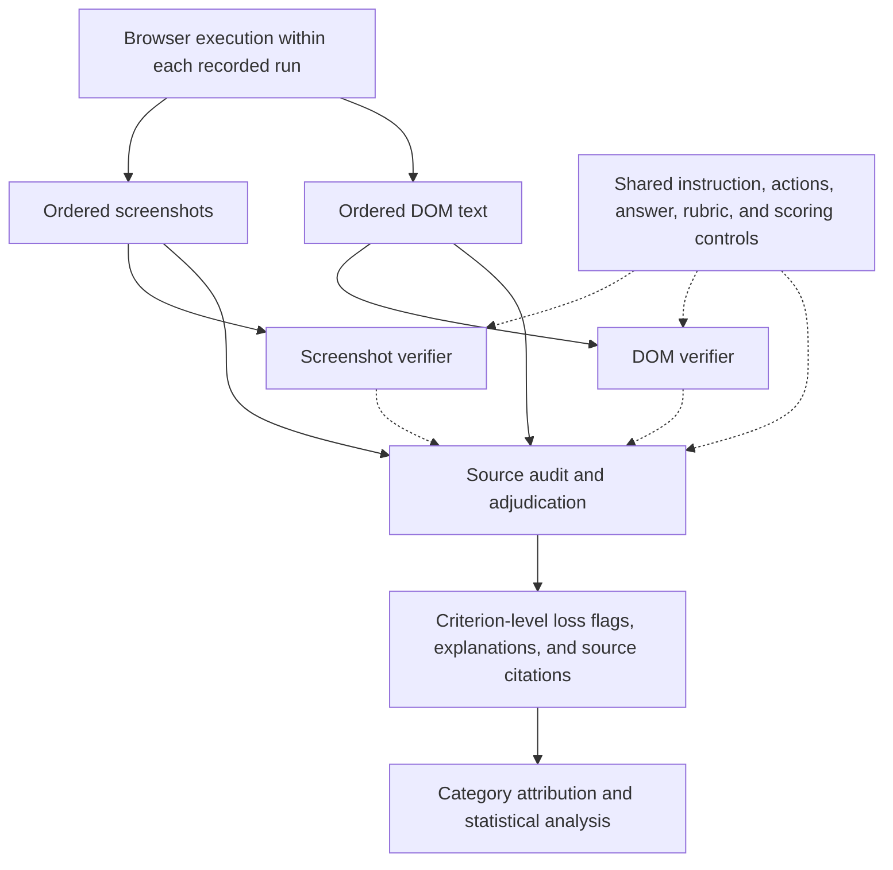
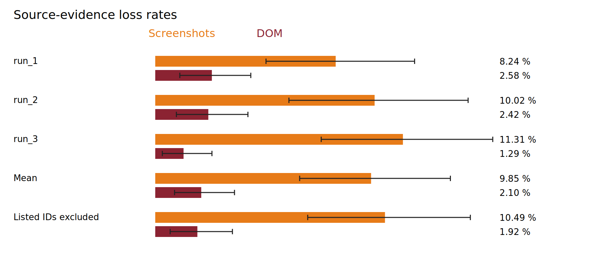
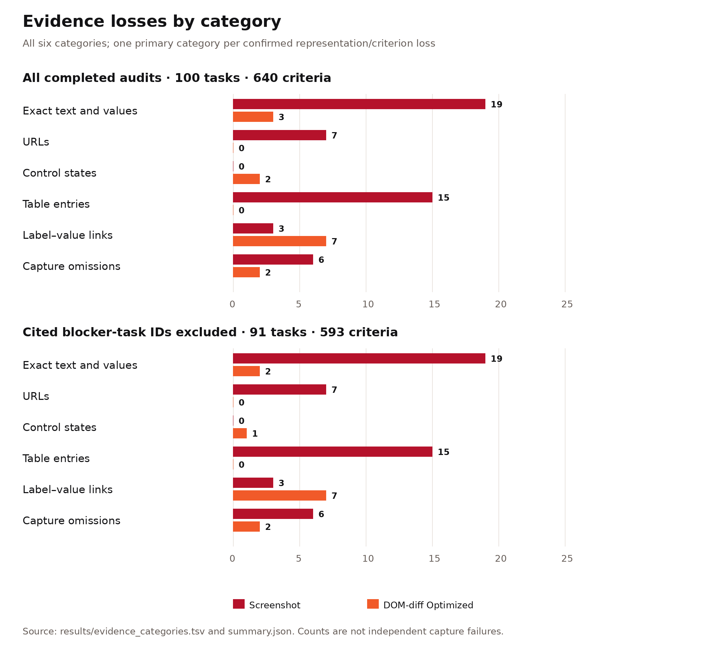

# Evidence Gaps in Browser-Agent Evaluation: A Paired Audit of Screenshots and DOM


**WootzApp**

## Contents

- [Abstract](#abstract)
- [1. Introduction](#1-introduction)
- [2. Related Work](#2-related-work)
- [3. Problem Definition](#3-problem-definition)
- [4. Study Design](#4-study-design)
- [5. Dataset and Experimental Setup](#5-dataset-and-experimental-setup)
- [6. Results](#6-results)
- [7. Discussion](#7-discussion)
- [8. Limitations](#8-limitations)
- [9. Conclusion](#9-conclusion)
- [Data and Code Availability](#data-and-code-availability)
- [Responsible Use](#responsible-use)
- [10. References](#10-references)
- [Appendix A. Formal Definitions and Equations](#appendix-a-formal-definitions-and-equations)
- [Appendix B. Recording and Verifier Implementation Details](#appendix-b-recording-and-verifier-implementation-details)
- [Appendix C. Dataset Provenance and Audit-Label Reconstruction](#appendix-c-dataset-provenance-and-audit-label-reconstruction)
- [Appendix D. Full Statistical Reanalysis](#appendix-d-full-statistical-reanalysis)
- [Appendix E. Complete Tables and Reproducibility Materials](#appendix-e-complete-tables-and-reproducibility-materials)

## Abstract

Browser-agent evaluators use recorded observations to judge what an agent did. Those observations may omit facts needed to assess a task. We introduce `w8-domdiff-bench`, a recording and audit framework that compares screenshots and compact DOM-derived text from the same browser execution. The task, executed actions, final answer, and verification rubric are held fixed within each pair. We open-source the companion [`browser-agent-tasks`](https://huggingface.co/datasets/WootzappLab/browser-agent-tasks) dataset, containing 300 retained recordings of 100 public-web tasks across three recorded runs, paired trajectories, frozen rubrics, verifier outputs, and automated source audits. The matched analysis covers 97 tasks and 619 criteria in every run. Screenshots have 61.00 evidence losses per run on average (9.85%; 95% interval 6.59–13.48%), compared with 13.00 for DOM text (2.10%; 0.88–3.62%). The paired difference is 7.75 percentage points, and the relative reduction is 78.69%. Intervals resample tasks, then runs within tasks, with audit labels held fixed. The findings include missing exact values, incomplete coverage, lost control states, and broken visual relationships. This study measures differences in recorded evidence availability; it does not establish verifier accuracy or agent success. The framework provides a way to inspect missing evidence separately from errors in interpreting it.

## 1. Introduction

A browser agent may claim that it read a price, applied a filter, or checked every entry in a list. A verifier must decide whether the recorded execution supports that claim. That decision depends on whether the required facts were recorded and whether the verifier interpreted them correctly. A stronger verifier cannot recover a fact that its inputs never contained.

Different browser observations preserve different facts. A screenshot can show a label next to its value or a control's checked state. A DOM-derived record can retain exact text and content outside the captured image. In the corpus studied here, one DOM record contains an absolute release date where screenshots show only a relative age. Conversely, one screenshot preserves a publisher's label–value relationship that the DOM record omits. These examples motivate our research question:

> For the same browser execution and verification rubric, which required facts are preserved by one recorded representation and missing from the other?

Answering this question requires aligned records. If two agents navigate or scroll differently, differences in their evidence may come from their actions. We instead record screenshots and DOM-derived text along one execution and compare them against the same rubric. A separate source audit checks the recorded observations for facts required by each rubric criterion. Here, “source” means the saved screenshots and DOM states themselves. Verifier-score disagreements alone do not establish that evidence is missing.

We implement this approach in `w8-domdiff-bench`, built on the `w8-core` Chromium recording stack. We collect the same 100 public-web research and extraction tasks in three recorded runs. The main analysis uses the 97 tasks with paired audits in every run, comprising 619 frozen criteria per run. Across these runs, screenshots have 61.00 losses on average (9.85%) and DOM text has 13.00 (2.10%), a difference of 7.75 percentage points. The audits identify 219 affected run/criterion observations, covering 118 distinct criterion positions across 49 tasks.

We report individual-run results, the mean across runs, source-loss categories, verifier misses, and an exploratory analysis excluding a listed set of tasks with access barriers.

Alongside the evaluation code, we open-source [`browser-agent-tasks`](https://huggingface.co/datasets/WootzappLab/browser-agent-tasks), the companion dataset. It contains the task definitions, paired observations, action logs, final answers, frozen rubrics, and saved verifier and audit outputs. Supporting browser recordings let readers follow the collection process back to individual captured states. Releasing these artifacts makes the evidence behind the findings inspectable and provides fixed inputs for further verifier comparisons.

The paper makes three contributions:

- A paired source-audit protocol for identifying required facts missing from one representation but present in another, while holding the execution and rubric fixed.
- The open [`browser-agent-tasks`](https://huggingface.co/datasets/WootzappLab/browser-agent-tasks) dataset: three recorded runs of 100 tasks, supporting browser recordings, and saved rubrics, verifier outputs, and criterion-level source audits where evidence was captured.
- A reproducible analysis of evidence loss across recorded runs, with paired task-and-run uncertainty estimates and an exploratory access-blocker analysis.

The study concerns recorded evidence from fixed trajectories generated by a DOM-conditioned acting policy. Measuring effects on verifier decisions or acting-agent performance requires additional experiments.

## 2. Related Work

### 2.1 Browser Benchmarks and Observation Interfaces

WebArena evaluates functional task completion in reproducible browser environments ([Zhou et al. 2024](https://proceedings.iclr.cc/paper_files/paper/2024/hash/4410c0711e9154a7a2d26f9b3816d1ef-Abstract-Conference.html)). VisualWebArena extends this setting to tasks requiring visual understanding ([Koh et al. 2024](https://doi.org/10.18653/v1/2024.acl-long.50)). BrowserGym standardizes observation and action interfaces across benchmarks, exposing screenshots, DOM and accessibility structures, tab metadata, and action feedback ([Le Sellier de Chezelles et al. 2025](https://openreview.net/forum?id=5298fKGmv3)).

These systems establish tasks and interfaces for browser-agent evaluation. Our question concerns the evidence those interfaces retain: whether two records of the same execution preserve the same facts required by a verification criterion.

### 2.2 Trajectory Verification

WebVoyager uses multimodal evaluation for live-web tasks ([He et al. 2024](https://doi.org/10.18653/v1/2024.acl-long.371)). WebJudge selects relevant intermediate screenshots to assess completion ([Xue et al. 2025](https://openreview.net/forum?id=6jZi4HSs6o)). Universal Verifier studies rubric construction, process and outcome judgments, environmental blockers, and context management over screenshot trajectories ([Rosset et al. 2026](#ref-rosset-2026)). Human review of WebArena-Lite also identifies discrepancies between automatic outcomes and observed completion ([Gan et al. 2026](https://doi.org/10.48550/arXiv.2610.01491)).

Our screenshot verifier follows Universal Verifier's rubric-centered design ([Rosset et al. 2026](#ref-rosset-2026)). Its judgments depend on the evidence supplied to it. A score disagreement can reflect either missing observations or differences in interpreting available observations. We therefore add a source audit that explicitly checks availability in both saved representations. This separates the measurement of missing evidence from the scoring workflow.

### 2.3 Observation Reduction and Evidence Retention

[Enomoto et al. (2026)](https://doi.org/10.48550/arXiv.2605.29397) evaluate HTML reduction through retention of Minimal Failure Sets, connecting retained elements to agent performance. We examine retrospective verification: after an execution is fixed, which rubric-required facts remain available in its recorded observations? The reported loss rates describe evidence availability and have not been validated as a proxy for downstream agent success.

### 2.4 Positioning DOM-diff Optimized

DOM-diff Optimized is the compact text representation evaluated here. It turns captured Chromium state into sections describing content, tables, media, controls, relationships, and scroll regions. Despite its historical name, the evaluated output describes each state directly; readers do not need to reconstruct it from a separate difference file.

The representation is produced through the `w8-core` recording stack. Selection and grouping use the captured browser state, so the structured snapshot and rendered text refer to that capture rather than a later read of the live page. This study compares that representation with screenshots. It does not isolate the renderer's improvement over an ordinary DOM dump, an accessibility tree, or a lightly filtered structured record.

Prior work supplies browser tasks, observation interfaces, and trajectory verifiers. This study adds a criterion-level audit of evidence retention across paired records of the same execution.

## 3. Problem Definition

A **task** specifies the browser activity to perform. Its **trajectory** is the initial browser state followed by executed actions and their recorded states. A **rubric** describes how to assess the task; each **criterion** is one requirement within that rubric.

A criterion may require several concrete facts: an exact price, the identity of a page, an unchecked filter, a table entry, or evidence that the end of a list was reached. We call these **required evidence items**. A label and its value can both be present while their relationship is missing, so availability must be judged at the specificity required by the criterion.

The two representations are the ordered screenshots and the ordered DOM-derived text from the same trajectory. A **source audit** examines those saved records to determine whether the required items are available. A **directional evidence loss** occurs when an item required by a criterion is absent from one representation and present in the other.

Each criterion can contribute at most one loss to each representation, even if several items are missing. A criterion can have losses in both directions if the two representations omit different required items. For example, a screenshot might preserve a filter's unchecked state while the DOM record preserves a required exact value missing from the image.

This definition detects differences between the records. It cannot detect an item missing from both. A criterion with no detected directional loss therefore need not have complete evidence. Establishing absolute coverage would require an additional reference, such as expert-reviewed environment state.

Availability is evaluated across each representation together with the shared task inputs and formatted executed-action history. A URL, identifier, or requested filter already supplied there is available to both sides; an absent browser address bar alone is not a loss. Shared instructions do not prove that a requested action occurred, and a final-answer claim is not independent evidence of completion. Page-specific values and relationships still require supporting evidence at the specificity of the criterion. [Appendix A](#appendix-a-formal-definitions-and-equations) gives the formal definition.

## 4. Study Design

### 4.1 Paired Comparison

Within each recorded run, we compare screenshots and DOM text from the same execution. Both verifiers receive the same task instruction, executed action history, final answer, frozen rubric, models, and scoring controls. The evidence representation changes between the paired verifiers. The same task definitions and frozen rubrics are used across the three recorded runs; executions and captured states may differ.

The source audit then receives both saved channels and both verifier outputs. It produces screenshot and DOM loss flags for each criterion, with explanations and source citations. Figure 1 shows these inputs and outputs.



*Figure 1. Data flow within each recorded run. Solid arrows carry execution records or audit outputs; dashed arrows carry shared context or verifier judgments. Frozen rubrics are shared across runs. Category assignments are linked to the saved adjudicated findings.*

### 4.2 Recording Channels

The screenshot channel records rendered page content without the browser address bar. The DOM channel records compact structured text, including page-identity metadata. Both the full structured DOM and compact DOM use viewport-only selection with off-screen inclusion disabled. This restricts node selection, not every character associated with a selected element: a selected node can retain text or relationships extending beyond the screenshot's visible area. The channels therefore share a viewport-oriented capture setting, but not necessarily identical retained coverage.

The two captures are sequential. A page that changes between captures can produce different records even when both capture procedures work as intended. Viewport selection and rendering also affect coverage: a list entry outside a screenshot may be retained in DOM text, while visual notation may be flattened by text rendering. We consequently interpret the findings as gaps in the recorded evidence under this configuration.

### 4.3 Source Audit

Audit and adjudication receive the ordered screenshots, line-numbered DOM states, shared trajectory context, and both verifier outputs. The verifier workflow nominates five evidence items per criterion for scoring. The source audit receives the full saved channels and can examine states beyond those nominated items.

Evidence inventory uses `gpt-5.6-sol`; adjudication uses `gemini-3.1-pro-preview`. Each task/run pair receives one source audit. Requested and returned model IDs, generation settings, timestamps, validation attempts, and source fingerprints are saved with the findings. WootzApp employees provide internal review, separate from these automated labels. The saved results do not establish complete human-review coverage, blinded annotation, or independent agreement.

Source citations point to the saved screenshot states or DOM lines supporting a finding. For example, run_1 task_08 C2 concerns a release date: the DOM record preserves an absolute publication date while screenshots retain a relative age. A reader can inspect the cited states to evaluate the claimed difference. Supplying all saved states makes review possible, but does not guarantee that a model or reviewer notices every relevant detail. Verifier misses are recorded separately when available evidence was overlooked or misinterpreted.

### 4.4 Loss Categories and Exploratory Analysis

Each loss receives one primary category describing its main missing fact or relationship:

| Category | Required evidence concerned |
|---|---|
| Exact text and values | Precise wording, numbers, dates, or notation |
| URLs | Exact website, page, record, or endpoint identity |
| Control states | Whether a control is checked, selected, or otherwise set |
| Table entries | Required entries in tabular content |
| Label–value links | The relationship between a label and its value |
| Capture omissions | Required content or coverage absent from the saved record |

Category assignments are stored in `results/evidence_categories.tsv`, keyed by run, task, criterion, and representation. Each row includes a hash of the corresponding adjudicated finding. The analysis checks that every confirmed source loss has exactly one primary category. One category does not enumerate every omission associated with a finding, and category assignment does not alter the loss flags.

The main result includes all six categories. An exploratory analysis removes a listed set of nine tasks with observed access barriers. The set was not specified before examining the recordings and is not a list of failed tasks: some completed despite an earlier barrier. Its IDs and counting rule are given in [Appendix D](#appendix-d-full-statistical-reanalysis).

### 4.5 Counts and Rates

Within each run, the loss rate is the number of affected criteria divided by the number of audited criteria. The primary comparison uses the same 97 tasks and 619 criteria in every run. We report mean counts and rates across these runs, the screenshot-minus-DOM difference in percentage points, and the relative reduction calculated from the mean counts. This is not a majority vote or a task-success-attempt metric. All criteria receive equal weight, so tasks with more criteria contribute more to the pooled rate.

Criteria within a task can depend on the same observation. For example, one missing list entry may affect several criteria. The counts therefore describe affected rubric criteria rather than independent capture failures. Paired 95% intervals use 20,000 bootstrap draws, sampling tasks and then runs within each sampled task. All criteria and both channels remain paired. These intervals hold the audit labels fixed and do not account for annotation error.

## 5. Dataset and Experimental Setup

### 5.1 Task Corpus

The release contains 100 public-web research and extraction tasks, each recorded in three runs ([WootzApp 2026a](https://huggingface.co/datasets/WootzappLab/browser-agent-tasks)). Tasks include retrieving release metadata, checking ranked lists, extracting product fields, and inspecting search filters. There are 300 retained recordings and 296 prepared, evaluated task/run pairs. Run_2 task_94 and run_3 tasks_80, _83, and _94 have no captured state and remain unscored; they are not treated as zero-loss observations. The matched panel contains the 97 tasks with audits in every run.

The 296 audited histories contain 2,296 executed-action records. Per-run totals are 783, 718, and 795; median action counts are 2.5, 2, and 3, with a range of zero to 80 in each run. Across these histories, seven task/run pairs have no recorded action and 87 have one. The full catalog starts at 90 distinct hostnames; frozen rubrics contain three to 13 criteria per task. A task with no recorded action can still have evidence from its initial state. These summaries indicate substantial direct lookup activity and limited evidence for broader claims about long interactive workflows.

### 5.2 Dataset Contents and Reuse

The companion dataset, [`browser-agent-tasks`](https://huggingface.co/datasets/WootzappLab/browser-agent-tasks), is released alongside this repository. The dataset holds the evidence and saved evaluation artifacts; `w8-domdiff-bench` supplies the recording, verification, and audit code.

| Dataset path | Released material | Purpose |
|---|---|---|
| `tasks.jsonl` | 100 task definitions, including IDs, categories, instructions, start URLs, stopping conditions, and constraints | Inspect the requested behavior and task boundaries |
| `trajectories/run_*/data-ss/` | 100, 99, and 97 task folders with metadata, final answers, normalized action logs, and ordered screenshots | Evaluate or inspect the screenshot representation |
| `trajectories/run_*/data-dom/` | Corresponding task folders with the same metadata, answers, and actions, plus ordered DOM text | Compare structured observations against the same execution |
| `recordings/run_*/` | 100 retained recordings per run, with manifests, model decisions, executed actions, final records, and captured state assets where available | Trace collection and inspect rejected actions or failures |
| `evaluations/run_*/` | Frozen rubrics, verifier results, comparison reports, run manifests, and evidence audits for 296 task/run pairs | Inspect scoring controls and follow findings to their cited sources |
| `EVALUATIONS.md` and `EVIDENCE-CATEGORIES.md` | Aggregate findings and category definitions | Interpret the saved labels and counting rules |

Prepared pairs share `task_data.json`, `final_answer.json`, and `web_surfer.log`. Screenshot folders contain `screenshotN.png`; DOM folders contain `dom_modelN.txt`. State 0 is the initial observation, and subsequent numbered states follow executed actions. Raw recordings provide additional detail through files such as `manifest.json`, `decisions.jsonl`, and `trajectory.jsonl`, together with screenshots and structured or rendered DOM states when capture succeeded.

These materials support several forms of reuse. Researchers can test a verifier on the saved evidence and frozen rubrics, inspect a claimed loss against its screenshot or DOM citation, or study how evidence selection changes a judgment. The supporting recordings expose collection details beyond the prepared verification inputs, including failed actions and rejected proposals. A recorded success status is a collection outcome rather than independently established answer correctness.

The dataset loader exposes the task catalog as a `test` split. Its `trajectory_pairs` configuration indexes prepared pairs by run through `trajectories/run_*/pairs.jsonl`. These are evaluation inputs, not validated training demonstrations. Catalog ID `browser_task_008`, prepared alias `task_08`, and recording task selector `task8` refer to the same numbered task.

### 5.3 Trajectory Generation

The acting model, `gpt-5.6`, receives DOM text, executable `agent-browser` references, task memory, and recent action outcomes. Screenshots are retained for comparison but are not supplied to the acting model. Pairing holds each executed trajectory fixed; a screenshot-conditioned policy could navigate, scroll, or stop differently. Each recording starts with a fresh browser profile. The recorder reads its model from `OPENAI_MODEL`, with an explicit CLI override available; model settings are recorded rather than fixed in the implementation.

The recorder uses WootzApp Browser, powered by the Chromium-based `w8-core` engine. It captures browser states through ChromiumRL and the Chrome DevTools Protocol. This provides the browser captures from which the screenshot and structured records are produced. [Appendix B](#appendix-b-recording-and-verifier-implementation-details) describes the execution and recording details.

### 5.4 Verifier Setup

Both verifiers receive the same frozen rubric and scoring controls. The rubric generator takes the instruction and initial URL context, without the compared screenshots or DOM states. Its requirements can still be imperfect; independence from the observations does not establish rubric validity.

Rubric generation and evidence judgments use `gpt-5.2`; action and validity judgments use `gpt-5.6-terra`. The paired scoring controls include five evidence items per criterion and one voting instance. Evidence loaders, prompts, grounding rules, and context packing differ between the verifier implementations; shared numeric controls do not establish identical reasoning pipelines. [Appendix B](#appendix-b-recording-and-verifier-implementation-details) lists the remaining settings.

The reported outcomes are the saved source-audit labels. Verifier scores alone combine the availability of evidence with how that evidence is selected and interpreted, so a score difference cannot identify a source omission on its own.

### 5.5 Provenance and Quality Controls

Preflight checks validate task identity, action alignment, state order, required artifacts, and rubric structure. The rubric's canonical hash and point denominator are recorded so that both runs can be checked against the same scoring requirements.

The numerical analysis reads 296 saved audit files and the corresponding category assignments from a pinned dataset revision. It compares frozen rubric hashes across runs and computes the headline from the matched panel, without imputing missing audits. Each audit records its schema, prompt version, requested and returned models, and source fingerprints. The aggregator checks protocol and model consistency and distinct recording provenance. [Appendix C](#appendix-c-dataset-provenance-and-audit-label-reconstruction) documents extraction, and [Appendix E](#appendix-e-complete-tables-and-reproducibility-materials) includes the complete analysis inputs.

<a id="evaluation-results"></a>

## 6. Results

### 6.1 Mean Evidence Loss Across Recorded Runs

On the matched panel of 97 tasks and 619 criteria per run, screenshots lose required evidence for 61.00 criteria on average (9.85%), compared with 13.00 (2.10%) for DOM text. The paired difference is 7.75 percentage points (95% interval 4.07–11.71). Relative reduction, calculated from the mean counts, is 78.69% (57.25–91.62%). Table 1 gives each run on this same denominator.

| Recorded run | Tasks | Criteria | Screenshot losses | DOM losses |
|---|---:|---:|---:|---:|
| run_1 | 97 | 619 | 51 (8.24%) | 16 (2.58%) |
| run_2 | 97 | 619 | 62 (10.02%) | 15 (2.42%) |
| run_3 | 97 | 619 | 70 (11.31%) | 8 (1.29%) |
| Mean per run | 97 | 619 | **61.00 (9.85%)** | **13.00 (2.10%)** |

*Table 1. Evidence loss on the matched panel. Mean screenshot and DOM rates have 95% intervals of 6.59–13.48% and 0.88–3.62%, respectively. Counts and rates include all six categories.*



*Figure 2. Individual runs on the same 97-task panel, their mean, and the exploratory subset. Error bars show paired task-and-run bootstrap intervals with audit labels held fixed.*

There are 222 representation-level losses across the matched runs: 183 screenshot and 39 DOM losses. They affect 219 run/criterion observations, covering 118 distinct criterion positions across 49 tasks. A criterion can have losses in both representations when they concern different required items. Table 2 shows the mean overlap.

| Findings counted | Screenshot only | DOM only | Both | Neither |
|---|---:|---:|---:|---:|
| Mean per run | 60.00 | 12.00 | 1.00 | 546.00 |

*Table 2. Joint criterion outcomes, averaging over runs. The four cells sum to 619. “Neither” does not establish complete evidence, because an item missing from both records is undetectable by this comparison.*

### 6.2 Available Coverage and Verifier Misses

Run_1 has audits for all 100 tasks and 640 criteria; run_2 has 99 tasks and 633 criteria; run_3 has 97 tasks and 619 criteria. Using each run's available coverage, the screenshot/DOM rates are 7.97%/2.50%, 9.79%/2.37%, and 11.31%/1.29%, respectively. The loss counts are unchanged from Table 1 because the additional criteria outside the matched panel have no confirmed source loss. Their differing denominators are not mixed into the headline mean.

On the matched panel, the audits also identify 54.67 screenshot verifier misses per run on average (8.83%), compared with 63.33 DOM verifier misses (10.23%). These flags concern available evidence that a verifier overlooked or misinterpreted. Fewer source losses therefore do not imply fewer verifier mistakes, and neither measure establishes overall verifier accuracy without independent correctness labels.

### 6.3 Types of Losses

Screenshot losses are concentrated in exact text and values, table entries, and capture omissions. DOM losses include exact text, label–value relationships, control states, and page-specific URL fields.

| Primary category | Screenshot losses | DOM losses |
|---|---:|---:|
| Exact text and values | 25.00 | 5.67 |
| URLs | 0.33 | 1.00 |
| Control states | 0.67 | 0.67 |
| Table entries | 19.00 | 0.00 |
| Label–value links | 3.33 | 4.00 |
| Capture omissions | 12.67 | 1.67 |
| All-category total | 61.00 | 13.00 |

*Table 3. Mean primary-category counts per run on the matched panel. Each representation contributes at most once per criterion. Rows are rounded independently; totals use unrounded counts. Secondary omissions are not separately enumerated.*



*Figure 3. Category means for the matched panel and exploratory subset. Categories describe adjudicated findings rather than independent capture failures.*

Five cases illustrate the kinds of gaps involved:

| Case | Saved evidence difference | Significance |
|---|---|---|
| run_1, task_08 C2 | DOM text contains an absolute publication date; screenshots show a relative age. | Recorded precision can differ even when both channels show a date. |
| run_1, task_35 C2–C4 | DOM text contains the third Docker tag's Linux/amd64 size row; screenshots crop that row. | One coverage gap affects three rubric criteria. |
| task_37 C4, all runs | DOM retains availability checkmarks where screenshots show hollow boxes; screenshots preserve “Golden Gate” capitalization that DOM lowercases. | Different required items can be lost on each side of one criterion. |
| run_1, task_02 C2 | The screenshot links “Published by” to “Microsoft Studios”; the DOM record omits that association. | Retaining nearby text does not establish a label's value. |
| run_1, task_48 C0 | Screenshots show the Accounts checkbox checked; DOM text does not preserve its checked state. | A control label alone does not specify its state. |

*Table 4. Illustrative findings from the saved audit. The examples explain the loss types; their selection does not estimate how frequently each mechanism occurs beyond the category counts in Table 3.*

### 6.4 Robustness Checks

Removing the nine listed tasks with observed access barriers leaves 88 matched tasks and 572 criteria per run. Mean losses are 60.00 for screenshots (10.49%) and 11.00 for DOM text (1.92%). The difference is 8.57 percentage points, and relative reduction is 81.67%. This post-hoc subset is exploratory, not the primary result or a general rule for deciding which future tasks to evaluate. It removes 1.00 screenshot loss and 2.00 DOM losses per run on average.

Recording outcomes are a separate measure. The three runs retain 88, 84, and 88 recorded successes; 7, 7, and 5 failures; and 5, 9, and 7 errors. A failed or errored recording can still supply usable evidence and be audited. A website barrier, an unsuccessful recording, a failed individual action, and an unscored empty recording are distinct cases and must not be added as overlapping failure counts.

## 7. Discussion

### 7.1 Evidence Availability Is a Separate Evaluation Variable

The findings show that different records of the same execution can preserve different facts required by a rubric. Evaluation therefore has an evidence component that can be inspected separately from the final score. When a verifier misses a required fact, source review can help determine whether that fact was available to be found. The higher mean DOM verifier-miss count, despite fewer DOM source losses, further separates evidence retention from the ability to use that evidence.

A missing fact need not change the final verdict if shared context is sufficient. Establishing its effect on decisions requires independently adjudicated correctness labels and a controlled comparison of verifier outcomes under alternative evidence inputs.

### 7.2 Metadata Parity as a Baseline

Metadata parity means giving both representations equivalent page-identity and tab information. BrowserGym already exposes tab URLs separately from screenshots ([Le Sellier de Chezelles et al. 2025](https://openreview.net/forum?id=5298fKGmv3)). In this comparison, the initial URL and executed-action history are shared inputs, and the audit credits their contents to both representations.

That shared context does not supply every page-specific identity field or relationship. For example, run_1 task_42 C5 has a DOM loss for the displayed Website field `https://about.museum`, which screenshots preserve. Such a field is different from an initial URL already given to both sides. Capture and audit protocols should make that distinction explicit rather than treating every absent address bar as missing evidence.

### 7.3 Implications for Benchmark and Verifier Design

Benchmarks can report evidence availability alongside verifier outcomes and preserve the sources supporting disputed judgments. This makes it easier to diagnose whether changes in scores arise from observations, evidence selection, or interpretation.

The loss categories also suggest concrete recording checks: whether exact values remain readable, list endings are captured, control states are explicit, notation survives text conversion, and labels remain associated with their values. Their value as diagnostics follows from the observed cases; improvements in verifier accuracy would still need to be measured.

### 7.4 Future Comparisons

The released evidence supports further investigation of ordinary DOM dumps, accessibility trees, lightly filtered structured records, screenshots with identity metadata, and combined screenshot-plus-DOM inputs. Controlled renderer ablations could identify which grouping or filtering choices change evidence retention. Repeating trajectories under different acting policies would test how the recording findings depend on navigation and scrolling behavior.

## 8. Limitations

**Corpus and policy.** The study uses 100 selected public-web tasks across three recorded runs and a DOM-conditioned acting policy. The corpus emphasizes research and extraction, often through short direct lookups or JSON endpoints. It provides limited support for generalization to transactional, authenticated, long-horizon, or visually intensive workflows. There is no reported probability-sampling design for tasks or websites. The matched headline covers 97 tasks, not all 100; missing captures are not imputed.

**Audit validity.** Findings are model-generated, with internal WootzApp review as a separate role. The saved artifacts do not establish complete human coverage, independent agreement, blinded review, or calibration on no-loss decisions. Inventory sees verifier outputs, and adjudication also sees the inventory, creating an anchoring risk. Different model providers do not establish annotation independence or correctness. Primary categories compress potentially multiple omissions into one label. Hash checks verify source identity rather than annotation correctness.

**Capture and comparison.** Sequential capture can introduce temporal differences. Viewport selection, resolution, filtering, and grouping can change what each record contains. The comparison does not isolate these mechanisms or the contribution of individual renderer changes. Evidence missing from both channels is undetectable through paired losses.

**Interpretation of the rates.** The rates describe the selected tasks and their saved labels. They do not establish how common these gaps are across all browser tasks. Criteria within a task may share the same missing evidence; hierarchical intervals preserve this grouping but do not cover annotation mistakes. Three runs provide limited information about execution variability. The access-blocker subset was defined after inspecting recordings and remains exploratory.

**Outcomes and baselines.** The results measure saved evidence gaps. The study has no independent verifier-accuracy endpoint, causal estimate of agent improvement, or matched comparison with standard accessibility or DOM baselines. It consequently does not establish that one modality is inherently better.

**Reproduction.** The released analysis inputs and code reproduce the saved-label statistics. The public repository supplies recording, prepared-pair conversion, verification, auditing, and recorded-run aggregation commands. Repeating model judgments requires model access and may produce different findings; recording live websites again adds page drift, especially for tasks about current dates or recent events. Source pins and hashes identify the saved inputs, not an unchanged future website.

## 9. Conclusion

Browser-agent evaluation depends on the evidence recorded during execution. Comparing aligned representations makes it possible to inspect which required facts survive before attributing differences to verifier reasoning.

Across three recorded runs, the matched comparison covers 97 tasks and 619 criteria per run. Screenshots have 61.00 source losses per run on average (9.85%), compared with 13.00 for DOM text (2.10%): a difference of 7.75 percentage points and a relative reduction of 78.69%. The gaps concern exact values, coverage, table entries, control states, page-specific identity fields, and relationships. These results describe evidence availability under the recorded policy and capture settings, not an improvement in agent success or verifier accuracy.

`w8-domdiff-bench` contributes a paired source-audit protocol, released evidence and findings, and reproducible analysis of those findings. Together, these provide a basis for testing how recording choices affect the evidence available to browser-agent evaluators.

## Data and Code Availability

The recorder, prepared-pair evaluator, and technical documentation are available in the [project repository](https://github.com/wootzapp/w8-domdiff-bench). Task definitions, recordings, prepared evidence, and saved audits are available in the [dataset release](https://huggingface.co/datasets/WootzappLab/browser-agent-tasks) ([WootzApp 2026a](https://huggingface.co/datasets/WootzappLab/browser-agent-tasks)). The [technical report](docs/technical-report.md) describes the findings; the [category table](results/evidence_categories.tsv) links each source-loss assignment to its adjudicated finding.

The dataset's [card](https://huggingface.co/datasets/WootzappLab/browser-agent-tasks/blob/main/README.md) describes the prepared pairs and task catalog. Its [recording guide](https://huggingface.co/datasets/WootzappLab/browser-agent-tasks/blob/main/RECORDINGS.md) explains the supporting browser-run artifacts. Section 5.2 maps the released files to their intended uses; [Appendix C](#appendix-c-dataset-provenance-and-audit-label-reconstruction) identifies the fixed revision used for this paper's analysis.

[Appendix E](#appendix-e-complete-tables-and-reproducibility-materials) links the analysis program, saved criterion records, run manifests, and reference results. They support offline recomputation from the saved labels. The [runbook](docs/runbook.md) gives browser-build, recording, conversion, and evaluation commands. Repeating data collection and model review also requires the tools and access discussed in [Appendix B](#appendix-b-recording-and-verifier-implementation-details) and Section 8.

## Responsible Use

The released tasks concern public-web research and extraction. Researchers extending the recorder to other settings should minimize sensitive information in traces and check redistribution permissions, since browser states can contain identifying content or account information. Benchmark designers and verifier developers should not treat an evidence-availability flag alone as a validated reward or decision label: a recorded fact can be interpreted incorrectly, and a paired audit can miss facts absent from both records.


## 10. References

Enomoto, Masafumi, Ryoma Obara, Haochen Zhang, and Masafumi Oyamada. 2026. [Revisiting Observation Reduction for Web Agents: Comprehensive Evaluation with a Lightweight Framework.](https://doi.org/10.48550/arXiv.2605.29397) arXiv preprint arXiv:2605.29397.

Gan, Chengguang, Zimeng He, Yoshihiro Tsujii, Ken-ichiro Kobayashi, Hiroki Itoh, and Kotaro Funakoshi. 2026. [Auditing Web Agent Evaluation on WebArena-Lite: Human Review of Outcomes and Trajectories.](https://doi.org/10.48550/arXiv.2610.01491) arXiv preprint arXiv:2610.01491.

He, Hongliang, Wenlin Yao, Kaixin Ma, Wenhao Yu, Yong Dai, Hongming Zhang, Zhenzhong Lan, and Dong Yu. 2024. [WebVoyager: Building an End-to-End Web Agent with Large Multimodal Models.](https://doi.org/10.18653/v1/2024.acl-long.371) In *Proceedings of the 62nd Annual Meeting of the Association for Computational Linguistics (Volume 1: Long Papers)*, 6864–90. Bangkok, Thailand: Association for Computational Linguistics.

Koh, Jing Yu, Robert Lo, Lawrence Jang, Vikram Duvvur, Ming Lim, Po-Yu Huang, Graham Neubig, Shuyan Zhou, Russ Salakhutdinov, and Daniel Fried. 2024. [VisualWebArena: Evaluating Multimodal Agents on Realistic Visual Web Tasks.](https://doi.org/10.18653/v1/2024.acl-long.50) In *Proceedings of the 62nd Annual Meeting of the Association for Computational Linguistics (Volume 1: Long Papers)*, 881–905. Bangkok, Thailand: Association for Computational Linguistics.

Le Sellier de Chezelles, Thibault, Maxime Gasse, Alexandre Lacoste, Massimo Caccia, Alexandre Drouin, Léo Boisvert, Megh Thakkar, et al. 2025. [The BrowserGym Ecosystem for Web Agent Research.](https://openreview.net/forum?id=5298fKGmv3) *Transactions on Machine Learning Research*.

<a id="ref-rosset-2026"></a>

Rosset, Corby, Pratyusha Sharma, Andrew Zhao, Miguel Gonzalez-Fernandez, and Ahmed Awadallah. 2026. [The Art of Building Verifiers for Computer Use Agents.](https://doi.org/10.48550/arXiv.2604.06240) arXiv preprint arXiv:2604.06240.

WootzApp. 2026a. [w8-domdiff-bench Benchmark Data and Criterion-Level Audit Records.](https://huggingface.co/datasets/WootzappLab/browser-agent-tasks) Hugging Face dataset.

WootzApp. 2026b. [w8-domdiff-bench: Browser Evidence and Evaluation Report.](https://github.com/wootzapp/w8-domdiff-bench/blob/0143092182bf43473282594497cd8ef9db85f58a/docs/technical-report.md) WootzApp.

Xue, Tianci, Weijian Qi, Tianneng Shi, Chan Hee Song, Boyu Gou, Dawn Song, Huan Sun, and Yu Su. 2025. [An Illusion of Progress? Assessing the Current State of Web Agents.](https://openreview.net/forum?id=6jZi4HSs6o) In *Second Conference on Language Modeling*.

Zhou, Shuyan, Frank F. Xu, Hao Zhu, Xuhui Zhou, Robert Lo, Abishek Sridhar, Xianyi Cheng, et al. 2024. [WebArena: A Realistic Web Environment for Building Autonomous Agents.](https://proceedings.iclr.cc/paper_files/paper/2024/hash/4410c0711e9154a7a2d26f9b3816d1ef-Abstract-Conference.html) In *The Twelfth International Conference on Learning Representations*.

## Appendix A. Formal Definitions and Equations

Let $`S`$ denote screenshots and $`D`$ denote DOM text. For each criterion $`c`$ in recorded run $`r`$, let $`\mathcal{I}_c`$ be its set of required evidence items. For an item $`i \in \mathcal{I}_c`$ and a representation $`m \in \{S,D\}`$, the availability indicator $`a_{r,c,i,m} \in \{0,1\}`$ is one when the item is available at the specificity required by $`c`$, and zero otherwise. Availability includes that representation's saved states together with the shared task inputs and formatted executed-action history. Let $`\mathbf{1}\{\cdot\}`$ denote an indicator that is one when its condition holds and zero otherwise. The directional loss indicators are:

```math
\begin{aligned}
\ell_{r,c,S} &= \mathbf{1}\left\{\exists i \in \mathcal{I}_c : a_{r,c,i,S}=0 \land a_{r,c,i,D}=1\right\}, \\
\ell_{r,c,D} &= \mathbf{1}\left\{\exists i \in \mathcal{I}_c : a_{r,c,i,D}=0 \land a_{r,c,i,S}=1\right\}.
\end{aligned}
```

For $`M`$ matched criteria per run, $`L_{r,m}`$ is the loss count in representation $`m`$ and run $`r`$. Across $`k`$ recorded runs, the mean count, mean percentage rate, paired difference, and relative reduction are:

```math
L_{r,m}=\sum_{c=1}^{M}\ell_{r,c,m},\qquad
\bar L_m=\frac{1}{k}\sum_{r=1}^{k}L_{r,m},\qquad
\bar p_m=\frac{1}{k}\sum_{r=1}^{k}100\,\frac{L_{r,m}}{M},
\qquad
\Delta=\bar p_S-\bar p_D,\qquad
R=100\,\frac{\bar L_S-\bar L_D}{\bar L_S}\quad(\bar L_S>0).
```

Here $`k=3`$ and $`M=619`$. All six source-loss categories contribute. The mean is over recorded executions, not repeated votes on a single trajectory. Relative reduction is computed from mean counts, not by averaging individual-run relative reductions.

These indicators count affected criteria, rather than the number of missing items. Neither zero loss nor one minus the loss rate measures absolute evidence completeness.

## Appendix B. Recording and Verifier Implementation Details

### B.1 Recording and Action Alignment

WootzApp Browser uses the Chromium-based `w8-core` engine, with browser-state capture through ChromiumRL and the Chrome DevTools Protocol. A Python harness validates proposed actions and executes accepted actions through `agent-browser` in the same tab. A state can contain a screenshot, structured DOM snapshot, detailed readable text, compact model-facing text, and action-tool observations.

Rejected proposals are logged separately and do not create executed-action states. An execution with $`N`$ actions normally has $`N+1`$ states, including its initial state. Raw folders start at `steps/step_001/`; prepared evidence begins with `screenshot0.png` and `dom_model0.txt`. Chromium node IDs and executable `agent-browser` references belong to different identifier systems. Raw recordings cannot be supplied directly to the prepared-pair comparison command.

### B.2 Models and Scoring Controls

| Component | Model or reviewer |
|---|---|
| Action generation | `gpt-5.6`, receiving DOM observations |
| Rubric generation and evidence judgments | `gpt-5.2` |
| Action and validity judgments | `gpt-5.6-terra` |
| Source-evidence inventory | `gpt-5.6-sol` |
| Source-evidence adjudication | `gemini-3.1-pro-preview` |
| Internal review | WootzApp employees |

*Table 5. Roles in the reported workflow. These roles document provenance and do not establish independent annotation accuracy.*

The paired configuration fixes five evidence items per criterion, a screenshot keypoint threshold of three, a minimum relevance threshold of zero, and one voting instance. Run manifests record the settings. Source auditing subsequently receives the complete saved ordered channels.

Audit model IDs come from `EVIDENCE_AUDIT_MODEL` and `EVIDENCE_ADJUDICATOR_MODEL`, with CLI flags taking precedence. Exact model availability is checked before calls. Inventory uses OpenAI JSON mode; adjudication uses Google API `v1beta`, JSON mode, and `MEDIA_RESOLUTION_HIGH`. Neither stage sets temperature, seed, or thinking level. Audit files record requested and returned model IDs; no returned-model drift is present in these runs.

For awarded criterion points $`s_j`$ and maxima $`q_j`$, the normalized process score $`r`$ is:

```math
r=\begin{cases}
\displaystyle\frac{\sum_j s_j}{\sum_j q_j}, & \text{if }\sum_j q_j>0, \\
0, & \text{otherwise}.
\end{cases}
```

Process success requires $`r \geq 0.8`$. The paired workflow's binary score follows the outcome judge's `output_success` decision. Standalone runners also support process-only and combined process/outcome rules. Strict full-score success requires every available point with a positive maximum. None of these scoring rules defines the evidence-loss rate analyzed in this paper.

### B.3 Representation Sizes

Across the same 2,592 captured states from all 300 retained recordings, mean file sizes are 5.25 KiB for `dom_model.txt`, 47.26 KiB for `dom_full.txt`, and 206.45 KiB for `dom.json`. The corresponding decimal means are 5.37, 48.40, and 211.40 kB. Each captured file has equal weight, including states from unsuccessful recordings; these are not means over only the matched 97-task panel. One KiB equals 1,024 bytes, while one kB equals 1,000 bytes. Serialized byte counts do not establish token cost, latency, or verifier accuracy.

<a id="7-run-the-benchmark"></a>

### B.4 Running Prepared-Pair Evaluation

Prepared-pair evaluation requires 64-bit Linux or WSL 2, Python 3.10 or newer, Git, network access, and model-provider credentials for executed judgments. Google adjudication requires the Gemini extra and `GEMINI_API_KEY`. Recording additionally requires Docker Engine with Compose and Buildx, `rsync`, and a Chromium build workspace. The [runbook](docs/runbook.md) gives the complete browser build and runtime setup.

After installation, use either locally prepared trajectories or the published inputs from Hugging Face. Set provider keys and audit model IDs in the root `.env` file. The following command validates a local prepared pair without model calls:

```bash
./scripts/run-comparison --task task_01 --run-name run_1 --data-source local
```

Use `--data-source huggingface` instead when using published trajectories. Adding `--execute` runs paired evaluation and auditing; `--all --execute` processes all prepared tasks for the selected run. These operations produce fresh judgments, which may differ from the saved labels analyzed here. Offline statistical reanalysis uses the separate procedure in [Appendix D](#appendix-d-full-statistical-reanalysis).

## Appendix C. Dataset Provenance and Audit-Label Reconstruction

The analysis pins repository commit `0143092182bf43473282594497cd8ef9db85f58a` and dataset revision `70059e9d842429779141d24f5cee10a2da5a6341`. Pinning identifies the exact analysis code, category table, and saved audits even if the public repository or dataset changes later.

The run manifests linked in [Appendix E](#appendix-e-complete-tables-and-reproducibility-materials) identify the retained recordings, prepared inputs, frozen rubrics, and evaluation artifacts. There are 100 audits in run_1, 99 in run_2, and 97 in run_3. Audit source fingerprints identify the evidence actually supplied, and category-table finding hashes link assignments to the adjudicated explanations.

For each criterion, extraction reads the adjudicated screenshot and DOM loss flags and checks them against the duplicated flags in the saved audit. It reads verifier-miss flags separately and joins source-loss categories by run, task, criterion index, and representation. Separate categories are retained when both representations have losses. Checks reconcile all 1,892 available criterion/run observations, the 1,857 matched observations, per-task totals, frozen rubric hashes, and all 222 confirmed source-loss assignments. This procedure reconstructs existing annotations; it does not add judgments.

Task action counts are the lengths of `shared_trajectory.actions`. Of the 2,296 records in audited histories, 2,286 have a success execution status and 10 a failure status. Starting hostnames come from `shared_trajectory.initial_url`; they describe initial hosts rather than all visited sites or distinct registrable domains. These summaries use saved records, without replaying executions.

## Appendix D. Full Statistical Reanalysis

This appendix specifies the paired hierarchical calculation used for the reported means and intervals. The statistical analysis holds saved audit flags and category assignments fixed.

### D.1 Paired Task-and-Run Resampling

For each matched task $`t`$, let $`m_t`$ be its frozen criterion count and $`u_{t,r,S}`$ and $`u_{t,r,D}`$ its loss counts in run $`r`$. Let $`T`$ be the number of tasks. Each resample $`b`$ first draws $`T`$ task indices $`I_{b,j}`$ with replacement. For each selected task occurrence, it then draws $`k`$ run indices $`J_{b,j,h}`$ with replacement. The paired rate difference is:

```math
\Delta^{(b)}=100\,
\frac{\sum_{j=1}^{T}\sum_{h=1}^{k}\left(u_{I_{b,j},J_{b,j,h},S}-u_{I_{b,j},J_{b,j,h},D}\right)}
{k\sum_{j=1}^{T}m_{I_{b,j}}}.
```

Tasks are ordered lexicographically by prepared alias and runs by run name. The program uses Python's `random.Random(0)`, 20,000 resamples, and the inclusive linearly interpolated 2.5th and 97.5th percentiles. It computes screenshot and DOM rates, their difference, and relative reduction from the same paired draws. A resample with no screenshot loss has undefined relative reduction; the count of such draws is recorded, and is zero in the reported analysis.

The denominator is recomputed because tasks have different criterion counts. This gives a pooled criterion-weighted difference, rather than an equally weighted average of task percentages. Repeating a task/run observation repeats all its criteria and both channels' labels together. The method preserves within-task pairing and samples variation across the recorded runs. It does not account for annotation error or establish that the selected tasks represent a wider population.

### D.2 Cohort Restrictions

The primary cohort is the intersection of tasks with valid paired audits across all three runs: 97 tasks and 619 criteria per run. Tasks_80, _83, and _94 fall outside that matched panel because at least one run has no captured state. Their available audits remain in the release and in the individual-run coverage summaries.

The exploratory access-barrier subset removes task IDs 01, 06, 07, 14, 15, 22, 53, 56, and 92 from the matched panel, totaling 47 criteria. It leaves 88 tasks and 572 criteria per run and does not additionally exclude unsuccessful recordings. The subset is post-hoc and is not an eligibility rule for later collections.

### D.3 Offline Reproduction

The [recorded-run aggregator](w8bench/verifier/aggregate_runs.py) reads saved audits through their run manifests, checks task and rubric alignment, and computes the paired means and intervals. From an installed checkout containing the evaluation artifacts, run:

```bash
python -m w8bench.verifier.aggregate_runs evaluations/run_1 evaluations/run_2 evaluations/run_3 --categories results/evidence_categories.tsv --output-dir /tmp/w8bench-analysis
```

This command writes the matched-panel calculation outside the checkout and makes no model calls. Compare its loss counts, denominators, category means, paired outcomes, and intervals with [summary.json](results/summary.json). The exploratory subset is defined separately in Section D.2 and recorded in the published summary.

Reproduction uses the evaluation directories and run manifests in their released relative layout. File-size means and recording-outcome counts additionally require the corresponding `recordings/run_*/` folders, since those summaries use raw recordings rather than prepared trajectories.

The output contains `summary.json`, `evidence_categories.tsv`, and `comparison.md`. Each matched run has the same criterion denominator. Its four paired-outcome cells partition those criteria, and category counts sum to each representation's loss count. Rates and interval bounds in JSON are fractions, converted to percentages by multiplying by 100. Calculations use unrounded counts and rates.

The aggregation accepts any number of complete run catalogs. It uses tasks audited in every selected run, checks the same frozen rubric for each task, and does not treat missing audits as zero loss.

### D.4 Source Verification

The [run manifests](manifests/) identify the selected audits, retained recordings, frozen rubric hashes, and protected-input hashes. Each audit also records its source fingerprints, shared trajectory, model calls, and final adjudication. The [category table](results/evidence_categories.tsv) keys annotations by run, task, criterion, and representation and includes a hash of the associated finding.

Source verification covers three relationships:

1. The run and task alias identify the audit selected by the manifest. Its frozen rubric hash agrees with the manifest and with the other runs for that task.
2. Final source-loss flags agree with `criteria[*].adjudication`; verifier-miss flags agree with the saved `verifier_caught` values. Evidence paths and source fingerprints identify the associated screenshots, DOM states, shared history, and verifier results.
3. Each positive source-loss finding matches a category row by run, task, criterion index, representation, and finding hash. No-loss criteria remain in the audit but have no row in the loss-category table.

The aggregator checks protocol consistency, rubric signatures, flag agreement, shared-trajectory fingerprints, and recording provenance. Image interpretation and recomputation of individual evidence-file checksums are separate from these aggregation checks.

These records support checking which saved inputs produced each result. Hash agreement establishes artifact identity; it does not independently validate an audit's interpretation of the screenshots or DOM.

## Appendix E. Complete Tables and Reproducibility Materials

The following artifacts provide the analysis inputs, reference results, and source provenance.

### E.1 Analysis Program

The [recorded-run aggregator](w8bench/verifier/aggregate_runs.py) implements protocol checks, matched-panel selection, run means, paired outcomes, hierarchical intervals, and category aggregation. Section D.3 gives the offline command. The [evaluation protocol](docs/evaluation-protocol.md) describes the scoring and audit controls.

### E.2 Criterion Records

The 296 saved audits contain all 1,892 available criterion/run records, including no-loss judgments. Of these, 1,857 belong to the matched panel. Each audit retains the criterion text, source coverage, adjudicated loss and verifier-miss flags, explanations, and citations. The [category table](results/evidence_categories.tsv) contains one row for each of the 222 confirmed representation-level source losses on that panel.

`criterion_index` is zero-based: C0 is the first frozen criterion. For each representation, `evidence_loss` flags describe source availability and `verifier_miss` flags describe interpretation of available evidence. Both positive and negative judgments remain in the saved criterion records.

Audits are available by run in the pinned dataset:

- [run_1: 100 tasks](https://huggingface.co/datasets/WootzappLab/browser-agent-tasks/tree/70059e9d842429779141d24f5cee10a2da5a6341/evaluations/run_1).
- [run_2: 99 tasks](https://huggingface.co/datasets/WootzappLab/browser-agent-tasks/tree/70059e9d842429779141d24f5cee10a2da5a6341/evaluations/run_2).
- [run_3: 97 tasks](https://huggingface.co/datasets/WootzappLab/browser-agent-tasks/tree/70059e9d842429779141d24f5cee10a2da5a6341/evaluations/run_3).

### E.3 Task Summaries

The manifests for [run_1](manifests/run_1.json), [run_2](manifests/run_2.json), and [run_3](manifests/run_3.json) map catalog tasks to their recording, preparation, and evaluation artifacts. Per-run task counts, criterion denominators, paired outcomes, and verifier-miss totals are recorded in [summary.json](results/summary.json), separately for available audits and the matched panel. Action counts come from each audit's `shared_trajectory.actions` and exclude rejected model proposals; captured-state counts and recording outcomes are separate fields.

### E.4 Reference Results

[summary.json](results/summary.json) stores the unrounded rates, relative reduction, confidence intervals, category means, available coverage, exploratory subset, recording outcomes, and file-size statistics. [evidence_categories.tsv](results/evidence_categories.tsv) stores the source-loss assignments. The [figure directory](docs/assets/evaluations/) contains PNG and SVG versions of the plotted results.

The aggregator derives loss counts from the saved audit flags and category assignments from the annotation table. Offline reproduction recalculates the reported statistics while holding the model judgments fixed.

### E.5 Source Manifest

The analysis uses dataset revision `70059e9d842429779141d24f5cee10a2da5a6341` and repository commit `0143092182bf43473282594497cd8ef9db85f58a`. Run manifests and audit fingerprints identify the selected source files and frozen rubrics. These pins identify the saved inputs independently of later changes to either repository.

File checksums and canonical JSON hashes identify different artifacts. `protected_input_sha256` and the screenshot, DOM, and verifier-result fingerprints hash the stored file bytes. The frozen rubric hash covers the `precomputed_rubric` object, and the shared-trajectory hash covers its parsed JSON object. A category row's `finding_sha256` covers the criterion wording and that representation's adjudicated source-loss object. These JSON hashes use sorted keys, compact separators, UTF-8, and unescaped Unicode through [canonical hashing](w8bench/verifier/common.py), so indentation does not affect their values.

The source materials and their attribution remain with the [WootzApp repository](https://github.com/wootzapp/w8-domdiff-bench) and [dataset release](https://huggingface.co/datasets/WootzappLab/browser-agent-tasks).
