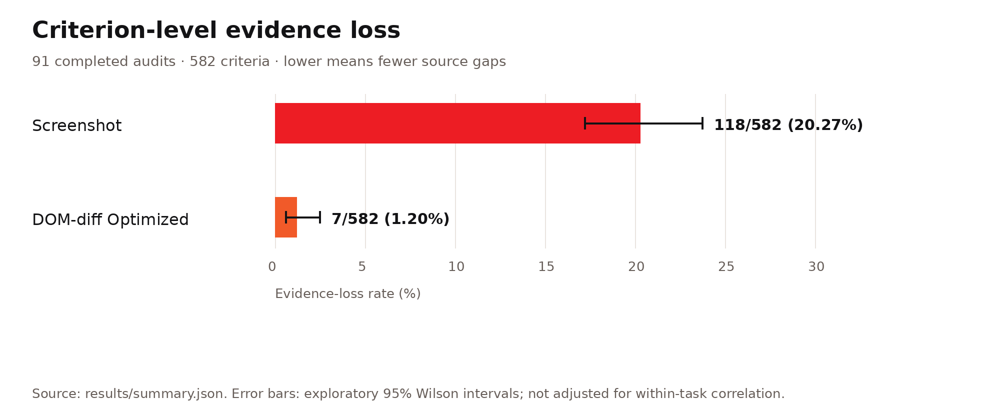
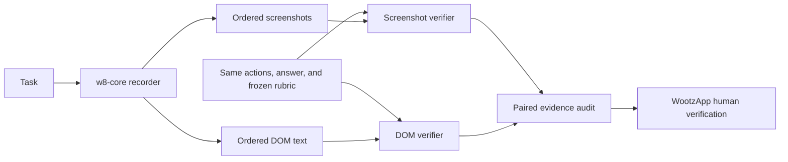

# w8-domdiff-bench

`w8-domdiff-bench` records browser-agent runs in WootzApp’s Chromium-based
`w8-core` browser and compares screenshot evidence with DOM-diff Optimized,
a compact text representation of each captured page state. The recorder,
paired verifiers, and evidence audit make it possible to inspect what a
browser agent observed and which required information each representation
preserved.

The benchmark contains 100 paired browser tasks. Its evaluation covers
**642 rubric criteria**, using the same task, executed
actions, final answer, and frozen rubric for each screenshot/DOM comparison.
The [technical report](docs/technical-report.md) contains the full evaluation
write-up and all criterion-level findings; selected results follow below.

## Evaluation results

A source-evidence loss means a required item is absent from one recorded
representation and present in the other. The counts below come from
`gpt-5.6-sol` evidence audits verified by internal WootzApp employees.
They measure evidence availability, not task success, answer correctness,
or acting-agent improvement.

| Analysis | Tasks | Audited criteria | Screenshot losses | DOM losses |
| --- | ---: | ---: | ---: | ---: |
| All source-evidence loss categories | 100 | 642 | **151 (23.52%)** | **5 (0.78%)** |
| URL loss category excluded | 100 | 642 | **34 (5.30%)** | **5 (0.78%)** |
| Listed access-blocked task IDs excluded | 88 | 575 | **125 (21.74%)** | **5 (0.87%)** |
| Listed access-blocked task IDs and URL loss category excluded | 88 | 575 | **32 (5.57%)** | **5 (0.87%)** |

Excluding the URL category removes those losses from the numerator and
retains every audited criterion in that cohort. Excluding the 12 listed
access-blocked task IDs removes their 67 criteria. The
[report defines both exclusions](docs/technical-report.md#analysis-excluding-the-listed-access-blocked-tasks)
and also gives alternatives that remove entire criteria with URL findings.



The intervals shown are exploratory 95% Wilson intervals. They assume
independent criteria and do not adjust for correlation within tasks or
annotation errors. Full counts, intervals, and paired outcomes
are in the [technical report](docs/technical-report.md#url-sensitivity-and-paired-comparison).

### Why URL sensitivity matters

URLs account for **117 of the 151 screenshot losses (77.5%)**. The screenshot
capture mechanism omits the browser’s address bar. Under the saved audit’s
identity rule, a missing URL counts only when the rubric requires exact
website, page, record, or endpoint identity and DOM preserves the required
URL. Branding and URLs in the shared action history do not substitute for
URL evidence within the representation itself.

DOM has 96.7% fewer losses across all categories and 85.3% fewer non-URL
losses in this evaluation. The URL-excluded view recalculates existing
findings; it does not measure what would happen if URLs were added to
screenshots or a different rubric were used.

### What the findings show

The full audits identify **154 affected criteria across 91 tasks**. Two
criteria have losses in both representations, so the 151 screenshot and 5
DOM losses overlap. Each affected representation receives one primary
[category](docs/EVIDENCE-CATEGORIES.md).

Examples show the practical differences:

- **Exact values:** task_19 C3 preserves an absolute release timestamp in DOM,
  while screenshots retain a relative date.
- **Capture coverage:** task_24 preserves story 30 in DOM, while screenshots
  stop at story 29. That shared omission affects three rubric criteria.
- **Visual notation:** task_66 C1 preserves the rendered Fibonacci subscripts
  in screenshots, while DOM normalizes the notation to plain text.
- **Relationships and controls:** DOM losses include a disconnected publisher
  label/value in task_02 C2 and missing unchecked-filter states in task_56 C1.

The detailed evidence links and saved findings are in the
[report’s criterion table](docs/technical-report.md#source-evidence-gaps-by-task-and-criterion).
These findings combine model-generated audit/adjudication with verification
by internal WootzApp employees.

Website access blockers, execution errors, and source-evidence gaps describe
different events. The report lists 12 task IDs with access blockers and
separately records 12 execution failures in the published trajectories.
Those sets overlap; their counts cannot be added into a single failure rate.

## How the system works

The acting model, `gpt-5.2`, generates browser actions from DOM-based text
observations and executable `agent-browser` references. The recorder saves
an initial browser state and one state after each executed action, including
screenshots and structured DOM evidence. DOM-diff Optimized describes individual captured states;
it does not require separate before/after diff files.
The model-facing `dom_model.txt` observations average **5.87 KiB**; see
[representation sizes](docs/technical-report.md#current-representation-size).



Both verifiers use the same scoring controls. The benchmark uses `gpt-5.2`
for action generation, rubric generation, and evidence judgments;
`o4-mini` for action/validity judgments; and `gpt-5.6-sol` for evidence
audit/adjudication. Internal WootzApp employees verify the audit findings.
See [model provenance](docs/technical-report.md#models-and-evaluation-provenance).

The screenshot baseline follows the Universal Verifier's rubric-based
design; WootzApp adds the DOM adaptation, browser-native evidence pipeline,
paired comparison, and source-aware audit. See the report's
[background and attribution](docs/technical-report.md#foundations-and-baselines)
and [references](docs/technical-report.md#references).

Screenshots and DOM remain complementary: visual form, control state,
label/value associations, viewport coverage, and sequential capture can
produce gaps in either representation. Items missing from both are outside
the paired source-loss metric. The [architecture guide](docs/architecture.md)
explains the capture pipeline and its boundaries.

## Run the benchmark

Follow the [runbook](docs/runbook.md) for Python installation, API-key setup,
browser builds, recording, and scoring. Scoring prepared data uses the
published screenshot/DOM pairs. Recording new tasks additionally requires
building Chromium, applying the `w8-core` source overlay, and creating the
local browser image.

After completing Python setup, download and validate one prepared pair:

```bash
./scripts/run-comparison --task task_01
```

Run rubric generation, both verifiers, and the paired evidence audit:

```bash
./scripts/run-comparison --task task_01 --execute
```

Run all prepared tasks with `./scripts/run-comparison --all --execute`.
Generated runs are written to the ignored `evaluation/` directory. Raw
recordings and prepared verifier pairs have different file contracts; see
[recording and evaluation inputs](docs/runbook.md#recording-and-evaluation-inputs).

The offline test suite runs with:

```bash
python -m pytest
```

## Documentation and data

| Resource | Contents |
| --- | --- |
| [Technical report](docs/technical-report.md) | Full evaluation findings, mathematical definitions, success rules, current observation sizes, references, and all 154 affected criteria. |
| [Results](results/README.md) · [JSON summary](results/summary.json) | Published aggregate counts and analysis definitions. |
| [Evaluation protocol](docs/evaluation-protocol.md) | Shared inputs, scoring controls, source-loss definition, and counting rules. |
| [Architecture](docs/architecture.md) | Browser capture, DOM-diff Optimized, verifier components, and boundaries. |
| [Runbook](docs/runbook.md) | Installation, browser build, recording, scoring, and troubleshooting. |
| [Dataset card](docs/datacard.md) | Paired data layout, local samples, collection policy, and limitations. |
| [Recordings](docs/recordings.md) | Raw collection artifacts, action/state alignment, and provenance. |
| [Evidence categories](docs/EVIDENCE-CATEGORIES.md) | Six category definitions, boundary rules, and annotated examples. |
| [Published dataset](https://huggingface.co/datasets/WootzappLab/browser-agent-tasks) | All paired trajectories, task catalog, recordings, and saved evaluations. |

Implementation lives in `w8bench/task_recorder/`, `w8bench/dom_model/`,
`w8bench/screenshot_verifier/`, and `w8bench/verifier/`. The pinned browser
protocol is [protocol/ChromiumRL.pdl](protocol/ChromiumRL.pdl); small example
pairs are in [data/samples/](data/samples/).

## License

Licensed under the Apache License, Version 2.0. See [LICENSE](LICENSE).
