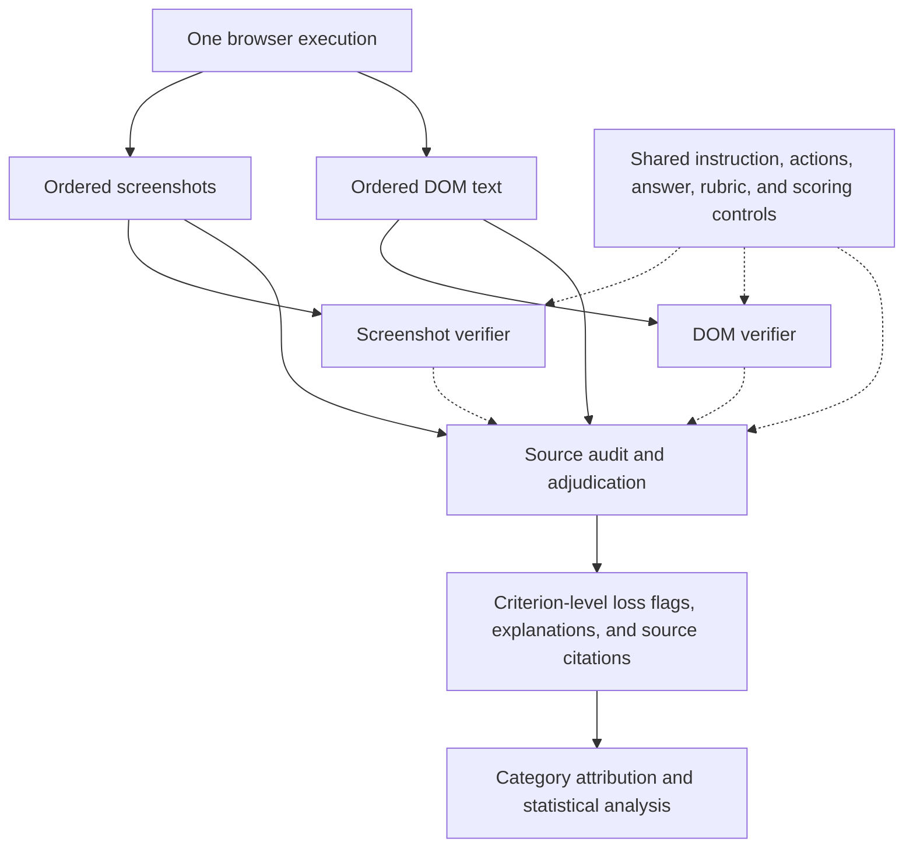

# Evidence Gaps in Browser-Agent Evaluation: A Paired Audit of Screenshots and DOM


**WootzApp**

## Contents

- [Abstract](#abstract)
- [1. Introduction](#1-introduction)
- [2. Related Work](#2-related-work)
- [3. Problem Definition](#3-problem-definition)
- [4. Study Design](#4-study-design)
- [5. Dataset and Experimental Setup](#5-dataset-and-experimental-setup)
- [6. Results](#6-results)
- [7. Discussion](#7-discussion)
- [8. Limitations](#8-limitations)
- [9. Conclusion](#9-conclusion)
- [Data and Code Availability](#data-and-code-availability)
- [Responsible Use](#responsible-use)
- [10. References](#10-references)
- [Appendix A. Formal Definitions and Equations](#appendix-a-formal-definitions-and-equations)
- [Appendix B. Recording and Verifier Implementation Details](#appendix-b-recording-and-verifier-implementation-details)
- [Appendix C. Dataset Provenance and Audit-Label Reconstruction](#appendix-c-dataset-provenance-and-audit-label-reconstruction)
- [Appendix D. Full Statistical Reanalysis](#appendix-d-full-statistical-reanalysis)
- [Appendix E. Complete Tables and Reproducibility Materials](#appendix-e-complete-tables-and-reproducibility-materials)

## Abstract

Browser-agent evaluators use recorded observations to judge what an agent did. Those observations may omit facts needed to assess a task. We introduce `w8-domdiff-bench`, a recording and audit framework that compares screenshots and compact DOM-derived text from the same browser execution. The task, executed actions, final answer, and verification rubric are held fixed. We open-source the companion [`browser-agent-tasks`](https://huggingface.co/datasets/WootzappLab/browser-agent-tasks) dataset, containing paired trajectories for 100 public-web tasks, supporting browser recordings, frozen rubrics, verifier outputs, and model-assisted audit findings reviewed by WootzApp employees covering 642 criteria. Counting losses assigned a non-URL primary category, screenshots have 34 losses (5.30%) and DOM text has 5 (0.78%). The difference is 4.52 percentage points. The findings include missing exact values, incomplete coverage, lost control states, and broken visual relationships. This study measures differences in recorded evidence availability; it does not establish verifier accuracy or agent success. The framework provides a way to inspect missing evidence separately from errors in interpreting it.

## 1. Introduction

A browser agent may claim that it read a price, applied a filter, or checked every entry in a list. A verifier must decide whether the recorded execution supports that claim. That decision depends on whether the required facts were recorded and whether the verifier interpreted them correctly. A stronger verifier cannot recover a fact that its inputs never contained.

Different browser observations preserve different facts. A screenshot can show a label next to its value or a mathematical subscript. A DOM-derived record can retain exact text and content outside the captured image. In the corpus studied here, one DOM record contains an absolute release timestamp where screenshots show only a relative date. Conversely, one screenshot preserves Fibonacci subscripts that are flattened in the DOM text. These examples motivate our research question:

> For the same browser execution and verification rubric, which required facts are preserved by one recorded representation and missing from the other?

Answering this question requires aligned records. If two agents navigate or scroll differently, differences in their evidence may come from their actions. We instead record screenshots and DOM-derived text along one execution and compare them against the same rubric. A separate source audit checks the recorded observations for facts required by each rubric criterion. Here, “source” means the saved screenshots and DOM states themselves. Verifier-score disagreements alone do not establish that evidence is missing.

We implement this approach in `w8-domdiff-bench`, built on the `w8-core` Chromium recording stack. We release paired evidence and saved audit findings for 100 public-web research and extraction tasks, comprising 642 criteria. Our main analysis counts findings whose primary category concerns evidence other than URL identity. It retains all 642 criteria: screenshots have 34 losses (5.30%) and DOM text has 5 (0.78%), a difference of 4.52 percentage points. These findings affect 38 criteria across 23 tasks.

We also report all-category results and sensitivity analyses for URL identity and access-blocked tasks.

Alongside the evaluation code, we open-source [`browser-agent-tasks`](https://huggingface.co/datasets/WootzappLab/browser-agent-tasks), the companion dataset. It contains the task definitions, paired observations, action logs, final answers, frozen rubrics, and saved verifier and audit outputs. Supporting browser recordings let readers follow the collection process back to individual captured states. Releasing these artifacts makes the evidence behind the findings inspectable and provides fixed inputs for further verifier comparisons.

The paper makes three contributions:

- A paired source-audit protocol for identifying required facts missing from one representation but present in another, while holding the execution and rubric fixed.
- The open [`browser-agent-tasks`](https://huggingface.co/datasets/WootzappLab/browser-agent-tasks) dataset: 100 paired task trajectories, supporting browser recordings, and saved rubrics, verifier outputs, and criterion-level source audits.
- A reproducible analysis of non-URL evidence loss, supported by URL and access-blocker sensitivity analyses.

The study concerns recorded evidence from fixed trajectories generated by a DOM-conditioned acting policy. Measuring effects on verifier decisions or acting-agent performance requires additional experiments.

## 2. Related Work

### 2.1 Browser Benchmarks and Observation Interfaces

WebArena evaluates functional task completion in reproducible browser environments ([Zhou et al. 2024](https://proceedings.iclr.cc/paper_files/paper/2024/hash/4410c0711e9154a7a2d26f9b3816d1ef-Abstract-Conference.html)). VisualWebArena extends this setting to tasks requiring visual understanding ([Koh et al. 2024](https://doi.org/10.18653/v1/2024.acl-long.50)). BrowserGym standardizes observation and action interfaces across benchmarks, exposing screenshots, DOM and accessibility structures, tab metadata, and action feedback ([Le Sellier de Chezelles et al. 2025](https://openreview.net/forum?id=5298fKGmv3)).

These systems establish tasks and interfaces for browser-agent evaluation. Our question concerns the evidence those interfaces retain: whether two records of the same execution preserve the same facts required by a verification criterion.

### 2.2 Trajectory Verification

WebVoyager uses multimodal evaluation for live-web tasks ([He et al. 2024](https://doi.org/10.18653/v1/2024.acl-long.371)). WebJudge selects relevant intermediate screenshots to assess completion ([Xue et al. 2025](https://openreview.net/forum?id=6jZi4HSs6o)). Universal Verifier studies rubric construction, process and outcome judgments, environmental blockers, and context management over screenshot trajectories ([Rosset et al. 2026](https://doi.org/10.48550/arXiv.2604.06240)). Human review of WebArena-Lite also identifies discrepancies between automatic outcomes and observed completion ([Gan et al. 2026](https://doi.org/10.48550/arXiv.2610.01491)).

Our screenshot verifier follows [Universal Verifier's rubric-centered design](https://doi.org/10.48550/arXiv.2604.06240). Its judgments depend on the evidence supplied to it. A score disagreement can reflect either missing observations or differences in interpreting available observations. We therefore add a source audit that explicitly checks availability in both saved representations. This separates the measurement of missing evidence from the scoring workflow.

### 2.3 Observation Reduction and Evidence Retention

[Enomoto et al. (2026)](https://doi.org/10.48550/arXiv.2605.29397) evaluate HTML reduction through retention of Minimal Failure Sets, connecting retained elements to agent performance. We examine retrospective verification: after an execution is fixed, which rubric-required facts remain available in its recorded observations? The reported loss rates describe evidence availability and have not been validated as a proxy for downstream agent success.

### 2.4 Positioning DOM-diff Optimized

DOM-diff Optimized is the compact text representation evaluated here. It turns captured Chromium state into sections describing content, tables, media, controls, relationships, and scroll regions. Despite its historical name, the evaluated output describes each state directly; readers do not need to reconstruct it from a separate difference file.

The representation is produced through the `w8-core` recording stack. Selection and grouping use the captured browser state, so the structured snapshot and rendered text refer to that capture rather than a later read of the live page. This study compares that representation with screenshots. It does not isolate the renderer's improvement over an ordinary DOM dump, an accessibility tree, or a lightly filtered structured record.

Prior work supplies browser tasks, observation interfaces, and trajectory verifiers. This study adds a criterion-level audit of evidence retention across paired records of the same execution.

## 3. Problem Definition

A **task** specifies the browser activity to perform. Its **trajectory** is the initial browser state followed by executed actions and their recorded states. A **rubric** describes how to assess the task; each **criterion** is one requirement within that rubric.

A criterion may require several concrete facts: an exact price, the identity of a page, an unchecked filter, a table entry, or evidence that the end of a list was reached. We call these **required evidence items**. A label and its value can both be present while their relationship is missing, so availability must be judged at the specificity required by the criterion.

The two representations are the ordered screenshots and the ordered DOM-derived text from the same trajectory. A **source audit** examines those saved records to determine whether the required items are available. A **directional evidence loss** occurs when an item required by a criterion is absent from one representation and present in the other.

Each criterion can contribute at most one loss to each representation, even if several items are missing. A criterion can have losses in both directions if the two representations omit different required items. For example, a screenshot might preserve a filter's unchecked state while the DOM record preserves a required exact value missing from the image.

This definition detects differences between the records. It cannot detect an item missing from both. A criterion with no detected directional loss therefore need not have complete evidence. Establishing absolute coverage would require an additional reference, such as expert-reviewed environment state.

The audit evaluates evidence inside each representation. Shared action history and the final answer remain available to the verifiers, but do not substitute for missing source evidence under the audit rule. In particular, a URL in an action log does not resolve a missing page identity in a representation. Thus, a source loss need not cause a verifier to reach the wrong verdict: shared context may still provide another basis for its decision. [Appendix A](#appendix-a-formal-definitions-and-equations) gives the formal definition.

## 4. Study Design

### 4.1 Paired Comparison

We compare screenshots and DOM text recorded along one execution. Both verification runs receive the same task instruction, executed action history, final answer, frozen rubric, models, and scoring controls. The evidence representation changes between runs.

The source audit then receives both saved channels and both verifier outputs. It produces screenshot and DOM loss flags for each criterion, with explanations and source citations. Figure 1 shows these inputs and outputs.



*Figure 1. Data flow from a fixed execution to paired verification and the source audit. Solid arrows carry execution records or audit outputs; dashed arrows carry shared context or verifier judgments. Category assignments are reconstructed from the published report.*

### 4.2 Recording Channels

The screenshot channel records rendered page content without the browser address bar. The DOM channel records compact structured text, including page-identity metadata. Its filters and capture limits mean that it does not necessarily contain every off-screen element.

The two captures are sequential. A page that changes between captures can produce different records even when both capture procedures work as intended. Viewport selection and rendering also affect coverage: a list entry outside a screenshot may be retained in DOM text, while visual notation may be flattened by text rendering. We consequently interpret the findings as gaps in the recorded evidence under this configuration.

### 4.3 Source Audit

Audit and adjudication receive the ordered screenshots, line-numbered DOM states, shared trajectory context, and both verifier outputs. The verifier workflow nominates five evidence items per criterion for scoring. The source audit receives the full saved channels and can examine states beyond those nominated items.

Findings were generated and adjudicated with `gpt-5.6-sol` and verified by WootzApp employees. This is model-assisted review with verification by WootzApp employees. The study does not report blinded annotation or independent agreement.

Source citations point to the saved screenshot states or DOM lines supporting a finding. For example, task 19, criterion C3 concerns a release timestamp: the DOM record preserves an absolute timestamp while screenshots retain a relative date. A reader can inspect the cited states to evaluate the claimed difference. Supplying all saved states makes review possible, but does not guarantee that a model or reviewer notices every relevant detail.

### 4.4 Loss Categories and Sensitivity Analyses

Each loss receives one primary category describing its main missing fact or relationship:

| Category | Required evidence concerned |
|---|---|
| Exact text and values | Precise wording, numbers, dates, or notation |
| URLs | Exact website, page, record, or endpoint identity |
| Control states | Whether a control is checked, selected, or otherwise set |
| Table entries | Required entries in tabular content |
| Label–value links | The relationship between a label and its value |
| Capture omissions | Required content or coverage absent from the saved record |

We reconstruct these assignments from the pinned report's criterion table and match them to the saved loss flags. We introduce no new labels. One primary category does not enumerate every omission associated with a finding.

Our main analysis counts only losses assigned a primary category other than URLs, while retaining every criterion in the denominator. We call this **primary-category filtering**. For the full corpus, the denominator therefore remains 642: the non-URL rates are 34/642 for screenshots and 5/642 for DOM text. No criterion is removed because of a URL loss. Secondary non-URL omissions within a URL-attributed finding are not separately counted.


A further analysis removes the tasks listed as access-blocked in the published report. This label concerns barriers to accessing a website during a task and is separate from a failed action or an unsuccessful execution. The excluded IDs are listed in [Appendix D](#appendix-d-full-statistical-reanalysis).

### 4.5 Counts and Rates

For each representation, the loss rate is its number of affected criteria divided by the number of audited criteria. We report percentages and the screenshot-minus-DOM difference in percentage points. All criteria receive equal weight, so tasks with more criteria contribute more to the pooled rate.

Criteria within a task can depend on the same observation. For example, one missing list entry may affect several criteria. The counts therefore describe affected rubric criteria rather than independent capture failures. We use these rates to describe the saved corpus.

## 5. Dataset and Experimental Setup

### 5.1 Task Corpus

The release contains one paired trajectory for each of 100 public-web research and extraction tasks and 642 rubric criteria ([WootzApp 2026a](https://huggingface.co/datasets/WootzappLab/browser-agent-tasks)). Tasks include retrieving release metadata, checking ranked lists, extracting product fields, and inspecting search filters.

The saved histories contain 365 executed-action records, with a median of one per task and a range of zero to 48. Twelve tasks have no recorded action and 49 have one. Tasks start at 90 distinct hostnames and have three to 12 criteria each. A task with no recorded action can still have evidence from its initial state. These summaries indicate substantial direct lookup activity and limited evidence for broader claims about long interactive workflows.

### 5.2 Dataset Contents and Reuse

The companion dataset, [`browser-agent-tasks`](https://huggingface.co/datasets/WootzappLab/browser-agent-tasks), is released alongside this repository. The dataset holds the evidence and saved evaluation artifacts; `w8-domdiff-bench` supplies the recording, verification, and audit code.

| Dataset path | Released material | Purpose |
|---|---|---|
| `tasks.jsonl` | 100 task definitions, including IDs, categories, instructions, start URLs, stopping conditions, and constraints | Inspect the requested behavior and task boundaries |
| `trajectories/data-ss/` | 100 task folders with metadata, final answers, normalized action logs, and ordered screenshots | Evaluate or inspect the screenshot representation |
| `trajectories/data-dom/` | 100 corresponding task folders with the same metadata, answers, and actions, plus ordered DOM text | Compare structured observations against the same execution |
| `recordings/` | Browser-run manifests, model decisions, executed actions, final records, and captured state assets where available | Trace the collection process and examine rejected actions or failures |
| `evaluation/` | Frozen rubrics, verifier results, comparison reports, run manifests, and evidence audits | Inspect scoring controls and follow findings to their cited sources |
| `EVALUATIONS.md` and `EVIDENCE-CATEGORIES.md` | Aggregate findings and category definitions | Interpret the saved labels and counting rules |

Prepared pairs share `task_data.json`, `final_answer.json`, and `web_surfer.log`. Screenshot folders contain `screenshotN.png`; DOM folders contain `dom_modelN.txt`. State 0 is the initial observation, and subsequent numbered states follow executed actions. Raw recordings provide additional detail through files such as `manifest.json`, `decisions.jsonl`, and `trajectory.jsonl`, together with screenshots and structured or rendered DOM states when capture succeeded.

These materials support several forms of reuse. Researchers can test a verifier on the saved evidence and frozen rubrics, inspect a claimed loss against its screenshot or DOM citation, or study how evidence selection changes a judgment. The supporting recordings expose collection details beyond the prepared verification inputs, including failed actions and rejected proposals. A recorded success status is a collection outcome rather than independently established answer correctness.

The dataset loader exposes `tasks.jsonl` as a `train` split. This is a catalog configuration, not a separate training/evaluation partition or a claim that the trajectories are validated training demonstrations.

### 5.3 Trajectory Generation

The acting model, `gpt-5.2`, receives DOM text, executable `agent-browser` references, task memory, and recent action outcomes. Screenshots are retained for comparison but are not supplied to the acting model. Pairing holds the executed trajectory fixed; a screenshot-conditioned policy could navigate, scroll, or stop differently.

The recorder uses WootzApp Browser, powered by the Chromium-based `w8-core` engine. It captures browser states through ChromiumRL and the Chrome DevTools Protocol. This provides the browser captures from which the screenshot and structured records are produced. [Appendix B](#appendix-b-recording-and-verifier-implementation-details) describes the execution and recording details.

### 5.4 Verifier Setup

Both verifiers receive the same frozen rubric and scoring controls. The rubric generator takes the instruction and initial URL context, without the compared screenshots or DOM states. Its requirements can still be imperfect; independence from the observations does not establish rubric validity.

Rubric generation and evidence judgments use `gpt-5.2`; action and validity judgments use `o4-mini`. The paired scoring controls include five evidence items per criterion and one voting instance. [Appendix B](#appendix-b-recording-and-verifier-implementation-details) lists the remaining settings.

The reported outcomes are the saved source-audit labels. Verifier scores alone combine the availability of evidence with how that evidence is selected and interpreted, so a score difference cannot identify a source omission on its own.

### 5.5 Provenance and Quality Controls

Preflight checks validate task identity, action alignment, state order, required artifacts, and rubric structure. The rubric's canonical hash and point denominator are recorded so that both runs can be checked against the same scoring requirements.

The numerical analysis uses all 100 saved audit files from a pinned dataset revision and the corresponding published category assignments. It recomputes statistics from existing labels and adds no annotations. Pinned source paths, byte counts, and SHA-256 hashes identify the artifacts used. [Appendix C](#appendix-c-dataset-provenance-and-audit-label-reconstruction) documents reconstruction, and [Appendix E](#appendix-e-complete-tables-and-reproducibility-materials) includes the complete analysis inputs.

## 6. Results

### 6.1 Main Non-URL Evidence-Loss Result

Counting findings assigned a non-URL primary category, screenshots lose required evidence for 34 of 642 criteria (5.30%), compared with 5 criteria (0.78%) for DOM text. The difference is 4.52 percentage points. URL filtering changes only the loss counts in the numerators; both rates use all 642 audited criteria. Screenshots have more detected evidence gaps under this rule.


| Analysis | Tasks | Criteria | Screenshot losses | DOM losses | Difference in percentage points |
|---|---:|---:|---:|---:|---:|
| Non-URL primary categories | 100 | 642 | 34 (5.30%) | 5 (0.78%) | 4.52 |
| Non-URL primary categories; blocked tasks removed | 88 | 575 | 32 (5.57%) | 5 (0.87%) | 4.70 |

*Table 1. Main result and access-blocker sensitivity. Percentages retain all criteria in the indicated cohort; URL-attributed losses are excluded from the numerators. Differences are screenshot minus DOM.*

The 39 representation-level losses affect 38 distinct criteria across 23 tasks. One criterion has a loss in each representation, concerning different required evidence. Table 2 shows the overlap.

| Findings counted | Screenshot only | DOM only | Both | Neither |
|---|---:|---:|---:|---:|
| Non-URL primary categories | 33 | 4 | 1 | 604 |
| All primary categories | 149 | 3 | 2 | 488 |

*Table 2. Joint criterion outcomes over all 642 criteria. “Neither” means no directional loss is counted under that row's category rule. It does not establish that the evidence is complete, because an item missing from both records is undetectable by this comparison.*

### 6.2 Full-Corpus Result and URL Sensitivity

Across all categories, screenshots have 151 losses (23.52%) and DOM text has 5 (0.78%). The difference is 22.74 percentage points. These losses affect 154 distinct criteria across 91 tasks.

URL identity accounts for 117 of the 151 screenshot losses (77.5%). The captured images omit the browser address bar, while DOM text includes page identity. The audit counts this difference when a criterion requires an exact website, page, record, or endpoint identity. Under its rule, branding and URLs in shared action history do not replace identity evidence inside the representation.

The larger all-category difference consequently depends on the capture configuration and the audit's identity rule. Filtering URL-attributed findings describes the existing labels; it does not estimate what would happen if URL metadata were added to screenshots.

### 6.3 Types of Losses

Outside URL-attributed findings, screenshot losses concern exact text and values, capture omissions, and table entries. DOM losses concern notation, label–value relationships, and control states.

| Primary category | Screenshot losses | DOM losses |
|---|---:|---:|
| Exact text and values | 16 | 1 |
| Capture omissions | 14 | 0 |
| Table entries | 4 | 0 |
| Label–value links | 0 | 3 |
| Control states | 0 | 1 |
| Non-URL subtotal | 34 | 5 |
| URLs | 117 | 0 |
| All-category total | 151 | 5 |

*Table 3. Primary categories of representation-level losses. Each representation contributes at most once per criterion. Secondary omissions are not separately enumerated.*

Five cases illustrate the kinds of gaps involved:

| Case | Saved evidence difference | Significance |
|---|---|---|
| Task 19, C3 | DOM text contains an absolute release timestamp; screenshots show a relative date. | Recorded precision can differ even when both channels show a date. |
| Task 24 | DOM text includes story 30 and the following list boundary; screenshots stop at story 29. | One coverage gap affects three rubric criteria. |
| Task 66, C1 | Fibonacci subscripts remain visible in screenshots but are flattened in DOM text. | Text conversion can lose mathematical notation. |
| Task 02, C2 | The screenshot links a publisher label to its value; the DOM record does not preserve the association. | Retaining both strings does not establish their relationship. |
| Task 56, C1 | Screenshots show unchecked filters whose states are not explicit in DOM text. | A control label alone does not specify its state. |

*Table 4. Illustrative findings from the saved audit. The examples explain the loss types; their selection does not estimate how frequently each mechanism occurs beyond the category counts in Table 3.*

### 6.4 Robustness Checks

Removing the 12 listed access-blocked tasks removes 67 criteria. Among the remaining 88 tasks and 575 criteria, the non-URL counts are 32 screenshot losses and 5 DOM losses. The difference remains 4.70 percentage points (Table 1). The non-URL difference is therefore not confined to the listed blocked tasks.

For all categories after removing those tasks, the counts are 125 screenshot losses (21.74%) and 5 DOM losses (0.87%). The difference is 20.87 percentage points.


The published report also lists 12 execution failures. Their task IDs overlap with, but do not equal, the blocked-task list. These counts cannot be added to obtain an overall failure rate. Likewise, the 11 failed action records in the normalized histories count individual actions rather than unsuccessful tasks.

## 7. Discussion

### 7.1 Evidence Availability Is a Separate Evaluation Variable

The non-URL findings show that different records of the same execution can preserve different facts required by a rubric. Evaluation therefore has an evidence component that can be inspected independently of the final score. When a verifier misses a required fact, source review can help determine whether that fact was available to be found.

A missing fact need not change the final verdict if shared context is sufficient. Establishing its effect on decisions requires independently adjudicated correctness labels and a controlled comparison of verifier outcomes under alternative evidence inputs.

### 7.2 Metadata Parity as a Baseline

Metadata parity means giving both representations equivalent page-identity and tab information. BrowserGym already exposes tab URLs separately from screenshots ([Le Sellier de Chezelles et al. 2025](https://openreview.net/forum?id=5298fKGmv3)). A screenshot-plus-URL condition would test how much of the observed difference remains when that information is equalized.

The URL sensitivities make the saved results easier to interpret, but cannot replace this experiment. In particular, removing URL-attributed losses does not recreate the judgments that would be obtained from augmented screenshots.

### 7.3 Implications for Benchmark and Verifier Design

Benchmarks can report evidence availability alongside verifier outcomes and preserve the sources supporting disputed judgments. This makes it easier to diagnose whether changes in scores arise from observations, evidence selection, or interpretation.

The loss categories also suggest concrete recording checks: whether exact values remain readable, list endings are captured, control states are explicit, notation survives text conversion, and labels remain associated with their values. Their value as diagnostics follows from the observed cases; improvements in verifier accuracy would still need to be measured.

### 7.4 Future Comparisons

The released evidence supports further investigation of ordinary DOM dumps, accessibility trees, lightly filtered structured records, screenshots with identity metadata, and combined screenshot-plus-DOM inputs. Controlled renderer ablations could identify which grouping or filtering choices change evidence retention. Repeating trajectories under different acting policies would test how the recording findings depend on navigation and scrolling behavior.

## 8. Limitations

**Corpus and policy.** The study uses 100 selected public-web tasks with one trajectory per task and a DOM-conditioned acting policy. The corpus emphasizes research and extraction, often through short direct lookups. It provides limited support for generalization to transactional, authenticated, long-horizon, or visually intensive workflows. There is no reported probability-sampling design for tasks or websites.

**Audit validity.** Findings are model-generated and verified by WootzApp employees. The study does not report the number of human annotators, independent agreement, blinded review, or human coverage of no-loss decisions. Reviewers see verifier outputs, which may influence judgments. Primary categories compress potentially multiple omissions into one label. Hash checks verify the identity of source artifacts rather than the correctness of their annotations.

**Capture and comparison.** Sequential capture can introduce temporal differences. Viewport selection, resolution, filtering, and grouping can change what each record contains. The comparison does not isolate these mechanisms or the contribution of individual renderer changes. Evidence missing from both channels is undetectable through paired losses.

**Interpretation of the rates.** The rates describe the selected tasks and their saved labels. They do not establish how common these gaps are across all browser tasks. Criteria within a task may share the same missing evidence, and annotation mistakes can affect the reported counts.

**Outcomes and baselines.** The results measure saved evidence gaps. The study has no independent verifier-accuracy endpoint, causal estimate of agent improvement, or matched comparison with standard accessibility or DOM baselines. It consequently does not establish that one modality is inherently better.

**Reproduction.** The embedded materials reproduce the saved-label statistics. Repeating model judgments requires model access and may produce different findings; re-recording live websites adds page drift. The public repository does not supply the raw-recording-to-prepared-pair conversion command, internal category registry, or report exporter described in the archived manuscript. These gaps limit reproduction of the complete pipeline.

## 9. Conclusion

Browser-agent evaluation depends on the evidence recorded during execution. Comparing aligned representations makes it possible to inspect which required facts survive before attributing differences to verifier reasoning.

Across 100 tasks and 642 criteria, findings assigned non-URL primary categories include 34 screenshot losses and 5 DOM losses: a difference of 4.52 percentage points. URL metadata explains most of the larger all-category difference. The observed non-URL gaps concern exact values, coverage, notation, control states, and relationships.

`w8-domdiff-bench` contributes a paired source-audit protocol, released evidence and findings, and reproducible analysis of those findings. Together, these provide a basis for testing how recording choices affect the evidence available to browser-agent evaluators.

## Data and Code Availability

The recorder, prepared-pair evaluator, and technical documentation are available in the [project repository](https://github.com/wootzapp/w8-domdiff-bench). Task definitions, recordings, prepared evidence, and saved audits are available in the [dataset release](https://huggingface.co/datasets/WootzappLab/browser-agent-tasks) ([WootzApp 2026a](https://huggingface.co/datasets/WootzappLab/browser-agent-tasks)). The pinned technical report supplies the category assignments ([WootzApp 2026b](https://github.com/wootzapp/w8-domdiff-bench/blob/bc2ebf509ce786d1622bd41c854c7b27a4cefbdc/docs/technical-report.md)).

The dataset's [card](https://huggingface.co/datasets/WootzappLab/browser-agent-tasks/blob/main/README.md) describes the prepared pairs and task catalog. Its [recording guide](https://huggingface.co/datasets/WootzappLab/browser-agent-tasks/blob/main/RECORDINGS.md) explains the supporting browser-run artifacts. Section 5.2 maps the released files to their intended uses; [Appendix C](#appendix-c-dataset-provenance-and-audit-label-reconstruction) identifies the fixed revision used for this paper's analysis.

[Appendix E](#appendix-e-complete-tables-and-reproducibility-materials) embeds the analysis program, 642 criterion records, 100 task summaries, reference results, and source manifest. These are sufficient to recompute the saved-label statistics offline with Python and NumPy. Optional source verification checks the embedded rows against the pinned public artifacts. Repeating data collection and model review requires the additional tools, access, and workflow components discussed in [Appendix B](#appendix-b-recording-and-verifier-implementation-details) and Section 8.

The earlier manuscript, including its editorial comments, is preserved in [old_readme.md](old_readme.md). The rewrite follows [rewritten-paper-outline.md](rewritten-paper-outline.md).

## Responsible Use

The released tasks concern public-web research and extraction. Researchers extending the recorder to other settings should minimize sensitive information in traces and check redistribution permissions, since browser states can contain identifying content or account information. Benchmark designers and verifier developers should not treat an evidence-availability flag alone as a validated reward or decision label: a recorded fact can be interpreted incorrectly, and a paired audit can miss facts absent from both records.


## 10. References

Enomoto, Masafumi, Ryoma Obara, Haochen Zhang, and Masafumi Oyamada. 2026. [Revisiting Observation Reduction for Web Agents: Comprehensive Evaluation with a Lightweight Framework.](https://doi.org/10.48550/arXiv.2605.29397) arXiv preprint arXiv:2605.29397.

Gan, Chengguang, Zimeng He, Yoshihiro Tsujii, Ken-ichiro Kobayashi, Hiroki Itoh, and Kotaro Funakoshi. 2026. [Auditing Web Agent Evaluation on WebArena-Lite: Human Review of Outcomes and Trajectories.](https://doi.org/10.48550/arXiv.2610.01491) arXiv preprint arXiv:2610.01491.

He, Hongliang, Wenlin Yao, Kaixin Ma, Wenhao Yu, Yong Dai, Hongming Zhang, Zhenzhong Lan, and Dong Yu. 2024. [WebVoyager: Building an End-to-End Web Agent with Large Multimodal Models.](https://doi.org/10.18653/v1/2024.acl-long.371) In *Proceedings of the 62nd Annual Meeting of the Association for Computational Linguistics (Volume 1: Long Papers)*, 6864–90. Bangkok, Thailand: Association for Computational Linguistics.

Koh, Jing Yu, Robert Lo, Lawrence Jang, Vikram Duvvur, Ming Lim, Po-Yu Huang, Graham Neubig, Shuyan Zhou, Russ Salakhutdinov, and Daniel Fried. 2024. [VisualWebArena: Evaluating Multimodal Agents on Realistic Visual Web Tasks.](https://doi.org/10.18653/v1/2024.acl-long.50) In *Proceedings of the 62nd Annual Meeting of the Association for Computational Linguistics (Volume 1: Long Papers)*, 881–905. Bangkok, Thailand: Association for Computational Linguistics.

Le Sellier de Chezelles, Thibault, Maxime Gasse, Alexandre Lacoste, Massimo Caccia, Alexandre Drouin, Léo Boisvert, Megh Thakkar, et al. 2025. [The BrowserGym Ecosystem for Web Agent Research.](https://openreview.net/forum?id=5298fKGmv3) *Transactions on Machine Learning Research*.

Rosset, Corby, Pratyusha Sharma, Andrew Zhao, Miguel Gonzalez-Fernandez, and Ahmed Awadallah. 2026. [The Art of Building Verifiers for Computer Use Agents.](https://doi.org/10.48550/arXiv.2604.06240) arXiv preprint arXiv:2604.06240.

WootzApp. 2026a. [w8-domdiff-bench Benchmark Data and Criterion-Level Audit Records.](https://huggingface.co/datasets/WootzappLab/browser-agent-tasks) Hugging Face dataset.

WootzApp. 2026b. [w8-domdiff-bench: Browser Evidence and Evaluation Report.](https://github.com/wootzapp/w8-domdiff-bench/blob/bc2ebf509ce786d1622bd41c854c7b27a4cefbdc/docs/technical-report.md) WootzApp.

Xue, Tianci, Weijian Qi, Tianneng Shi, Chan Hee Song, Boyu Gou, Dawn Song, Huan Sun, and Yu Su. 2025. [An Illusion of Progress? Assessing the Current State of Web Agents.](https://openreview.net/forum?id=6jZi4HSs6o) In *Second Conference on Language Modeling*.

Zhou, Shuyan, Frank F. Xu, Hao Zhu, Xuhui Zhou, Robert Lo, Abishek Sridhar, Xianyi Cheng, et al. 2024. [WebArena: A Realistic Web Environment for Building Autonomous Agents.](https://proceedings.iclr.cc/paper_files/paper/2024/hash/4410c0711e9154a7a2d26f9b3816d1ef-Abstract-Conference.html) In *The Twelfth International Conference on Learning Representations*.

## Appendix A. Formal Definitions and Equations

Let $S$ denote screenshots and $D$ denote DOM text. For each criterion $c$, let $\mathcal{I}_c$ be its set of required evidence items. For an item $i \in \mathcal{I}_c$ and a representation $m \in \{S,D\}$, the availability indicator $a_{c,i,m} \in \{0,1\}$ is one when the item is available at the specificity required by $c$, and zero otherwise. Let $\mathbf{1}\{\cdot\}$ denote an indicator that is one when its condition holds and zero otherwise. The directional loss indicators are:

$$
\begin{aligned}
\ell_{c,S} &= \mathbf{1}\left\{\exists i \in \mathcal{I}_c : a_{c,i,S}=0 \land a_{c,i,D}=1\right\}, \\
\ell_{c,D} &= \mathbf{1}\left\{\exists i \in \mathcal{I}_c : a_{c,i,D}=0 \land a_{c,i,S}=1\right\}.
\end{aligned}
$$

For $M$ audited criteria, $L_m$ is the number with a loss in representation $m$, $p_m$ is the percentage with a loss, and $\Delta$ is the screenshot-minus-DOM difference in percentage points:

$$
L_m=\sum_{c=1}^{M}\ell_{c,m},\qquad
p_m=100\,\frac{L_m}{M},\qquad
\Delta=p_S-p_D=100\,\frac{L_S-L_D}{M}.
$$

For the non-URL analysis, a loss flag contributes only if its assigned primary category is not URLs. $M$ remains unchanged.

These indicators count affected criteria, rather than the number of missing items. Neither zero loss nor one minus the loss rate measures absolute evidence completeness.

## Appendix B. Recording and Verifier Implementation Details

### B.1 Recording and Action Alignment

WootzApp Browser uses the Chromium-based `w8-core` engine, with browser-state capture through ChromiumRL and the Chrome DevTools Protocol. A Python harness validates proposed actions and executes accepted actions through `agent-browser` in the same tab. A state can contain a screenshot, structured DOM snapshot, detailed readable text, compact model-facing text, and action-tool observations.

Rejected proposals are logged separately and do not create executed-action states. An execution with $N$ actions normally has $N+1$ states, including its initial state. Raw folders start at `steps/step_001/`; prepared evidence begins with `screenshot0.png` and `dom_model0.txt`. Chromium node IDs and executable `agent-browser` references belong to different identifier systems. Raw recordings cannot be supplied directly to the prepared-pair comparison command.

### B.2 Models and Scoring Controls

| Component | Model or reviewer |
|---|---|
| Action generation | `gpt-5.2`, receiving DOM observations |
| Rubric generation and evidence judgments | `gpt-5.2` |
| Action and validity judgments | `o4-mini` |
| Source audit and adjudication | `gpt-5.6-sol` |
| Verification of published findings | WootzApp employees |

*Table 5. Roles in the reported workflow. These roles document provenance and do not establish independent annotation accuracy.*

The paired configuration fixes five evidence items per criterion, a screenshot keypoint threshold of three, a minimum relevance threshold of zero, and one voting instance. Run manifests record the settings. Source auditing subsequently receives the complete saved ordered channels.

For awarded criterion points $s_j$ and maxima $q_j$, the normalized process score $r$ is:

$$
r=\begin{cases}
\displaystyle\frac{\sum_j s_j}{\sum_j q_j}, & \text{if }\sum_j q_j>0, \\
0, & \text{otherwise}.
\end{cases}
$$

Process success requires $r \geq 0.8$. The paired workflow's binary score follows the outcome judge's `output_success` decision. Standalone runners also support process-only and combined process/outcome rules. Strict full-score success requires every available point with a positive maximum. None of these scoring rules defines the evidence-loss rate analyzed in this paper.

### B.3 Representation Sizes

The reported current mean model-facing observation size is 5.87 KiB. A separate historical sample of 650 states averaged 4.84 KiB for optimized text, 44.88 KiB for detailed readable text, and 191.32 KiB for structured snapshots. One KiB equals 1,024 bytes. These serialized byte counts come from different summaries and do not establish tokenizer cost, latency, or a matched evidence-retention advantage.

### B.4 Running Prepared-Pair Evaluation

Prepared-pair evaluation requires 64-bit Linux or WSL 2, Python 3.10 or newer, Git, network access, and an OpenAI API key for model execution. Recording additionally requires Docker Engine with Compose and Buildx, `rsync`, and a Chromium build workspace.

The following command validates a prepared pair without model calls:

```bash
./scripts/run-comparison --task task_01
```

Adding `--execute` runs paired evaluation and auditing. The flags `--all --execute` run the prepared dataset. These operations produce fresh judgments, which may differ from the saved labels analyzed here. Offline statistical reanalysis uses the separate procedure in [Appendix D](#appendix-d-full-statistical-reanalysis).

## Appendix C. Dataset Provenance and Audit-Label Reconstruction

The reanalysis pins repository commit `bc2ebf509ce786d1622bd41c854c7b27a4cefbdc` and dataset revision `111c2d229333b85bf7b205458766f8dce195b2e2`. Pinning identifies the exact artifacts used even if the public repository or dataset changes later.

The source manifest in [Appendix E](#appendix-e-complete-tables-and-reproducibility-materials) records each audit's dataset path, pinned URL, byte count, and SHA-256 hash, along with those of the technical report. There is one `evidence_audit.json` per task. Seventy-eight use run directory `20261021T040737Z`; the remaining 22 use other recorded run directories. The archived reanalysis reports that all 100 files were checked against these sources.

For each criterion, extraction reads the adjudicated screenshot and DOM loss flags and checks them against the duplicated summary flags in the saved audit. It then matches the primary category from the pinned report's criterion table using task ID and criterion index. Separate categories are retained when both representations have losses. Checks require a category for every positive loss and reconcile the 642 criteria, per-task totals, and 154 distinct affected criteria. This procedure reconstructs existing annotations.

Task action counts are the lengths of `shared_trajectory.actions`. Of the 365 records, 354 have a success execution status and 11 a failure status. Starting hostnames come from `shared_trajectory.initial_url`; they describe initial hosts rather than all visited sites or distinct registrable domains. These summaries use saved records, without replaying executions.

## Appendix D. Full Statistical Reanalysis

This appendix retains the original bootstrap calculation to reproduce the archived reference output. The main paper reports descriptive counts, rates, and sensitivity analyses; it does not use the bootstrap intervals as a reported finding.

### D.1 Whole-Task Resampling

For each task $t$, let $m_t$ be its criterion count and $u_{t,S}$ and $u_{t,D}$ its loss counts under the selected category rule. Let $T$ be the number of tasks in the cohort. For each bootstrap resample $b$, draw task indices $I_{b,1},\ldots,I_{b,T}$ independently and uniformly with replacement from $\{1,\ldots,T\}$. Add the selected tasks' screenshot and DOM counts, take their difference, and divide by their total criterion count:

$$
\Delta^{(b)}=100\,
\frac{\sum_{k=1}^{T}\left(u_{I_{b,k},S}-u_{I_{b,k},D}\right)}
{\sum_{k=1}^{T}m_{I_{b,k}}}.
$$

Tasks are ordered numerically. The program uses NumPy's `default_rng` with seed `20261028`, 20,000 resamples, and linearly interpolated 2.5th and 97.5th percentiles. It resets the generator for each cohort, using the same draws for all-category and non-URL calculations within that cohort. The recorded calculation used NumPy 2.3.5.

The denominator is recomputed for each resample because tasks have different numbers of criteria. This gives a pooled criterion-weighted difference, rather than an equally weighted average of task percentages. Repeating a task repeats all its criteria and both channels' labels together. The method preserves dependence within a sampled task while holding annotations fixed.

### D.2 Cohort Restrictions

The access-blocked exclusion removes task IDs 01, 06, 07, 10, 14, 15, 20, 22, 23, 46, 53, and 58, totaling 67 criteria. It does not additionally exclude execution failures.

URL filtering removes only losses primarily attributed to URLs from each representation's numerator. All 642 criteria remain in the full-corpus denominator, giving 34/642 screenshot losses (5.30%) and 5/642 DOM losses (0.78%). The access-blocked cohort has 575 criteria because entire blocked tasks are excluded; URL filtering does not reduce that cohort's denominator further.

### D.3 Offline Reproduction

The complete program and all its inputs are embedded below in [Appendix E](#appendix-e-complete-tables-and-reproducibility-materials). Keeping them together makes the numerical analysis available with the manuscript, without requiring the browser recordings or a separate data download. Python 3.11 or newer and NumPy are required; NumPy 2.3.5 matches the recorded environment.

From the repository root, run this Bash command. It reads the embedded program and executes it against this README without creating supplementary files:

```bash
python - README.md <<'PY'
from pathlib import Path
import re
import sys

paper = Path(sys.argv[1])
extra_args = sys.argv[2:]
text = paper.read_text(encoding="utf-8")
pattern = (
    r"(?ms)^<!-- BEGIN EMBEDDED: reproduce\.py -->\n"
    r"```python\n(.*?)\n```\n"
    r"<!-- END EMBEDDED: reproduce\.py -->$"
)
matches = re.findall(pattern, text)
if len(matches) != 1:
    raise ValueError("Expected exactly one embedded analysis program")
sys.argv = ["reproduce.py", str(paper), *extra_args]
exec(compile(matches[0], "<README.md embedded analysis>", "exec"),
     {"__name__": "__main__"})
PY
```

A successful run prints JSON with `verification.offline_recomputation_matches_embedded_results` set to `true`. It validates the embedded rows and recomputes the rates, paired outcomes, category totals, corpus summaries, cohort restrictions, and bootstrap intervals. Integer comparisons are exact; floating-point comparisons use relative tolerance $10^{-12}$ and absolute tolerance $10^{-10}$.

### D.4 Optional Source Verification

To verify the embedded rows against the public source artifacts, change the command's first line to `python - README.md --verify-sources <<'PY'`, keeping the remaining lines and final `PY` unchanged. This mode fetches the 100 pinned audits and technical report into memory, checks their sizes and hashes, reconstructs the data rows, and compares them with the embedded tables. It requires network access and makes no model calls. Success also sets `verification.source_hashes_and_reconstructed_rows_verified` to `true`.

Recomputation verifies calculations from saved labels. Source verification additionally checks the labels' extraction from specified artifacts. Neither procedure independently judges the browser evidence or establishes annotation correctness.

## Appendix E. Complete Tables and Reproducibility Materials

The following expandable blocks preserve the original analysis program and data payloads unchanged. The embedded filenames identify blocks inside this document. The program reads those blocks directly using the document path supplied in [Appendix D](#appendix-d-full-statistical-reanalysis); no companion files are required. The archived output includes a historical whole-criterion URL exclusion calculation; the report uses numerator-only URL filtering with an unchanged denominator. Historical references to `paper.md` or Appendix C inside the preserved program docstring describe the earlier manuscript's layout.

### E.1 Analysis Program

The complete program below implements validation, aggregation, paired task resampling, reference-result comparison, and optional source reconstruction. It reads the other marked blocks from this document.

<details>
<summary>Expand the complete Python analysis program</summary>

<!-- BEGIN EMBEDDED: reproduce.py -->
```python
#!/usr/bin/env python3
"""Reproduce the embedded saved-audit analysis without creating files/folders.

Python 3.11+ and NumPy 2.3.5 are recommended. Launch with Appendix C's
embedded-runner command; paper.md is the only input file.
Default: offline recomputation of counts, categories, corpus summaries, and
20,000 paired whole-task bootstrap replicates; compare with embedded results.
Optional --verify-sources: fetch the 100 revision-pinned audits and report into
memory, check hashes, and reconstruct every embedded criterion/task row.

Fixed estimand: criterion-weighted screenshot-minus-DOM loss difference.
Whole tasks carry both modalities and all criteria together; the denominator
is recomputed per replicate. Primary URL-loss exclusion keeps all criteria.
Whole-criterion URL exclusion is a separate outcome-selected sensitivity.
Intervals condition on saved labels/categories and this empirical task corpus;
they exclude annotation uncertainty and imply neither population sampling nor
causal effects on agent performance. No browser runs or model calls are made.
"""
from __future__ import annotations

import argparse
import csv
import hashlib
import io
import json
import math
import re
import sys
import urllib.request
from collections import Counter, defaultdict
from concurrent.futures import ThreadPoolExecutor
from pathlib import Path
from urllib.parse import urlsplit

import numpy as np

SEED, REPLICATES = 20261028, 20000
DATASET_REV = "111c2d229333b85bf7b205458766f8dce195b2e2"
REPO_REV = "bc2ebf509ce786d1622bd41c854c7b27a4cefbdc"
TASKS = {f"task_{i:02d}" for i in range(1, 101)}
BLOCKED = {f"task_{i:02d}" for i in (1, 6, 7, 10, 14, 15, 20, 22, 23, 46, 53, 58)}
CATEGORIES = {"URLs", "Exact text and values", "Control states", "Table entries",
              "Label–value links", "Capture omissions"}
LANGUAGES = {"criterion_labels.csv": "csv", "task_counts.csv": "csv",
             "bootstrap_results.json": "json", "source_manifest.json": "json",
             "reproduce.py": "python"}
CRITERION_FIELDS = "task_alias criterion_index screenshot_loss dom_loss screenshot_primary_category dom_primary_category screenshot_non_url_loss dom_non_url_loss excluded_access_blocked audit_dataset_path".split()
TASK_FIELDS = "task_alias criteria normalized_executed_actions initial_url_hostname screenshot_losses dom_losses screenshot_url_losses dom_url_losses screenshot_non_url_losses dom_non_url_losses excluded_access_blocked recorded_successful_actions recorded_failed_actions".split()


def require(condition, message):
    if not condition:
        raise ValueError(message)


def embedded_blocks(text):
    """Strict unique line markers around one matching fenced block each."""
    marker = re.compile(r"<!-- (BEGIN|END) EMBEDDED: ([A-Za-z0-9_.-]+) -->")
    blocks, active, lines = {}, None, []
    for lineno, line in enumerate(text.splitlines(), 1):
        match = marker.fullmatch(line.strip())
        if match:
            direction, name = match.groups()
            require(name in LANGUAGES, f"Unknown embedded block {name}, line {lineno}")
            if direction == "BEGIN":
                require(active is None and name not in blocks,
                        f"Duplicate or nested block {name}, line {lineno}")
                active, lines = name, []
            else:
                require(active == name, f"Unmatched block end {name}, line {lineno}")
                require(len(lines) >= 2 and lines[0] == "```" + LANGUAGES[name]
                        and lines[-1] == "```", f"Invalid fence for {name}")
                require("```" not in lines[1:-1], f"Premature fence in {name}")
                blocks[name] = "\n".join(lines[1:-1]) + "\n"
                active = None
        elif active is not None:
            lines.append(line)
    require(active is None, f"Unterminated block {active}")
    require(set(LANGUAGES) - {"reproduce.py"} <= blocks.keys(), "Missing embedded data block")
    return blocks


def json_object(text, name):
    def unique(pairs):
        result = {}
        for key, value in pairs:
            require(key not in result, f"Duplicate JSON key {key!r} in {name}")
            result[key] = value
        return result
    def invalid_number(value):
        raise ValueError(f"Nonfinite JSON value {value} in {name}")
    result = json.loads(text, object_pairs_hook=unique, parse_constant=invalid_number)
    require(isinstance(result, dict), f"{name} must be a JSON object")
    return result


def csv_rows(text, fields, name):
    reader = csv.DictReader(io.StringIO(text), strict=True)
    require(reader.fieldnames == fields, f"Unexpected/duplicate CSV columns in {name}")
    strings = {"task_alias", "initial_url_hostname", "audit_dataset_path",
               "screenshot_primary_category", "dom_primary_category"}
    rows = []
    for number, row in enumerate(reader, 2):
        require(None not in row and None not in row.values(), f"Malformed {name} row {number}")
        for key in set(fields) - strings:
            require(re.fullmatch(r"0|[1-9][0-9]*", row[key]) is not None,
                    f"Invalid nonnegative integer {name}:{number}:{key}")
            row[key] = int(row[key])
        require(row["task_alias"] in TASKS, f"Unknown task in {name}:{number}")
        rows.append(row)
    return rows


def compare(actual, expected, path="results"):
    if isinstance(expected, dict):
        require(isinstance(actual, dict) and actual.keys() == expected.keys(), f"Key mismatch: {path}")
        for key in expected:
            compare(actual[key], expected[key], f"{path}.{key}")
    elif isinstance(expected, list):
        require(isinstance(actual, list) and len(actual) == len(expected), f"List mismatch: {path}")
        for i, (left, right) in enumerate(zip(actual, expected)):
            compare(left, right, f"{path}[{i}]")
    elif type(expected) is float:
        require(type(actual) in (int, float) and math.isfinite(actual)
                and math.isclose(actual, expected, rel_tol=1e-12, abs_tol=1e-10),
                f"Numeric mismatch: {path}: {actual!r} != {expected!r}")
    else:
        require(type(actual) is type(expected) and actual == expected,
                f"Value mismatch: {path}: {actual!r} != {expected!r}")


def validate_manifest(manifest):
    require(manifest.get("dataset_revision") == DATASET_REV
            and manifest.get("repository_commit") == REPO_REV, "Source revision changed")
    entries = manifest.get("audits")
    require(isinstance(entries, list) and len(entries) == 100, "Expected exactly 100 audit sources")
    by_task = {}
    for entry in entries:
        match = re.fullmatch(r"evaluation/(task_[0-9]+)/([0-9]{8}T[0-9]{6}Z)/evidence_audit.json",
                             entry.get("dataset_path", ""))
        require(match is not None, "Invalid audit source path")
        task, run = match.groups()
        require(task in TASKS and task not in by_task, f"Duplicate/unknown audit task {task}")
        require(entry.get("local_filename") == f"{task}_{run}.json", f"Filename mismatch: {task}")
        url = f"https://huggingface.co/datasets/WootzappLab/browser-agent-tasks/resolve/{DATASET_REV}/{entry['dataset_path']}"
        require(entry.get("url") == url, f"Audit URL is not the expected pinned source: {task}")
        by_task[task] = entry
    report = manifest.get("technical_report", {})
    require(report.get("url") == f"https://raw.githubusercontent.com/wootzapp/w8-domdiff-bench/{REPO_REV}/docs/technical-report.md",
            "Technical-report URL is not the expected pinned source")
    for entry in entries + [report]:
        require(re.fullmatch(r"[0-9a-f]{64}", entry.get("sha256", "")) is not None, "Invalid source SHA-256")
        require(type(entry.get("size_bytes")) is int and 0 < entry["size_bytes"] < 10_000_000,
                "Invalid source size")
    return by_task


def aggregate_task(task, rows, metadata):
    result = {"task_alias": task, "criteria": len(rows),
              "normalized_executed_actions": metadata["normalized_executed_actions"],
              "initial_url_hostname": metadata["initial_url_hostname"]}
    for mode in ("screenshot", "dom"):
        result[mode + "_losses"] = sum(r[mode + "_loss"] for r in rows)
        result[mode + "_url_losses"] = sum(r[mode + "_primary_category"] == "URLs" for r in rows)
        result[mode + "_non_url_losses"] = sum(r[mode + "_non_url_loss"] for r in rows)
    result.update(excluded_access_blocked=int(task in BLOCKED),
                  recorded_successful_actions=metadata["recorded_successful_actions"],
                  recorded_failed_actions=metadata["recorded_failed_actions"])
    return result


def validate_data(rows, task_rows, sources):
    require(len(rows) == 642 and len(task_rows) == 100, "Expected 642 criteria and 100 tasks")
    per_task, seen = defaultdict(list), set()
    for row in rows:
        task, idx = row["task_alias"], row["criterion_index"]
        require((task, idx) not in seen, f"Duplicate criterion {task}/C{idx}")
        seen.add((task, idx))
        require(row["audit_dataset_path"] == sources[task]["dataset_path"], f"Source mismatch: {task}")
        require(row["excluded_access_blocked"] == int(task in BLOCKED), f"Blocker flag changed: {task}")
        for mode in ("screenshot", "dom"):
            loss, category = row[mode + "_loss"], row[mode + "_primary_category"]
            require(loss in (0, 1) and category in CATEGORIES | {""}
                    and bool(category) == bool(loss), f"Invalid loss/category: {task}/C{idx}/{mode}")
            require(row[mode + "_non_url_loss"] == int(loss and category != "URLs"),
                    f"URL sensitivity flag changed: {task}/C{idx}/{mode}")
        per_task[task].append(row)
    require(set(per_task) == TASKS, "Criterion task set is incomplete")
    task_map = {}
    for task_row in task_rows:
        task = task_row["task_alias"]
        require(task not in task_map, f"Duplicate task row {task}")
        task_map[task] = task_row
        require(re.fullmatch(r"[a-z0-9.-]+", task_row["initial_url_hostname"]) is not None,
                f"Invalid starting hostname: {task}")
        require(task_row["normalized_executed_actions"] == task_row["recorded_successful_actions"]
                + task_row["recorded_failed_actions"], f"Action status totals disagree: {task}")
        criteria = per_task[task]
        require(sorted(r["criterion_index"] for r in criteria) == list(range(len(criteria))),
                f"Noncontiguous criterion indices: {task}")
        compare(aggregate_task(task, criteria, task_row), task_row, f"task_counts.{task}")
    require(set(task_map) == TASKS, "Task-count table is incomplete")
    return sorted(rows, key=lambda r: (int(r["task_alias"][5:]), r["criterion_index"])), sorted(task_rows, key=lambda r: int(r["task_alias"][5:]))


def descriptive(rows, non_url=False):
    suffix = "_non_url_loss" if non_url else "_loss"
    pairs = Counter((r["screenshot" + suffix], r["dom" + suffix]) for r in rows)
    s = sum(r["screenshot" + suffix] for r in rows)
    d = sum(r["dom" + suffix] for r in rows)
    m = len(rows)
    require(m > 0, "Empty analysis cohort")
    return {"tasks_in_cohort": len({r["task_alias"] for r in rows}), "criteria": m,
            "screenshot_losses": s, "dom_losses": d, "screenshot_rate_percent": 100 * s / m,
            "dom_rate_percent": 100 * d / m, "difference_percentage_points": 100 * (s - d) / m,
            "paired_outcomes": {"screenshot_only": pairs[1, 0], "dom_only": pairs[0, 1],
                                "both": pairs[1, 1], "neither": pairs[0, 0]},
            "affected_criteria": sum(bool(r["screenshot" + suffix] or r["dom" + suffix]) for r in rows),
            "affected_tasks": len({r["task_alias"] for r in rows if r["screenshot" + suffix] or r["dom" + suffix]})}


def bootstrap(task_rows):
    keys = ("criteria", "screenshot_losses", "dom_losses", "screenshot_non_url_losses", "dom_non_url_losses")
    counts = np.array([[r[k] for k in keys] for r in task_rows], dtype=np.int64)
    rng = np.random.default_rng(SEED)  # Reset per cohort; numeric task order.
    indices = rng.integers(0, len(counts), size=(REPLICATES, len(counts)))
    totals = counts[indices].sum(axis=1)
    require(bool(np.all(totals[:, 0] > 0)), "Zero bootstrap denominator")
    rates = 100 * totals[:, 1:] / totals[:, 0, None]
    result = {}
    for name, si, di in (("all_categories", 0, 1), ("non_url_primary_categories", 2, 3)):
        values = {"screenshot_rate_percent": rates[:, si], "dom_rate_percent": rates[:, di],
                  "difference_percentage_points": rates[:, si] - rates[:, di]}
        result[name] = {k: np.quantile(v, [0.025, 0.975], method="linear").tolist() for k, v in values.items()}
    return result


def compute(rows, tasks):
    actions, sizes = [r["normalized_executed_actions"] for r in tasks], [r["criteria"] for r in tasks]
    metadata = {
        "total_normalized_executed_actions": sum(actions),
        "median_normalized_executed_actions_per_task": float(np.median(actions)),
        "normalized_executed_actions_per_task_range": [min(actions), max(actions)],
        "tasks_with_zero_recorded_actions": actions.count(0), "tasks_with_one_recorded_action": actions.count(1),
        "recorded_action_status_counts": {"failure": sum(r["recorded_failed_actions"] for r in tasks),
                                          "success": sum(r["recorded_successful_actions"] for r in tasks)},
        "distinct_starting_hostnames": len({r["initial_url_hostname"] for r in tasks}),
        "criteria_per_task_range": [min(sizes), max(sizes)],
    }
    result = {"corpus_metadata": metadata, "cohorts": {}}
    for name, exclude in (("full_cohort", False), ("listed_blocked_tasks_excluded", True)):
        cohort = [r for r in rows if not (exclude and r["excluded_access_blocked"])]
        task_cohort = [r for r in tasks if not (exclude and r["excluded_access_blocked"])]
        result["cohorts"][name] = {"all_categories": descriptive(cohort),
                                  "non_url_primary_categories": descriptive(cohort, True),
                                  "bootstrap_95_percent_intervals": bootstrap(task_cohort)}
    subset = [r for r in rows if "URLs" not in (r["screenshot_primary_category"], r["dom_primary_category"])]
    result["whole_criteria_with_primary_url_loss_removed"] = descriptive(subset)
    result["category_counts"] = {mode: dict(sorted(Counter(r[mode + "_primary_category"] for r in rows
                                                         if r[mode + "_loss"]).items())) for mode in ("screenshot", "dom")}
    return result


def report_categories(text):
    result = {}
    for line in text.splitlines():
        match = re.match(r"\| (task_[0-9]+) \| \*\*C([0-9]+)\*\*", line)
        if not match:
            continue
        key = match[1], int(match[2])
        fields = [part.strip() for part in line.split("|")[1:-1]]
        require(len(fields) == 6 and key not in result, f"Malformed/duplicate report category {key}")
        category, classification = fields[2:4]
        if classification == "`BOTH_EVIDENCE_INCOMPLETE`":
            parts = category.split("<br>")
            require(len(parts) == 2 and parts[0].startswith("Screenshot: ") and parts[1].startswith("DOM: "),
                    f"Malformed paired category {key}")
            pair = parts[0][12:], parts[1][5:]
        elif classification == "`SCREENSHOT_EVIDENCE_MISSING`":
            pair = category, ""
        elif classification == "`DOM_EVIDENCE_MISSING`":
            pair = "", category
        else:
            raise ValueError(f"Unknown report classification {classification}")
        require(all(c in CATEGORIES | {""} for c in pair), f"Unknown report category {key}")
        result[key] = pair
    require(len(result) == 154, "Expected 154 affected criteria in technical report")
    return result


def fetch_bytes(entry):
    with urllib.request.urlopen(entry["url"], timeout=45) as response:
        data = response.read(entry["size_bytes"] + 1)
    require(len(data) == entry["size_bytes"] and hashlib.sha256(data).hexdigest() == entry["sha256"],
            f"Source size/hash mismatch: {entry['url']}")
    return data


def verify_sources(manifest, rows, tasks):
    categories = report_categories(fetch_bytes(manifest["technical_report"]).decode("utf-8"))
    reconstructed_rows, reconstructed_tasks, used_categories = [], [], set()
    entries = sorted(manifest["audits"], key=lambda e: int(e["local_filename"].split("_")[1]))
    with ThreadPoolExecutor(max_workers=8) as pool:
        for entry, data in zip(entries, pool.map(fetch_bytes, entries)):
            audit = json_object(data.decode("utf-8"), entry["dataset_path"])
            task = entry["local_filename"].rsplit("_", 1)[0]
            require(audit.get("task_alias") == task, f"Source task mismatch: {task}")
            criteria, shared = audit["criteria"], audit["shared_trajectory"]
            require(len(criteria) == audit["metrics"]["total_criteria"], f"Source denominator mismatch: {task}")
            require(isinstance(shared["actions"], list), f"Malformed source actions: {task}")
            states = Counter()
            for action in shared["actions"]:
                require(isinstance(action, dict) and action.get("execution_status") in ("success", "failure"),
                        f"Unknown source action status: {task}")
                states[action["execution_status"]] += 1
            task_criteria, seen = [], set()
            for c in sorted(criteria, key=lambda c: c["criterion_index"]):
                idx = c["criterion_index"]
                require(type(idx) is int and idx >= 0 and idx not in seen, f"Invalid/duplicate source criterion: {task}")
                seen.add(idx)
                s, d = (c["adjudication"][m + "_evidence_loss"]["confirmed"] for m in ("screenshot", "dom_model"))
                require(type(s) is bool and type(d) is bool, f"Non-Boolean source labels: {task}/C{idx}")
                require(c["screenshot_evidence_loss"] is s and c["dom_model_evidence_loss"] is d,
                        f"Source flattened/adjudicated flag mismatch: {task}/C{idx}")
                sc, dc = categories.get((task, idx), ("", ""))
                if (task, idx) in categories:
                    used_categories.add((task, idx))
                row = {"task_alias": task, "criterion_index": idx, "screenshot_loss": int(s), "dom_loss": int(d),
                       "screenshot_primary_category": sc, "dom_primary_category": dc,
                       "screenshot_non_url_loss": int(s and sc != "URLs"), "dom_non_url_loss": int(d and dc != "URLs"),
                       "excluded_access_blocked": int(task in BLOCKED), "audit_dataset_path": entry["dataset_path"]}
                task_criteria.append(row)
            metadata = {"normalized_executed_actions": len(shared["actions"]),
                        "initial_url_hostname": urlsplit(shared["initial_url"]).hostname,
                        "recorded_successful_actions": states["success"], "recorded_failed_actions": states["failure"]}
            reconstructed_rows.extend(task_criteria)
            reconstructed_tasks.append(aggregate_task(task, task_criteria, metadata))
    require(used_categories == categories.keys(), "Unmatched category rows in report")
    reconstructed_rows, reconstructed_tasks = validate_data(reconstructed_rows, reconstructed_tasks, validate_manifest(manifest))
    compare(reconstructed_rows, rows, "source_reconstruction.criterion_labels")
    compare(reconstructed_tasks, tasks, "source_reconstruction.task_counts")


def main():
    parser = argparse.ArgumentParser(description=__doc__)
    parser.add_argument("paper", nargs="?", type=Path, default=Path("paper.md"))
    parser.add_argument("--verify-sources", action="store_true")
    args = parser.parse_args()
    blocks = embedded_blocks(args.paper.read_text(encoding="utf-8"))
    manifest = json_object(blocks["source_manifest.json"], "source_manifest.json")
    expected = json_object(blocks["bootstrap_results.json"], "bootstrap_results.json")
    for key, value in {"source_dataset_revision": DATASET_REV, "source_repository_commit": REPO_REV,
                       "seed": SEED, "bootstrap_samples": REPLICATES}.items():
        compare(value, expected.get(key), key)
    rows = csv_rows(blocks["criterion_labels.csv"], CRITERION_FIELDS, "criterion_labels.csv")
    tasks = csv_rows(blocks["task_counts.csv"], TASK_FIELDS, "task_counts.csv")
    rows, tasks = validate_data(rows, tasks, validate_manifest(manifest))
    actual = compute(rows, tasks)
    for key, value in actual.items():
        target = expected[key]
        if key == "corpus_metadata":
            target = {k: v for k, v in target.items() if k != "source_fields"}
        compare(value, target, key)
    if args.verify_sources:
        verify_sources(manifest, rows, tasks)
    verification = {
        "offline_recomputation_matches_embedded_results": True,
        "source_hashes_and_reconstructed_rows_verified": bool(args.verify_sources),
        "source_verification_note": "All 100 audits and the report fetched and checked in memory." if args.verify_sources else "Not requested; default verifies embedded data only.",
        "seed": SEED, "bootstrap_samples": REPLICATES,
        "recorded_numpy_version": expected.get("numpy_version"), "runtime_numpy_version": np.__version__,
        "float_comparison_tolerance": {"relative": 1e-12, "absolute": 1e-10},
        "assumptions": "Paired whole-task, criterion-weighted resampling; fixed saved labels, category assignments, task corpus, and blocked-task set; excludes annotation uncertainty and causal interpretation.",
    }
    print(json.dumps({"verification": verification, "recomputed_results": actual}, indent=2, allow_nan=False))


if __name__ == "__main__":
    try:
        main()
    except (ValueError, KeyError, TypeError, OSError, csv.Error) as error:
        print(f"Reproduction failed: {error}", file=sys.stderr)
        raise SystemExit(1)
```
<!-- END EMBEDDED: reproduce.py -->

</details>

### E.2 Criterion Records

Each row identifies a task and its zero-based criterion index. Binary loss fields encode the saved adjudicated judgments. A primary category is empty when that representation has no confirmed loss. The non-URL fields count positive losses whose primary category is not URLs; they retain every criterion in the denominator. The blocked-task flag identifies the prespecified sensitivity cohort. `audit_dataset_path` links each row to the corresponding manifest entry.

<details>
<summary>Expand all 642 criterion records</summary>

<!-- BEGIN EMBEDDED: criterion_labels.csv -->
```csv
task_alias,criterion_index,screenshot_loss,dom_loss,screenshot_primary_category,dom_primary_category,screenshot_non_url_loss,dom_non_url_loss,excluded_access_blocked,audit_dataset_path
task_01,0,1,0,URLs,,0,0,1,evaluation/task_01/20261021T040737Z/evidence_audit.json
task_01,1,1,0,URLs,,0,0,1,evaluation/task_01/20261021T040737Z/evidence_audit.json
task_01,2,1,0,URLs,,0,0,1,evaluation/task_01/20261021T040737Z/evidence_audit.json
task_01,3,0,0,,,0,0,1,evaluation/task_01/20261021T040737Z/evidence_audit.json
task_02,0,0,0,,,0,0,0,evaluation/task_02/20261021T040737Z/evidence_audit.json
task_02,1,1,0,URLs,,0,0,0,evaluation/task_02/20261021T040737Z/evidence_audit.json
task_02,2,0,1,,Label–value links,0,1,0,evaluation/task_02/20261021T040737Z/evidence_audit.json
task_02,3,0,0,,,0,0,0,evaluation/task_02/20261021T040737Z/evidence_audit.json
task_03,0,1,0,URLs,,0,0,0,evaluation/task_03/20261021T040737Z/evidence_audit.json
task_03,1,0,0,,,0,0,0,evaluation/task_03/20261021T040737Z/evidence_audit.json
task_03,2,0,0,,,0,0,0,evaluation/task_03/20261021T040737Z/evidence_audit.json
task_03,3,0,0,,,0,0,0,evaluation/task_03/20261021T040737Z/evidence_audit.json
task_03,4,0,0,,,0,0,0,evaluation/task_03/20261021T040737Z/evidence_audit.json
task_03,5,0,0,,,0,0,0,evaluation/task_03/20261021T040737Z/evidence_audit.json
task_03,6,0,0,,,0,0,0,evaluation/task_03/20261021T040737Z/evidence_audit.json
task_03,7,0,0,,,0,0,0,evaluation/task_03/20261021T040737Z/evidence_audit.json
task_04,0,1,0,URLs,,0,0,0,evaluation/task_04/20261021T040737Z/evidence_audit.json
task_04,1,0,0,,,0,0,0,evaluation/task_04/20261021T040737Z/evidence_audit.json
task_04,2,0,0,,,0,0,0,evaluation/task_04/20261021T040737Z/evidence_audit.json
task_04,3,0,0,,,0,0,0,evaluation/task_04/20261021T040737Z/evidence_audit.json
task_04,4,0,0,,,0,0,0,evaluation/task_04/20261021T040737Z/evidence_audit.json
task_05,0,1,0,URLs,,0,0,0,evaluation/task_05/20261021T040737Z/evidence_audit.json
task_05,1,1,0,Capture omissions,,1,0,0,evaluation/task_05/20261021T040737Z/evidence_audit.json
task_05,2,0,0,,,0,0,0,evaluation/task_05/20261021T040737Z/evidence_audit.json
task_05,3,0,0,,,0,0,0,evaluation/task_05/20261021T040737Z/evidence_audit.json
task_05,4,0,0,,,0,0,0,evaluation/task_05/20261021T040737Z/evidence_audit.json
task_05,5,0,0,,,0,0,0,evaluation/task_05/20261021T040737Z/evidence_audit.json
task_05,6,0,0,,,0,0,0,evaluation/task_05/20261021T040737Z/evidence_audit.json
task_06,0,1,0,URLs,,0,0,1,evaluation/task_06/20261021T040737Z/evidence_audit.json
task_06,1,0,0,,,0,0,1,evaluation/task_06/20261021T040737Z/evidence_audit.json
task_06,2,0,0,,,0,0,1,evaluation/task_06/20261021T040737Z/evidence_audit.json
task_06,3,0,0,,,0,0,1,evaluation/task_06/20261021T040737Z/evidence_audit.json
task_06,4,0,0,,,0,0,1,evaluation/task_06/20261021T040737Z/evidence_audit.json
task_07,0,1,0,URLs,,0,0,1,evaluation/task_07/20261021T040737Z/evidence_audit.json
task_07,1,1,0,URLs,,0,0,1,evaluation/task_07/20261021T040737Z/evidence_audit.json
task_07,2,1,0,URLs,,0,0,1,evaluation/task_07/20261021T040737Z/evidence_audit.json
task_07,3,1,0,URLs,,0,0,1,evaluation/task_07/20261021T040737Z/evidence_audit.json
task_07,4,0,0,,,0,0,1,evaluation/task_07/20261021T040737Z/evidence_audit.json
task_08,0,1,0,URLs,,0,0,0,evaluation/task_08/20261021T040737Z/evidence_audit.json
task_08,1,0,0,,,0,0,0,evaluation/task_08/20261021T040737Z/evidence_audit.json
task_08,2,1,0,Exact text and values,,1,0,0,evaluation/task_08/20261021T040737Z/evidence_audit.json
task_08,3,0,0,,,0,0,0,evaluation/task_08/20261021T040737Z/evidence_audit.json
task_08,4,1,0,URLs,,0,0,0,evaluation/task_08/20261021T040737Z/evidence_audit.json
task_08,5,0,0,,,0,0,0,evaluation/task_08/20261021T040737Z/evidence_audit.json
task_09,0,1,0,URLs,,0,0,0,evaluation/task_09/20261021T040737Z/evidence_audit.json
task_09,1,0,0,,,0,0,0,evaluation/task_09/20261021T040737Z/evidence_audit.json
task_09,2,0,0,,,0,0,0,evaluation/task_09/20261021T040737Z/evidence_audit.json
task_09,3,0,0,,,0,0,0,evaluation/task_09/20261021T040737Z/evidence_audit.json
task_09,4,0,0,,,0,0,0,evaluation/task_09/20261021T040737Z/evidence_audit.json
task_09,5,0,0,,,0,0,0,evaluation/task_09/20261021T040737Z/evidence_audit.json
task_09,6,0,0,,,0,0,0,evaluation/task_09/20261021T040737Z/evidence_audit.json
task_10,0,0,0,,,0,0,1,evaluation/task_10/20261021T040737Z/evidence_audit.json
task_10,1,0,0,,,0,0,1,evaluation/task_10/20261021T040737Z/evidence_audit.json
task_10,2,0,0,,,0,0,1,evaluation/task_10/20261021T040737Z/evidence_audit.json
task_10,3,0,0,,,0,0,1,evaluation/task_10/20261021T040737Z/evidence_audit.json
task_10,4,0,0,,,0,0,1,evaluation/task_10/20261021T040737Z/evidence_audit.json
task_10,5,0,0,,,0,0,1,evaluation/task_10/20261021T040737Z/evidence_audit.json
task_11,0,1,0,URLs,,0,0,0,evaluation/task_11/20261021T040737Z/evidence_audit.json
task_11,1,0,0,,,0,0,0,evaluation/task_11/20261021T040737Z/evidence_audit.json
task_11,2,0,0,,,0,0,0,evaluation/task_11/20261021T040737Z/evidence_audit.json
task_11,3,0,0,,,0,0,0,evaluation/task_11/20261021T040737Z/evidence_audit.json
task_11,4,0,0,,,0,0,0,evaluation/task_11/20261021T040737Z/evidence_audit.json
task_11,5,0,0,,,0,0,0,evaluation/task_11/20261021T040737Z/evidence_audit.json
task_12,0,1,0,URLs,,0,0,0,evaluation/task_12/20261021T040737Z/evidence_audit.json
task_12,1,1,0,URLs,,0,0,0,evaluation/task_12/20261021T040737Z/evidence_audit.json
task_12,2,1,0,URLs,,0,0,0,evaluation/task_12/20261021T040737Z/evidence_audit.json
task_12,3,0,0,,,0,0,0,evaluation/task_12/20261021T040737Z/evidence_audit.json
task_13,0,1,0,URLs,,0,0,0,evaluation/task_13/20261021T040737Z/evidence_audit.json
task_13,1,0,0,,,0,0,0,evaluation/task_13/20261021T040737Z/evidence_audit.json
task_13,2,0,0,,,0,0,0,evaluation/task_13/20261021T040737Z/evidence_audit.json
task_13,3,0,0,,,0,0,0,evaluation/task_13/20261021T040737Z/evidence_audit.json
task_14,0,1,0,URLs,,0,0,1,evaluation/task_14/20261021T040737Z/evidence_audit.json
task_14,1,0,0,,,0,0,1,evaluation/task_14/20261021T040737Z/evidence_audit.json
task_14,2,0,0,,,0,0,1,evaluation/task_14/20261021T040737Z/evidence_audit.json
task_14,3,0,0,,,0,0,1,evaluation/task_14/20261021T040737Z/evidence_audit.json
task_15,0,1,0,URLs,,0,0,1,evaluation/task_15/20261021T040737Z/evidence_audit.json
task_15,1,0,0,,,0,0,1,evaluation/task_15/20261021T040737Z/evidence_audit.json
task_15,2,0,0,,,0,0,1,evaluation/task_15/20261021T040737Z/evidence_audit.json
task_15,3,0,0,,,0,0,1,evaluation/task_15/20261021T040737Z/evidence_audit.json
task_15,4,0,0,,,0,0,1,evaluation/task_15/20261021T040737Z/evidence_audit.json
task_16,0,1,0,URLs,,0,0,0,evaluation/task_16/20261021T040737Z/evidence_audit.json
task_16,1,0,0,,,0,0,0,evaluation/task_16/20261021T040737Z/evidence_audit.json
task_16,2,0,0,,,0,0,0,evaluation/task_16/20261021T040737Z/evidence_audit.json
task_16,3,0,0,,,0,0,0,evaluation/task_16/20261021T040737Z/evidence_audit.json
task_16,4,0,0,,,0,0,0,evaluation/task_16/20261021T040737Z/evidence_audit.json
task_17,0,1,0,URLs,,0,0,0,evaluation/task_17/20261021T040737Z/evidence_audit.json
task_17,1,0,0,,,0,0,0,evaluation/task_17/20261021T040737Z/evidence_audit.json
task_17,2,0,0,,,0,0,0,evaluation/task_17/20261021T040737Z/evidence_audit.json
task_17,3,0,0,,,0,0,0,evaluation/task_17/20261021T040737Z/evidence_audit.json
task_18,0,1,0,URLs,,0,0,0,evaluation/task_18/20261021T040737Z/evidence_audit.json
task_18,1,0,0,,,0,0,0,evaluation/task_18/20261021T040737Z/evidence_audit.json
task_18,2,0,0,,,0,0,0,evaluation/task_18/20261021T040737Z/evidence_audit.json
task_18,3,0,0,,,0,0,0,evaluation/task_18/20261021T040737Z/evidence_audit.json
task_18,4,0,0,,,0,0,0,evaluation/task_18/20261021T040737Z/evidence_audit.json
task_19,0,1,0,URLs,,0,0,0,evaluation/task_19/20261021T040737Z/evidence_audit.json
task_19,1,0,0,,,0,0,0,evaluation/task_19/20261021T040737Z/evidence_audit.json
task_19,2,0,0,,,0,0,0,evaluation/task_19/20261021T040737Z/evidence_audit.json
task_19,3,1,0,Exact text and values,,1,0,0,evaluation/task_19/20261021T040737Z/evidence_audit.json
task_19,4,0,0,,,0,0,0,evaluation/task_19/20261021T040737Z/evidence_audit.json
task_19,5,0,0,,,0,0,0,evaluation/task_19/20261021T040737Z/evidence_audit.json
task_20,0,0,0,,,0,0,1,evaluation/task_20/20261021T040737Z/evidence_audit.json
task_20,1,0,0,,,0,0,1,evaluation/task_20/20261021T040737Z/evidence_audit.json
task_20,2,0,0,,,0,0,1,evaluation/task_20/20261021T040737Z/evidence_audit.json
task_20,3,0,0,,,0,0,1,evaluation/task_20/20261021T040737Z/evidence_audit.json
task_21,0,1,0,URLs,,0,0,0,evaluation/task_21/20261021T040737Z/evidence_audit.json
task_21,1,1,0,URLs,,0,0,0,evaluation/task_21/20261021T040737Z/evidence_audit.json
task_21,2,1,0,URLs,,0,0,0,evaluation/task_21/20261021T040737Z/evidence_audit.json
task_21,3,0,0,,,0,0,0,evaluation/task_21/20261021T040737Z/evidence_audit.json
task_21,4,0,0,,,0,0,0,evaluation/task_21/20261021T040737Z/evidence_audit.json
task_21,5,0,0,,,0,0,0,evaluation/task_21/20261021T040737Z/evidence_audit.json
task_22,0,1,0,URLs,,0,0,1,evaluation/task_22/20261021T040737Z/evidence_audit.json
task_22,1,0,0,,,0,0,1,evaluation/task_22/20261021T040737Z/evidence_audit.json
task_22,2,0,0,,,0,0,1,evaluation/task_22/20261021T040737Z/evidence_audit.json
task_22,3,0,0,,,0,0,1,evaluation/task_22/20261021T040737Z/evidence_audit.json
task_22,4,0,0,,,0,0,1,evaluation/task_22/20261021T040737Z/evidence_audit.json
task_22,5,0,0,,,0,0,1,evaluation/task_22/20261021T040737Z/evidence_audit.json
task_23,0,1,0,URLs,,0,0,1,evaluation/task_23/20261021T040737Z/evidence_audit.json
task_23,1,0,0,,,0,0,1,evaluation/task_23/20261021T040737Z/evidence_audit.json
task_23,2,1,0,URLs,,0,0,1,evaluation/task_23/20261021T040737Z/evidence_audit.json
task_23,3,1,0,URLs,,0,0,1,evaluation/task_23/20261021T040737Z/evidence_audit.json
task_23,4,0,0,,,0,0,1,evaluation/task_23/20261021T040737Z/evidence_audit.json
task_23,5,0,0,,,0,0,1,evaluation/task_23/20261021T040737Z/evidence_audit.json
task_24,0,1,0,Capture omissions,,1,0,0,evaluation/task_24/20261021T040737Z/evidence_audit.json
task_24,1,1,0,Capture omissions,,1,0,0,evaluation/task_24/20261021T040737Z/evidence_audit.json
task_24,2,1,0,Capture omissions,,1,0,0,evaluation/task_24/20261021T040737Z/evidence_audit.json
task_24,3,0,0,,,0,0,0,evaluation/task_24/20261021T040737Z/evidence_audit.json
task_25,0,1,0,URLs,,0,0,0,evaluation/task_25/20261021T040737Z/evidence_audit.json
task_25,1,0,0,,,0,0,0,evaluation/task_25/20261021T040737Z/evidence_audit.json
task_25,2,0,0,,,0,0,0,evaluation/task_25/20261021T040737Z/evidence_audit.json
task_25,3,0,0,,,0,0,0,evaluation/task_25/20261021T040737Z/evidence_audit.json
task_25,4,0,0,,,0,0,0,evaluation/task_25/20261021T040737Z/evidence_audit.json
task_25,5,0,0,,,0,0,0,evaluation/task_25/20261021T040737Z/evidence_audit.json
task_26,0,1,0,URLs,,0,0,0,evaluation/task_26/20261021T040737Z/evidence_audit.json
task_26,1,0,0,,,0,0,0,evaluation/task_26/20261021T040737Z/evidence_audit.json
task_26,2,0,0,,,0,0,0,evaluation/task_26/20261021T040737Z/evidence_audit.json
task_26,3,0,0,,,0,0,0,evaluation/task_26/20261021T040737Z/evidence_audit.json
task_26,4,0,0,,,0,0,0,evaluation/task_26/20261021T040737Z/evidence_audit.json
task_26,5,0,0,,,0,0,0,evaluation/task_26/20261021T040737Z/evidence_audit.json
task_26,6,0,0,,,0,0,0,evaluation/task_26/20261021T040737Z/evidence_audit.json
task_26,7,0,0,,,0,0,0,evaluation/task_26/20261021T040737Z/evidence_audit.json
task_27,0,1,0,URLs,,0,0,0,evaluation/task_27/20261021T040737Z/evidence_audit.json
task_27,1,0,0,,,0,0,0,evaluation/task_27/20261021T040737Z/evidence_audit.json
task_27,2,0,0,,,0,0,0,evaluation/task_27/20261021T040737Z/evidence_audit.json
task_27,3,0,0,,,0,0,0,evaluation/task_27/20261021T040737Z/evidence_audit.json
task_27,4,0,0,,,0,0,0,evaluation/task_27/20261021T040737Z/evidence_audit.json
task_27,5,0,0,,,0,0,0,evaluation/task_27/20261021T040737Z/evidence_audit.json
task_28,0,1,0,URLs,,0,0,0,evaluation/task_28/20261021T040737Z/evidence_audit.json
task_28,1,0,0,,,0,0,0,evaluation/task_28/20261021T040737Z/evidence_audit.json
task_28,2,0,0,,,0,0,0,evaluation/task_28/20261021T040737Z/evidence_audit.json
task_28,3,0,0,,,0,0,0,evaluation/task_28/20261021T040737Z/evidence_audit.json
task_29,0,1,0,URLs,,0,0,0,evaluation/task_29/20261021T040737Z/evidence_audit.json
task_29,1,1,0,Capture omissions,,1,0,0,evaluation/task_29/20261021T040737Z/evidence_audit.json
task_29,2,0,0,,,0,0,0,evaluation/task_29/20261021T040737Z/evidence_audit.json
task_29,3,0,0,,,0,0,0,evaluation/task_29/20261021T040737Z/evidence_audit.json
task_29,4,1,0,Capture omissions,,1,0,0,evaluation/task_29/20261021T040737Z/evidence_audit.json
task_29,5,0,0,,,0,0,0,evaluation/task_29/20261021T040737Z/evidence_audit.json
task_30,0,1,0,URLs,,0,0,0,evaluation/task_30/20261021T040737Z/evidence_audit.json
task_30,1,0,0,,,0,0,0,evaluation/task_30/20261021T040737Z/evidence_audit.json
task_30,2,0,0,,,0,0,0,evaluation/task_30/20261021T040737Z/evidence_audit.json
task_30,3,0,0,,,0,0,0,evaluation/task_30/20261021T040737Z/evidence_audit.json
task_30,4,0,0,,,0,0,0,evaluation/task_30/20261021T040737Z/evidence_audit.json
task_30,5,0,0,,,0,0,0,evaluation/task_30/20261021T040737Z/evidence_audit.json
task_30,6,0,0,,,0,0,0,evaluation/task_30/20261021T040737Z/evidence_audit.json
task_31,0,1,0,URLs,,0,0,0,evaluation/task_31/20261021T040737Z/evidence_audit.json
task_31,1,0,0,,,0,0,0,evaluation/task_31/20261021T040737Z/evidence_audit.json
task_31,2,0,0,,,0,0,0,evaluation/task_31/20261021T040737Z/evidence_audit.json
task_31,3,0,0,,,0,0,0,evaluation/task_31/20261021T040737Z/evidence_audit.json
task_31,4,0,0,,,0,0,0,evaluation/task_31/20261021T040737Z/evidence_audit.json
task_32,0,0,0,,,0,0,0,evaluation/task_32/20261021T040737Z/evidence_audit.json
task_32,1,0,0,,,0,0,0,evaluation/task_32/20261021T040737Z/evidence_audit.json
task_32,2,0,0,,,0,0,0,evaluation/task_32/20261021T040737Z/evidence_audit.json
task_32,3,0,0,,,0,0,0,evaluation/task_32/20261021T040737Z/evidence_audit.json
task_32,4,0,0,,,0,0,0,evaluation/task_32/20261021T040737Z/evidence_audit.json
task_32,5,0,0,,,0,0,0,evaluation/task_32/20261021T040737Z/evidence_audit.json
task_32,6,0,0,,,0,0,0,evaluation/task_32/20261021T040737Z/evidence_audit.json
task_33,0,1,0,URLs,,0,0,0,evaluation/task_33/20261021T040737Z/evidence_audit.json
task_33,1,0,0,,,0,0,0,evaluation/task_33/20261021T040737Z/evidence_audit.json
task_33,2,0,0,,,0,0,0,evaluation/task_33/20261021T040737Z/evidence_audit.json
task_33,3,0,0,,,0,0,0,evaluation/task_33/20261021T040737Z/evidence_audit.json
task_33,4,0,0,,,0,0,0,evaluation/task_33/20261021T040737Z/evidence_audit.json
task_33,5,1,0,Capture omissions,,1,0,0,evaluation/task_33/20261021T040737Z/evidence_audit.json
task_34,0,1,0,URLs,,0,0,0,evaluation/task_34/20261021T040737Z/evidence_audit.json
task_34,1,0,0,,,0,0,0,evaluation/task_34/20261021T040737Z/evidence_audit.json
task_34,2,1,0,Exact text and values,,1,0,0,evaluation/task_34/20261021T040737Z/evidence_audit.json
task_34,3,0,0,,,0,0,0,evaluation/task_34/20261021T040737Z/evidence_audit.json
task_34,4,0,0,,,0,0,0,evaluation/task_34/20261021T040737Z/evidence_audit.json
task_35,0,1,0,URLs,,0,0,0,evaluation/task_35/20261021T040737Z/evidence_audit.json
task_35,1,1,0,Capture omissions,,1,0,0,evaluation/task_35/20261021T040737Z/evidence_audit.json
task_35,2,1,0,Capture omissions,,1,0,0,evaluation/task_35/20261021T040737Z/evidence_audit.json
task_35,3,0,1,,Label–value links,0,1,0,evaluation/task_35/20261021T040737Z/evidence_audit.json
task_35,4,1,0,Table entries,,1,0,0,evaluation/task_35/20261021T040737Z/evidence_audit.json
task_35,5,1,1,Table entries,Label–value links,1,1,0,evaluation/task_35/20261021T040737Z/evidence_audit.json
task_36,0,1,0,URLs,,0,0,0,evaluation/task_36/20261021T040737Z/evidence_audit.json
task_36,1,0,0,,,0,0,0,evaluation/task_36/20261021T040737Z/evidence_audit.json
task_36,2,0,0,,,0,0,0,evaluation/task_36/20261021T040737Z/evidence_audit.json
task_36,3,0,0,,,0,0,0,evaluation/task_36/20261021T040737Z/evidence_audit.json
task_36,4,0,0,,,0,0,0,evaluation/task_36/20261021T040737Z/evidence_audit.json
task_37,0,1,0,URLs,,0,0,0,evaluation/task_37/20261021T040737Z/evidence_audit.json
task_37,1,0,0,,,0,0,0,evaluation/task_37/20261021T040737Z/evidence_audit.json
task_37,2,0,0,,,0,0,0,evaluation/task_37/20261021T040737Z/evidence_audit.json
task_37,3,0,0,,,0,0,0,evaluation/task_37/20261021T040737Z/evidence_audit.json
task_37,4,0,0,,,0,0,0,evaluation/task_37/20261021T040737Z/evidence_audit.json
task_37,5,1,0,Exact text and values,,1,0,0,evaluation/task_37/20261021T040737Z/evidence_audit.json
task_37,6,0,0,,,0,0,0,evaluation/task_37/20261021T040737Z/evidence_audit.json
task_38,0,1,0,URLs,,0,0,0,evaluation/task_38/20261021T040737Z/evidence_audit.json
task_38,1,0,0,,,0,0,0,evaluation/task_38/20261021T040737Z/evidence_audit.json
task_38,2,0,0,,,0,0,0,evaluation/task_38/20261021T040737Z/evidence_audit.json
task_38,3,0,0,,,0,0,0,evaluation/task_38/20261021T040737Z/evidence_audit.json
task_38,4,0,0,,,0,0,0,evaluation/task_38/20261021T040737Z/evidence_audit.json
task_39,0,1,0,Capture omissions,,1,0,0,evaluation/task_39/20261021T040737Z/evidence_audit.json
task_39,1,0,0,,,0,0,0,evaluation/task_39/20261021T040737Z/evidence_audit.json
task_39,2,0,0,,,0,0,0,evaluation/task_39/20261021T040737Z/evidence_audit.json
task_40,0,1,0,URLs,,0,0,0,evaluation/task_40/20261022T062752Z/evidence_audit.json
task_40,1,1,0,URLs,,0,0,0,evaluation/task_40/20261022T062752Z/evidence_audit.json
task_40,2,0,0,,,0,0,0,evaluation/task_40/20261022T062752Z/evidence_audit.json
task_40,3,0,0,,,0,0,0,evaluation/task_40/20261022T062752Z/evidence_audit.json
task_40,4,0,0,,,0,0,0,evaluation/task_40/20261022T062752Z/evidence_audit.json
task_40,5,0,0,,,0,0,0,evaluation/task_40/20261022T062752Z/evidence_audit.json
task_41,0,1,0,URLs,,0,0,0,evaluation/task_41/20261021T040737Z/evidence_audit.json
task_41,1,0,0,,,0,0,0,evaluation/task_41/20261021T040737Z/evidence_audit.json
task_41,2,0,0,,,0,0,0,evaluation/task_41/20261021T040737Z/evidence_audit.json
task_41,3,0,0,,,0,0,0,evaluation/task_41/20261021T040737Z/evidence_audit.json
task_41,4,0,0,,,0,0,0,evaluation/task_41/20261021T040737Z/evidence_audit.json
task_41,5,0,0,,,0,0,0,evaluation/task_41/20261021T040737Z/evidence_audit.json
task_41,6,0,0,,,0,0,0,evaluation/task_41/20261021T040737Z/evidence_audit.json
task_42,0,1,0,URLs,,0,0,0,evaluation/task_42/20261021T040737Z/evidence_audit.json
task_42,1,0,0,,,0,0,0,evaluation/task_42/20261021T040737Z/evidence_audit.json
task_42,2,0,0,,,0,0,0,evaluation/task_42/20261021T040737Z/evidence_audit.json
task_42,3,0,0,,,0,0,0,evaluation/task_42/20261021T040737Z/evidence_audit.json
task_42,4,0,0,,,0,0,0,evaluation/task_42/20261021T040737Z/evidence_audit.json
task_42,5,0,0,,,0,0,0,evaluation/task_42/20261021T040737Z/evidence_audit.json
task_42,6,0,0,,,0,0,0,evaluation/task_42/20261021T040737Z/evidence_audit.json
task_43,0,1,0,URLs,,0,0,0,evaluation/task_43/20261021T040737Z/evidence_audit.json
task_43,1,0,0,,,0,0,0,evaluation/task_43/20261021T040737Z/evidence_audit.json
task_43,2,0,0,,,0,0,0,evaluation/task_43/20261021T040737Z/evidence_audit.json
task_43,3,0,0,,,0,0,0,evaluation/task_43/20261021T040737Z/evidence_audit.json
task_43,4,0,0,,,0,0,0,evaluation/task_43/20261021T040737Z/evidence_audit.json
task_44,0,0,0,,,0,0,0,evaluation/task_44/20261021T040737Z/evidence_audit.json
task_44,1,0,0,,,0,0,0,evaluation/task_44/20261021T040737Z/evidence_audit.json
task_44,2,0,0,,,0,0,0,evaluation/task_44/20261021T040737Z/evidence_audit.json
task_44,3,0,0,,,0,0,0,evaluation/task_44/20261021T040737Z/evidence_audit.json
task_44,4,1,0,Table entries,,1,0,0,evaluation/task_44/20261021T040737Z/evidence_audit.json
task_44,5,0,0,,,0,0,0,evaluation/task_44/20261021T040737Z/evidence_audit.json
task_45,0,1,0,URLs,,0,0,0,evaluation/task_45/20261021T040737Z/evidence_audit.json
task_45,1,0,0,,,0,0,0,evaluation/task_45/20261021T040737Z/evidence_audit.json
task_45,2,0,0,,,0,0,0,evaluation/task_45/20261021T040737Z/evidence_audit.json
task_45,3,0,0,,,0,0,0,evaluation/task_45/20261021T040737Z/evidence_audit.json
task_45,4,0,0,,,0,0,0,evaluation/task_45/20261021T040737Z/evidence_audit.json
task_46,0,0,0,,,0,0,1,evaluation/task_46/20261021T040737Z/evidence_audit.json
task_46,1,0,0,,,0,0,1,evaluation/task_46/20261021T040737Z/evidence_audit.json
task_46,2,0,0,,,0,0,1,evaluation/task_46/20261021T040737Z/evidence_audit.json
task_46,3,1,0,URLs,,0,0,1,evaluation/task_46/20261021T040737Z/evidence_audit.json
task_46,4,0,0,,,0,0,1,evaluation/task_46/20261021T040737Z/evidence_audit.json
task_47,0,1,0,URLs,,0,0,0,evaluation/task_47/20261021T040737Z/evidence_audit.json
task_47,1,0,0,,,0,0,0,evaluation/task_47/20261021T040737Z/evidence_audit.json
task_47,2,0,0,,,0,0,0,evaluation/task_47/20261021T040737Z/evidence_audit.json
task_47,3,0,0,,,0,0,0,evaluation/task_47/20261021T040737Z/evidence_audit.json
task_47,4,0,0,,,0,0,0,evaluation/task_47/20261021T040737Z/evidence_audit.json
task_47,5,0,0,,,0,0,0,evaluation/task_47/20261021T040737Z/evidence_audit.json
task_48,0,1,0,URLs,,0,0,0,evaluation/task_48/20261021T040737Z/evidence_audit.json
task_48,1,0,0,,,0,0,0,evaluation/task_48/20261021T040737Z/evidence_audit.json
task_48,2,0,0,,,0,0,0,evaluation/task_48/20261021T040737Z/evidence_audit.json
task_48,3,0,0,,,0,0,0,evaluation/task_48/20261021T040737Z/evidence_audit.json
task_48,4,0,0,,,0,0,0,evaluation/task_48/20261021T040737Z/evidence_audit.json
task_48,5,0,0,,,0,0,0,evaluation/task_48/20261021T040737Z/evidence_audit.json
task_49,0,0,0,,,0,0,0,evaluation/task_49/20261021T040737Z/evidence_audit.json
task_49,1,0,0,,,0,0,0,evaluation/task_49/20261021T040737Z/evidence_audit.json
task_49,2,0,0,,,0,0,0,evaluation/task_49/20261021T040737Z/evidence_audit.json
task_49,3,0,0,,,0,0,0,evaluation/task_49/20261021T040737Z/evidence_audit.json
task_50,0,1,0,URLs,,0,0,0,evaluation/task_50/20261021T040737Z/evidence_audit.json
task_50,1,1,0,URLs,,0,0,0,evaluation/task_50/20261021T040737Z/evidence_audit.json
task_50,2,0,0,,,0,0,0,evaluation/task_50/20261021T040737Z/evidence_audit.json
task_50,3,0,0,,,0,0,0,evaluation/task_50/20261021T040737Z/evidence_audit.json
task_50,4,0,0,,,0,0,0,evaluation/task_50/20261021T040737Z/evidence_audit.json
task_50,5,0,0,,,0,0,0,evaluation/task_50/20261021T040737Z/evidence_audit.json
task_50,6,0,0,,,0,0,0,evaluation/task_50/20261021T040737Z/evidence_audit.json
task_51,0,1,0,URLs,,0,0,0,evaluation/task_51/20261021T040737Z/evidence_audit.json
task_51,1,0,0,,,0,0,0,evaluation/task_51/20261021T040737Z/evidence_audit.json
task_51,2,1,0,Exact text and values,,1,0,0,evaluation/task_51/20261021T040737Z/evidence_audit.json
task_51,3,0,0,,,0,0,0,evaluation/task_51/20261021T040737Z/evidence_audit.json
task_51,4,0,0,,,0,0,0,evaluation/task_51/20261021T040737Z/evidence_audit.json
task_51,5,1,0,URLs,,0,0,0,evaluation/task_51/20261021T040737Z/evidence_audit.json
task_51,6,0,0,,,0,0,0,evaluation/task_51/20261021T040737Z/evidence_audit.json
task_52,0,1,0,URLs,,0,0,0,evaluation/task_52/20261021T040737Z/evidence_audit.json
task_52,1,0,0,,,0,0,0,evaluation/task_52/20261021T040737Z/evidence_audit.json
task_52,2,0,0,,,0,0,0,evaluation/task_52/20261021T040737Z/evidence_audit.json
task_52,3,0,0,,,0,0,0,evaluation/task_52/20261021T040737Z/evidence_audit.json
task_52,4,0,0,,,0,0,0,evaluation/task_52/20261021T040737Z/evidence_audit.json
task_52,5,0,0,,,0,0,0,evaluation/task_52/20261021T040737Z/evidence_audit.json
task_52,6,0,0,,,0,0,0,evaluation/task_52/20261021T040737Z/evidence_audit.json
task_52,7,0,0,,,0,0,0,evaluation/task_52/20261021T040737Z/evidence_audit.json
task_53,0,1,0,URLs,,0,0,1,evaluation/task_53/20261021T040737Z/evidence_audit.json
task_53,1,1,0,URLs,,0,0,1,evaluation/task_53/20261021T040737Z/evidence_audit.json
task_53,2,1,0,URLs,,0,0,1,evaluation/task_53/20261021T040737Z/evidence_audit.json
task_53,3,1,0,URLs,,0,0,1,evaluation/task_53/20261021T040737Z/evidence_audit.json
task_53,4,1,0,URLs,,0,0,1,evaluation/task_53/20261021T040737Z/evidence_audit.json
task_53,5,1,0,URLs,,0,0,1,evaluation/task_53/20261021T040737Z/evidence_audit.json
task_53,6,1,0,URLs,,0,0,1,evaluation/task_53/20261021T040737Z/evidence_audit.json
task_53,7,1,0,URLs,,0,0,1,evaluation/task_53/20261021T040737Z/evidence_audit.json
task_53,8,0,0,,,0,0,1,evaluation/task_53/20261021T040737Z/evidence_audit.json
task_54,0,1,0,URLs,,0,0,0,evaluation/task_54/20261021T040737Z/evidence_audit.json
task_54,1,0,0,,,0,0,0,evaluation/task_54/20261021T040737Z/evidence_audit.json
task_54,2,0,0,,,0,0,0,evaluation/task_54/20261021T040737Z/evidence_audit.json
task_54,3,1,0,URLs,,0,0,0,evaluation/task_54/20261021T040737Z/evidence_audit.json
task_54,4,1,0,URLs,,0,0,0,evaluation/task_54/20261021T040737Z/evidence_audit.json
task_54,5,1,0,Capture omissions,,1,0,0,evaluation/task_54/20261021T040737Z/evidence_audit.json
task_54,6,1,0,Capture omissions,,1,0,0,evaluation/task_54/20261021T040737Z/evidence_audit.json
task_54,7,1,0,URLs,,0,0,0,evaluation/task_54/20261021T040737Z/evidence_audit.json
task_55,0,1,0,URLs,,0,0,0,evaluation/task_55/20261021T040737Z/evidence_audit.json
task_55,1,0,0,,,0,0,0,evaluation/task_55/20261021T040737Z/evidence_audit.json
task_55,2,0,0,,,0,0,0,evaluation/task_55/20261021T040737Z/evidence_audit.json
task_55,3,0,0,,,0,0,0,evaluation/task_55/20261021T040737Z/evidence_audit.json
task_55,4,0,0,,,0,0,0,evaluation/task_55/20261021T040737Z/evidence_audit.json
task_55,5,0,0,,,0,0,0,evaluation/task_55/20261021T040737Z/evidence_audit.json
task_55,6,0,0,,,0,0,0,evaluation/task_55/20261021T040737Z/evidence_audit.json
task_55,7,0,0,,,0,0,0,evaluation/task_55/20261021T040737Z/evidence_audit.json
task_55,8,0,0,,,0,0,0,evaluation/task_55/20261021T040737Z/evidence_audit.json
task_56,0,1,0,URLs,,0,0,0,evaluation/task_56/20261021T040737Z/evidence_audit.json
task_56,1,1,1,URLs,Control states,0,1,0,evaluation/task_56/20261021T040737Z/evidence_audit.json
task_56,2,0,0,,,0,0,0,evaluation/task_56/20261021T040737Z/evidence_audit.json
task_56,3,0,0,,,0,0,0,evaluation/task_56/20261021T040737Z/evidence_audit.json
task_56,4,0,0,,,0,0,0,evaluation/task_56/20261021T040737Z/evidence_audit.json
task_56,5,0,0,,,0,0,0,evaluation/task_56/20261021T040737Z/evidence_audit.json
task_57,0,1,0,URLs,,0,0,0,evaluation/task_57/20261021T040737Z/evidence_audit.json
task_57,1,0,0,,,0,0,0,evaluation/task_57/20261021T040737Z/evidence_audit.json
task_57,2,0,0,,,0,0,0,evaluation/task_57/20261021T040737Z/evidence_audit.json
task_57,3,0,0,,,0,0,0,evaluation/task_57/20261021T040737Z/evidence_audit.json
task_57,4,0,0,,,0,0,0,evaluation/task_57/20261021T040737Z/evidence_audit.json
task_57,5,0,0,,,0,0,0,evaluation/task_57/20261021T040737Z/evidence_audit.json
task_57,6,0,0,,,0,0,0,evaluation/task_57/20261021T040737Z/evidence_audit.json
task_58,0,1,0,URLs,,0,0,1,evaluation/task_58/20261021T040737Z/evidence_audit.json
task_58,1,1,0,Exact text and values,,1,0,1,evaluation/task_58/20261021T040737Z/evidence_audit.json
task_58,2,0,0,,,0,0,1,evaluation/task_58/20261021T040737Z/evidence_audit.json
task_58,3,1,0,Exact text and values,,1,0,1,evaluation/task_58/20261021T040737Z/evidence_audit.json
task_58,4,0,0,,,0,0,1,evaluation/task_58/20261021T040737Z/evidence_audit.json
task_58,5,0,0,,,0,0,1,evaluation/task_58/20261021T040737Z/evidence_audit.json
task_58,6,0,0,,,0,0,1,evaluation/task_58/20261021T040737Z/evidence_audit.json
task_58,7,0,0,,,0,0,1,evaluation/task_58/20261021T040737Z/evidence_audit.json
task_59,0,1,0,URLs,,0,0,0,evaluation/task_59/20261021T040737Z/evidence_audit.json
task_59,1,0,0,,,0,0,0,evaluation/task_59/20261021T040737Z/evidence_audit.json
task_59,2,0,0,,,0,0,0,evaluation/task_59/20261021T040737Z/evidence_audit.json
task_59,3,0,0,,,0,0,0,evaluation/task_59/20261021T040737Z/evidence_audit.json
task_59,4,0,0,,,0,0,0,evaluation/task_59/20261021T040737Z/evidence_audit.json
task_59,5,0,0,,,0,0,0,evaluation/task_59/20261021T040737Z/evidence_audit.json
task_60,0,1,0,URLs,,0,0,0,evaluation/task_60/20261021T040737Z/evidence_audit.json
task_60,1,0,0,,,0,0,0,evaluation/task_60/20261021T040737Z/evidence_audit.json
task_60,2,0,0,,,0,0,0,evaluation/task_60/20261021T040737Z/evidence_audit.json
task_60,3,0,0,,,0,0,0,evaluation/task_60/20261021T040737Z/evidence_audit.json
task_60,4,0,0,,,0,0,0,evaluation/task_60/20261021T040737Z/evidence_audit.json
task_60,5,0,0,,,0,0,0,evaluation/task_60/20261021T040737Z/evidence_audit.json
task_61,0,1,0,URLs,,0,0,0,evaluation/task_61/20261021T040737Z/evidence_audit.json
task_61,1,0,0,,,0,0,0,evaluation/task_61/20261021T040737Z/evidence_audit.json
task_61,2,0,0,,,0,0,0,evaluation/task_61/20261021T040737Z/evidence_audit.json
task_61,3,0,0,,,0,0,0,evaluation/task_61/20261021T040737Z/evidence_audit.json
task_61,4,0,0,,,0,0,0,evaluation/task_61/20261021T040737Z/evidence_audit.json
task_61,5,0,0,,,0,0,0,evaluation/task_61/20261021T040737Z/evidence_audit.json
task_61,6,0,0,,,0,0,0,evaluation/task_61/20261021T040737Z/evidence_audit.json
task_61,7,0,0,,,0,0,0,evaluation/task_61/20261021T040737Z/evidence_audit.json
task_62,0,1,0,URLs,,0,0,0,evaluation/task_62/20261021T040737Z/evidence_audit.json
task_62,1,0,0,,,0,0,0,evaluation/task_62/20261021T040737Z/evidence_audit.json
task_62,2,0,0,,,0,0,0,evaluation/task_62/20261021T040737Z/evidence_audit.json
task_62,3,0,0,,,0,0,0,evaluation/task_62/20261021T040737Z/evidence_audit.json
task_62,4,0,0,,,0,0,0,evaluation/task_62/20261021T040737Z/evidence_audit.json
task_62,5,0,0,,,0,0,0,evaluation/task_62/20261021T040737Z/evidence_audit.json
task_62,6,0,0,,,0,0,0,evaluation/task_62/20261021T040737Z/evidence_audit.json
task_62,7,0,0,,,0,0,0,evaluation/task_62/20261021T040737Z/evidence_audit.json
task_62,8,0,0,,,0,0,0,evaluation/task_62/20261021T040737Z/evidence_audit.json
task_62,9,0,0,,,0,0,0,evaluation/task_62/20261021T040737Z/evidence_audit.json
task_63,0,1,0,URLs,,0,0,0,evaluation/task_63/20261021T040737Z/evidence_audit.json
task_63,1,0,0,,,0,0,0,evaluation/task_63/20261021T040737Z/evidence_audit.json
task_63,2,0,0,,,0,0,0,evaluation/task_63/20261021T040737Z/evidence_audit.json
task_63,3,1,0,Table entries,,1,0,0,evaluation/task_63/20261021T040737Z/evidence_audit.json
task_63,4,1,0,Capture omissions,,1,0,0,evaluation/task_63/20261021T040737Z/evidence_audit.json
task_63,5,0,0,,,0,0,0,evaluation/task_63/20261021T040737Z/evidence_audit.json
task_64,0,1,0,URLs,,0,0,0,evaluation/task_64/20261021T040737Z/evidence_audit.json
task_64,1,0,0,,,0,0,0,evaluation/task_64/20261021T040737Z/evidence_audit.json
task_64,2,0,0,,,0,0,0,evaluation/task_64/20261021T040737Z/evidence_audit.json
task_64,3,0,0,,,0,0,0,evaluation/task_64/20261021T040737Z/evidence_audit.json
task_64,4,0,0,,,0,0,0,evaluation/task_64/20261021T040737Z/evidence_audit.json
task_64,5,0,0,,,0,0,0,evaluation/task_64/20261021T040737Z/evidence_audit.json
task_65,0,1,0,URLs,,0,0,0,evaluation/task_65/20261021T040737Z/evidence_audit.json
task_65,1,0,0,,,0,0,0,evaluation/task_65/20261021T040737Z/evidence_audit.json
task_65,2,0,0,,,0,0,0,evaluation/task_65/20261021T040737Z/evidence_audit.json
task_65,3,0,0,,,0,0,0,evaluation/task_65/20261021T040737Z/evidence_audit.json
task_65,4,0,0,,,0,0,0,evaluation/task_65/20261021T040737Z/evidence_audit.json
task_65,5,0,0,,,0,0,0,evaluation/task_65/20261021T040737Z/evidence_audit.json
task_65,6,0,0,,,0,0,0,evaluation/task_65/20261021T040737Z/evidence_audit.json
task_66,0,1,0,URLs,,0,0,0,evaluation/task_66/20261021T040737Z/evidence_audit.json
task_66,1,0,1,,Exact text and values,0,1,0,evaluation/task_66/20261021T040737Z/evidence_audit.json
task_66,2,0,0,,,0,0,0,evaluation/task_66/20261021T040737Z/evidence_audit.json
task_66,3,0,0,,,0,0,0,evaluation/task_66/20261021T040737Z/evidence_audit.json
task_66,4,0,0,,,0,0,0,evaluation/task_66/20261021T040737Z/evidence_audit.json
task_66,5,0,0,,,0,0,0,evaluation/task_66/20261021T040737Z/evidence_audit.json
task_67,0,1,0,URLs,,0,0,0,evaluation/task_67/20261021T040737Z/evidence_audit.json
task_67,1,0,0,,,0,0,0,evaluation/task_67/20261021T040737Z/evidence_audit.json
task_67,2,0,0,,,0,0,0,evaluation/task_67/20261021T040737Z/evidence_audit.json
task_67,3,0,0,,,0,0,0,evaluation/task_67/20261021T040737Z/evidence_audit.json
task_67,4,0,0,,,0,0,0,evaluation/task_67/20261021T040737Z/evidence_audit.json
task_67,5,0,0,,,0,0,0,evaluation/task_67/20261021T040737Z/evidence_audit.json
task_68,0,1,0,URLs,,0,0,0,evaluation/task_68/20261021T040737Z/evidence_audit.json
task_68,1,0,0,,,0,0,0,evaluation/task_68/20261021T040737Z/evidence_audit.json
task_68,2,0,0,,,0,0,0,evaluation/task_68/20261021T040737Z/evidence_audit.json
task_68,3,0,0,,,0,0,0,evaluation/task_68/20261021T040737Z/evidence_audit.json
task_68,4,0,0,,,0,0,0,evaluation/task_68/20261021T040737Z/evidence_audit.json
task_68,5,0,0,,,0,0,0,evaluation/task_68/20261021T040737Z/evidence_audit.json
task_68,6,0,0,,,0,0,0,evaluation/task_68/20261021T040737Z/evidence_audit.json
task_68,7,0,0,,,0,0,0,evaluation/task_68/20261021T040737Z/evidence_audit.json
task_68,8,0,0,,,0,0,0,evaluation/task_68/20261021T040737Z/evidence_audit.json
task_68,9,0,0,,,0,0,0,evaluation/task_68/20261021T040737Z/evidence_audit.json
task_68,10,0,0,,,0,0,0,evaluation/task_68/20261021T040737Z/evidence_audit.json
task_68,11,0,0,,,0,0,0,evaluation/task_68/20261021T040737Z/evidence_audit.json
task_69,0,0,0,,,0,0,0,evaluation/task_69/20261021T040737Z/evidence_audit.json
task_69,1,0,0,,,0,0,0,evaluation/task_69/20261021T040737Z/evidence_audit.json
task_69,2,0,0,,,0,0,0,evaluation/task_69/20261021T040737Z/evidence_audit.json
task_69,3,0,0,,,0,0,0,evaluation/task_69/20261021T040737Z/evidence_audit.json
task_69,4,0,0,,,0,0,0,evaluation/task_69/20261021T040737Z/evidence_audit.json
task_69,5,0,0,,,0,0,0,evaluation/task_69/20261021T040737Z/evidence_audit.json
task_69,6,0,0,,,0,0,0,evaluation/task_69/20261021T040737Z/evidence_audit.json
task_69,7,0,0,,,0,0,0,evaluation/task_69/20261021T040737Z/evidence_audit.json
task_70,0,1,0,URLs,,0,0,0,evaluation/task_70/20261022T063054Z/evidence_audit.json
task_70,1,1,0,Exact text and values,,1,0,0,evaluation/task_70/20261022T063054Z/evidence_audit.json
task_70,2,0,0,,,0,0,0,evaluation/task_70/20261022T063054Z/evidence_audit.json
task_70,3,0,0,,,0,0,0,evaluation/task_70/20261022T063054Z/evidence_audit.json
task_70,4,0,0,,,0,0,0,evaluation/task_70/20261022T063054Z/evidence_audit.json
task_70,5,0,0,,,0,0,0,evaluation/task_70/20261022T063054Z/evidence_audit.json
task_70,6,0,0,,,0,0,0,evaluation/task_70/20261022T063054Z/evidence_audit.json
task_70,7,0,0,,,0,0,0,evaluation/task_70/20261022T063054Z/evidence_audit.json
task_70,8,0,0,,,0,0,0,evaluation/task_70/20261022T063054Z/evidence_audit.json
task_70,9,1,0,URLs,,0,0,0,evaluation/task_70/20261022T063054Z/evidence_audit.json
task_71,0,1,0,URLs,,0,0,0,evaluation/task_71/20261021T040737Z/evidence_audit.json
task_71,1,0,0,,,0,0,0,evaluation/task_71/20261021T040737Z/evidence_audit.json
task_71,2,0,0,,,0,0,0,evaluation/task_71/20261021T040737Z/evidence_audit.json
task_71,3,0,0,,,0,0,0,evaluation/task_71/20261021T040737Z/evidence_audit.json
task_71,4,0,0,,,0,0,0,evaluation/task_71/20261021T040737Z/evidence_audit.json
task_72,0,1,0,URLs,,0,0,0,evaluation/task_72/20261022T063356Z/evidence_audit.json
task_72,1,0,0,,,0,0,0,evaluation/task_72/20261022T063356Z/evidence_audit.json
task_72,2,0,0,,,0,0,0,evaluation/task_72/20261022T063356Z/evidence_audit.json
task_72,3,0,0,,,0,0,0,evaluation/task_72/20261022T063356Z/evidence_audit.json
task_72,4,0,0,,,0,0,0,evaluation/task_72/20261022T063356Z/evidence_audit.json
task_72,5,0,0,,,0,0,0,evaluation/task_72/20261022T063356Z/evidence_audit.json
task_73,0,1,0,URLs,,0,0,0,evaluation/task_73/20261021T040737Z/evidence_audit.json
task_73,1,0,0,,,0,0,0,evaluation/task_73/20261021T040737Z/evidence_audit.json
task_73,2,0,0,,,0,0,0,evaluation/task_73/20261021T040737Z/evidence_audit.json
task_73,3,0,0,,,0,0,0,evaluation/task_73/20261021T040737Z/evidence_audit.json
task_73,4,0,0,,,0,0,0,evaluation/task_73/20261021T040737Z/evidence_audit.json
task_74,0,1,0,URLs,,0,0,0,evaluation/task_74/20261021T040737Z/evidence_audit.json
task_74,1,0,0,,,0,0,0,evaluation/task_74/20261021T040737Z/evidence_audit.json
task_74,2,0,0,,,0,0,0,evaluation/task_74/20261021T040737Z/evidence_audit.json
task_74,3,0,0,,,0,0,0,evaluation/task_74/20261021T040737Z/evidence_audit.json
task_74,4,0,0,,,0,0,0,evaluation/task_74/20261021T040737Z/evidence_audit.json
task_74,5,0,0,,,0,0,0,evaluation/task_74/20261021T040737Z/evidence_audit.json
task_74,6,0,0,,,0,0,0,evaluation/task_74/20261021T040737Z/evidence_audit.json
task_74,7,0,0,,,0,0,0,evaluation/task_74/20261021T040737Z/evidence_audit.json
task_74,8,0,0,,,0,0,0,evaluation/task_74/20261021T040737Z/evidence_audit.json
task_75,0,1,0,URLs,,0,0,0,evaluation/task_75/20261021T040737Z/evidence_audit.json
task_75,1,0,0,,,0,0,0,evaluation/task_75/20261021T040737Z/evidence_audit.json
task_75,2,0,0,,,0,0,0,evaluation/task_75/20261021T040737Z/evidence_audit.json
task_75,3,0,0,,,0,0,0,evaluation/task_75/20261021T040737Z/evidence_audit.json
task_75,4,0,0,,,0,0,0,evaluation/task_75/20261021T040737Z/evidence_audit.json
task_75,5,0,0,,,0,0,0,evaluation/task_75/20261021T040737Z/evidence_audit.json
task_76,0,1,0,URLs,,0,0,0,evaluation/task_76/20261021T040737Z/evidence_audit.json
task_76,1,0,0,,,0,0,0,evaluation/task_76/20261021T040737Z/evidence_audit.json
task_76,2,0,0,,,0,0,0,evaluation/task_76/20261021T040737Z/evidence_audit.json
task_76,3,0,0,,,0,0,0,evaluation/task_76/20261021T040737Z/evidence_audit.json
task_76,4,0,0,,,0,0,0,evaluation/task_76/20261021T040737Z/evidence_audit.json
task_76,5,0,0,,,0,0,0,evaluation/task_76/20261021T040737Z/evidence_audit.json
task_76,6,0,0,,,0,0,0,evaluation/task_76/20261021T040737Z/evidence_audit.json
task_77,0,1,0,URLs,,0,0,0,evaluation/task_77/20261021T040737Z/evidence_audit.json
task_77,1,0,0,,,0,0,0,evaluation/task_77/20261021T040737Z/evidence_audit.json
task_77,2,0,0,,,0,0,0,evaluation/task_77/20261021T040737Z/evidence_audit.json
task_77,3,0,0,,,0,0,0,evaluation/task_77/20261021T040737Z/evidence_audit.json
task_77,4,0,0,,,0,0,0,evaluation/task_77/20261021T040737Z/evidence_audit.json
task_77,5,0,0,,,0,0,0,evaluation/task_77/20261021T040737Z/evidence_audit.json
task_77,6,0,0,,,0,0,0,evaluation/task_77/20261021T040737Z/evidence_audit.json
task_77,7,0,0,,,0,0,0,evaluation/task_77/20261021T040737Z/evidence_audit.json
task_77,8,0,0,,,0,0,0,evaluation/task_77/20261021T040737Z/evidence_audit.json
task_77,9,0,0,,,0,0,0,evaluation/task_77/20261021T040737Z/evidence_audit.json
task_77,10,0,0,,,0,0,0,evaluation/task_77/20261021T040737Z/evidence_audit.json
task_77,11,0,0,,,0,0,0,evaluation/task_77/20261021T040737Z/evidence_audit.json
task_78,0,0,0,,,0,0,0,evaluation/task_78/20261021T040737Z/evidence_audit.json
task_78,1,0,0,,,0,0,0,evaluation/task_78/20261021T040737Z/evidence_audit.json
task_78,2,0,0,,,0,0,0,evaluation/task_78/20261021T040737Z/evidence_audit.json
task_78,3,0,0,,,0,0,0,evaluation/task_78/20261021T040737Z/evidence_audit.json
task_78,4,1,0,URLs,,0,0,0,evaluation/task_78/20261021T040737Z/evidence_audit.json
task_78,5,0,0,,,0,0,0,evaluation/task_78/20261021T040737Z/evidence_audit.json
task_79,0,1,0,URLs,,0,0,0,evaluation/task_79/20261021T040737Z/evidence_audit.json
task_79,1,0,0,,,0,0,0,evaluation/task_79/20261021T040737Z/evidence_audit.json
task_79,2,0,0,,,0,0,0,evaluation/task_79/20261021T040737Z/evidence_audit.json
task_79,3,0,0,,,0,0,0,evaluation/task_79/20261021T040737Z/evidence_audit.json
task_79,4,0,0,,,0,0,0,evaluation/task_79/20261021T040737Z/evidence_audit.json
task_79,5,0,0,,,0,0,0,evaluation/task_79/20261021T040737Z/evidence_audit.json
task_80,0,1,0,URLs,,0,0,0,evaluation/task_80/20261021T040737Z/evidence_audit.json
task_80,1,0,0,,,0,0,0,evaluation/task_80/20261021T040737Z/evidence_audit.json
task_80,2,0,0,,,0,0,0,evaluation/task_80/20261021T040737Z/evidence_audit.json
task_80,3,0,0,,,0,0,0,evaluation/task_80/20261021T040737Z/evidence_audit.json
task_80,4,0,0,,,0,0,0,evaluation/task_80/20261021T040737Z/evidence_audit.json
task_80,5,0,0,,,0,0,0,evaluation/task_80/20261021T040737Z/evidence_audit.json
task_80,6,0,0,,,0,0,0,evaluation/task_80/20261021T040737Z/evidence_audit.json
task_81,0,0,0,,,0,0,0,evaluation/task_81/20261022T063423Z/evidence_audit.json
task_81,1,0,0,,,0,0,0,evaluation/task_81/20261022T063423Z/evidence_audit.json
task_81,2,0,0,,,0,0,0,evaluation/task_81/20261022T063423Z/evidence_audit.json
task_81,3,1,0,Exact text and values,,1,0,0,evaluation/task_81/20261022T063423Z/evidence_audit.json
task_81,4,1,0,Exact text and values,,1,0,0,evaluation/task_81/20261022T063423Z/evidence_audit.json
task_81,5,0,0,,,0,0,0,evaluation/task_81/20261022T063423Z/evidence_audit.json
task_81,6,0,0,,,0,0,0,evaluation/task_81/20261022T063423Z/evidence_audit.json
task_81,7,1,0,URLs,,0,0,0,evaluation/task_81/20261022T063423Z/evidence_audit.json
task_82,0,1,0,URLs,,0,0,0,evaluation/task_82/20261022T062100Z/evidence_audit.json
task_82,1,0,0,,,0,0,0,evaluation/task_82/20261022T062100Z/evidence_audit.json
task_82,2,0,0,,,0,0,0,evaluation/task_82/20261022T062100Z/evidence_audit.json
task_82,3,0,0,,,0,0,0,evaluation/task_82/20261022T062100Z/evidence_audit.json
task_82,4,0,0,,,0,0,0,evaluation/task_82/20261022T062100Z/evidence_audit.json
task_82,5,0,0,,,0,0,0,evaluation/task_82/20261022T062100Z/evidence_audit.json
task_82,6,0,0,,,0,0,0,evaluation/task_82/20261022T062100Z/evidence_audit.json
task_82,7,0,0,,,0,0,0,evaluation/task_82/20261022T062100Z/evidence_audit.json
task_83,0,0,0,,,0,0,0,evaluation/task_83/20261021T120730Z/evidence_audit.json
task_83,1,0,0,,,0,0,0,evaluation/task_83/20261021T120730Z/evidence_audit.json
task_83,2,0,0,,,0,0,0,evaluation/task_83/20261021T120730Z/evidence_audit.json
task_83,3,0,0,,,0,0,0,evaluation/task_83/20261021T120730Z/evidence_audit.json
task_83,4,0,0,,,0,0,0,evaluation/task_83/20261021T120730Z/evidence_audit.json
task_83,5,0,0,,,0,0,0,evaluation/task_83/20261021T120730Z/evidence_audit.json
task_83,6,0,0,,,0,0,0,evaluation/task_83/20261021T120730Z/evidence_audit.json
task_83,7,0,0,,,0,0,0,evaluation/task_83/20261021T120730Z/evidence_audit.json
task_84,0,1,0,URLs,,0,0,0,evaluation/task_84/20261021T121231Z/evidence_audit.json
task_84,1,0,0,,,0,0,0,evaluation/task_84/20261021T121231Z/evidence_audit.json
task_84,2,0,0,,,0,0,0,evaluation/task_84/20261021T121231Z/evidence_audit.json
task_84,3,0,0,,,0,0,0,evaluation/task_84/20261021T121231Z/evidence_audit.json
task_84,4,0,0,,,0,0,0,evaluation/task_84/20261021T121231Z/evidence_audit.json
task_84,5,0,0,,,0,0,0,evaluation/task_84/20261021T121231Z/evidence_audit.json
task_84,6,0,0,,,0,0,0,evaluation/task_84/20261021T121231Z/evidence_audit.json
task_84,7,0,0,,,0,0,0,evaluation/task_84/20261021T121231Z/evidence_audit.json
task_84,8,0,0,,,0,0,0,evaluation/task_84/20261021T121231Z/evidence_audit.json
task_85,0,1,0,URLs,,0,0,0,evaluation/task_85/20261021T121800Z/evidence_audit.json
task_85,1,0,0,,,0,0,0,evaluation/task_85/20261021T121800Z/evidence_audit.json
task_85,2,0,0,,,0,0,0,evaluation/task_85/20261021T121800Z/evidence_audit.json
task_85,3,0,0,,,0,0,0,evaluation/task_85/20261021T121800Z/evidence_audit.json
task_85,4,0,0,,,0,0,0,evaluation/task_85/20261021T121800Z/evidence_audit.json
task_85,5,0,0,,,0,0,0,evaluation/task_85/20261021T121800Z/evidence_audit.json
task_85,6,0,0,,,0,0,0,evaluation/task_85/20261021T121800Z/evidence_audit.json
task_85,7,0,0,,,0,0,0,evaluation/task_85/20261021T121800Z/evidence_audit.json
task_86,0,1,0,URLs,,0,0,0,evaluation/task_86/20261021T122337Z/evidence_audit.json
task_86,1,0,0,,,0,0,0,evaluation/task_86/20261021T122337Z/evidence_audit.json
task_86,2,0,0,,,0,0,0,evaluation/task_86/20261021T122337Z/evidence_audit.json
task_86,3,0,0,,,0,0,0,evaluation/task_86/20261021T122337Z/evidence_audit.json
task_86,4,0,0,,,0,0,0,evaluation/task_86/20261021T122337Z/evidence_audit.json
task_87,0,1,0,URLs,,0,0,0,evaluation/task_87/20261021T122910Z/evidence_audit.json
task_87,1,0,0,,,0,0,0,evaluation/task_87/20261021T122910Z/evidence_audit.json
task_87,2,1,0,Exact text and values,,1,0,0,evaluation/task_87/20261021T122910Z/evidence_audit.json
task_87,3,0,0,,,0,0,0,evaluation/task_87/20261021T122910Z/evidence_audit.json
task_87,4,0,0,,,0,0,0,evaluation/task_87/20261021T122910Z/evidence_audit.json
task_88,0,1,0,URLs,,0,0,0,evaluation/task_88/20261021T123532Z/evidence_audit.json
task_88,1,0,0,,,0,0,0,evaluation/task_88/20261021T123532Z/evidence_audit.json
task_88,2,0,0,,,0,0,0,evaluation/task_88/20261021T123532Z/evidence_audit.json
task_88,3,0,0,,,0,0,0,evaluation/task_88/20261021T123532Z/evidence_audit.json
task_88,4,0,0,,,0,0,0,evaluation/task_88/20261021T123532Z/evidence_audit.json
task_89,0,0,0,,,0,0,0,evaluation/task_89/20261021T124131Z/evidence_audit.json
task_89,1,0,0,,,0,0,0,evaluation/task_89/20261021T124131Z/evidence_audit.json
task_89,2,0,0,,,0,0,0,evaluation/task_89/20261021T124131Z/evidence_audit.json
task_89,3,0,0,,,0,0,0,evaluation/task_89/20261021T124131Z/evidence_audit.json
task_89,4,0,0,,,0,0,0,evaluation/task_89/20261021T124131Z/evidence_audit.json
task_89,5,0,0,,,0,0,0,evaluation/task_89/20261021T124131Z/evidence_audit.json
task_89,6,0,0,,,0,0,0,evaluation/task_89/20261021T124131Z/evidence_audit.json
task_89,7,0,0,,,0,0,0,evaluation/task_89/20261021T124131Z/evidence_audit.json
task_89,8,0,0,,,0,0,0,evaluation/task_89/20261021T124131Z/evidence_audit.json
task_89,9,0,0,,,0,0,0,evaluation/task_89/20261021T124131Z/evidence_audit.json
task_89,10,0,0,,,0,0,0,evaluation/task_89/20261021T124131Z/evidence_audit.json
task_90,0,0,0,,,0,0,0,evaluation/task_90/20261021T124537Z/evidence_audit.json
task_90,1,0,0,,,0,0,0,evaluation/task_90/20261021T124537Z/evidence_audit.json
task_90,2,0,0,,,0,0,0,evaluation/task_90/20261021T124537Z/evidence_audit.json
task_90,3,1,0,Exact text and values,,1,0,0,evaluation/task_90/20261021T124537Z/evidence_audit.json
task_90,4,1,0,Exact text and values,,1,0,0,evaluation/task_90/20261021T124537Z/evidence_audit.json
task_90,5,1,0,Exact text and values,,1,0,0,evaluation/task_90/20261021T124537Z/evidence_audit.json
task_90,6,1,0,Exact text and values,,1,0,0,evaluation/task_90/20261021T124537Z/evidence_audit.json
task_90,7,0,0,,,0,0,0,evaluation/task_90/20261021T124537Z/evidence_audit.json
task_91,0,1,0,URLs,,0,0,0,evaluation/task_91/20261021T125244Z/evidence_audit.json
task_91,1,1,0,URLs,,0,0,0,evaluation/task_91/20261021T125244Z/evidence_audit.json
task_91,2,0,0,,,0,0,0,evaluation/task_91/20261021T125244Z/evidence_audit.json
task_91,3,0,0,,,0,0,0,evaluation/task_91/20261021T125244Z/evidence_audit.json
task_91,4,0,0,,,0,0,0,evaluation/task_91/20261021T125244Z/evidence_audit.json
task_92,0,1,0,URLs,,0,0,0,evaluation/task_92/20261021T125846Z/evidence_audit.json
task_92,1,0,0,,,0,0,0,evaluation/task_92/20261021T125846Z/evidence_audit.json
task_92,2,0,0,,,0,0,0,evaluation/task_92/20261021T125846Z/evidence_audit.json
task_92,3,0,0,,,0,0,0,evaluation/task_92/20261021T125846Z/evidence_audit.json
task_92,4,0,0,,,0,0,0,evaluation/task_92/20261021T125846Z/evidence_audit.json
task_93,0,1,0,URLs,,0,0,0,evaluation/task_93/20261021T130457Z/evidence_audit.json
task_93,1,0,0,,,0,0,0,evaluation/task_93/20261021T130457Z/evidence_audit.json
task_93,2,0,0,,,0,0,0,evaluation/task_93/20261021T130457Z/evidence_audit.json
task_93,3,0,0,,,0,0,0,evaluation/task_93/20261021T130457Z/evidence_audit.json
task_93,4,0,0,,,0,0,0,evaluation/task_93/20261021T130457Z/evidence_audit.json
task_93,5,0,0,,,0,0,0,evaluation/task_93/20261021T130457Z/evidence_audit.json
task_93,6,0,0,,,0,0,0,evaluation/task_93/20261021T130457Z/evidence_audit.json
task_93,7,0,0,,,0,0,0,evaluation/task_93/20261021T130457Z/evidence_audit.json
task_94,0,1,0,URLs,,0,0,0,evaluation/task_94/20261021T131143Z/evidence_audit.json
task_94,1,0,0,,,0,0,0,evaluation/task_94/20261021T131143Z/evidence_audit.json
task_94,2,0,0,,,0,0,0,evaluation/task_94/20261021T131143Z/evidence_audit.json
task_94,3,0,0,,,0,0,0,evaluation/task_94/20261021T131143Z/evidence_audit.json
task_94,4,0,0,,,0,0,0,evaluation/task_94/20261021T131143Z/evidence_audit.json
task_94,5,0,0,,,0,0,0,evaluation/task_94/20261021T131143Z/evidence_audit.json
task_94,6,0,0,,,0,0,0,evaluation/task_94/20261021T131143Z/evidence_audit.json
task_95,0,0,0,,,0,0,0,evaluation/task_95/20261021T131843Z/evidence_audit.json
task_95,1,0,0,,,0,0,0,evaluation/task_95/20261021T131843Z/evidence_audit.json
task_95,2,0,0,,,0,0,0,evaluation/task_95/20261021T131843Z/evidence_audit.json
task_95,3,0,0,,,0,0,0,evaluation/task_95/20261021T131843Z/evidence_audit.json
task_96,0,1,0,URLs,,0,0,0,evaluation/task_96/20261022T060407Z/evidence_audit.json
task_96,1,1,0,URLs,,0,0,0,evaluation/task_96/20261022T060407Z/evidence_audit.json
task_96,2,1,0,URLs,,0,0,0,evaluation/task_96/20261022T060407Z/evidence_audit.json
task_96,3,0,0,,,0,0,0,evaluation/task_96/20261022T060407Z/evidence_audit.json
task_96,4,1,0,Exact text and values,,1,0,0,evaluation/task_96/20261022T060407Z/evidence_audit.json
task_96,5,1,0,Capture omissions,,1,0,0,evaluation/task_96/20261022T060407Z/evidence_audit.json
task_96,6,0,0,,,0,0,0,evaluation/task_96/20261022T060407Z/evidence_audit.json
task_96,7,0,0,,,0,0,0,evaluation/task_96/20261022T060407Z/evidence_audit.json
task_96,8,0,0,,,0,0,0,evaluation/task_96/20261022T060407Z/evidence_audit.json
task_96,9,0,0,,,0,0,0,evaluation/task_96/20261022T060407Z/evidence_audit.json
task_97,0,1,0,URLs,,0,0,0,evaluation/task_97/20261021T132836Z/evidence_audit.json
task_97,1,0,0,,,0,0,0,evaluation/task_97/20261021T132836Z/evidence_audit.json
task_97,2,0,0,,,0,0,0,evaluation/task_97/20261021T132836Z/evidence_audit.json
task_97,3,0,0,,,0,0,0,evaluation/task_97/20261021T132836Z/evidence_audit.json
task_97,4,0,0,,,0,0,0,evaluation/task_97/20261021T132836Z/evidence_audit.json
task_97,5,0,0,,,0,0,0,evaluation/task_97/20261021T132836Z/evidence_audit.json
task_98,0,0,0,,,0,0,0,evaluation/task_98/20261021T133804Z/evidence_audit.json
task_98,1,0,0,,,0,0,0,evaluation/task_98/20261021T133804Z/evidence_audit.json
task_98,2,0,0,,,0,0,0,evaluation/task_98/20261021T133804Z/evidence_audit.json
task_98,3,0,0,,,0,0,0,evaluation/task_98/20261021T133804Z/evidence_audit.json
task_98,4,0,0,,,0,0,0,evaluation/task_98/20261021T133804Z/evidence_audit.json
task_98,5,0,0,,,0,0,0,evaluation/task_98/20261021T133804Z/evidence_audit.json
task_98,6,0,0,,,0,0,0,evaluation/task_98/20261021T133804Z/evidence_audit.json
task_98,7,0,0,,,0,0,0,evaluation/task_98/20261021T133804Z/evidence_audit.json
task_99,0,1,0,URLs,,0,0,0,evaluation/task_99/20261021T134401Z/evidence_audit.json
task_99,1,0,0,,,0,0,0,evaluation/task_99/20261021T134401Z/evidence_audit.json
task_99,2,0,0,,,0,0,0,evaluation/task_99/20261021T134401Z/evidence_audit.json
task_99,3,0,0,,,0,0,0,evaluation/task_99/20261021T134401Z/evidence_audit.json
task_99,4,0,0,,,0,0,0,evaluation/task_99/20261021T134401Z/evidence_audit.json
task_99,5,0,0,,,0,0,0,evaluation/task_99/20261021T134401Z/evidence_audit.json
task_99,6,0,0,,,0,0,0,evaluation/task_99/20261021T134401Z/evidence_audit.json
task_99,7,0,0,,,0,0,0,evaluation/task_99/20261021T134401Z/evidence_audit.json
task_99,8,0,0,,,0,0,0,evaluation/task_99/20261021T134401Z/evidence_audit.json
task_99,9,0,0,,,0,0,0,evaluation/task_99/20261021T134401Z/evidence_audit.json
task_100,0,0,0,,,0,0,0,evaluation/task_100/20261021T040737Z/evidence_audit.json
task_100,1,0,0,,,0,0,0,evaluation/task_100/20261021T040737Z/evidence_audit.json
task_100,2,0,0,,,0,0,0,evaluation/task_100/20261021T040737Z/evidence_audit.json
task_100,3,0,0,,,0,0,0,evaluation/task_100/20261021T040737Z/evidence_audit.json
task_100,4,0,0,,,0,0,0,evaluation/task_100/20261021T040737Z/evidence_audit.json
task_100,5,1,0,URLs,,0,0,0,evaluation/task_100/20261021T040737Z/evidence_audit.json
```
<!-- END EMBEDDED: criterion_labels.csv -->

</details>

### E.3 Task Summaries

The table preserves the paired counts for each task, its number of criteria, the starting hostname, the number of normalized action records, the access-blocked flag, and the two action-status counts. The program verifies the task loss totals against the criterion table and checks that successful and failed action counts sum to the total recorded actions.

<details>
<summary>Expand all 100 task summaries</summary>

<!-- BEGIN EMBEDDED: task_counts.csv -->
```csv
task_alias,criteria,normalized_executed_actions,initial_url_hostname,screenshot_losses,dom_losses,screenshot_url_losses,dom_url_losses,screenshot_non_url_losses,dom_non_url_losses,excluded_access_blocked,recorded_successful_actions,recorded_failed_actions
task_01,4,0,www.reddit.com,3,0,3,0,0,0,1,0,0
task_02,4,7,www.xbox.com,1,1,1,0,0,1,0,6,1
task_03,8,5,careers.microsoft.com,1,0,1,0,0,0,0,5,0
task_04,5,5,www.dmns.org,1,0,1,0,0,0,0,5,0
task_05,7,2,bush41.org,2,0,1,0,1,0,0,2,0
task_06,5,12,searchengineland.com,1,0,1,0,0,0,1,11,1
task_07,5,1,www.amazon.in,4,0,4,0,0,0,1,1,0
task_08,6,5,github.com,3,0,2,0,1,0,0,5,0
task_09,7,2,www.nasa.gov,1,0,1,0,0,0,0,2,0
task_10,6,3,www.google.com,0,0,0,0,0,0,1,3,0
task_11,6,26,arxiv.org,1,0,1,0,0,0,0,26,0
task_12,4,1,arxiv.org,3,0,3,0,0,0,0,1,0
task_13,4,1,www.chess.com,1,0,1,0,0,0,0,1,0
task_14,4,0,www.reddit.com,1,0,1,0,0,0,1,0,0
task_15,5,0,www.reddit.com,1,0,1,0,0,0,1,0,0
task_16,5,1,huggingface.co,1,0,1,0,0,0,0,1,0
task_17,4,0,huggingface.co,1,0,1,0,0,0,0,0,0
task_18,5,3,github.com,1,0,1,0,0,0,0,3,0
task_19,6,1,github.com,2,0,1,0,1,0,0,1,0
task_20,4,7,github.com,0,0,0,0,0,0,1,6,1
task_21,6,2,github.com,3,0,3,0,0,0,0,2,0
task_22,6,8,stackoverflow.com,1,0,1,0,0,0,1,8,0
task_23,6,10,scholar.google.com,3,0,3,0,0,0,1,10,0
task_24,4,1,news.ycombinator.com,3,0,0,0,3,0,0,1,0
task_25,6,5,hn.algolia.com,1,0,1,0,0,0,0,5,0
task_26,8,4,www.amazon.com,1,0,1,0,0,0,0,4,0
task_27,6,2,www.ebay.com,1,0,1,0,0,0,0,2,0
task_28,4,1,www.bbc.com,1,0,1,0,0,0,0,1,0
task_29,6,6,www.coursera.org,3,0,1,0,2,0,0,4,2
task_30,7,1,www.coursera.org,1,0,1,0,0,0,0,1,0
task_31,5,0,en.wikipedia.org,1,0,1,0,0,0,0,0,0
task_32,7,1,developer.mozilla.org,0,0,0,0,0,0,0,1,0
task_33,6,7,pypi.org,2,0,1,0,1,0,0,7,0
task_34,5,1,rubygems.org,2,0,1,0,1,0,0,1,0
task_35,6,3,hub.docker.com,5,2,1,0,4,2,0,3,0
task_36,5,1,packages.debian.org,1,0,1,0,0,0,0,1,0
task_37,7,2,formulae.brew.sh,2,0,1,0,1,0,0,2,0
task_38,5,1,gitlab.com,1,0,1,0,0,0,0,1,0
task_39,3,3,kubernetes.io,1,0,0,0,1,0,0,3,0
task_40,6,1,www.openstreetmap.org,2,0,2,0,0,0,0,1,0
task_41,7,0,www.rfc-editor.org,1,0,1,0,0,0,0,0,0
task_42,7,1,www.iana.org,1,0,1,0,0,0,0,1,0
task_43,5,1,www.cve.org,1,0,1,0,0,0,0,1,0
task_44,6,14,earthquake.usgs.gov,1,0,0,0,1,0,0,14,0
task_45,5,1,forecast.weather.gov,1,0,1,0,0,0,0,1,0
task_46,5,2,www.nps.gov,1,0,1,0,0,0,1,2,0
task_47,6,0,www.federalregister.gov,1,0,1,0,0,0,0,0,0
task_48,6,1,find-and-update.company-information.service.gov.uk,1,0,1,0,0,0,0,1,0
task_49,4,4,fred.stlouisfed.org,0,0,0,0,0,0,0,3,1
task_50,7,1,api.worldbank.org,2,0,2,0,0,0,0,1,0
task_51,7,2,www.europeana.eu,3,0,2,0,1,0,0,2,0
task_52,8,3,airandspace.si.edu,1,0,1,0,0,0,0,3,0
task_53,9,0,openlibrary.org,8,0,8,0,0,0,1,0,0
task_54,8,1,www.gutenberg.org,6,0,4,0,2,0,0,1,0
task_55,9,1,archive.org,1,0,1,0,0,0,0,1,0
task_56,6,29,pubmed.ncbi.nlm.nih.gov,2,1,2,0,0,1,0,24,5
task_57,7,16,clinicaltrials.gov,1,0,1,0,0,0,0,16,0
task_58,8,1,world.openfoodfacts.org,3,0,1,0,2,0,1,1,0
task_59,6,5,store.steampowered.com,1,0,1,0,0,0,0,5,0
task_60,6,2,musicbrainz.org,1,0,1,0,0,0,0,2,0
task_61,8,1,registry.npmjs.org,1,0,1,0,0,0,0,1,0
task_62,10,2,crates.io,1,0,1,0,0,0,0,2,0
task_63,6,1,www.rcsb.org,3,0,1,0,2,0,0,1,0
task_64,6,3,www.legislation.gov.uk,1,0,1,0,0,0,0,3,0
task_65,7,48,api.tfl.gov.uk,1,0,1,0,0,0,0,48,0
task_66,6,1,mathworld.wolfram.com,1,1,1,0,0,1,0,1,0
task_67,6,1,webbook.nist.gov,1,0,1,0,0,0,0,1,0
task_68,12,1,vpic.nhtsa.dot.gov,1,0,1,0,0,0,0,1,0
task_69,8,1,rdap.arin.net,0,0,0,0,0,0,0,1,0
task_70,10,1,www.unicode.org,3,0,2,0,1,0,0,1,0
task_71,5,1,celestrak.org,1,0,1,0,0,0,0,1,0
task_72,6,1,www.gov.uk,1,0,1,0,0,0,0,1,0
task_73,5,0,wikimedia.org,1,0,1,0,0,0,0,0,0
task_74,9,0,www.onetonline.org,1,0,1,0,0,0,0,0,0
task_75,6,1,api.scryfall.com,1,0,1,0,0,0,0,1,0
task_76,7,1,api.crossref.org,1,0,1,0,0,0,0,1,0
task_77,12,27,patents.google.com,1,0,1,0,0,0,0,27,0
task_78,6,1,pokeapi.co,1,0,1,0,0,0,0,1,0
task_79,6,1,api.jolpi.ca,1,0,1,0,0,0,0,1,0
task_80,7,0,www.uniprot.org,1,0,1,0,0,0,0,0,0
task_81,8,1,en.wiktionary.org,3,0,1,0,2,0,0,1,0
task_82,8,1,lichess.org,1,0,1,0,0,0,0,1,0
task_83,8,1,www.marinespecies.org,0,0,0,0,0,0,0,1,0
task_84,9,1,exoplanetarchive.ipac.caltech.edu,1,0,1,0,0,0,0,1,0
task_85,8,1,ssd-api.jpl.nasa.gov,1,0,1,0,0,0,0,1,0
task_86,5,1,api.tidesandcurrents.noaa.gov,1,0,1,0,0,0,0,1,0
task_87,5,6,waterdata.usgs.gov,2,0,1,0,1,0,0,6,0
task_88,5,1,api.tvmaze.com,1,0,1,0,0,0,0,1,0
task_89,11,1,api.postcodes.io,0,0,0,0,0,0,0,1,0
task_90,8,1,www.bipm.org,4,0,0,0,4,0,0,1,0
task_91,5,1,blockstream.info,2,0,2,0,0,0,0,1,0
task_92,5,0,clerk.house.gov,1,0,1,0,0,0,0,0,0
task_93,8,2,www.oyez.org,1,0,1,0,0,0,0,2,0
task_94,7,1,eur-lex.europa.eu,1,0,1,0,0,0,0,1,0
task_95,4,1,api.carbonintensity.org.uk,0,0,0,0,0,0,0,1,0
task_96,10,4,dailymed.nlm.nih.gov,5,0,3,0,2,0,0,4,0
task_97,6,18,dns.google,1,0,1,0,0,0,0,18,0
task_98,8,1,aa.usno.navy.mil,0,0,0,0,0,0,0,1,0
task_99,10,1,www.saferproducts.gov,1,0,1,0,0,0,0,1,0
task_100,6,1,earthquake.usgs.gov,1,0,1,0,0,0,0,1,0
```
<!-- END EMBEDDED: task_counts.csv -->

</details>

### E.4 Reference Results

These are the archived numerical results from the pinned-source reanalysis, including unrounded rates and intervals. The embedded program computes new values from the CSV records and compares them with these results; it does not substitute the archived values for the calculation. The JSON also records the original analysis settings and source revisions.

<details>
<summary>Expand the reference results and analysis settings</summary>

<!-- BEGIN EMBEDDED: bootstrap_results.json -->
```json
{
  "source_dataset_revision": "111c2d229333b85bf7b205458766f8dce195b2e2",
  "source_repository_commit": "bc2ebf509ce786d1622bd41c854c7b27a4cefbdc",
  "seed": 20261028,
  "bootstrap_samples": 20000,
  "resampling_unit": "whole task, preserving its criteria and both modalities",
  "estimand": "criterion-weighted rate; paired screenshot-minus-DOM percentage-point difference",
  "interval_method": "2.5th and 97.5th percentiles; numpy quantile method=linear",
  "bootstrap_draws": "numpy default_rng(seed) reinitialized for each cohort; shared resamples for all-category and non-URL measures within each cohort",
  "non_url_definition": "omit only losses primarily attributed to URLs; retain every criterion in the cohort; category assignments from the pinned technical report",
  "interpretation": "conditional on fixed saved labels and categories and the empirical task corpus; does not include annotation uncertainty or establish population representativeness",
  "numpy_version": "2.3.5",
  "corpus_metadata": {
    "source_fields": {
      "normalized_executed_actions": "len(evidence_audit.json shared_trajectory.actions); normalized saved action records, not live replay measurements",
      "initial_url_hostname": "urllib.parse.urlsplit(evidence_audit.json shared_trajectory.initial_url).hostname; unique starting hostnames, not registrable domains or all visited websites",
      "criteria_per_task": "len(evidence_audit.json criteria)"
    },
    "total_normalized_executed_actions": 365,
    "median_normalized_executed_actions_per_task": 1.0,
    "normalized_executed_actions_per_task_range": [
      0,
      48
    ],
    "tasks_with_zero_recorded_actions": 12,
    "tasks_with_one_recorded_action": 49,
    "recorded_action_status_counts": {
      "failure": 11,
      "success": 354
    },
    "distinct_starting_hostnames": 90,
    "criteria_per_task_range": [
      3,
      12
    ]
  },
  "cohorts": {
    "full_cohort": {
      "all_categories": {
        "tasks_in_cohort": 100,
        "criteria": 642,
        "screenshot_losses": 151,
        "dom_losses": 5,
        "screenshot_rate_percent": 23.5202492211838,
        "dom_rate_percent": 0.778816199376947,
        "difference_percentage_points": 22.741433021806852,
        "paired_outcomes": {
          "screenshot_only": 149,
          "dom_only": 3,
          "both": 2,
          "neither": 488
        },
        "affected_criteria": 154,
        "affected_tasks": 91
      },
      "non_url_primary_categories": {
        "tasks_in_cohort": 100,
        "criteria": 642,
        "screenshot_losses": 34,
        "dom_losses": 5,
        "screenshot_rate_percent": 5.29595015576324,
        "dom_rate_percent": 0.778816199376947,
        "difference_percentage_points": 4.517133956386293,
        "paired_outcomes": {
          "screenshot_only": 33,
          "dom_only": 4,
          "both": 1,
          "neither": 604
        },
        "affected_criteria": 38,
        "affected_tasks": 23
      },
      "bootstrap_95_percent_intervals": {
        "all_categories": {
          "screenshot_rate_percent": [
            19.754929763862894,
            27.666729323308267
          ],
          "dom_rate_percent": [
            0.15060240963855423,
            1.6793893129770991
          ],
          "difference_percentage_points": [
            19.076923076923077,
            26.78578223526853
          ]
        },
        "non_url_primary_categories": {
          "screenshot_rate_percent": [
            2.9967994982075092,
            7.87037037037037
          ],
          "dom_rate_percent": [
            0.15060240963855423,
            1.6793893129770991
          ],
          "difference_percentage_points": [
            2.321981424148607,
            6.912442396313364
          ]
        }
      }
    },
    "listed_blocked_tasks_excluded": {
      "all_categories": {
        "tasks_in_cohort": 88,
        "criteria": 575,
        "screenshot_losses": 125,
        "dom_losses": 5,
        "screenshot_rate_percent": 21.73913043478261,
        "dom_rate_percent": 0.8695652173913043,
        "difference_percentage_points": 20.869565217391305,
        "paired_outcomes": {
          "screenshot_only": 123,
          "dom_only": 3,
          "both": 2,
          "neither": 447
        },
        "affected_criteria": 128,
        "affected_tasks": 81
      },
      "non_url_primary_categories": {
        "tasks_in_cohort": 88,
        "criteria": 575,
        "screenshot_losses": 32,
        "dom_losses": 5,
        "screenshot_rate_percent": 5.565217391304348,
        "dom_rate_percent": 0.8695652173913043,
        "difference_percentage_points": 4.695652173913044,
        "paired_outcomes": {
          "screenshot_only": 31,
          "dom_only": 4,
          "both": 1,
          "neither": 539
        },
        "affected_criteria": 36,
        "affected_tasks": 22
      },
      "bootstrap_95_percent_intervals": {
        "all_categories": {
          "screenshot_rate_percent": [
            18.26086956521739,
            25.55366269165247
          ],
          "dom_rate_percent": [
            0.16835016835016836,
            1.8932874354561102
          ],
          "difference_percentage_points": [
            17.57469244288225,
            24.482758620689655
          ]
        },
        "non_url_primary_categories": {
          "screenshot_rate_percent": [
            3.068592057761733,
            8.421149026412175
          ],
          "dom_rate_percent": [
            0.16835016835016836,
            1.8932874354561102
          ],
          "difference_percentage_points": [
            2.2847100175746924,
            7.360915557905606
          ]
        }
      }
    }
  },
  "whole_criteria_with_primary_url_loss_removed": {
    "tasks_in_cohort": 100,
    "criteria": 525,
    "screenshot_losses": 34,
    "dom_losses": 4,
    "screenshot_rate_percent": 6.476190476190476,
    "dom_rate_percent": 0.7619047619047619,
    "difference_percentage_points": 5.714285714285714,
    "paired_outcomes": {
      "screenshot_only": 33,
      "dom_only": 3,
      "both": 1,
      "neither": 488
    },
    "affected_criteria": 37,
    "affected_tasks": 22
  },
  "whole_criterion_exclusion_note": "Selected by observed primary loss category; not a denominator for all URL-requiring criteria. Removes the DOM control-state loss on task_56 criterion 1.",
  "category_counts": {
    "screenshot": {
      "Capture omissions": 14,
      "Exact text and values": 16,
      "Table entries": 4,
      "URLs": 117
    },
    "dom": {
      "Control states": 1,
      "Exact text and values": 1,
      "Label\u2013value links": 3
    }
  }
}
```
<!-- END EMBEDDED: bootstrap_results.json -->

</details>

### E.5 Source Manifest

The manifest gives the pinned URL, byte count, and SHA-256 for every audit JSON and the technical report. `local_filename` preserves the historical source identifier used during extraction; it does not require a local companion file. Hashes refer to the original source bytes, not the normalized CSV blocks above. The source-verification mode uses the URLs and checks all records in memory.

<details>
<summary>Expand the full source manifest</summary>

<!-- BEGIN EMBEDDED: source_manifest.json -->
```json
{
  "dataset_revision": "111c2d229333b85bf7b205458766f8dce195b2e2",
  "repository_commit": "bc2ebf509ce786d1622bd41c854c7b27a4cefbdc",
  "audits": [
    {
      "local_filename": "task_01_20261021T040737Z.json",
      "dataset_path": "evaluation/task_01/20261021T040737Z/evidence_audit.json",
      "url": "https://huggingface.co/datasets/WootzappLab/browser-agent-tasks/resolve/111c2d229333b85bf7b205458766f8dce195b2e2/evaluation/task_01/20261021T040737Z/evidence_audit.json",
      "sha256": "f684dbb96e4599e08f7c3d134452809ee37a4cfc680a11e6f35d8c70ff26ec2e",
      "size_bytes": 75317
    },
    {
      "local_filename": "task_02_20261021T040737Z.json",
      "dataset_path": "evaluation/task_02/20261021T040737Z/evidence_audit.json",
      "url": "https://huggingface.co/datasets/WootzappLab/browser-agent-tasks/resolve/111c2d229333b85bf7b205458766f8dce195b2e2/evaluation/task_02/20261021T040737Z/evidence_audit.json",
      "sha256": "bdea1e0f8241ae160becce69135088bd0a79ad06c37a6908b6f714b0b7cae76f",
      "size_bytes": 117773
    },
    {
      "local_filename": "task_03_20261021T040737Z.json",
      "dataset_path": "evaluation/task_03/20261021T040737Z/evidence_audit.json",
      "url": "https://huggingface.co/datasets/WootzappLab/browser-agent-tasks/resolve/111c2d229333b85bf7b205458766f8dce195b2e2/evaluation/task_03/20261021T040737Z/evidence_audit.json",
      "sha256": "c59403997e29b117600fdd77829ed826d903f21225115e95716aea8bebeab293",
      "size_bytes": 145982
    },
    {
      "local_filename": "task_04_20261021T040737Z.json",
      "dataset_path": "evaluation/task_04/20261021T040737Z/evidence_audit.json",
      "url": "https://huggingface.co/datasets/WootzappLab/browser-agent-tasks/resolve/111c2d229333b85bf7b205458766f8dce195b2e2/evaluation/task_04/20261021T040737Z/evidence_audit.json",
      "sha256": "299bab2ac875b00bb47aedb036c0d014423ff3f5122afebec84563a03581524f",
      "size_bytes": 126780
    },
    {
      "local_filename": "task_05_20261021T040737Z.json",
      "dataset_path": "evaluation/task_05/20261021T040737Z/evidence_audit.json",
      "url": "https://huggingface.co/datasets/WootzappLab/browser-agent-tasks/resolve/111c2d229333b85bf7b205458766f8dce195b2e2/evaluation/task_05/20261021T040737Z/evidence_audit.json",
      "sha256": "6ce3e497e0b70ac778c4838af5e7fab65bee81487bf356506d19688f9c4dbe40",
      "size_bytes": 109852
    },
    {
      "local_filename": "task_06_20261021T040737Z.json",
      "dataset_path": "evaluation/task_06/20261021T040737Z/evidence_audit.json",
      "url": "https://huggingface.co/datasets/WootzappLab/browser-agent-tasks/resolve/111c2d229333b85bf7b205458766f8dce195b2e2/evaluation/task_06/20261021T040737Z/evidence_audit.json",
      "sha256": "829aa5e3377fbf8fda9126a14c6f9a17d47bf32fb36ea4bea116f13372e2356f",
      "size_bytes": 162485
    },
    {
      "local_filename": "task_07_20261021T040737Z.json",
      "dataset_path": "evaluation/task_07/20261021T040737Z/evidence_audit.json",
      "url": "https://huggingface.co/datasets/WootzappLab/browser-agent-tasks/resolve/111c2d229333b85bf7b205458766f8dce195b2e2/evaluation/task_07/20261021T040737Z/evidence_audit.json",
      "sha256": "aa14408df9d7e28770fe90bc0ae7fd9986d415cb43bc30e5b6791f8169d09704",
      "size_bytes": 98999
    },
    {
      "local_filename": "task_08_20261021T040737Z.json",
      "dataset_path": "evaluation/task_08/20261021T040737Z/evidence_audit.json",
      "url": "https://huggingface.co/datasets/WootzappLab/browser-agent-tasks/resolve/111c2d229333b85bf7b205458766f8dce195b2e2/evaluation/task_08/20261021T040737Z/evidence_audit.json",
      "sha256": "812c55c67a81b07b7b83b342c24f86ad5662ba2b19d2dd8dde736c9f5c2efe9e",
      "size_bytes": 138643
    },
    {
      "local_filename": "task_09_20261021T040737Z.json",
      "dataset_path": "evaluation/task_09/20261021T040737Z/evidence_audit.json",
      "url": "https://huggingface.co/datasets/WootzappLab/browser-agent-tasks/resolve/111c2d229333b85bf7b205458766f8dce195b2e2/evaluation/task_09/20261021T040737Z/evidence_audit.json",
      "sha256": "fedccde13eb72d6ac60599c3696540febd3c76764e04d3390f099adcbb4edd48",
      "size_bytes": 152384
    },
    {
      "local_filename": "task_100_20261021T040737Z.json",
      "dataset_path": "evaluation/task_100/20261021T040737Z/evidence_audit.json",
      "url": "https://huggingface.co/datasets/WootzappLab/browser-agent-tasks/resolve/111c2d229333b85bf7b205458766f8dce195b2e2/evaluation/task_100/20261021T040737Z/evidence_audit.json",
      "sha256": "7ff323f3673f28a575c772c5ec426b0cef4758ffaac0bdf8cef54a114dc872cd",
      "size_bytes": 100361
    },
    {
      "local_filename": "task_10_20261021T040737Z.json",
      "dataset_path": "evaluation/task_10/20261021T040737Z/evidence_audit.json",
      "url": "https://huggingface.co/datasets/WootzappLab/browser-agent-tasks/resolve/111c2d229333b85bf7b205458766f8dce195b2e2/evaluation/task_10/20261021T040737Z/evidence_audit.json",
      "sha256": "567751d0866faab98c044f1f6ea1e47c4a25cf3a8b4eb7278790d094f5e2caf7",
      "size_bytes": 131850
    },
    {
      "local_filename": "task_11_20261021T040737Z.json",
      "dataset_path": "evaluation/task_11/20261021T040737Z/evidence_audit.json",
      "url": "https://huggingface.co/datasets/WootzappLab/browser-agent-tasks/resolve/111c2d229333b85bf7b205458766f8dce195b2e2/evaluation/task_11/20261021T040737Z/evidence_audit.json",
      "sha256": "fe29c7b5ca90cba58ec0a22e12564ab9023a2cb81b2c30c7f4a77cf5bcd33f45",
      "size_bytes": 230354
    },
    {
      "local_filename": "task_12_20261021T040737Z.json",
      "dataset_path": "evaluation/task_12/20261021T040737Z/evidence_audit.json",
      "url": "https://huggingface.co/datasets/WootzappLab/browser-agent-tasks/resolve/111c2d229333b85bf7b205458766f8dce195b2e2/evaluation/task_12/20261021T040737Z/evidence_audit.json",
      "sha256": "a43c61677edb5853892b7e45506b8c9462c8a7796442634e5d228524852cd5aa",
      "size_bytes": 65343
    },
    {
      "local_filename": "task_13_20261021T040737Z.json",
      "dataset_path": "evaluation/task_13/20261021T040737Z/evidence_audit.json",
      "url": "https://huggingface.co/datasets/WootzappLab/browser-agent-tasks/resolve/111c2d229333b85bf7b205458766f8dce195b2e2/evaluation/task_13/20261021T040737Z/evidence_audit.json",
      "sha256": "703888953b19040620aa2e049e9f45a25550e79fe67124bb5b83e56e3556f85a",
      "size_bytes": 64996
    },
    {
      "local_filename": "task_14_20261021T040737Z.json",
      "dataset_path": "evaluation/task_14/20261021T040737Z/evidence_audit.json",
      "url": "https://huggingface.co/datasets/WootzappLab/browser-agent-tasks/resolve/111c2d229333b85bf7b205458766f8dce195b2e2/evaluation/task_14/20261021T040737Z/evidence_audit.json",
      "sha256": "f9551fcf37bbdb476e006de98e41f6b132e2ce2c7975daaea75ed6156e60ec99",
      "size_bytes": 63575
    },
    {
      "local_filename": "task_15_20261021T040737Z.json",
      "dataset_path": "evaluation/task_15/20261021T040737Z/evidence_audit.json",
      "url": "https://huggingface.co/datasets/WootzappLab/browser-agent-tasks/resolve/111c2d229333b85bf7b205458766f8dce195b2e2/evaluation/task_15/20261021T040737Z/evidence_audit.json",
      "sha256": "2fb0f1dbbcdeca85557f950d2dd07a60b2f78ed6112a082b8f1c93d3700513b8",
      "size_bytes": 90576
    },
    {
      "local_filename": "task_16_20261021T040737Z.json",
      "dataset_path": "evaluation/task_16/20261021T040737Z/evidence_audit.json",
      "url": "https://huggingface.co/datasets/WootzappLab/browser-agent-tasks/resolve/111c2d229333b85bf7b205458766f8dce195b2e2/evaluation/task_16/20261021T040737Z/evidence_audit.json",
      "sha256": "8530fb8b65af6d85e822073ed6a9725a820598fb1231b905093800fa383885f1",
      "size_bytes": 78777
    },
    {
      "local_filename": "task_17_20261021T040737Z.json",
      "dataset_path": "evaluation/task_17/20261021T040737Z/evidence_audit.json",
      "url": "https://huggingface.co/datasets/WootzappLab/browser-agent-tasks/resolve/111c2d229333b85bf7b205458766f8dce195b2e2/evaluation/task_17/20261021T040737Z/evidence_audit.json",
      "sha256": "51c0237bdd374e9fe57adb4874cae8b80211a27b1d7b8c6a870577d2cca2a780",
      "size_bytes": 56054
    },
    {
      "local_filename": "task_18_20261021T040737Z.json",
      "dataset_path": "evaluation/task_18/20261021T040737Z/evidence_audit.json",
      "url": "https://huggingface.co/datasets/WootzappLab/browser-agent-tasks/resolve/111c2d229333b85bf7b205458766f8dce195b2e2/evaluation/task_18/20261021T040737Z/evidence_audit.json",
      "sha256": "e01978de8695bf0f0f357416c1c77d3e516c49b7537480bb7639cfd0e20c397e",
      "size_bytes": 111823
    },
    {
      "local_filename": "task_19_20261021T040737Z.json",
      "dataset_path": "evaluation/task_19/20261021T040737Z/evidence_audit.json",
      "url": "https://huggingface.co/datasets/WootzappLab/browser-agent-tasks/resolve/111c2d229333b85bf7b205458766f8dce195b2e2/evaluation/task_19/20261021T040737Z/evidence_audit.json",
      "sha256": "fbb9b66d55e3d8bb51ce4885d555ce92cc5c483a2b137a56c91c3c6276fd08a6",
      "size_bytes": 109463
    },
    {
      "local_filename": "task_20_20261021T040737Z.json",
      "dataset_path": "evaluation/task_20/20261021T040737Z/evidence_audit.json",
      "url": "https://huggingface.co/datasets/WootzappLab/browser-agent-tasks/resolve/111c2d229333b85bf7b205458766f8dce195b2e2/evaluation/task_20/20261021T040737Z/evidence_audit.json",
      "sha256": "f5502cdf3e5e0d8afba61d8b27fdef864511de9a66d1c578d248c682186df6a9",
      "size_bytes": 121150
    },
    {
      "local_filename": "task_21_20261021T040737Z.json",
      "dataset_path": "evaluation/task_21/20261021T040737Z/evidence_audit.json",
      "url": "https://huggingface.co/datasets/WootzappLab/browser-agent-tasks/resolve/111c2d229333b85bf7b205458766f8dce195b2e2/evaluation/task_21/20261021T040737Z/evidence_audit.json",
      "sha256": "522364f10e5451aa178764c3bffcf0351b9f641828df72646472402e085edaca",
      "size_bytes": 111843
    },
    {
      "local_filename": "task_22_20261021T040737Z.json",
      "dataset_path": "evaluation/task_22/20261021T040737Z/evidence_audit.json",
      "url": "https://huggingface.co/datasets/WootzappLab/browser-agent-tasks/resolve/111c2d229333b85bf7b205458766f8dce195b2e2/evaluation/task_22/20261021T040737Z/evidence_audit.json",
      "sha256": "4817c92849c1fb7ffb0846b9ba0d1e760156cccd9b73d0e479327f17ec103bae",
      "size_bytes": 184279
    },
    {
      "local_filename": "task_23_20261021T040737Z.json",
      "dataset_path": "evaluation/task_23/20261021T040737Z/evidence_audit.json",
      "url": "https://huggingface.co/datasets/WootzappLab/browser-agent-tasks/resolve/111c2d229333b85bf7b205458766f8dce195b2e2/evaluation/task_23/20261021T040737Z/evidence_audit.json",
      "sha256": "87d7225a411316e6ca0dbb61426873d43da26bc9025d40599aee98503c3aa090",
      "size_bytes": 190084
    },
    {
      "local_filename": "task_24_20261021T040737Z.json",
      "dataset_path": "evaluation/task_24/20261021T040737Z/evidence_audit.json",
      "url": "https://huggingface.co/datasets/WootzappLab/browser-agent-tasks/resolve/111c2d229333b85bf7b205458766f8dce195b2e2/evaluation/task_24/20261021T040737Z/evidence_audit.json",
      "sha256": "521ae1b0c8253c416ffd3a88639995b4669908915d98b9a13890e8a02061538e",
      "size_bytes": 85945
    },
    {
      "local_filename": "task_25_20261021T040737Z.json",
      "dataset_path": "evaluation/task_25/20261021T040737Z/evidence_audit.json",
      "url": "https://huggingface.co/datasets/WootzappLab/browser-agent-tasks/resolve/111c2d229333b85bf7b205458766f8dce195b2e2/evaluation/task_25/20261021T040737Z/evidence_audit.json",
      "sha256": "cc6880f9aac8c16df1fdbe37b6c1dd59c6587fa4071e7fe9dfc9fdefc78a1cf1",
      "size_bytes": 168280
    },
    {
      "local_filename": "task_26_20261021T040737Z.json",
      "dataset_path": "evaluation/task_26/20261021T040737Z/evidence_audit.json",
      "url": "https://huggingface.co/datasets/WootzappLab/browser-agent-tasks/resolve/111c2d229333b85bf7b205458766f8dce195b2e2/evaluation/task_26/20261021T040737Z/evidence_audit.json",
      "sha256": "a4fe59a510c731f52d00b4c5c8f6b04d5bc22272038fdea4bc44b65784bcc85d",
      "size_bytes": 162930
    },
    {
      "local_filename": "task_27_20261021T040737Z.json",
      "dataset_path": "evaluation/task_27/20261021T040737Z/evidence_audit.json",
      "url": "https://huggingface.co/datasets/WootzappLab/browser-agent-tasks/resolve/111c2d229333b85bf7b205458766f8dce195b2e2/evaluation/task_27/20261021T040737Z/evidence_audit.json",
      "sha256": "8e9dbf4bf9d7802db1b8f46a00d3d17367ab34c2ffe35ce2c9eb57d58edf69da",
      "size_bytes": 115865
    },
    {
      "local_filename": "task_28_20261021T040737Z.json",
      "dataset_path": "evaluation/task_28/20261021T040737Z/evidence_audit.json",
      "url": "https://huggingface.co/datasets/WootzappLab/browser-agent-tasks/resolve/111c2d229333b85bf7b205458766f8dce195b2e2/evaluation/task_28/20261021T040737Z/evidence_audit.json",
      "sha256": "fa889828d644496795e27cebbb2ec93230e252533d54d0085cc2bffd8fc1819c",
      "size_bytes": 86623
    },
    {
      "local_filename": "task_29_20261021T040737Z.json",
      "dataset_path": "evaluation/task_29/20261021T040737Z/evidence_audit.json",
      "url": "https://huggingface.co/datasets/WootzappLab/browser-agent-tasks/resolve/111c2d229333b85bf7b205458766f8dce195b2e2/evaluation/task_29/20261021T040737Z/evidence_audit.json",
      "sha256": "d6ddbb512f2222dbc9b5ad1e026c23e4f1f60ad93c1f3126b5d5cd8f37187ca2",
      "size_bytes": 181270
    },
    {
      "local_filename": "task_30_20261021T040737Z.json",
      "dataset_path": "evaluation/task_30/20261021T040737Z/evidence_audit.json",
      "url": "https://huggingface.co/datasets/WootzappLab/browser-agent-tasks/resolve/111c2d229333b85bf7b205458766f8dce195b2e2/evaluation/task_30/20261021T040737Z/evidence_audit.json",
      "sha256": "e4736eba501163c7577b48cdd82a67732850b638ed97981db256e367dd46c669",
      "size_bytes": 116739
    },
    {
      "local_filename": "task_31_20261021T040737Z.json",
      "dataset_path": "evaluation/task_31/20261021T040737Z/evidence_audit.json",
      "url": "https://huggingface.co/datasets/WootzappLab/browser-agent-tasks/resolve/111c2d229333b85bf7b205458766f8dce195b2e2/evaluation/task_31/20261021T040737Z/evidence_audit.json",
      "sha256": "e00d64fdfbfba4c5128d6c77016cf760e8baac2da81eba0f3673ac358ccceae5",
      "size_bytes": 68784
    },
    {
      "local_filename": "task_32_20261021T040737Z.json",
      "dataset_path": "evaluation/task_32/20261021T040737Z/evidence_audit.json",
      "url": "https://huggingface.co/datasets/WootzappLab/browser-agent-tasks/resolve/111c2d229333b85bf7b205458766f8dce195b2e2/evaluation/task_32/20261021T040737Z/evidence_audit.json",
      "sha256": "6e6320bbeec4287f441a1492dc625c4aa853f9b116f4b5a141604e03966c7e7c",
      "size_bytes": 127306
    },
    {
      "local_filename": "task_33_20261021T040737Z.json",
      "dataset_path": "evaluation/task_33/20261021T040737Z/evidence_audit.json",
      "url": "https://huggingface.co/datasets/WootzappLab/browser-agent-tasks/resolve/111c2d229333b85bf7b205458766f8dce195b2e2/evaluation/task_33/20261021T040737Z/evidence_audit.json",
      "sha256": "b8e0da2425790f541e561f437b32b4b7dfe92a047402135797e96382e1b84983",
      "size_bytes": 129324
    },
    {
      "local_filename": "task_34_20261021T040737Z.json",
      "dataset_path": "evaluation/task_34/20261021T040737Z/evidence_audit.json",
      "url": "https://huggingface.co/datasets/WootzappLab/browser-agent-tasks/resolve/111c2d229333b85bf7b205458766f8dce195b2e2/evaluation/task_34/20261021T040737Z/evidence_audit.json",
      "sha256": "10808ba4a9023794f016332dcf962d1713b0d0c8ab815323bc064395f31b175f",
      "size_bytes": 99350
    },
    {
      "local_filename": "task_35_20261021T040737Z.json",
      "dataset_path": "evaluation/task_35/20261021T040737Z/evidence_audit.json",
      "url": "https://huggingface.co/datasets/WootzappLab/browser-agent-tasks/resolve/111c2d229333b85bf7b205458766f8dce195b2e2/evaluation/task_35/20261021T040737Z/evidence_audit.json",
      "sha256": "41b9899bc1cf4764e782cfced74e14aac813c35090214d7c929575cda4aeda27",
      "size_bytes": 147585
    },
    {
      "local_filename": "task_36_20261021T040737Z.json",
      "dataset_path": "evaluation/task_36/20261021T040737Z/evidence_audit.json",
      "url": "https://huggingface.co/datasets/WootzappLab/browser-agent-tasks/resolve/111c2d229333b85bf7b205458766f8dce195b2e2/evaluation/task_36/20261021T040737Z/evidence_audit.json",
      "sha256": "70249e2f04232accc751485ff7282fea5123786c4fc413b710e6f25e22a2a112",
      "size_bytes": 96818
    },
    {
      "local_filename": "task_37_20261021T040737Z.json",
      "dataset_path": "evaluation/task_37/20261021T040737Z/evidence_audit.json",
      "url": "https://huggingface.co/datasets/WootzappLab/browser-agent-tasks/resolve/111c2d229333b85bf7b205458766f8dce195b2e2/evaluation/task_37/20261021T040737Z/evidence_audit.json",
      "sha256": "807d1195b004cbde328f047208bfbd18658488f4027986b2bf5ecbbe72eded53",
      "size_bytes": 115145
    },
    {
      "local_filename": "task_38_20261021T040737Z.json",
      "dataset_path": "evaluation/task_38/20261021T040737Z/evidence_audit.json",
      "url": "https://huggingface.co/datasets/WootzappLab/browser-agent-tasks/resolve/111c2d229333b85bf7b205458766f8dce195b2e2/evaluation/task_38/20261021T040737Z/evidence_audit.json",
      "sha256": "cae283794a9cf9e68b446185a24b3d21f98e9867a1835ba971320e3463305219",
      "size_bytes": 112647
    },
    {
      "local_filename": "task_39_20261021T040737Z.json",
      "dataset_path": "evaluation/task_39/20261021T040737Z/evidence_audit.json",
      "url": "https://huggingface.co/datasets/WootzappLab/browser-agent-tasks/resolve/111c2d229333b85bf7b205458766f8dce195b2e2/evaluation/task_39/20261021T040737Z/evidence_audit.json",
      "sha256": "75d3dbff12793e38d084c61e5231c636663d7975f0b94f71ca87605d00911996",
      "size_bytes": 65374
    },
    {
      "local_filename": "task_40_20261022T062752Z.json",
      "dataset_path": "evaluation/task_40/20261022T062752Z/evidence_audit.json",
      "url": "https://huggingface.co/datasets/WootzappLab/browser-agent-tasks/resolve/111c2d229333b85bf7b205458766f8dce195b2e2/evaluation/task_40/20261022T062752Z/evidence_audit.json",
      "sha256": "393a5bea8c0394780e60d3911786921c78fb453ba4b6f75c6a29af2571d834c4",
      "size_bytes": 88441
    },
    {
      "local_filename": "task_41_20261021T040737Z.json",
      "dataset_path": "evaluation/task_41/20261021T040737Z/evidence_audit.json",
      "url": "https://huggingface.co/datasets/WootzappLab/browser-agent-tasks/resolve/111c2d229333b85bf7b205458766f8dce195b2e2/evaluation/task_41/20261021T040737Z/evidence_audit.json",
      "sha256": "0da00962800d0c4ddf70a392a170537c62c000096d4ebe540afb1f1daaabbcc2",
      "size_bytes": 91958
    },
    {
      "local_filename": "task_42_20261021T040737Z.json",
      "dataset_path": "evaluation/task_42/20261021T040737Z/evidence_audit.json",
      "url": "https://huggingface.co/datasets/WootzappLab/browser-agent-tasks/resolve/111c2d229333b85bf7b205458766f8dce195b2e2/evaluation/task_42/20261021T040737Z/evidence_audit.json",
      "sha256": "fc343022a00f33cb91a328a1d92874d9c946e3c06324909023c18207256e677c",
      "size_bytes": 94277
    },
    {
      "local_filename": "task_43_20261021T040737Z.json",
      "dataset_path": "evaluation/task_43/20261021T040737Z/evidence_audit.json",
      "url": "https://huggingface.co/datasets/WootzappLab/browser-agent-tasks/resolve/111c2d229333b85bf7b205458766f8dce195b2e2/evaluation/task_43/20261021T040737Z/evidence_audit.json",
      "sha256": "28d0bdfdd26dbc5b65fc8b0200f0c1ff39e96a2d347200b21ce63a5fa1fe1620",
      "size_bytes": 102690
    },
    {
      "local_filename": "task_44_20261021T040737Z.json",
      "dataset_path": "evaluation/task_44/20261021T040737Z/evidence_audit.json",
      "url": "https://huggingface.co/datasets/WootzappLab/browser-agent-tasks/resolve/111c2d229333b85bf7b205458766f8dce195b2e2/evaluation/task_44/20261021T040737Z/evidence_audit.json",
      "sha256": "0f39ddb578b82b9d5b3df74120533e9eb897f1819b344ddd6d2a63048edc6e8c",
      "size_bytes": 154747
    },
    {
      "local_filename": "task_45_20261021T040737Z.json",
      "dataset_path": "evaluation/task_45/20261021T040737Z/evidence_audit.json",
      "url": "https://huggingface.co/datasets/WootzappLab/browser-agent-tasks/resolve/111c2d229333b85bf7b205458766f8dce195b2e2/evaluation/task_45/20261021T040737Z/evidence_audit.json",
      "sha256": "b7a59125052044de128223fc6b73b109f947241aad59c411e00d8e3a9bb394bd",
      "size_bytes": 97799
    },
    {
      "local_filename": "task_46_20261021T040737Z.json",
      "dataset_path": "evaluation/task_46/20261021T040737Z/evidence_audit.json",
      "url": "https://huggingface.co/datasets/WootzappLab/browser-agent-tasks/resolve/111c2d229333b85bf7b205458766f8dce195b2e2/evaluation/task_46/20261021T040737Z/evidence_audit.json",
      "sha256": "ded952a842372621a62dff6b594a8c83146587a2ff9c73db9d7033ebac280544",
      "size_bytes": 116806
    },
    {
      "local_filename": "task_47_20261021T040737Z.json",
      "dataset_path": "evaluation/task_47/20261021T040737Z/evidence_audit.json",
      "url": "https://huggingface.co/datasets/WootzappLab/browser-agent-tasks/resolve/111c2d229333b85bf7b205458766f8dce195b2e2/evaluation/task_47/20261021T040737Z/evidence_audit.json",
      "sha256": "33ef7ad89b732bf400c8f3b4c0dd39d03d82c3a6b368b60bc784c595b58e279e",
      "size_bytes": 99996
    },
    {
      "local_filename": "task_48_20261021T040737Z.json",
      "dataset_path": "evaluation/task_48/20261021T040737Z/evidence_audit.json",
      "url": "https://huggingface.co/datasets/WootzappLab/browser-agent-tasks/resolve/111c2d229333b85bf7b205458766f8dce195b2e2/evaluation/task_48/20261021T040737Z/evidence_audit.json",
      "sha256": "428578f93f8de2ccf5a4bd4bf86e7c78fb9934f6a756def2667f9a2c699c2fee",
      "size_bytes": 100642
    },
    {
      "local_filename": "task_49_20261021T040737Z.json",
      "dataset_path": "evaluation/task_49/20261021T040737Z/evidence_audit.json",
      "url": "https://huggingface.co/datasets/WootzappLab/browser-agent-tasks/resolve/111c2d229333b85bf7b205458766f8dce195b2e2/evaluation/task_49/20261021T040737Z/evidence_audit.json",
      "sha256": "aff34aedb628d539ca29cdfe01a1eff664e877358d90bbb7cd8b9333c3e6995c",
      "size_bytes": 92010
    },
    {
      "local_filename": "task_50_20261021T040737Z.json",
      "dataset_path": "evaluation/task_50/20261021T040737Z/evidence_audit.json",
      "url": "https://huggingface.co/datasets/WootzappLab/browser-agent-tasks/resolve/111c2d229333b85bf7b205458766f8dce195b2e2/evaluation/task_50/20261021T040737Z/evidence_audit.json",
      "sha256": "1fa257462f832dd9535d04ff23438fb4fc9567ef9e9a2def567a203fad66bf5f",
      "size_bytes": 118583
    },
    {
      "local_filename": "task_51_20261021T040737Z.json",
      "dataset_path": "evaluation/task_51/20261021T040737Z/evidence_audit.json",
      "url": "https://huggingface.co/datasets/WootzappLab/browser-agent-tasks/resolve/111c2d229333b85bf7b205458766f8dce195b2e2/evaluation/task_51/20261021T040737Z/evidence_audit.json",
      "sha256": "05013b0987c63b1261e3aae4ab2585ca6fb67b8c8f1d74772355a2ce66312320",
      "size_bytes": 108304
    },
    {
      "local_filename": "task_52_20261021T040737Z.json",
      "dataset_path": "evaluation/task_52/20261021T040737Z/evidence_audit.json",
      "url": "https://huggingface.co/datasets/WootzappLab/browser-agent-tasks/resolve/111c2d229333b85bf7b205458766f8dce195b2e2/evaluation/task_52/20261021T040737Z/evidence_audit.json",
      "sha256": "1092e7793da84b67c3695c32b8f5904c428880c2e0230299c80a1f0f960c0fbd",
      "size_bytes": 131498
    },
    {
      "local_filename": "task_53_20261021T040737Z.json",
      "dataset_path": "evaluation/task_53/20261021T040737Z/evidence_audit.json",
      "url": "https://huggingface.co/datasets/WootzappLab/browser-agent-tasks/resolve/111c2d229333b85bf7b205458766f8dce195b2e2/evaluation/task_53/20261021T040737Z/evidence_audit.json",
      "sha256": "074c22c2697b477189ca7f99ce8911003fb91021f89340e76193a374cfcdec44",
      "size_bytes": 141385
    },
    {
      "local_filename": "task_54_20261021T040737Z.json",
      "dataset_path": "evaluation/task_54/20261021T040737Z/evidence_audit.json",
      "url": "https://huggingface.co/datasets/WootzappLab/browser-agent-tasks/resolve/111c2d229333b85bf7b205458766f8dce195b2e2/evaluation/task_54/20261021T040737Z/evidence_audit.json",
      "sha256": "7b4ffde1ed7fdbd21d28874a75d1a57f6cdc7795d74e7e19a03d8d1e2e088608",
      "size_bytes": 119390
    },
    {
      "local_filename": "task_55_20261021T040737Z.json",
      "dataset_path": "evaluation/task_55/20261021T040737Z/evidence_audit.json",
      "url": "https://huggingface.co/datasets/WootzappLab/browser-agent-tasks/resolve/111c2d229333b85bf7b205458766f8dce195b2e2/evaluation/task_55/20261021T040737Z/evidence_audit.json",
      "sha256": "736e3e1d5794cdf3a401f8004d5361661699c531704db442b68291351bef3054",
      "size_bytes": 106958
    },
    {
      "local_filename": "task_56_20261021T040737Z.json",
      "dataset_path": "evaluation/task_56/20261021T040737Z/evidence_audit.json",
      "url": "https://huggingface.co/datasets/WootzappLab/browser-agent-tasks/resolve/111c2d229333b85bf7b205458766f8dce195b2e2/evaluation/task_56/20261021T040737Z/evidence_audit.json",
      "sha256": "e3e5c02b764c21664234690a37ff1725f9641a7a68ebe90ae19ed39422982e75",
      "size_bytes": 218416
    },
    {
      "local_filename": "task_57_20261021T040737Z.json",
      "dataset_path": "evaluation/task_57/20261021T040737Z/evidence_audit.json",
      "url": "https://huggingface.co/datasets/WootzappLab/browser-agent-tasks/resolve/111c2d229333b85bf7b205458766f8dce195b2e2/evaluation/task_57/20261021T040737Z/evidence_audit.json",
      "sha256": "e3cb264024060f918006f686a4d5f22f8019814cd8d89817cdd0a8a3ec44ed8b",
      "size_bytes": 214114
    },
    {
      "local_filename": "task_58_20261021T040737Z.json",
      "dataset_path": "evaluation/task_58/20261021T040737Z/evidence_audit.json",
      "url": "https://huggingface.co/datasets/WootzappLab/browser-agent-tasks/resolve/111c2d229333b85bf7b205458766f8dce195b2e2/evaluation/task_58/20261021T040737Z/evidence_audit.json",
      "sha256": "4e003bb978ba32ddb33106e24b8cb81802f7d411adbb00c4f3ce85e23ef029fc",
      "size_bytes": 113993
    },
    {
      "local_filename": "task_59_20261021T040737Z.json",
      "dataset_path": "evaluation/task_59/20261021T040737Z/evidence_audit.json",
      "url": "https://huggingface.co/datasets/WootzappLab/browser-agent-tasks/resolve/111c2d229333b85bf7b205458766f8dce195b2e2/evaluation/task_59/20261021T040737Z/evidence_audit.json",
      "sha256": "567ee5db36dc693b384fad5a6700db02bc9dc0cb55bb8daad5bc4c95828c79d2",
      "size_bytes": 132372
    },
    {
      "local_filename": "task_60_20261021T040737Z.json",
      "dataset_path": "evaluation/task_60/20261021T040737Z/evidence_audit.json",
      "url": "https://huggingface.co/datasets/WootzappLab/browser-agent-tasks/resolve/111c2d229333b85bf7b205458766f8dce195b2e2/evaluation/task_60/20261021T040737Z/evidence_audit.json",
      "sha256": "9ac54dadf2fa42b932c78e2bf2fc52e39660ac65f687bcd3b5f9cae0421596bd",
      "size_bytes": 146478
    },
    {
      "local_filename": "task_61_20261021T040737Z.json",
      "dataset_path": "evaluation/task_61/20261021T040737Z/evidence_audit.json",
      "url": "https://huggingface.co/datasets/WootzappLab/browser-agent-tasks/resolve/111c2d229333b85bf7b205458766f8dce195b2e2/evaluation/task_61/20261021T040737Z/evidence_audit.json",
      "sha256": "4ac6e617b0edce927c029ef1d303fbe4b0880ec6d965c97cdd0d4ead65dfe38d",
      "size_bytes": 101061
    },
    {
      "local_filename": "task_62_20261021T040737Z.json",
      "dataset_path": "evaluation/task_62/20261021T040737Z/evidence_audit.json",
      "url": "https://huggingface.co/datasets/WootzappLab/browser-agent-tasks/resolve/111c2d229333b85bf7b205458766f8dce195b2e2/evaluation/task_62/20261021T040737Z/evidence_audit.json",
      "sha256": "8e365ee44c087369cbb9954cd3abb3bfd17be71629f1b31bab1bdcef5e2a0ac3",
      "size_bytes": 139365
    },
    {
      "local_filename": "task_63_20261021T040737Z.json",
      "dataset_path": "evaluation/task_63/20261021T040737Z/evidence_audit.json",
      "url": "https://huggingface.co/datasets/WootzappLab/browser-agent-tasks/resolve/111c2d229333b85bf7b205458766f8dce195b2e2/evaluation/task_63/20261021T040737Z/evidence_audit.json",
      "sha256": "6fbed67ab1ac8b8a14b375f3d55d310d95ab1091586c58d6c049923b062c79d0",
      "size_bytes": 96340
    },
    {
      "local_filename": "task_64_20261021T040737Z.json",
      "dataset_path": "evaluation/task_64/20261021T040737Z/evidence_audit.json",
      "url": "https://huggingface.co/datasets/WootzappLab/browser-agent-tasks/resolve/111c2d229333b85bf7b205458766f8dce195b2e2/evaluation/task_64/20261021T040737Z/evidence_audit.json",
      "sha256": "6a1f7e2602aa233b2461539bdd2413aa4e2384cdd3c9f2a84c2ac0f1cd8434ba",
      "size_bytes": 121134
    },
    {
      "local_filename": "task_65_20261021T040737Z.json",
      "dataset_path": "evaluation/task_65/20261021T040737Z/evidence_audit.json",
      "url": "https://huggingface.co/datasets/WootzappLab/browser-agent-tasks/resolve/111c2d229333b85bf7b205458766f8dce195b2e2/evaluation/task_65/20261021T040737Z/evidence_audit.json",
      "sha256": "3a031b36dc2f79e88ea93ba364fbefb7f580d5597a728112cda624f96dfa167e",
      "size_bytes": 177224
    },
    {
      "local_filename": "task_66_20261021T040737Z.json",
      "dataset_path": "evaluation/task_66/20261021T040737Z/evidence_audit.json",
      "url": "https://huggingface.co/datasets/WootzappLab/browser-agent-tasks/resolve/111c2d229333b85bf7b205458766f8dce195b2e2/evaluation/task_66/20261021T040737Z/evidence_audit.json",
      "sha256": "e015b57f78c704989dde5b96c82f5dbeb33b40b31943093489d076f49dfdf670",
      "size_bytes": 83309
    },
    {
      "local_filename": "task_67_20261021T040737Z.json",
      "dataset_path": "evaluation/task_67/20261021T040737Z/evidence_audit.json",
      "url": "https://huggingface.co/datasets/WootzappLab/browser-agent-tasks/resolve/111c2d229333b85bf7b205458766f8dce195b2e2/evaluation/task_67/20261021T040737Z/evidence_audit.json",
      "sha256": "547a23f1864fb6c43b105d91b414dc5f9e49aff3778182958c86e3bc6cf090fe",
      "size_bytes": 82092
    },
    {
      "local_filename": "task_68_20261021T040737Z.json",
      "dataset_path": "evaluation/task_68/20261021T040737Z/evidence_audit.json",
      "url": "https://huggingface.co/datasets/WootzappLab/browser-agent-tasks/resolve/111c2d229333b85bf7b205458766f8dce195b2e2/evaluation/task_68/20261021T040737Z/evidence_audit.json",
      "sha256": "057a987caf6c0da038305034db8e141ae5492fa72ef25a96c26cd86a1c40e1d7",
      "size_bytes": 146479
    },
    {
      "local_filename": "task_69_20261021T040737Z.json",
      "dataset_path": "evaluation/task_69/20261021T040737Z/evidence_audit.json",
      "url": "https://huggingface.co/datasets/WootzappLab/browser-agent-tasks/resolve/111c2d229333b85bf7b205458766f8dce195b2e2/evaluation/task_69/20261021T040737Z/evidence_audit.json",
      "sha256": "9b0c2a674db29f9211e09e06cb71655d349be9d72d46e9afb5e229e16aa83e91",
      "size_bytes": 139128
    },
    {
      "local_filename": "task_70_20261022T063054Z.json",
      "dataset_path": "evaluation/task_70/20261022T063054Z/evidence_audit.json",
      "url": "https://huggingface.co/datasets/WootzappLab/browser-agent-tasks/resolve/111c2d229333b85bf7b205458766f8dce195b2e2/evaluation/task_70/20261022T063054Z/evidence_audit.json",
      "sha256": "1a801b961336654bc502cc683e3f5f5ec59adf9a02b900c3863081206870eab6",
      "size_bytes": 131090
    },
    {
      "local_filename": "task_71_20261021T040737Z.json",
      "dataset_path": "evaluation/task_71/20261021T040737Z/evidence_audit.json",
      "url": "https://huggingface.co/datasets/WootzappLab/browser-agent-tasks/resolve/111c2d229333b85bf7b205458766f8dce195b2e2/evaluation/task_71/20261021T040737Z/evidence_audit.json",
      "sha256": "6b135eba6c0185d714dfe057e035b680bd3756ca9b71c9e7752aa236b08c2662",
      "size_bytes": 68511
    },
    {
      "local_filename": "task_72_20261022T063356Z.json",
      "dataset_path": "evaluation/task_72/20261022T063356Z/evidence_audit.json",
      "url": "https://huggingface.co/datasets/WootzappLab/browser-agent-tasks/resolve/111c2d229333b85bf7b205458766f8dce195b2e2/evaluation/task_72/20261022T063356Z/evidence_audit.json",
      "sha256": "cc3598313f09e1fc53117444f654f8de9b064552fd3a349f43d9d18baa550d91",
      "size_bytes": 110319
    },
    {
      "local_filename": "task_73_20261021T040737Z.json",
      "dataset_path": "evaluation/task_73/20261021T040737Z/evidence_audit.json",
      "url": "https://huggingface.co/datasets/WootzappLab/browser-agent-tasks/resolve/111c2d229333b85bf7b205458766f8dce195b2e2/evaluation/task_73/20261021T040737Z/evidence_audit.json",
      "sha256": "3b6317e200de725a73d73a9d27db320bcd129093899b7c7ababadcbe1e90a615",
      "size_bytes": 83673
    },
    {
      "local_filename": "task_74_20261021T040737Z.json",
      "dataset_path": "evaluation/task_74/20261021T040737Z/evidence_audit.json",
      "url": "https://huggingface.co/datasets/WootzappLab/browser-agent-tasks/resolve/111c2d229333b85bf7b205458766f8dce195b2e2/evaluation/task_74/20261021T040737Z/evidence_audit.json",
      "sha256": "7ea8876c1c0e97e0f811e575d3d1367d5e5a05defac63cdf658c2db98c7bd851",
      "size_bytes": 139957
    },
    {
      "local_filename": "task_75_20261021T040737Z.json",
      "dataset_path": "evaluation/task_75/20261021T040737Z/evidence_audit.json",
      "url": "https://huggingface.co/datasets/WootzappLab/browser-agent-tasks/resolve/111c2d229333b85bf7b205458766f8dce195b2e2/evaluation/task_75/20261021T040737Z/evidence_audit.json",
      "sha256": "3388cca9652871a72e92ffa57e6ac241ed0c0c6db210aa42461806dad49b758b",
      "size_bytes": 89856
    },
    {
      "local_filename": "task_76_20261021T040737Z.json",
      "dataset_path": "evaluation/task_76/20261021T040737Z/evidence_audit.json",
      "url": "https://huggingface.co/datasets/WootzappLab/browser-agent-tasks/resolve/111c2d229333b85bf7b205458766f8dce195b2e2/evaluation/task_76/20261021T040737Z/evidence_audit.json",
      "sha256": "252be182c3fcdbe3f47e440e959731f22adf1643bc795dac26b99523e0ef6953",
      "size_bytes": 118590
    },
    {
      "local_filename": "task_77_20261021T040737Z.json",
      "dataset_path": "evaluation/task_77/20261021T040737Z/evidence_audit.json",
      "url": "https://huggingface.co/datasets/WootzappLab/browser-agent-tasks/resolve/111c2d229333b85bf7b205458766f8dce195b2e2/evaluation/task_77/20261021T040737Z/evidence_audit.json",
      "sha256": "a542af20ecf0d06c1c8183e27694981d822a07fbb7c5b2a81f9adbc103fdede4",
      "size_bytes": 245095
    },
    {
      "local_filename": "task_78_20261021T040737Z.json",
      "dataset_path": "evaluation/task_78/20261021T040737Z/evidence_audit.json",
      "url": "https://huggingface.co/datasets/WootzappLab/browser-agent-tasks/resolve/111c2d229333b85bf7b205458766f8dce195b2e2/evaluation/task_78/20261021T040737Z/evidence_audit.json",
      "sha256": "74f0b95e0fbdd891e6892239b47949312d6b97a01df68a8cb886954fb2c73fd9",
      "size_bytes": 109521
    },
    {
      "local_filename": "task_79_20261021T040737Z.json",
      "dataset_path": "evaluation/task_79/20261021T040737Z/evidence_audit.json",
      "url": "https://huggingface.co/datasets/WootzappLab/browser-agent-tasks/resolve/111c2d229333b85bf7b205458766f8dce195b2e2/evaluation/task_79/20261021T040737Z/evidence_audit.json",
      "sha256": "7ad7d90bec793b9f63a8655112979def86a415da97f67fd6f4d2bcac30990c3f",
      "size_bytes": 99251
    },
    {
      "local_filename": "task_80_20261021T040737Z.json",
      "dataset_path": "evaluation/task_80/20261021T040737Z/evidence_audit.json",
      "url": "https://huggingface.co/datasets/WootzappLab/browser-agent-tasks/resolve/111c2d229333b85bf7b205458766f8dce195b2e2/evaluation/task_80/20261021T040737Z/evidence_audit.json",
      "sha256": "6d8364e4335442981a747e7028c53e71c680e191a935610c3de795228e561286",
      "size_bytes": 103393
    },
    {
      "local_filename": "task_81_20261022T063423Z.json",
      "dataset_path": "evaluation/task_81/20261022T063423Z/evidence_audit.json",
      "url": "https://huggingface.co/datasets/WootzappLab/browser-agent-tasks/resolve/111c2d229333b85bf7b205458766f8dce195b2e2/evaluation/task_81/20261022T063423Z/evidence_audit.json",
      "sha256": "da7329585fc93412942560b7e90d5b7ff9e6f6e5410703e9b777cdbf6e78b9e4",
      "size_bytes": 120819
    },
    {
      "local_filename": "task_82_20261022T062100Z.json",
      "dataset_path": "evaluation/task_82/20261022T062100Z/evidence_audit.json",
      "url": "https://huggingface.co/datasets/WootzappLab/browser-agent-tasks/resolve/111c2d229333b85bf7b205458766f8dce195b2e2/evaluation/task_82/20261022T062100Z/evidence_audit.json",
      "sha256": "7193f6cb638ae720926c3fc2cb1a443f90dc37c2c486ae158a7f0053e812fecf",
      "size_bytes": 126271
    },
    {
      "local_filename": "task_83_20261021T120730Z.json",
      "dataset_path": "evaluation/task_83/20261021T120730Z/evidence_audit.json",
      "url": "https://huggingface.co/datasets/WootzappLab/browser-agent-tasks/resolve/111c2d229333b85bf7b205458766f8dce195b2e2/evaluation/task_83/20261021T120730Z/evidence_audit.json",
      "sha256": "33e6cdef7014a18da64dc32dd313feaa4dc41828c52c32a0983e13cc645483b2",
      "size_bytes": 110918
    },
    {
      "local_filename": "task_84_20261021T121231Z.json",
      "dataset_path": "evaluation/task_84/20261021T121231Z/evidence_audit.json",
      "url": "https://huggingface.co/datasets/WootzappLab/browser-agent-tasks/resolve/111c2d229333b85bf7b205458766f8dce195b2e2/evaluation/task_84/20261021T121231Z/evidence_audit.json",
      "sha256": "c684106c731591f89a6157cb6c870d391e69f8e80575965e97a45fde314fd9c2",
      "size_bytes": 114970
    },
    {
      "local_filename": "task_85_20261021T121800Z.json",
      "dataset_path": "evaluation/task_85/20261021T121800Z/evidence_audit.json",
      "url": "https://huggingface.co/datasets/WootzappLab/browser-agent-tasks/resolve/111c2d229333b85bf7b205458766f8dce195b2e2/evaluation/task_85/20261021T121800Z/evidence_audit.json",
      "sha256": "2167e422ad9638a79604df66fe03b985e501bffc523f88591fb0128a212c4944",
      "size_bytes": 117631
    },
    {
      "local_filename": "task_86_20261021T122337Z.json",
      "dataset_path": "evaluation/task_86/20261021T122337Z/evidence_audit.json",
      "url": "https://huggingface.co/datasets/WootzappLab/browser-agent-tasks/resolve/111c2d229333b85bf7b205458766f8dce195b2e2/evaluation/task_86/20261021T122337Z/evidence_audit.json",
      "sha256": "13e3836f12f2588ac595ff63d1f250eaf1f3c8e73233b5cd2d367658caf32dda",
      "size_bytes": 97386
    },
    {
      "local_filename": "task_87_20261021T122910Z.json",
      "dataset_path": "evaluation/task_87/20261021T122910Z/evidence_audit.json",
      "url": "https://huggingface.co/datasets/WootzappLab/browser-agent-tasks/resolve/111c2d229333b85bf7b205458766f8dce195b2e2/evaluation/task_87/20261021T122910Z/evidence_audit.json",
      "sha256": "32b5ce84b3aa5a1f2719cbf7e086c5787321b4618b11dccaf87e7899ff8d391f",
      "size_bytes": 131409
    },
    {
      "local_filename": "task_88_20261021T123532Z.json",
      "dataset_path": "evaluation/task_88/20261021T123532Z/evidence_audit.json",
      "url": "https://huggingface.co/datasets/WootzappLab/browser-agent-tasks/resolve/111c2d229333b85bf7b205458766f8dce195b2e2/evaluation/task_88/20261021T123532Z/evidence_audit.json",
      "sha256": "3adc7ea95a924ee8930e9f37f7a3b9a25ca26f862da0f6cd342c1ba26f79aa71",
      "size_bytes": 98603
    },
    {
      "local_filename": "task_89_20261021T124131Z.json",
      "dataset_path": "evaluation/task_89/20261021T124131Z/evidence_audit.json",
      "url": "https://huggingface.co/datasets/WootzappLab/browser-agent-tasks/resolve/111c2d229333b85bf7b205458766f8dce195b2e2/evaluation/task_89/20261021T124131Z/evidence_audit.json",
      "sha256": "93f7a6bc207886e8dbb6a6efc197439807e9a1aad424947bcc21658866467d59",
      "size_bytes": 123948
    },
    {
      "local_filename": "task_90_20261021T124537Z.json",
      "dataset_path": "evaluation/task_90/20261021T124537Z/evidence_audit.json",
      "url": "https://huggingface.co/datasets/WootzappLab/browser-agent-tasks/resolve/111c2d229333b85bf7b205458766f8dce195b2e2/evaluation/task_90/20261021T124537Z/evidence_audit.json",
      "sha256": "79ddc535ac134544692748c233b49b3f55f41842bee2b4c31e7774ef1a5d9249",
      "size_bytes": 136420
    },
    {
      "local_filename": "task_91_20261021T125244Z.json",
      "dataset_path": "evaluation/task_91/20261021T125244Z/evidence_audit.json",
      "url": "https://huggingface.co/datasets/WootzappLab/browser-agent-tasks/resolve/111c2d229333b85bf7b205458766f8dce195b2e2/evaluation/task_91/20261021T125244Z/evidence_audit.json",
      "sha256": "fbfa776959daf0b771a699066276296bb9d3351046e6801ad3c0490f398ac057",
      "size_bytes": 91326
    },
    {
      "local_filename": "task_92_20261021T125846Z.json",
      "dataset_path": "evaluation/task_92/20261021T125846Z/evidence_audit.json",
      "url": "https://huggingface.co/datasets/WootzappLab/browser-agent-tasks/resolve/111c2d229333b85bf7b205458766f8dce195b2e2/evaluation/task_92/20261021T125846Z/evidence_audit.json",
      "sha256": "2e2441bb56eaac7217f740a732f3457d5ad0a475d06038fdd8ab722192b51d66",
      "size_bytes": 98829
    },
    {
      "local_filename": "task_93_20261021T130457Z.json",
      "dataset_path": "evaluation/task_93/20261021T130457Z/evidence_audit.json",
      "url": "https://huggingface.co/datasets/WootzappLab/browser-agent-tasks/resolve/111c2d229333b85bf7b205458766f8dce195b2e2/evaluation/task_93/20261021T130457Z/evidence_audit.json",
      "sha256": "90ef0b69936e4ac6b8b1eb60a496f3530869e90caab73154e92aed3df05af9a6",
      "size_bytes": 122340
    },
    {
      "local_filename": "task_94_20261021T131143Z.json",
      "dataset_path": "evaluation/task_94/20261021T131143Z/evidence_audit.json",
      "url": "https://huggingface.co/datasets/WootzappLab/browser-agent-tasks/resolve/111c2d229333b85bf7b205458766f8dce195b2e2/evaluation/task_94/20261021T131143Z/evidence_audit.json",
      "sha256": "f3d262eeaed1ed38185b05cf4a17081c58680834f89a1921e1d67c4f0b3ce0ff",
      "size_bytes": 115324
    },
    {
      "local_filename": "task_95_20261021T131843Z.json",
      "dataset_path": "evaluation/task_95/20261021T131843Z/evidence_audit.json",
      "url": "https://huggingface.co/datasets/WootzappLab/browser-agent-tasks/resolve/111c2d229333b85bf7b205458766f8dce195b2e2/evaluation/task_95/20261021T131843Z/evidence_audit.json",
      "sha256": "634cb1b1ca4eeeb9169847c7910d5df6104f6cf813ea2294d46413efb35020de",
      "size_bytes": 75862
    },
    {
      "local_filename": "task_96_20261022T060407Z.json",
      "dataset_path": "evaluation/task_96/20261022T060407Z/evidence_audit.json",
      "url": "https://huggingface.co/datasets/WootzappLab/browser-agent-tasks/resolve/111c2d229333b85bf7b205458766f8dce195b2e2/evaluation/task_96/20261022T060407Z/evidence_audit.json",
      "sha256": "76dbfc7c761d566cfac835afea285c28f032951325309bf95cf97786f7d6d315",
      "size_bytes": 211535
    },
    {
      "local_filename": "task_97_20261021T132836Z.json",
      "dataset_path": "evaluation/task_97/20261021T132836Z/evidence_audit.json",
      "url": "https://huggingface.co/datasets/WootzappLab/browser-agent-tasks/resolve/111c2d229333b85bf7b205458766f8dce195b2e2/evaluation/task_97/20261021T132836Z/evidence_audit.json",
      "sha256": "1205df3b62aadddb96abcffbaed00fa18f4cf5640637e370b9b0fe80a5fe0f4d",
      "size_bytes": 161240
    },
    {
      "local_filename": "task_98_20261021T133804Z.json",
      "dataset_path": "evaluation/task_98/20261021T133804Z/evidence_audit.json",
      "url": "https://huggingface.co/datasets/WootzappLab/browser-agent-tasks/resolve/111c2d229333b85bf7b205458766f8dce195b2e2/evaluation/task_98/20261021T133804Z/evidence_audit.json",
      "sha256": "078648b0f52f4a1a02785b3d6a42adfae3a3e0bf7f978fa12dce76a673dad42d",
      "size_bytes": 113265
    },
    {
      "local_filename": "task_99_20261021T134401Z.json",
      "dataset_path": "evaluation/task_99/20261021T134401Z/evidence_audit.json",
      "url": "https://huggingface.co/datasets/WootzappLab/browser-agent-tasks/resolve/111c2d229333b85bf7b205458766f8dce195b2e2/evaluation/task_99/20261021T134401Z/evidence_audit.json",
      "sha256": "2b15f103ab4134396332cb088c8f33038d221a66abf62e2308c612566f99832a",
      "size_bytes": 152951
    }
  ],
  "technical_report": {
    "url": "https://raw.githubusercontent.com/wootzapp/w8-domdiff-bench/bc2ebf509ce786d1622bd41c854c7b27a4cefbdc/docs/technical-report.md",
    "sha256": "9743148199034ad0dd53c7a5472eb7db763b447e1776c107811226e135fd5626",
    "size_bytes": 143637
  },
  "retrieved_date_utc": "2026-10-28",
  "category_provenance": "Primary per-representation loss categories reconstructed from Table 12 of the pinned technical report, not inferred from audit prose; final confirmed loss booleans come from the pinned audit JSONs."
}
```
<!-- END EMBEDDED: source_manifest.json -->

</details>

The source materials and their attribution remain with the [WootzApp project](https://github.com/wootzapp/w8-domdiff-bench) and [dataset release](https://huggingface.co/datasets/WootzappLab/browser-agent-tasks). The embedded tables are normalized extracts for the saved-label reanalysis described in this paper.
