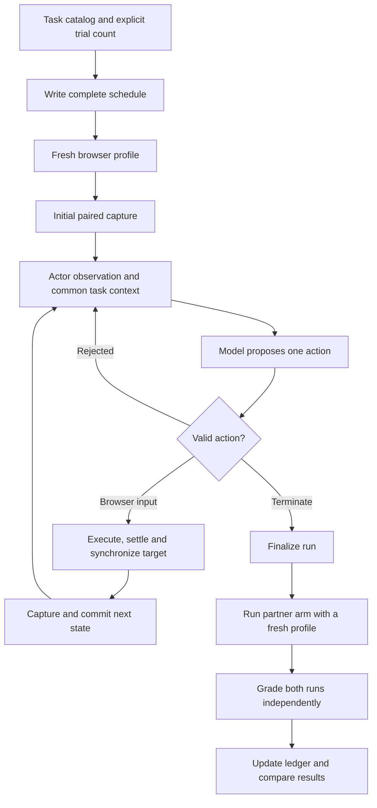

# Architecture

`w8-domdiff-bench` records paired browser evidence for evidence-loss analysis and
runs browser tasks with two independent actor arms. Execution metrics include
actor turns, token usage and task completion. The launcher schedules the work,
the recorder connects observations
to executed actions, and a separate judge grades each run against frozen task
criteria.

The browser runs in a `w8-core` container. The recorder and model clients run on
the host, connecting to the browser through CDP and the installed action CLI.
A task's two arms use separate browser profiles, memory and trajectories. Their
permitted differences are defined in the
[datacard](datacard.md#observation-modes).

| Component | Responsibility | Main implementation |
| --- | --- | --- |
| Task launcher | Load task definitions, create the schedule, start fresh browser profiles, record attempt outcomes and resume unfinished schedules. | [`task_cli.py`](../w8bench/task_recorder/task_cli.py) |
| Browser runtime | Configure the container, CDP endpoint, viewport and locale; record browser build and profile provenance. | [`browser_runtime.py`](../w8bench/task_recorder/browser_runtime.py), [`docker-compose.yml`](../docker-compose.yml) |
| Capture | Save structured DOM, readable DOM, model DOM and screenshot evidence with timing and identity metadata. | [`capture.py`](../w8bench/task_recorder/capture.py), [renderers](../w8bench/task_recorder/renderers/) |
| Actor loop | Build the selected observation request, validate one proposed action, execute it and record model usage and state transitions. | [`runner.py`](../w8bench/task_recorder/runner.py), [`prompts.py`](../w8bench/task_recorder/prompts.py) |
| Action driver | Execute reference-targeted actions and shared browser input primitives. | [`agent_browser/client.py`](../w8bench/task_recorder/agent_browser/client.py) |
| Recording validation/export | Check actor isolation, hashes and chronology; stage paired flat inputs with explicit gaps and provenance. | [`prepare_verifier_data.py`](../w8bench/task_recorder/prepare_verifier_data.py), [`trajectory.py`](../w8bench/task_recorder/trajectory.py) |
| Completion grading | Apply a frozen task rubric to each run using a common judge evidence policy. | [`completion.py`](../w8bench/verifier/completion.py) |
| DOM verification | Grade rubric criteria using recorded DOM text and action history. | [`verifier/dom_model/`](../w8bench/verifier/dom_model/) |
| Screenshot verification | Grade the same rubric using recorded screenshots and action history. | [`verifier/screenshot_verifier/`](../w8bench/verifier/screenshot_verifier/) |
| Verifier clients and types | Handle provider requests, usage, shared event/result types and frozen-rubric controls; retain modality-specific schemas in each scorer. | [`clients/`](../w8bench/verifier/clients/), [`models.py`](../w8bench/verifier/models.py), [`common.py`](../w8bench/verifier/common.py) |
| Rubric execution | Run rubric preparation, scoring, voting, outcome and task checks through one engine with explicit modality prompts and evidence hooks. | [`rubric_agent.py`](../w8bench/verifier/rubric_agent.py), [`rubric_scoring.py`](../w8bench/verifier/rubric_scoring.py), [`validity.py`](../w8bench/verifier/validity.py) |
| DOM evidence | Render ordered DOM states, bind grounding prompts, validate cited evidence and record selections. | [`evidence.py`](../w8bench/verifier/dom_model/evidence.py), [`prompts.py`](../w8bench/verifier/dom_model/prompts.py) |
| Screenshot input validation | Check action chronology, declared state gaps and final-answer screenshots before scoring. | [`screenshot_verifier/preflight.py`](../w8bench/verifier/screenshot_verifier/preflight.py) |
| Rubric scoring | Validate criteria, combine scores, select median results and check action arguments. | [`rubric_scoring.py`](../w8bench/verifier/rubric_scoring.py) |
| Verifier trajectories | Parse logs and answers with shared accounting and native field declarations. | [`trajectory.py`](../w8bench/verifier/trajectory.py), [`dom_model/models.py`](../w8bench/verifier/dom_model/models.py), [`screenshot_verifier/models.py`](../w8bench/verifier/screenshot_verifier/models.py) |
| Task validity | Classify task ambiguity and validity using each scorer’s prompt, date and logger. | [`validity.py`](../w8bench/verifier/validity.py) |
| Verifier taxonomy | Parse failure categories and Template variables from each scorer’s policy resource. | [`error_taxonomy.py`](../w8bench/verifier/error_taxonomy.py) |
| DOM state loading and packing | Parse chronological DOM states and pack complete evidence records within the configured budget. | [`dom_model/states.py`](../w8bench/verifier/dom_model/states.py) |
| Evidence audit | Compare both formats within one run and distinguish source loss from judge interpretation errors. | [`evidence_audit.py`](../w8bench/verifier/evidence_audit.py) |
| Comparison | Validate matching controls and aggregate scheduled outcomes, turns, tokens and completion statistics. | [`compare_results.py`](../w8bench/verifier/compare_results.py), [`run_full_comparison.py`](../w8bench/verifier/run_full_comparison.py), [`run_metrics.py`](../w8bench/verifier/run_metrics.py), [`paired_metrics.py`](../w8bench/verifier/paired_metrics.py) |

## Execution flow

The schedule contains one row per task, arm and trial. The two arms of each
task/trial run back to back, with the starting arm alternating across tasks and
trials. Grading follows both actor runs. Technical failures remain scheduled
outcomes, and resume skips completed attempts rather than silently retrying them.

Each actor request contains the task, current URL, turn budget, viewport,
bounded task memory, recent action outcomes and its selected page observation.
The model returns one JSON action. Rejected proposals consume a model turn but
do not execute browser input or create a new state. Normally, `N` action attempts
produce `N + 1` captured states: the initial state and one after each action.
A state's `action.json` describes the action taken from that state.

## Capture and actor isolation

After browser input, the recorder waits for the configured settling interval,
synchronizes the target, and captures in this order:

1. Structured DOM and its readable projection.
2. Browser-produced model DOM and its text projection.
3. The viewport screenshot.
4. Executable references when required by the actor.
5. The committed state record, artifact hashes and capture metadata.

Every complete state contains `dom.json`, `dom_full.txt`, `dom_model.json`,
`dom_model.txt` and `screenshot.png`. The reference snapshot is saved as
`agent_browser_actions.txt`. It is observation text produced by the action CLI,
not executable code written by the model.

The selected actor observation and passive evidence have separate roles.
Passive evidence stays available for inspection and judging without entering the
actor's prompt, memory, progress or rejection feedback. If a passive capture
fails, the usable actor observation can continue while the state records
`paired_complete=false`. Active observation failures are technical outcomes.

`inspect_recording()` checks the saved request against permitted sources,
verifies artifact and image hashes, and validates the action/state sequence.
Capture metadata includes target/session identity, per-phase timings, URLs and
navigation events. Capture is sequential; changing pages can produce differences
within the recorded interval even when the URL stays the same.

## DOM representation

The structured snapshot is viewport-scoped, with default limits of 7,000 nodes
and 200,000 text characters. `dom_full.txt` is a detailed rendering of that
bounded snapshot. `ChromiumRL.getModelDOM` organizes its content into
`dom_model.json`, and the text renderer creates `dom_model.txt`.

Stored model DOM retains the browser's identifiers. Actor-facing text masks
numeric ChromiumRL IDs so they cannot be mistaken for executable references.
The reference snapshot is filtered by viewport bounding-box overlap; partially
visible targets can retain complete accessible labels. Overlap does not itself
prove that a target is unobscured or clickable.

## Grading and results

The primary judge policy combines screenshots and model DOM text from the same
run with its action records, final answer and technical status. Both actor arms
use the same task rubric and judge controls. The optional actor-native policy
writes a separate secondary grade.

Both auxiliary verifiers grade each run independently using its own evidence.
The DOM package packs and analyses DOM-model text; the screenshot package
selects and analyses images. They retain original process/outcome scoring and
separate runtime penalties. The audit inventories both source formats and
adjudicates directional losses and verifier interpretation errors. Its shared
context includes only recorded execution facts and verified observed URLs.

Available states retain their source IDs and remain in their own verifier even
when the other format is missing. Directional audit decisions use only complete,
stable paired states. Staged evidence, judge results and coverage live outside
the immutable actor recording and are bound by hashes.

Actor-reported success, technical outcome and independent completion are
separate fields. Aggregation uses the schedule as its denominator, exposes
missing recordings and grading coverage, and accounts for actor and judge usage
separately. See the [evaluation protocol](evaluation-protocol.md) for metric
definitions and the [recording guide](recordings.md) for artifact fields.
