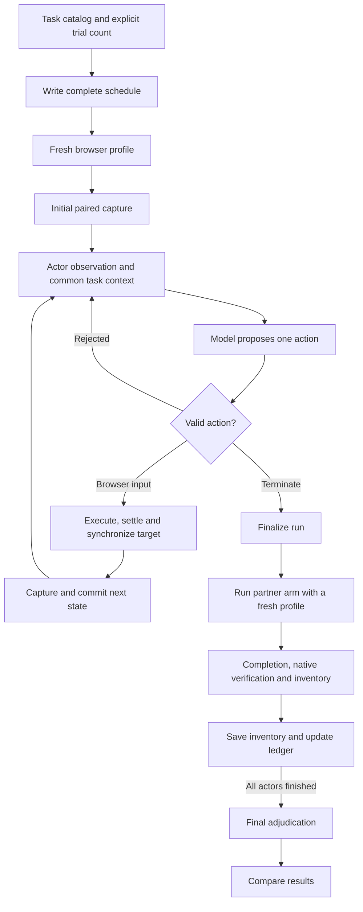

# Architecture

`w8-domdiff-bench` records paired browser evidence for evidence-loss analysis and
runs browser tasks with two independent actor arms. Execution metrics include
actor turns, token usage and task completion. The launcher schedules the work,
the recorder connects observations
to executed actions, and a separate judge grades each run against frozen task
criteria.

The browser runs in a `w8-core` container. The recorder and model clients run on
the host, connecting to the browser through CDP and the installed action CLI.
A task's two arms use separate browser profiles, memory and trajectories. Their
permitted differences are defined in the
[datacard](datacard.md#observation-modes).

## Terminology

| Term | Meaning |
| --- | --- |
| Task | A catalog instruction, start URL, stopping condition and constraints, bound to one frozen rubric. |
| Trial | One repetition of a task in both arms; the requested trial count is any positive integer. |
| DOM arm | The actor receives DOM text and executable references as page observation; screenshots are recorded privately. |
| Screenshot arm | The actor receives the saved viewport image as page observation; DOM evidence is recorded privately. Shared task context and URL are still supplied. |
| Run | One scheduled `(task, arm, trial)` execution, including its technical-attempt history. |
| Attempt / recording | One actor execution and its saved evidence. A technical rerun is a separate fresh attempt within the same run. |
| State | One recorded browser observation, initially or after an executable action, with artifact and capture metadata. |
| Paired state | Screenshot and DOM artifacts from one state's capture interval in one attempt. A valid empty DOM export is paired; artifacts from different arms are not a pair. |
| Completion | The independent verdict on frozen task criteria, separate from the actor's claimed outcome and recorder status. |
| Evidence loss | Criterion-required support preserved by one format but absent or disconnected in the other, assessed within the same recording using shared context. Absence from both formats is not directional loss. |
| Profile | A native-judge model assignment with isolated evaluation outputs, such as `primary` or `pro`; it is not an actor arm. |
| Inventory | Preliminary evidence findings and usage saved with source, rubric and model bindings for one recording. |
| Adjudication | Final evidence-loss decisions from the saved inventory and that recording's paired evidence. |

## Components

| Component | Responsibility | Main implementation |
| --- | --- | --- |
| Task launcher | Load task definitions, create the schedule, start fresh browser profiles, record attempt outcomes and resume unfinished schedules. | [`task_cli.py`](../w8bench/task_recorder/task_cli.py) |
| Browser runtime | Configure isolated container names and ports and verify browser services; the launcher records build and profile provenance. | [`browser_runtime.py`](../w8bench/task_recorder/browser_runtime.py), [`docker-compose.yml`](../docker-compose.yml) |
| Capture | Save structured DOM, readable DOM, model DOM and screenshot evidence with timing and identity metadata. | [`capture.py`](../w8bench/task_recorder/capture.py), [renderers](../w8bench/task_recorder/renderers/) |
| Actor loop | Build the selected observation request, validate one proposed action, execute it and record model usage and state transitions. | [`runner.py`](../w8bench/task_recorder/runner.py), [`prompts.py`](../w8bench/task_recorder/prompts.py) |
| Action driver | Execute reference-targeted actions and shared browser input primitives. | [`agent_browser/client.py`](../w8bench/task_recorder/agent_browser/client.py) |
| Recording validation/export | Check actor isolation, hashes and chronology; stage paired flat inputs with explicit gaps and provenance. | [`prepare_verifier_data.py`](../w8bench/task_recorder/prepare_verifier_data.py), [`trajectory.py`](../w8bench/task_recorder/trajectory.py) |
| Completion grading | Apply a frozen task rubric to each run using a common judge evidence policy. | [`completion.py`](../w8bench/verifier/completion.py) |
| DOM verification | Grade rubric criteria using recorded DOM text and action history. | [`verifier/dom_model/`](../w8bench/verifier/dom_model/) |
| Screenshot verification | Grade the same rubric using recorded screenshots and action history. | [`verifier/screenshot_verifier/`](../w8bench/verifier/screenshot_verifier/) |
| Verifier clients and types | Handle provider requests, usage, shared event/result types and frozen-rubric controls; retain modality-specific schemas in each scorer. | [`clients/`](../w8bench/verifier/clients/), [`models.py`](../w8bench/verifier/models.py), [`common.py`](../w8bench/verifier/common.py) |
| Rubric execution | Run rubric preparation, scoring, voting, outcome and task checks through one engine with explicit modality prompts and evidence hooks. | [`rubric_agent.py`](../w8bench/verifier/rubric_agent.py), [`rubric_scoring.py`](../w8bench/verifier/rubric_scoring.py), [`validity.py`](../w8bench/verifier/validity.py) |
| DOM evidence | Render ordered DOM states, bind grounding prompts, validate cited evidence and record selections. | [`evidence.py`](../w8bench/verifier/dom_model/evidence.py), [`prompts.py`](../w8bench/verifier/dom_model/prompts.py) |
| Screenshot input validation | Check action chronology, declared state gaps and final-answer screenshots before scoring. | [`screenshot_verifier/preflight.py`](../w8bench/verifier/screenshot_verifier/preflight.py) |
| Rubric scoring | Validate criteria, combine scores, select median results and check action arguments. | [`rubric_scoring.py`](../w8bench/verifier/rubric_scoring.py) |
| Verifier trajectories | Parse logs and answers with shared accounting and native field declarations. | [`trajectory.py`](../w8bench/verifier/trajectory.py), [`dom_model/models.py`](../w8bench/verifier/dom_model/models.py), [`screenshot_verifier/models.py`](../w8bench/verifier/screenshot_verifier/models.py) |
| Task validity | Classify task ambiguity and validity using each scorer’s prompt, date and logger. | [`validity.py`](../w8bench/verifier/validity.py) |
| Verifier taxonomy | Parse failure categories and template variables from each scorer’s policy resource. | [`error_taxonomy.py`](../w8bench/verifier/error_taxonomy.py) |
| DOM state loading and packing | Parse chronological DOM states and pack complete evidence records within the configured budget. | [`dom_model/states.py`](../w8bench/verifier/dom_model/states.py) |
| Evidence audit | Compare both formats within one recording and distinguish source loss from judge interpretation errors. | [`evidence_audit.py`](../w8bench/verifier/evidence_audit.py), [`audit_evidence.py`](../w8bench/verifier/audit_evidence.py), [`audit_requests.py`](../w8bench/verifier/audit_requests.py), [`audit_validation.py`](../w8bench/verifier/audit_validation.py) |
| Comparison | Validate matching controls and aggregate scheduled outcomes, turns, tokens and completion statistics. | [`compare_results.py`](../w8bench/verifier/compare_results.py), [`run_full_comparison.py`](../w8bench/verifier/run_full_comparison.py), [`run_metrics.py`](../w8bench/verifier/run_metrics.py), [`paired_metrics.py`](../w8bench/verifier/paired_metrics.py) |

## Execution flow

Each `recordings/runN/` folder contains one trial's catalog snapshot and ledger,
with one row per task and arm. Final attempts live under `<arm>/<task-id>/`;
earlier technical attempts remain under `attempts/`. Paired verifier inputs live
under `trajectories/runN/`, judge outputs under `evaluations/runN/`, and diagnostic
logs under local `logs/runN/`. The two arms of each
task/trial run back to back, with the starting arm alternating across tasks and
trials. Grading follows both actor runs. One technical failure permits a fresh
attempt for the same row. Both attempt records remain in the ledger; resume
continues a pending rerun without repeating a completed final attempt.

Each actor request contains the task, current URL, turn budget, viewport,
bounded task memory, standardized recent action outcomes and its selected page
observation. Private target descriptions and raw tool diagnostics are retained
with the recording rather than included in actor history. Shared URL changes and
modality-specific observation changes remain diagnostic; approximate stall
matches are private advisories: they neither reject otherwise valid actions nor
reach actor history. Each received response consumes one model turn. Failed
transport attempts have separate receipts and a bounded retry policy. Rejected
proposals do not execute browser input or create another state. Screenshot
coordinates are integers from 0 to 1000; the executor converts them once using
the captured viewport size. Normally, `N` action attempts produce `N + 1`
captured states: the initial state and one after each action. A state's
`action.json` describes the action taken from that state.

## Capture and actor isolation

After browser input, the recorder waits for the configured settling interval,
synchronizes the exact target, and follows this order:

1. Private document-readiness wait for the target/frame/loader, then two animation frames.
2. Raw structured DOM.
3. The viewport screenshot.
4. Executable references in the DOM arm.
5. DOM model artifacts and stored text projections from the captured DOM.
6. The committed state record, artifact hashes and capture metadata.

The readiness wait reuses the CDP navigation timeout and captures the current
state on expiry. Same-document changes do not repeat that asynchronous wait. An
empty structured export is valid: the DOM observation contains `[No exportable
DOM content]`, while the screenshot remains the painted viewport. No OCR or PDF
text extraction supplements it. The [recording
guide](recordings.md#capture-intervals) defines these records.

Every complete state contains `dom.json`, `dom_full.txt`, `dom_model.json`,
`dom_model.txt` and `screenshot.png`. The reference snapshot is saved as
`agent_browser_actions.txt`. It is observation text produced by the action CLI,
not executable code written by the model.

The selected actor observation and passive evidence have separate roles.
Passive evidence stays available for inspection and judging without entering the
actor's prompt, memory, progress or rejection feedback. If a passive capture
fails, the usable actor observation can continue while the state records
`paired_complete=false`. Active observation failures are technical outcomes.

`inspect_recording()` checks the saved request against permitted sources,
verifies artifact and image hashes, and validates the action/state sequence.
Capture metadata includes target/session identity, per-phase timings, URLs and
navigation events. Capture is sequential; changing pages can produce differences
within the recorded interval even when the URL stays the same. Available
content/paint-instability metadata covers observed main/known-frame contexts,
discovered open shadow roots and reported paint events, without automatic
recapture. Closed roots and unreported frames remain unknown. Global flags are
true on observed activity and otherwise unknown; partial coverage does not
certify stability. Bulk evidence writes follow raw capture, while per-call
operational traces remain durable throughout it.

A known active-target crash or destruction stops further attached calls. A
detached observation session can be reattached. Read-only timeout/internal
errors use a liveness probe and, for a live target, one reattachment and
observation retry. An action with uncertain delivery is not replayed. Exact
target IDs and a tab/opener registry bind observation to the selected page.
Private identity values live in an isolated JavaScript world. The CLI's active
target is verified through CDP inspector metadata without reading or writing
page globals. Per-call timings, events and failure health snapshots remain under local
`logs/<run-name>/<arm>/<task-id>/`.

Actor requests share the model, reasoning and limits in the
[datacard](datacard.md#shared-controls). The screenshot actor uses HIGH media
resolution; DOM requests contain no image. Local input estimation conditionally
uses `countTokens`; an input overflow ends technically without truncating
evidence. The [recording guide](recordings.md#run-level-artifacts) describes the
receipts.

## DOM representation

The structured snapshot is viewport-scoped, with default limits of 7,000 nodes
and 200,000 requested aggregate text characters; the aggregate threshold can
flag overflow without making every field a strict slice. `dom_full.txt` is a
detailed rendering of that bounded snapshot. `ChromiumRL.getModelDOM` organizes
its content into `dom_model.json`, and the text renderer creates
`dom_model.txt`.

Stored model DOM retains the browser's identifiers. Actor-facing text masks
numeric ChromiumRL IDs and filters inactive targeting/scroll instructions so
they cannot be mistaken for executable references. The saved projection remains
intact. The reference snapshot is filtered by viewport bounding-box overlap;
partially visible targets can retain complete accessible labels. Overlap does
not itself prove that a target is unobscured or clickable.

## Grading and results

The primary judge policy combines screenshots and model DOM text from the same
recording with its action records, final answer and technical status. Both actor arms
use the same task rubric and judge controls. The optional actor-native policy
writes a separate secondary grade.

Both auxiliary verifiers grade each final recording using its own evidence.
The DOM package packs and analyses DOM-model text; the screenshot package
selects and analyses images. They use native process/outcome policies and
separate runtime penalties. The audit inventories both source formats and
adjudicates directional losses and verifier interpretation errors. Its shared
context includes only recorded execution facts and verified observed URLs.
Native earned points require finite nonboolean values within each criterion's
weight; exhausted scoring is ungraded with null scores and a reason. Native
model-ID mismatches and DOM citation checks are separate diagnostics. Completion
and audit responses require matching returned IDs and complete output. All failed
attempt usage remains in receipts; ungraded audits have no pooled loss rate.

All model requests use Google's GenerateContent API. Native validation operations
allow an initial answer and one correction; a grouped evidence fallback gives
each individual criterion/state operation the same two-attempt budget. Rubric
preparation and audit validation have their own budgets in the
[datacard](datacard.md#judge-delivery).

Available states retain their source IDs and remain in their own verifier even
when the other format is missing. Directional audit decisions use only complete,
paired states with no navigation inside the evidence-acquisition interval.
Content/paint change flags are diagnostics, not another eligibility filter.
Staged evidence, judge results and coverage live outside the immutable actor
recording and are bound by hashes. Resume and comparison use the normalized
[effective settings
contract](evaluation-protocol.md#effective-settings-contract), including request
policies, prompt/schema identities, rubric bindings and browser source
provenance. Credentials and deployment locations are excluded from this
behavioral contract.

Actor-reported success, technical outcome and independent completion are
separate fields. Aggregation uses the schedule as its denominator, exposes
missing recordings and grading coverage, and accounts for actor and judge usage
separately. See the [evaluation protocol](evaluation-protocol.md) for metric
definitions and the [recording guide](recordings.md) for artifact fields.
