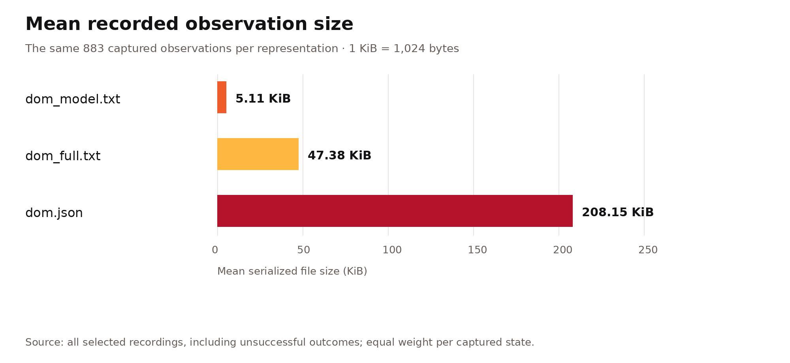
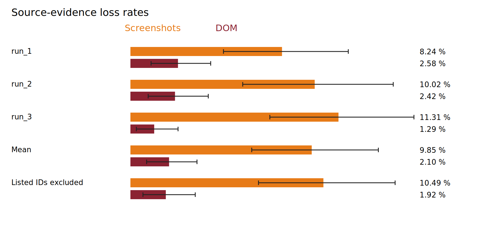
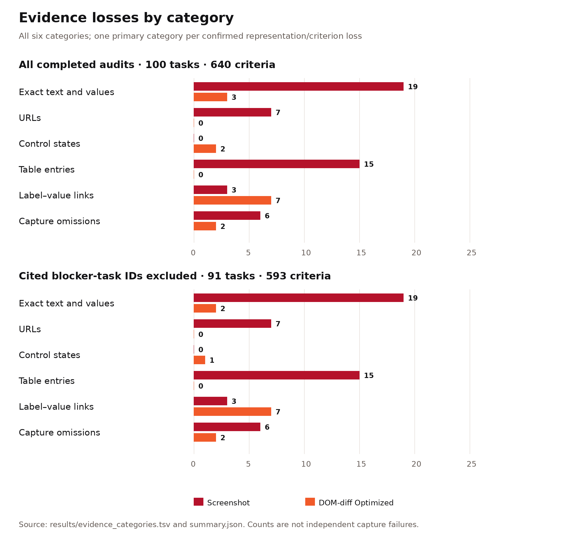
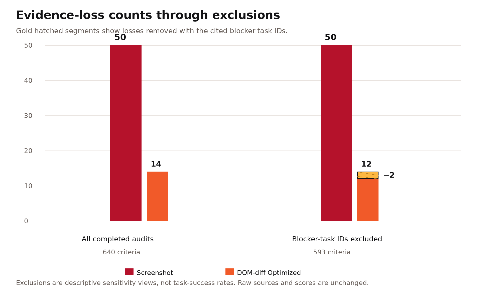
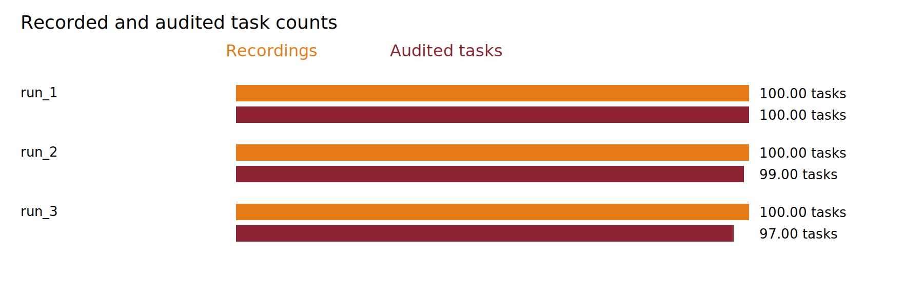
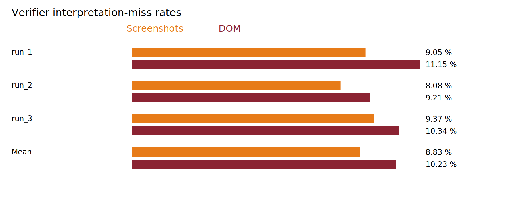

# w8-domdiff-bench: Browser Evidence and Evaluation Report

WootzApp · November 1, 2026

`w8-domdiff-bench` is WootzApp's framework for recording browser-agent trajectories and evaluating the evidence they preserve. Its `w8-core` recorder captures screenshots and DOM-diff Optimized text from the same execution, while its paired verifiers compare both representations against one frozen rubric. This report documents the repository's capture pipeline, evaluation method, and results for 100 browser tasks. The [README](../README.md) introduces the project, the [runbook](runbook.md) explains how to run it, and the [results index](../results/README.md) links its evaluation artifacts.

Both representations share the same task, executed action history, and final answer. Both scoring and validated evidence audits cover **100 task pairs and 640 criteria**, with **50 screenshot losses and 14 DOM losses**. Inventory uses `gpt-5.6-sol` and final adjudication uses `gemini-3.1-pro-preview`. These counts measure paired source-evidence availability; task-success rules and representation sizes are defined below.

## Foundations and baselines

WebVoyager introduced multimodal automatic evaluation for open-ended web tasks [[1]](#references). Our screenshot baseline follows the Universal Verifier's rubric-centered design: criterion-specific evidence selection, separate process and outcome judgments, and failure attribution [[2]](#references). WootzApp's contribution is the DOM-based adaptation, browser-native evidence capture, paired comparison protocol, and source-aware audit. The acting agent uses `gpt-5.6` to generate actions from compact text observations; screenshots are retained for inspection and screenshot-based verification.

WebArena provides screenshot, HTML DOM, and accessibility-tree observations and evaluates functional task completion in controlled websites [[4]](#references). These systems establish context for structured and visual browser evidence. This benchmark evaluates what paired recorded representations preserve under a shared rubric; it does not reproduce those benchmarks' task-success experiments. The [architecture guide](architecture.md) explains the browser stack and representation history.

## Browser capture and evaluation pipeline

The repository's [task recorder](../w8bench/task_recorder/) supplies `gpt-5.6` with DOM-based observations and executable `agent-browser` references. The harness validates each proposed action, executes it in `w8-core`, and records the resulting screenshot and structured browser state. DOM-diff Optimized organizes each captured state into readable content, tables, controls, relationships, and scroll context.

The [paired evaluation pipeline](../w8bench/verifier/) validates the prepared screenshot/DOM bundles, freezes a shared rubric, runs both verifiers, and audits criterion-level evidence availability. The inventory uses `gpt-5.6-sol` and adjudication uses `gemini-3.1-pro-preview`; internal WootzApp review is a separate verification role. The [published dataset](https://huggingface.co/datasets/WootzappLab/browser-agent-tasks) hosts the trajectories and supporting artifacts used by this repository; the tables below report the resulting benchmark findings.

## Benchmark protocol and mathematical definitions

All 100 recorded tasks have usable, aligned evidence and validated audits covering 640 criteria. Successful, failed and errored recordings with usable evidence are included; no tasks are excluded. Both verifiers scored the same **640 criteria**, which also form the evidence-loss denominator [[3]](#references). Both modes receive the same task inputs, executed actions, final answer, frozen rubric and scoring controls. An execution with $`N`$ actions normally yields $`N+1`$ recorded states: the initial state and one state after each executed action.

### Rubric scores and task-success rules

For task $`t`$, let $`s_{t,j}`$ be the final awarded points for rubric criterion $`j`$, after the verifier's scoring and rescoring stages, and let $`p_{t,j}`$ be its maximum points. The earned total, maximum total, and normalized rubric score are

```math
S_t=\sum_j s_{t,j},
\qquad
S_t^{\max}=\sum_j p_{t,j},
\qquad
r_t=\frac{S_t}{S_t^{\max}}\quad(S_t^{\max}>0).
```

The implementation sets the normalized score to zero when the maximum total is zero. For a valid rubric with a positive maximum total, a **strict full-score success** means earning every available point:

```math
\mathrm{Success}_{\mathrm{full}}(t)
=\mathbf{1}\{S_t=S_t^{\max}\}.
```

This defines the full-credit convention ($`x/x`$). The CLI also exposes distinct process and outcome rules. Let $`P_t`$ be the process pass flag at rubric threshold $`\tau`$, and let $`O_t`$ indicate that the outcome judge returned the Boolean `true`:

```math
P_t=\mathbf{1}\{r_t\ge\tau\},
\qquad
O_t=\mathbf{1}\{\texttt{output\_success}_t=\mathrm{true}\}.
```

The binary rules available through `--success` are

```math
\mathrm{Success}_{\mathrm{outcome}}(t)=O_t,
\qquad
\mathrm{Success}_{\mathrm{process}}(t)=P_t,
\qquad
\mathrm{Success}_{\mathrm{both}}(t)=P_t O_t.
```

The paired command currently fixes **`--success outcome`** and the threshold $`\tau=0.8`$, so its binary `score` follows the outcome judgment; `rubric_is_success` separately records whether at least 80% of rubric points were earned. A strict full-score summary uses the first rule above. The standalone verifier runners support all three CLI rules. These definitions apply separately to each representation of a task.

The [shared controls](../w8bench/verifier/common.py) also fix five evidence items per criterion, a screenshot keypoint threshold of 3, a minimum relevance threshold of 0, and one voting instance. The [screenshot runner](../w8bench/screenshot_verifier/runner.py) and [DOM runner](../w8bench/dom_model/runner.py) implement the binary rules. The [evaluation protocol](evaluation-protocol.md#success-rules) summarizes them, while saved run manifests establish the controls used by a particular evaluation. None of these success rules defines source-evidence loss.

### Paired source-evidence loss

Let $`\mathcal{C}`$ be the audited rubric criteria, $`M=|\mathcal{C}|`$, and $`\mathcal{I}_c`$ the concrete required values or states reviewed for criterion $`c`$. For required item $`i\in\mathcal{I}_c`$, let $`a_{c,i,S},a_{c,i,D}\in\{0,1\}`$ indicate its availability in screenshots ($`S`$) and DOM-diff Optimized ($`D`$), respectively, across the eligible ordered source states and the formatted action history supplied to that verifier. Both representations use the same evidence requirements and review scope.

```math
\ell_{c,S}=\mathbf{1}\!\left\{\exists i\in\mathcal{I}_c:
a_{c,i,S}=0\ \land\ a_{c,i,D}=1\right\},
\qquad
\ell_{c,D}=\mathbf{1}\!\left\{\exists i\in\mathcal{I}_c:
a_{c,i,D}=0\ \land\ a_{c,i,S}=1\right\}.
```

Each indicator is binary: a criterion contributes at most one loss per representation, even if several required items are missing. Partial preservation still counts as loss when one specific required item is absent from that representation and present in the other. Items available in both or absent from both do not trigger paired loss. Evidence that a verifier overlooks or misinterprets is an interpretation error, separate from source availability.

For representation $`m`$, the loss count and percentage rate are

```math
L_m=\sum_{c\in\mathcal{C}}\ell_{c,m},
\qquad
\mathrm{ELR}_m=\frac{100L_m}{M},
\qquad m\in\{S,D\}.
```

All audited criteria remain in the denominator, including those without a gap. A criterion can lose different items in both representations, contributing to both marginal counts. Multiple criteria can depend on one capture omission. This metric measures differences between paired recorded sources; information omitted from both sources remains undetected.

### Current counts and relative reduction

The saved evaluation findings give

```math
M=640,\qquad L_S=50,\qquad L_D=14.
```

Therefore,

```math
\mathrm{ELR}_S=\frac{50}{640}\times100\approx7.81\%,\qquad
\mathrm{ELR}_D=\frac{14}{640}\times100\approx2.19\%.
```

For a shared denominator and $`L_S>0`$, the relative reduction is

```math
\mathrm{Relative\ reduction}
=\frac{L_S-L_D}{L_S}\times100
=\frac{50-14}{50}\times100=72.00\%.
```

These are relative reductions in criterion-level source-loss counts. Task-success rates, verifier accuracy, and acting-agent improvement require separate measurements. The [paired comparison](#paired-comparison) reports overlapping findings and uncertainty estimates.

## Current representation size

The model-facing `dom_model.txt` files average **5.11 KiB** per captured observation. All three means below use the same **883 recorded states** from all **100 selected recordings**, including unsuccessful outcomes. Every state has equal weight; these are not averages of per-task means.

| Representation | Artifact | Captured observations | Mean kB | Mean KiB |
| --- | --- | ---: | ---: | ---: |
| DOM-diff Optimized | `dom_model.txt` — compact model-facing text | 883 | 5.23 | **5.11** |
| Text-dense DOM | `dom_full.txt` — detailed readable text | 883 | 48.51 | **47.38** |
| Full DOM | `dom.json` — structured snapshot | 883 | 213.15 | **208.15** |

The text-dense representation exposes detailed DOM information as readable text; the full DOM snapshot retains structured node data. DOM-diff Optimized groups selected content and controls into compact observations for model input. Sizes are serialized bytes: 1 kB = 1,000 bytes and 1 KiB = 1,024 bytes. Token counts depend on the tokenizer. This size comparison does not measure task success or evidence preservation. Full snapshots remain subject to the [capture boundaries](architecture.md#verification-and-boundaries).



## Evidence preservation across 100 tasks

All 100 recorded tasks have usable, aligned evidence and validated audits covering 640 criteria. Successful, failed and errored recordings with usable evidence are included; no tasks are excluded.

The completed audits identify **50 screenshot losses and 14 DOM losses** across **640 criteria**. The table reports the full paired comparison, including every loss category.

**Table 1.** Evidence-loss rates across the audited dataset

| Analysis | Screenshot: count, 95% CI, rate | DOM: count, 95% CI, rate | Common to both: count and rate |
|---|---|---|---|
| All source-evidence loss categories | **50/640**; 95% CI **4.71–11.30%** (rate 7.81%) | **14/640**; 95% CI **0.98–3.59%** (rate 2.19%) | 1/640 (0.16%) |

*All 640 audited criteria remain in the denominator.*



**Figure 1.** Evidence-loss rates for all completed audits and the subset excluding the nine cited blocker-task IDs. The 95% intervals resample whole tasks; they assume independent tasks and do not measure annotation error.

These counts measure evidence availability, not task success or answer correctness. A common loss concerns the same task/criterion and is already included in both marginal counts; each representation loses a different required item. The report presents the paired comparison and loss categories, then website blockers, execution failures, and evaluation provenance.

## Paired comparison

**Table 2.** Paired evidence-loss outcomes across the audited dataset

| Analysis | Screenshot only | DOM only | Both | Neither |
|---|---|---|---|---|
| All source-evidence loss categories | 49 | 13 | 1 | 577 |

*These four outcomes partition all 640 criteria.*

The primary intervals use a paired task-cluster percentile bootstrap: 20,000 whole-task draws, seed 0, with all criteria and both modalities kept together. Each draw divides total losses by total criteria. The paired rate difference uses the same draws. This assumes independent tasks and holds automated audit labels fixed; it does not measure annotation error.

DOM has **72.00% fewer losses** across all categories. The primary paired screenshot-minus-DOM difference is **5.62 percentage points**, with a **95% task-cluster interval of 2.22–9.35 percentage points**. The exploratory criterion-level exact McNemar test gives **p = 4.818e-06**; it does not adjust for task clustering. Relative percentages can change sharply when counts are small.


## Source-evidence loss by category

The category breakdown shows which required information each representation loses. The [category guide](evidence-categories.md) defines the six categories and boundary rules. Each confirmed representation/criterion loss receives one primary category in the [annotation table](../results/evidence_categories.tsv), with a rationale and source-finding hash. These are report annotations of the saved adjudications, not new verifier decisions or changes to the audit flags.

**Table 3.** Evidence losses by category across completed audits

| Category | Screenshots | DOM |
|---|---:|---:|
| Exact text and values | 19 | 3 |
| URLs | 7 | 0 |
| Control states | 0 | 2 |
| Table entries | 15 | 0 |
| Label–value links | 3 | 7 |
| Capture omissions | 6 | 2 |
| **All categories** | **50** | **14** |

*Counts cover 100 completed audits and 640 criteria. The 64 representation/criterion losses affect 63 distinct criteria because one criterion loses different items in both representations.*



**Figure 2.** All six categories share a count scale. The panels retain 640 and 593 audited criteria, respectively.

### Repeated capture gaps and mathematical notation

**Task_35: one cropped row affects three criteria.** The [C2/C3/C4 findings](https://huggingface.co/datasets/WootzappLab/browser-agent-tasks/blob/main/evaluations/run_1/task_35/batch_01/evidence_audit.json) identify the missing Linux/amd64 size row for the third Docker tag. The omission affects the complete tag report, the architecture check, and proof that all requested fields were reached before stopping. These are three criterion-level losses from one capture limitation, not three independent capture failures.

**Task_37 C4: exact glyphs and labels can favour different representations.** The [saved finding](https://huggingface.co/datasets/WootzappLab/browser-agent-tasks/blob/main/evaluations/run_1/task_37/batch_01/evidence_audit.json) records screenshot availability glyphs rendered as hollow boxes, while DOM retains checkmarks. Screenshots preserve “Golden Gate” capitalization while DOM lowercases that label. Each side loses a different required item under an exact-display criterion. This distinguishes symbol fidelity from label fidelity without claiming that either representation always preserves visual notation better.

## Website access blockers and unavailable content

Website restrictions can prevent access even when both representations retain the blocking page. The nine observations below are explicitly cited from the current recordings. Some tasks later completed or used a permitted alternative; this is not a list of nine failed tasks or an exhaustive blocker count.

**Table 4.** Website access blockers and unavailable content

| Task | Requested information | Why blocked | Evidence |
|---|---|---|---|
| task_01 | reddit ranking | Reddit network-security block at the initial page; the final answer later reports a weekly top post. | [Recorded DOM, line 7](https://huggingface.co/datasets/WootzappLab/browser-agent-tasks/blob/main/recordings/run_1/task_01/steps/step_001/dom_model.txt#L7) |
| task_06 | article metadata lookup | Search Engine Land security interstitial; the final answer later reports an article. | [Recorded DOM, line 9](https://huggingface.co/datasets/WootzappLab/browser-agent-tasks/blob/main/recordings/run_1/task_06/steps/step_001/dom_model.txt#L9) |
| task_07 | cross-site recipe lookup | AllRecipes JavaScript/cookies security check prevented recipe extraction. | [Recorded DOM, line 7](https://huggingface.co/datasets/WootzappLab/browser-agent-tasks/blob/main/recordings/run_1/task_07/steps/step_002/dom_model.txt#L7) |
| task_14 | reddit post lookup | Initial Reddit network-security block; the final answer later uses a search snippet. | [Recorded DOM, line 7](https://huggingface.co/datasets/WootzappLab/browser-agent-tasks/blob/main/recordings/run_1/task_14/steps/step_001/dom_model.txt#L7) |
| task_15 | reddit community comparison | Initial Reddit network-security block; the final answer uses other public sources. | [Recorded DOM, line 7](https://huggingface.co/datasets/WootzappLab/browser-agent-tasks/blob/main/recordings/run_1/task_15/steps/step_001/dom_model.txt#L7) |
| task_22 | stackoverflow search | Mandatory Stack Overflow CAPTCHA prevented the requested filtered result extraction. | [Recorded DOM, line 55](https://huggingface.co/datasets/WootzappLab/browser-agent-tasks/blob/main/recordings/run_1/task_22/steps/step_006/dom_model.txt#L55) |
| task_53 | book-edition resolution | Open Library human-verification gate prevented edition-field extraction. | [Recorded DOM, line 33](https://huggingface.co/datasets/WootzappLab/browser-agent-tasks/blob/main/recordings/run_1/task_53/steps/step_001/dom_model.txt#L33) |
| task_56 | biomedical literature filtering | A reCAPTCHA browser-check page was captured; the final run also records an action error. | [Recorded DOM, line 2](https://huggingface.co/datasets/WootzappLab/browser-agent-tasks/blob/main/recordings/run_1/task_56/steps/step_016/dom_model.txt#L2) |
| task_92 | legislative roll-call inspection | A security-verification page was captured; the final answer reports the requested vote fields. | [Recorded DOM, line 9](https://huggingface.co/datasets/WootzappLab/browser-agent-tasks/blob/main/recordings/run_1/task_92/steps/step_002/dom_model.txt#L9) |

*These nine cited task IDs define the sensitivity exclusion set in Tables 5–7. A transient blocker and a completed task can coexist.*

A blocker and a source gap describe different things. A blocking page can be preserved by both representations; its presence is not automatically evidence loss.

### Analysis excluding the listed access-blocked tasks

Excluding the nine cited task IDs removes **47 criteria**, leaving **91 audited tasks and 593 criteria**. It removes two DOM losses: the task_56 control-state loss and task_92 exact-format loss. It removes no screenshot losses. All these tasks remain in the primary 100-task analysis. This exploratory subset was selected after inspecting recordings and is not a pre-specified benchmark.

The task IDs are `task_01`, `task_06`, `task_07`, `task_14`, `task_15`, `task_22`, `task_53`, `task_56`, `task_92`. The exclusion removes only these cited task IDs; it does not establish that every remaining task was free of blockers. The same adjudications, category rules and task-cluster bootstrap method apply.

**Table 5.** Evidence-loss rates excluding the listed blocker-task IDs

| Analysis | Screenshot: count, 95% CI, rate | DOM: count, 95% CI, rate | Common to both: count and rate |
|---|---|---|---|
| Listed blocker-task IDs excluded; all categories | **50/593**; 95% CI **5.14–12.27%** (rate 8.43%) | **12/593**; 95% CI **0.83–3.51%** (rate 2.02%) | 1/593 (0.17%) |

*This subset retains all 593 criteria in its 91 tasks.*

**Table 6.** Paired evidence-loss outcomes excluding the listed blocker-task IDs

| Analysis | Screenshot only | DOM only | Both | Neither |
|---|---|---|---|---|
| All source-evidence loss categories | 49 | 11 | 1 | 532 |

DOM has **76.00% fewer losses** across all categories in this subset.



**Figure 3.** Screenshot losses remain at 50; DOM losses change from 14 to 12 after excluding the cited blocker-task IDs. The denominator changes from 640 to 593 criteria. The gold hatched segment shows the two excluded DOM losses.


#### Source-evidence loss by category

**Table 7.** Evidence losses by category excluding the listed blocker-task IDs

| Category | Screenshots | DOM |
|---|---:|---:|
| Exact text and values | 19 | 2 |
| URLs | 7 | 0 |
| Control states | 0 | 1 |
| Table entries | 15 | 0 |
| Label–value links | 3 | 7 |
| Capture omissions | 6 | 2 |
| **All categories** | **50** | **12** |

*The same six categories are applied to all 593 audited criteria in the 91-task subset. Its 62 representation/criterion losses affect 61 distinct criteria.*

## Recorded execution failures

The current recordings contain **5 manifest-recorded execution errors across 100 tasks (5%)**, alongside **88 successes and 7 agent failures**. Raw `final.json` records encode all 12 unsuccessful outcomes as `failure`; the manifest distinguishes the 5 execution errors. These are collection outcomes, not verifier scores.

**Table 8.** Recorded execution failures by reason

| Tasks | Recorded reason |
|---|---|
| [task_26](https://huggingface.co/datasets/WootzappLab/browser-agent-tasks/blob/main/recordings/run_1/task_26/final.json), [task_57](https://huggingface.co/datasets/WootzappLab/browser-agent-tasks/blob/main/recordings/run_1/task_57/final.json), [task_96](https://huggingface.co/datasets/WootzappLab/browser-agent-tasks/blob/main/recordings/run_1/task_96/final.json) | Structured snapshot capture timed out after two attempts. |
| [task_27](https://huggingface.co/datasets/WootzappLab/browser-agent-tasks/blob/main/recordings/run_1/task_27/final.json) | Structured capture returned zero nodes for a non-empty document after three attempts. |
| [task_87](https://huggingface.co/datasets/WootzappLab/browser-agent-tasks/blob/main/recordings/run_1/task_87/final.json) | agent-browser connection timed out after 90 seconds. |

*The three reason groups account for all 5 manifest-recorded execution errors. Source links open the raw final-answer records.*

Five error recordings retain usable aligned evidence and are evaluated: **task_26, task_27, task_57, task_87 and task_96**. No recording is excluded from the paired evaluation. Execution errors, website blockers and source losses overlap and must not be added into one failure rate.

## Models and evaluation provenance

The benchmark uses separate models for browser actions, trajectory verification and evidence auditing. Internal WootzApp review is a separate project verification role; the current saved model outputs do not attest that this human-review step has been completed for every finding.

**Table 9.** Model configuration and reviewers

| Role | Model or reviewer |
|---|---|
| Acting agent: browser-action generation | `gpt-5.6` |
| Screenshot verification: evidence/rubric judge | `gpt-5.2` |
| Screenshot verification: action/validity judge | `gpt-5.6-terra` |
| DOM verification: evidence/rubric judge | `gpt-5.2` |
| DOM verification: action/validity judge | `gpt-5.6-terra` |
| Rubric generation | `gpt-5.2` |
| Automated evidence inventory | `gpt-5.6-sol` |
| Final evidence-loss adjudication | `gemini-3.1-pro-preview` |
| Internal evidence-review role | Internal WootzApp employees; completion is not recorded in these audit files. |

*Action generation, evidence judging, action/validity judging, report category annotation and human verification are separate roles.*

Each evaluation manifest records the models and controls associated with its results. Both verifier results are checked against the same frozen rubric. The [category annotation table](../results/evidence_categories.tsv) records report classifications of the existing decisive evidence and citations; those labels do not change audit decisions or scores.

Inventory and adjudication use different providers; model-based annotation errors remain possible.

Example provenance: [run manifest](https://huggingface.co/datasets/WootzappLab/browser-agent-tasks/blob/main/evaluations/run_1/task_01/batch_01/run_manifest.json), [rubric metrics](https://huggingface.co/datasets/WootzappLab/browser-agent-tasks/blob/main/evaluations/run_1/task_01/batch_01/rubric_generation_metrics.json), [screenshot metrics](https://huggingface.co/datasets/WootzappLab/browser-agent-tasks/blob/main/evaluations/run_1/task_01/batch_01/screenshot_verifier/run_metrics.json) and [DOM metrics](https://huggingface.co/datasets/WootzappLab/browser-agent-tasks/blob/main/evaluations/run_1/task_01/batch_01/dom_model/run_metrics.json). The selected output group is `batch_01`; [summary.json](../results/summary.json) lists task identities and source checksums.

**Planned ablation study:** vary the verification and rubric-generation models and DOM representations while controlling task sets, paired trajectories, frozen rubrics and audit protocol. Cross-model and cross-DOM ablations have not been performed here; pooled results from different configurations would not constitute a controlled ablation.

## Source-evidence gaps by task and criterion

The detailed table consolidates the saved audits, with one row for each confirmed task/criterion loss in screenshots, DOM, or both. Criterion IDs (`C0`, `C1`, …) use the zero-based `criterion_index` from the audit.

The table contains **63 affected criteria across 34 tasks**. The **577 criteria without confirmed paired loss** remain in the 640-criterion denominator. Findings come from final saved adjudications, not final answers alone. Categories are report annotations; the complete decisive evidence and original citations remain in the linked audits.

### Files needed from the evaluation directory

- `task_*/<run-id>/evidence_audit.json` is the primary source: `criteria[*].adjudication` contains confirmed source-loss findings, decisive evidence and citations. Example: [task_02 audit](https://huggingface.co/datasets/WootzappLab/browser-agent-tasks/blob/main/evaluations/run_1/task_02/batch_01/evidence_audit.json).
- `task_*/<run-id>/frozen_rubric.json` supplies criterion wording, order and requirements. Example: [task_02 rubric](https://huggingface.co/datasets/WootzappLab/browser-agent-tasks/blob/main/evaluations/run_1/task_02/batch_01/frozen_rubric.json).
- `task_*/<run-id>/dom_model/result.json` and `screenshot_verifier/result.json` contain saved verifier results for rubric and audit consistency checks.
- `task_*/<run-id>/run_manifest.json` establishes run status and provenance; `comparison.json` cross-checks criterion order. Example: [manifest](https://huggingface.co/datasets/WootzappLab/browser-agent-tasks/blob/main/evaluations/run_1/task_02/batch_01/run_manifest.json) and [comparison](https://huggingface.co/datasets/WootzappLab/browser-agent-tasks/blob/main/evaluations/run_1/task_02/batch_01/comparison.json).
- `evidence_audit_error.json`, where present, records validation errors. Invalid responses are not confirmed findings.
- [evidence_categories.tsv](../results/evidence_categories.tsv) records the category, rationale and source-finding hash for each of the 64 representation/criterion losses.

### How to read the six columns

- **Task / criterion:** task alias and exact frozen-rubric criterion. The evidence link identifies the selected run.
- **Category:** the primary gap type. A criterion with losses on both sides can have a different category on each side.
- **Labels:** `SCREENSHOT_EVIDENCE_MISSING`, `DOM_EVIDENCE_MISSING`, or `BOTH_EVIDENCE_INCOMPLETE`, derived from confirmed loss flags.
- **Findings:** which representation loses decision-essential evidence preserved in the other.
- **Pointer to evidence file:** the linked audit, source filename and location. The audit retains the exact quotations.

**Table 10.** Confirmed evidence gaps by task and criterion

| Task | Criterion | Category | Labels | Findings | Pointer to evidence file |
|---|---|---|---|---|---|
| task_02 | **C0** — Navigate to Xbox.com and access the 'Best sellers' section | Capture omissions | `SCREENSHOT_EVIDENCE_MISSING` | Screenshot evidence loss | [Screenshot evidence loss](https://huggingface.co/datasets/WootzappLab/browser-agent-tasks/blob/main/evaluations/run_1/task_02/batch_01/evidence_audit.json)<br>Screenshot: The DOM explicitly preserves the required Best sellers heading and its game listings, while no screenshot preserves that required labeled listing.<br>Cited evidence: `dom_model4.txt` (L106-L112) |
| task_02 | **C1** — Select a game listed under 'Best sellers' and open its Xbox.com product page | Label–value links | `SCREENSHOT_EVIDENCE_MISSING` | Screenshot evidence loss | [Screenshot evidence loss](https://huggingface.co/datasets/WootzappLab/browser-agent-tasks/blob/main/evaluations/run_1/task_02/batch_01/evidence_audit.json)<br>Screenshot: The DOM explicitly shows Minecraft: Java &amp; Bedrock Edition for PC under Best sellers; the shared click record and following observed product URL link that listed title to the opened product page.<br>Cited evidence: `dom_model4.txt` (L106-L112); `action_history` (L0048-L0055) |
| task_02 | **C2** — Report publisher, developer, and release date from the product page | Label–value links | `DOM_EVIDENCE_MISSING` | DOM evidence loss | [DOM evidence loss](https://huggingface.co/datasets/WootzappLab/browser-agent-tasks/blob/main/evaluations/run_1/task_02/batch_01/evidence_audit.json)<br>DOM: The screenshot explicitly associates Published by with Microsoft Studios, as well as the developer and release-date fields. The DOM shows the Published by label without its publisher value, so it cannot establish the same three-field result.<br>Cited evidence: `screenshot24.png` (lower metadata row); `screenshot24.png` (lower metadata value beneath Published by); `screenshot24.png` (lower metadata row); `screenshot24.png` (lower metadata value beneath Developed by); `screenshot24.png` (lower metadata row); `screenshot24.png` (lower metadata value beneath Release date) |
| task_03 | **C3** — Report the work-site arrangement from the listing | Exact text and values | `SCREENSHOT_EVIDENCE_MISSING` | Screenshot evidence loss | [Screenshot evidence loss](https://huggingface.co/datasets/WootzappLab/browser-agent-tasks/blob/main/evaluations/run_1/task_03/batch_01/evidence_audit.json)<br>Screenshot: The DOM explicitly provides the opened listing&#x27;s work-site label and exact arrangement, while no screenshot shows either the Work site field or its value.<br>Cited evidence: `dom_model4.txt` (L0041-L0042) |
| task_03 | **C4** — Report two key responsibilities from the listing | Capture omissions | `SCREENSHOT_EVIDENCE_MISSING` | Screenshot evidence loss | [Screenshot evidence loss](https://huggingface.co/datasets/WootzappLab/browser-agent-tasks/blob/main/evaluations/run_1/task_03/batch_01/evidence_audit.json)<br>Screenshot: The DOM&#x27;s Responsibilities section explicitly contains the reported fine-tuning/RLHF duty as well as the reported tech-lead safety-mitigation duty. Screenshots show only the latter of those reported duties; they cannot establish that both reported responsibilities are supported.<br>Cited evidence: `dom_model5.txt` (L0045-L0047) |
| task_03 | **C5** — Report two preferred qualifications from the listing (or clearly report if none are listed) | Capture omissions | `SCREENSHOT_EVIDENCE_MISSING` | Screenshot evidence loss | [Screenshot evidence loss](https://huggingface.co/datasets/WootzappLab/browser-agent-tasks/blob/main/evaluations/run_1/task_03/batch_01/evidence_audit.json)<br>Screenshot: The DOM explicitly places both reported qualifications under the Preferred Qualifications heading, including the otherwise unseen 2+ years science-experience item. Screenshots show only the first item beginning below that heading.<br>Cited evidence: `dom_model5.txt` (L0061-L0064) |
| task_05 | **C1** — Identify the next upcoming event | Capture omissions | `SCREENSHOT_EVIDENCE_MISSING` | Screenshot evidence loss | [Screenshot evidence loss](https://huggingface.co/datasets/WootzappLab/browser-agent-tasks/blob/main/evaluations/run_1/task_05/batch_01/evidence_audit.json)<br>Screenshot: The DOM Events listing explicitly preserves the selected November 3 event and a later November 12 event, enabling the decisive chronological comparison that screenshots do not preserve.<br>Cited evidence: `dom_model2.txt` (L8-L11) |
| task_05 | **C2** — Report required event details (title, date, time, location) | Exact text and values | `SCREENSHOT_EVIDENCE_MISSING` | Screenshot evidence loss | [Screenshot evidence loss](https://huggingface.co/datasets/WootzappLab/browser-agent-tasks/blob/main/evaluations/run_1/task_05/batch_01/evidence_audit.json)<br>Screenshot: The detail-page DOM explicitly provides the Pavilion, Daisy&#x27;s Table, and complete address, while no supplied screenshot shows that location text.<br>Cited evidence: `dom_model3.txt` (L10) |
| task_08 | **C2** — Record release metadata (tag and publication date) | Exact text and values | `SCREENSHOT_EVIDENCE_MISSING` | Screenshot evidence loss | [Screenshot evidence loss](https://huggingface.co/datasets/WootzappLab/browser-agent-tasks/blob/main/evaluations/run_1/task_08/batch_01/evidence_audit.json)<br>Screenshot: The DOM uniquely preserves the absolute publication date associated with v1.64.1, whereas every screenshot shows only the relative wording “released this 2 weeks ago.”<br>Cited evidence: `dom_model1.txt` (L0159) |
| task_17 | **C3** — Record validation split name and row count exactly as shown in the Dataset Viewer (or document blocker) | Capture omissions | `DOM_EVIDENCE_MISSING` | DOM evidence loss | [DOM evidence loss](https://huggingface.co/datasets/WootzappLab/browser-agent-tasks/blob/main/evaluations/run_1/task_17/batch_01/evidence_audit.json)<br>DOM: The open screenshot dropdown explicitly shows the validation option and its 10.6k-row count, whereas neither supplied DOM state contains validation or 10.6k rows. The shared history records only an attempt to open the train-named combobox and does not establish that the validation option became visible.<br>Cited evidence: `screenshot1.png` (open split dropdown in the Dataset Viewer, second option) |
| task_17 | **C4** — Respect constraints and stopping condition | Capture omissions | `DOM_EVIDENCE_MISSING` | DOM evidence loss | [DOM evidence loss](https://huggingface.co/datasets/WootzappLab/browser-agent-tasks/blob/main/evaluations/run_1/task_17/batch_01/evidence_audit.json)<br>DOM: The screenshot&#x27;s final open dropdown shows validation (10.6k rows), completing the second required count alongside the train count already present in the DOM. The DOM states preserve only train and 87.6k rows, so DOM plus history cannot establish that the agent had addressed both required split counts before stopping.<br>Cited evidence: `screenshot1.png` (open split dropdown in the Dataset Viewer, second option) |
| task_19 | **C2** — Record the first three highlight bullets in displayed order | Capture omissions | `SCREENSHOT_EVIDENCE_MISSING` | Screenshot evidence loss | [Screenshot evidence loss](https://huggingface.co/datasets/WootzappLab/browser-agent-tasks/blob/main/evaluations/run_1/task_19/batch_01/evidence_audit.json)<br>Screenshot: The DOM preserves a three-row Highlights table and the complete control text supplies the untruncated ending of the third item; no screenshot displays any of these highlight-item texts.<br>Cited evidence: `dom_model3.txt` (L7-L10); `dom_model3.txt` (L85-L86) |
| task_28 | **C4** — Record newest technology headline #4 with displayed timestamp | Exact text and values | `SCREENSHOT_EVIDENCE_MISSING` | Screenshot evidence loss | [Screenshot evidence loss](https://huggingface.co/datasets/WootzappLab/browser-agent-tasks/blob/main/evaluations/run_1/task_28/batch_01/evidence_audit.json)<br>Screenshot: Ordered DOM continuity establishes the fourth item: state 5 ends with the third data-centres entry, while the earlier contiguous lower-feed state shows that same third entry immediately followed by the Super offensive entry and its 10 hrs ago timestamp. The screenshots show the fourth headline but not its associated timestamp.<br>Cited evidence: `dom_model5.txt` (L0048-L0057); `dom_model4.txt` (L0040-L0045) |
| task_28 | **C5** — Record newest technology headline #5 with displayed timestamp and stop | Label–value links | `SCREENSHOT_EVIDENCE_MISSING` | Screenshot evidence loss | [Screenshot evidence loss](https://huggingface.co/datasets/WootzappLab/browser-agent-tasks/blob/main/evaluations/run_1/task_28/batch_01/evidence_audit.json)<br>Screenshot: The DOM joins the first three entries in state 5 with the overlapping third, fourth, and fifth entries in state 4, preserving all five headline–timestamp pairs. Screenshots do not establish the fourth item&#x27;s timestamp association, so they cannot establish the complete required five-item timestamped set.<br>Cited evidence: `dom_model5.txt` (L0048-L0057); `dom_model4.txt` (L0040-L0048) |
| task_30 | **C3** — Record syllabus module/week count shown | Exact text and values | `SCREENSHOT_EVIDENCE_MISSING` | Screenshot evidence loss | [Screenshot evidence loss](https://huggingface.co/datasets/WootzappLab/browser-agent-tasks/blob/main/evaluations/run_1/task_30/batch_01/evidence_audit.json)<br>Screenshot: The expanded Coursera FAQ explicitly says the course consists of four modules and enumerates Modules 1 through 4; no supplied screenshot exposes that count or module list.<br>Cited evidence: `dom_model2.txt` (L0024) |
| task_32 | **C0** — Record formal definition fields from MDN (container-type) | Table entries | `SCREENSHOT_EVIDENCE_MISSING` | Screenshot evidence loss | [Screenshot evidence loss](https://huggingface.co/datasets/WootzappLab/browser-agent-tasks/blob/main/evaluations/run_1/task_32/batch_01/evidence_audit.json)<br>Screenshot: The DOM explicitly supplies both required formal-definition label/value pairs, whereas neither ordered screenshot displays either pair.<br>Cited evidence: `dom_model1.txt` (L7-L9) |
| task_33 | **C3** — Report Requires Python value for latest release | Exact text and values | `SCREENSHOT_EVIDENCE_MISSING` | Screenshot evidence loss | [Screenshot evidence loss](https://huggingface.co/datasets/WootzappLab/browser-agent-tasks/blob/main/evaluations/run_1/task_33/batch_01/evidence_audit.json)<br>Screenshot: The DOM explicitly preserves the exact labeled Python requirement, while screenshots show only a general support statement and a disconnected Requires heading.<br>Cited evidence: `dom_model3.txt` (L0067-L0070) |
| task_33 | **C5** — Count number of files under 'Download files' for latest release | Table entries | `SCREENSHOT_EVIDENCE_MISSING` | Screenshot evidence loss | [Screenshot evidence loss](https://huggingface.co/datasets/WootzappLab/browser-agent-tasks/blob/main/evaluations/run_1/task_33/batch_01/evidence_audit.json)<br>Screenshot: The DOM Files state explicitly enumerates one sdist and one wheel row for requests 2.34.2, permitting a direct count of two listed files. Screenshots do not show the wheel row in the release-files list.<br>Cited evidence: `dom_model1.txt` (L0007-L0012); `dom_model1.txt` (L0033-L0037) |
| task_33 | **C6** — Respect constraints (no sign-in, no download/install, no inference) | Table entries | `SCREENSHOT_EVIDENCE_MISSING` | Screenshot evidence loss | [Screenshot evidence loss](https://huggingface.co/datasets/WootzappLab/browser-agent-tasks/blob/main/evaluations/run_1/task_33/batch_01/evidence_audit.json)<br>Screenshot: The DOM provides exact Requires metadata and a directly enumerated two-file Files list, which together with the shared history is sufficient to establish that the reported metadata need not have been inferred. Screenshots omit the exact Requires value and the second file row.<br>Cited evidence: `dom_model3.txt` (L0067-L0070); `dom_model1.txt` (L0007-L0012) |
| task_34 | **C2** — Record latest version metadata (version, release date, required Ruby, license) | Exact text and values | `SCREENSHOT_EVIDENCE_MISSING` | Screenshot evidence loss | [Screenshot evidence loss](https://huggingface.co/datasets/WootzappLab/browser-agent-tasks/blob/main/evaluations/run_1/task_34/batch_01/evidence_audit.json)<br>Screenshot: The DOM explicitly supplies the required license value, allowing all four required metadata fields to be established. Neither screenshot visibly contains a License field or MIT value, so screenshot evidence cannot establish the same full-credit metadata conclusion.<br>Cited evidence: `dom_model0.txt` (L0052-L0053) |
| task_35 | **C2** — Report the three most recently updated exact-prefix '3.12-slim*' tags with requested displayed fields (or report inability/insufficiency) | Table entries | `SCREENSHOT_EVIDENCE_MISSING` | Screenshot evidence loss | [Screenshot evidence loss](https://huggingface.co/datasets/WootzappLab/browser-agent-tasks/blob/main/evaluations/run_1/task_35/batch_01/evidence_audit.json)<br>Screenshot: The DOM preserves the selected Newest ordering, the three ordered tag blocks, absolute update timestamps, and explicit linux/amd64 rows for all three. Screenshots preserve relative times and two architecture rows, but do not show the plain 3.12-slim linux/amd64 row or any claimed absolute timestamp, so they cannot establish the same complete report or full score.<br>Cited evidence: `dom_model4.txt` (L0028-L0033); `dom_model5.txt` (L0019-L0023); `dom_model5.txt` (L0027-L0038) |
| task_35 | **C3** — Handle missing Linux/amd64 size correctly as 'unavailable' and avoid substituting other architectures/OS sizes | Table entries | `SCREENSHOT_EVIDENCE_MISSING` | Screenshot evidence loss | [Screenshot evidence loss](https://huggingface.co/datasets/WootzappLab/browser-agent-tasks/blob/main/evaluations/run_1/task_35/batch_01/evidence_audit.json)<br>Screenshot: For the plain 3.12-slim tag, the final DOM explicitly contains a linux/amd64 row with 41.26 MB. The screenshots show only that tag&#x27;s linux/386 row, so they cannot establish that the reported 41.26 MB is architecture-correct rather than substituted; the DOM can.<br>Cited evidence: `dom_model5.txt` (L0019-L0023) |
| task_35 | **C4** — Respect constraints and stopping condition | Table entries | `SCREENSHOT_EVIDENCE_MISSING` | Screenshot evidence loss | [Screenshot evidence loss](https://huggingface.co/datasets/WootzappLab/browser-agent-tasks/blob/main/evaluations/run_1/task_35/batch_01/evidence_audit.json)<br>Screenshot: The shared history shows the trajectory ends with a metadata-oriented scroll, while the final DOM provides the previously screenshot-missing linux/amd64 value for plain 3.12-slim along with the other two architecture rows. Therefore DOM plus shared history establishes that all requested fields had been reached before the trajectory ended; screenshots plus the same history cannot establish that field because it is not in screenshot pixels.<br>Cited evidence: `action_history` (L0050-L0053); `dom_model5.txt` (L0013-L0023) |
| task_37 | **C4** — Report bottle availability for macOS Apple Silicon exactly as displayed | Exact text and values | `BOTH_EVIDENCE_INCOMPLETE` | Screenshot evidence loss<br>DOM evidence loss | [Screenshot evidence loss](https://huggingface.co/datasets/WootzappLab/browser-agent-tasks/blob/main/evaluations/run_1/task_37/batch_01/evidence_audit.json)<br>Screenshot: The DOM explicitly preserves all Apple Silicon entries with their checkmark statuses, whereas the screenshots render the status glyphs only as indistinguishable square outlines and cannot establish the same full exact-status conclusion.<br>Cited evidence: `dom_model1.txt` (L7-L10)<br>[DOM evidence loss](https://huggingface.co/datasets/WootzappLab/browser-agent-tasks/blob/main/evaluations/run_1/task_37/batch_01/evidence_audit.json)<br>DOM: The screenshot visibly renders the first macOS release label as title-cased “Golden Gate,” while the DOM only supplies lowercase “golden gate”; for a criterion requiring exact displayed wording, the DOM cannot establish the same rendered-label conclusion.<br>Cited evidence: `screenshot1.png` (upper-middle bottle table, first macOS on Apple Silicon row) |
| task_37 | **C5** — Report bottle availability for Linux exactly as displayed | Exact text and values | `SCREENSHOT_EVIDENCE_MISSING` | Screenshot evidence loss | [Screenshot evidence loss](https://huggingface.co/datasets/WootzappLab/browser-agent-tasks/blob/main/evaluations/run_1/task_37/batch_01/evidence_audit.json)<br>Screenshot: The DOM explicitly identifies each Linux bottle entry with a ✅ status, while the screenshots show only square-shaped glyphs and cannot establish the same exact-status conclusion.<br>Cited evidence: `dom_model1.txt` (L11-L12) |
| task_41 | **C1** — Report RFC 9110 core metadata | Exact text and values | `SCREENSHOT_EVIDENCE_MISSING` | Screenshot evidence loss | [Screenshot evidence loss](https://huggingface.co/datasets/WootzappLab/browser-agent-tasks/blob/main/evaluations/run_1/task_41/batch_01/evidence_audit.json)<br>Screenshot: The DOM explicitly supplies the otherwise unavailable publication value, June 2022, in the selected RFC Editor record panel; neither screenshot visibly supplies that value.<br>Cited evidence: `dom_model1.txt` (L90-L92) |
| task_44 | **C2** — Keep geographic region worldwide | Control states | `DOM_EVIDENCE_MISSING` | DOM evidence loss | [DOM evidence loss](https://huggingface.co/datasets/WootzappLab/browser-agent-tasks/blob/main/evaluations/run_1/task_44/batch_01/evidence_audit.json)<br>DOM: The screenshot explicitly preserves the selected World control, whereas the DOM only enumerates geographic options without a selected-state representation or an applied region parameter.<br>Cited evidence: `screenshot7.png` (Basic Options, Geographic Region, filled radio control beside World); `screenshot7.png` (Basic Options, Geographic Region scope text) |
| task_44 | **C5** — Report second result: magnitude, place, and UTC event time | Exact text and values | `SCREENSHOT_EVIDENCE_MISSING` | Screenshot evidence loss | [Screenshot evidence loss](https://huggingface.co/datasets/WootzappLab/browser-agent-tasks/blob/main/evaluations/run_1/task_44/batch_01/evidence_audit.json)<br>Screenshot: The DOM preserves the complete second-place field, including Philippines, while screenshots truncate that visible field after the initial P and therefore cannot establish the same full reported place.<br>Cited evidence: `dom_model10.txt` (L18) |
| task_44 | **C6** — Report third result: magnitude, place, and UTC event time (if available) | Exact text and values | `SCREENSHOT_EVIDENCE_MISSING` | Screenshot evidence loss | [Screenshot evidence loss](https://huggingface.co/datasets/WootzappLab/browser-agent-tasks/blob/main/evaluations/run_1/task_44/batch_01/evidence_audit.json)<br>Screenshot: The DOM preserves the complete third-place field, including New Guinea, while screenshots truncate the visible place after Papua and cannot establish the same complete reported place.<br>Cited evidence: `dom_model10.txt` (L23) |
| task_46 | **C5** — Respect constraints and stopping condition | Label–value links | `DOM_EVIDENCE_MISSING` | DOM evidence loss | [DOM evidence loss](https://huggingface.co/datasets/WootzappLab/browser-agent-tasks/blob/main/evaluations/run_1/task_46/batch_01/evidence_audit.json)<br>DOM: The screenshots visually associate the beginning of the overnight-parking item with the Current Conditions ALERTS area, while the DOM presents the overnight-parking sentence only as disconnected debug text outside its one-row Alerts table. This prevents DOM plus shared history from establishing the same full constraint-compliance conclusion as screenshots plus shared history.<br>Cited evidence: `screenshot0.png` (middle-left module label); `screenshot0.png` (lower-left immediately below the first alert's divider and Information heading) |
| task_49 | **C4** — Report Last updated date exactly as displayed | Label–value links | `DOM_EVIDENCE_MISSING` | DOM evidence loss | [DOM evidence loss](https://huggingface.co/datasets/WootzappLab/browser-agent-tasks/blob/main/evaluations/run_1/task_49/batch_01/evidence_audit.json)<br>DOM: The screenshot explicitly associates the requested date wording with the “Last updated” field, whereas the DOM metadata sequence contains the date without a Last updated label. Thus DOM plus shared history cannot establish the same exact field conclusion.<br>Cited evidence: `screenshot4.png` (More information panel, center column) |
| task_49 | **C7** — Respect constraints and stopping condition | Label–value links | `DOM_EVIDENCE_MISSING` | DOM evidence loss | [DOM evidence loss](https://huggingface.co/datasets/WootzappLab/browser-agent-tasks/blob/main/evaluations/run_1/task_49/batch_01/evidence_audit.json)<br>DOM: The screenshot establishes that the requested Last updated field was visibly recorded before the trajectory ended, while the DOM does not preserve the field label and therefore cannot establish complete requested-metadata capture to the same stopping-condition standard.<br>Cited evidence: `screenshot4.png` (More information panel, center column) |
| task_50 | **C0** — Use only the official World Bank API response at the supplied URL (2020–2026, IND/BRA/NGA, SP.POP.TOTL) or clearly report access failure | URLs | `SCREENSHOT_EVIDENCE_MISSING` | Screenshot evidence loss | [Screenshot evidence loss](https://huggingface.co/datasets/WootzappLab/browser-agent-tasks/blob/main/evaluations/run_1/task_50/batch_01/evidence_audit.json)<br>Screenshot: The DOM preserves the supplied endpoint&#x27;s query parameters, while the shared observed URL available to the screenshot verifier contains only the path and cannot establish the exact supplied URL.<br>Cited evidence: `dom_model0.txt` (L0001); `action_history` (L0001) |
| task_50 | **C1** — Identify the latest year (2020–2026) where all three countries have non-null population values (or report none exists in the API response) | URLs | `SCREENSHOT_EVIDENCE_MISSING` | Screenshot evidence loss | [Screenshot evidence loss](https://huggingface.co/datasets/WootzappLab/browser-agent-tasks/blob/main/evaluations/run_1/task_50/batch_01/evidence_audit.json)<br>Screenshot: The DOM explicitly shows that the request included the 2020:2026 range. The screenshot-side observed URL does not preserve that range, so its complete displayed records cannot establish that 2026 was requested before concluding 2025 is latest within that range.<br>Cited evidence: `dom_model0.txt` (L0001); `action_history` (L0001) |
| task_50 | **C2** — Report exact (unrounded) population values for India, Brazil, and Nigeria for that latest common year (when it exists) | URLs | `SCREENSHOT_EVIDENCE_MISSING` | Screenshot evidence loss | [Screenshot evidence loss](https://huggingface.co/datasets/WootzappLab/browser-agent-tasks/blob/main/evaluations/run_1/task_50/batch_01/evidence_audit.json)<br>Screenshot: The DOM identifies the request as covering 2020 through 2026, making the displayed 2025 country/value records evidence for the required latest common year. Screenshot-side evidence lacks the corresponding query-range proof.<br>Cited evidence: `dom_model0.txt` (L0001); `action_history` (L0001) |
| task_50 | **C3** — Rank countries from highest to lowest population for the latest common year (when it exists) | URLs | `SCREENSHOT_EVIDENCE_MISSING` | Screenshot evidence loss | [Screenshot evidence loss](https://huggingface.co/datasets/WootzappLab/browser-agent-tasks/blob/main/evaluations/run_1/task_50/batch_01/evidence_audit.json)<br>Screenshot: The DOM establishes the 2020:2026 request range that qualifies the 2025 ordering as the ranking for the latest common year; the screenshot-side observed URL does not contain that range.<br>Cited evidence: `dom_model0.txt` (L0001); `action_history` (L0001) |
| task_50 | **C4** — Respect null-handling and stopping condition (no inference; stop after recording required outputs or stating impossibility) | URLs | `SCREENSHOT_EVIDENCE_MISSING` | Screenshot evidence loss | [Screenshot evidence loss](https://huggingface.co/datasets/WootzappLab/browser-agent-tasks/blob/main/evaluations/run_1/task_50/batch_01/evidence_audit.json)<br>Screenshot: The DOM preserves that 2026 was requested, which is necessary to assess whether the agent avoided inferring an unavailable later year. Screenshot-side observed URL evidence does not preserve the date-range request.<br>Cited evidence: `dom_model0.txt` (L0001); `action_history` (L0001) |
| task_51 | **C6** — Report the identifier (exact) | Exact text and values | `DOM_EVIDENCE_MISSING` | DOM evidence loss | [DOM evidence loss](https://huggingface.co/datasets/WootzappLab/browser-agent-tasks/blob/main/evaluations/run_1/task_51/batch_01/evidence_audit.json)<br>DOM: The screenshot&#x27;s Identifier row visibly contains a semicolon before SK-A-2344, whereas the DOM&#x27;s combined identifier text contains only a space. The separator is decision-essential because the criterion requires the identifier exactly as rendered.<br>Cited evidence: `screenshot2.png` (middle-lower metadata table, Identifier row) |
| task_52 | **C4** — Record complete Primary Materials field | Exact text and values | `SCREENSHOT_EVIDENCE_MISSING` | Screenshot evidence loss | [Screenshot evidence loss](https://huggingface.co/datasets/WootzappLab/browser-agent-tasks/blob/main/evaluations/run_1/task_52/batch_01/evidence_audit.json)<br>Screenshot: The DOM supplies the complete labeled Primary Materials value, while none of the ordered screenshots shows that field or its value; therefore screenshots cannot establish the answer&#x27;s complete, verbatim-field conclusion.<br>Cited evidence: `dom_model2.txt` (L0025) |
| task_54 | **C6** — Check availability of Download HTML (zip) format (only this named label) | Exact text and values | `SCREENSHOT_EVIDENCE_MISSING` | Screenshot evidence loss | [Screenshot evidence loss](https://huggingface.co/datasets/WootzappLab/browser-agent-tasks/blob/main/evaluations/run_1/task_54/batch_01/evidence_audit.json)<br>Screenshot: DOM explicitly provides an available link with the exact required label, while no screenshot exposes that label.<br>Cited evidence: `dom_model80.txt` (L0109) |
| task_56 | **C2** — Sort results by Most Recent | Control states | `DOM_EVIDENCE_MISSING` | DOM evidence loss | [DOM evidence loss](https://huggingface.co/datasets/WootzappLab/browser-agent-tasks/blob/main/evaluations/run_1/task_56/batch_01/evidence_audit.json)<br>DOM: The screenshot explicitly displays the selected sort value, whereas the DOM concatenates available sort choices without preserving a selected-state association.<br>Cited evidence: `screenshot9.png` (top-center Sort by dropdown) |
| task_57 | **C3** — Record first displayed result (NCT, full title, status, Last Update Posted) | Label–value links | `DOM_EVIDENCE_MISSING` | DOM evidence loss | [DOM evidence loss](https://huggingface.co/datasets/WootzappLab/browser-agent-tasks/blob/main/evaluations/run_1/task_57/batch_01/evidence_audit.json)<br>DOM: The screenshot explicitly associates the first study&#x27;s Last Update Posted label with 2026-10-22, whereas the DOM presents the date as a standalone value and does not explicitly connect it to that label.<br>Cited evidence: `screenshot27.png` (bottom-left study header metadata) |
| task_58 | **C6** — Report complete displayed English ingredients text | Capture omissions | `SCREENSHOT_EVIDENCE_MISSING` | Screenshot evidence loss | [Screenshot evidence loss](https://huggingface.co/datasets/WootzappLab/browser-agent-tasks/blob/main/evaluations/run_1/task_58/batch_01/evidence_audit.json)<br>Screenshot: The DOM explicitly displays a two-ingredient count and the matching two-item ingredient text, establishing that the displayed list is complete; no screenshot shows this ingredients display.<br>Cited evidence: `dom_model4.txt` (L0020-L0023) |
| task_59 | **C0** — Open Blender System Requirements page (current table) | Table entries | `SCREENSHOT_EVIDENCE_MISSING` | Screenshot evidence loss | [Screenshot evidence loss](https://huggingface.co/datasets/WootzappLab/browser-agent-tasks/blob/main/evaluations/run_1/task_59/batch_01/evidence_audit.json)<br>Screenshot: The DOM explicitly supplies the current page identity and the Windows Minimum/Recommended table, while the screenshots show only introductory content and do not establish that table was located or used.<br>Cited evidence: `dom_model1.txt` (L0001-L0002); `dom_model1.txt` (L0007-L0008); `dom_model1.txt` (L0052) |
| task_59 | **C1** — Report Windows OS minimum and recommended | Table entries | `SCREENSHOT_EVIDENCE_MISSING` | Screenshot evidence loss | [Screenshot evidence loss](https://huggingface.co/datasets/WootzappLab/browser-agent-tasks/blob/main/evaluations/run_1/task_59/batch_01/evidence_audit.json)<br>Screenshot: The DOM explicitly presents the Windows OS entries in the table’s Minimum/Recommended ordering; neither screenshot displays either OS value.<br>Cited evidence: `dom_model1.txt` (L0007-L0008); `dom_model1.txt` (L0052) |
| task_59 | **C2** — Report Windows CPU minimum and recommended | Table entries | `SCREENSHOT_EVIDENCE_MISSING` | Screenshot evidence loss | [Screenshot evidence loss](https://huggingface.co/datasets/WootzappLab/browser-agent-tasks/blob/main/evaluations/run_1/task_59/batch_01/evidence_audit.json)<br>Screenshot: The DOM preserves the Windows CPU values in the displayed Minimum/Recommended table ordering, whereas screenshots show no processor row.<br>Cited evidence: `dom_model1.txt` (L0007-L0008); `dom_model1.txt` (L0052) |
| task_59 | **C3** — Report Windows RAM minimum and recommended | Table entries | `SCREENSHOT_EVIDENCE_MISSING` | Screenshot evidence loss | [Screenshot evidence loss](https://huggingface.co/datasets/WootzappLab/browser-agent-tasks/blob/main/evaluations/run_1/task_59/batch_01/evidence_audit.json)<br>Screenshot: The DOM explicitly contains the Windows RAM values, including their GB units, under the table’s Minimum/Recommended structure; screenshots contain no RAM row.<br>Cited evidence: `dom_model1.txt` (L0007-L0008); `dom_model1.txt` (L0052) |
| task_59 | **C4** — Report Windows GPU minimum and recommended | Table entries | `SCREENSHOT_EVIDENCE_MISSING` | Screenshot evidence loss | [Screenshot evidence loss](https://huggingface.co/datasets/WootzappLab/browser-agent-tasks/blob/main/evaluations/run_1/task_59/batch_01/evidence_audit.json)<br>Screenshot: The DOM explicitly preserves the Windows GPU minimum text, including VRAM, API versions, and parenthetical note, followed by the recommended GPU value in the Minimum/Recommended table ordering. No screenshot shows GPU content.<br>Cited evidence: `dom_model1.txt` (L0007-L0008); `dom_model1.txt` (L0052) |
| task_59 | **C5** — Respect constraints and stopping condition | Table entries | `SCREENSHOT_EVIDENCE_MISSING` | Screenshot evidence loss | [Screenshot evidence loss](https://huggingface.co/datasets/WootzappLab/browser-agent-tasks/blob/main/evaluations/run_1/task_59/batch_01/evidence_audit.json)<br>Screenshot: The DOM confirms the current table’s distinct Minimum/Recommended headers and preserves all requested Windows requirement text, enabling validation that the final output retained the table’s separation and substantive values. Screenshots do not display this table.<br>Cited evidence: `action_history` (L0002-L0008); `dom_model1.txt` (L0007-L0008); `dom_model1.txt` (L0052) |
| task_62 | **C3** — Record minimum Rust version | Label–value links | `SCREENSHOT_EVIDENCE_MISSING` | Screenshot evidence loss | [Screenshot evidence loss](https://huggingface.co/datasets/WootzappLab/browser-agent-tasks/blob/main/evaluations/run_1/task_62/batch_01/evidence_audit.json)<br>Screenshot: The DOM explicitly labels the value as the minimum Rust version, while screenshots show only an icon-led v1.56.0 row without textual field identification; the shared history does not supply that missing association.<br>Cited evidence: `dom_model0.txt` (L0044-L0046) |
| task_64 | **C2** — Report the complete long title (exact as displayed in as-enacted Introductory Text) | Exact text and values | `SCREENSHOT_EVIDENCE_MISSING` | Screenshot evidence loss | [Screenshot evidence loss](https://huggingface.co/datasets/WootzappLab/browser-agent-tasks/blob/main/evaluations/run_1/task_64/batch_01/evidence_audit.json)<br>Screenshot: The DOM explicitly contains the complete long title, including the portion below the screenshot boundary, whereas no screenshot displays that ending.<br>Cited evidence: `dom_model2.txt` (L0051) |
| task_64 | **C3** — Report the Royal Assent date (exact as displayed in as-enacted Introductory Text) | Exact text and values | `SCREENSHOT_EVIDENCE_MISSING` | Screenshot evidence loss | [Screenshot evidence loss](https://huggingface.co/datasets/WootzappLab/browser-agent-tasks/blob/main/evaluations/run_1/task_64/batch_01/evidence_audit.json)<br>Screenshot: The DOM explicitly displays the bracketed Royal Assent date, while no supplied screenshot contains a Royal Assent date line.<br>Cited evidence: `dom_model2.txt` (L0052) |
| task_66 | **C1** — Record the displayed Fibonacci recurrence | Label–value links | `DOM_EVIDENCE_MISSING` | DOM evidence loss | [DOM evidence loss](https://huggingface.co/datasets/WootzappLab/browser-agent-tasks/blob/main/evaluations/run_1/task_66/batch_01/evidence_audit.json)<br>DOM: The screenshot explicitly places the n≥3 qualification in the recurrence passage, while the DOM replaces that prose position with blanks and retains n&gt;=3 only as a separate media label. Consequently, the DOM cannot establish the same explicitly qualified displayed-recurrence conclusion.<br>Cited evidence: `screenshot1.png` (main article, displayed equation); `screenshot1.png` (main article, sentence below displayed equation); `dom_model1.txt` (L22-L23); `dom_model1.txt` (L35) |
| task_66 | **C3** — Record the first eight positive-index Fibonacci numbers (F1 through F8) | Label–value links | `DOM_EVIDENCE_MISSING` | DOM evidence loss | [DOM evidence loss](https://huggingface.co/datasets/WootzappLab/browser-agent-tasks/blob/main/evaluations/run_1/task_66/batch_01/evidence_audit.json)<br>DOM: The screenshot explicitly establishes that the displayed ordered list starts at n=1. In contrast, the DOM loses that first index in the sequence sentence and preserves n=1 only as a separate media label without an explicit connection to the listed values. The DOM therefore cannot establish the required n=1-to-values relationship.<br>Cited evidence: `screenshot1.png` (main article, sequence sentence); `dom_model1.txt` (L24); `dom_model1.txt` (L38) |
| task_70 | **C1** — Report code-point identity fields: displayed glyph and decimal value | Exact text and values | `SCREENSHOT_EVIDENCE_MISSING` | Screenshot evidence loss | [Screenshot evidence loss](https://huggingface.co/datasets/WootzappLab/browser-agent-tasks/blob/main/evaluations/run_1/task_70/batch_01/evidence_audit.json)<br>Screenshot: The DOM explicitly preserves the displayed glyph 一 together with the decimal encoding row, whereas the screenshot glyph rendering is not legible.<br>Cited evidence: `dom_model0.txt` (L0014-L0016) |
| task_70 | **C5** — Report Mandarin reading (as labeled in record) | Table entries | `SCREENSHOT_EVIDENCE_MISSING` | Screenshot evidence loss | [Screenshot evidence loss](https://huggingface.co/datasets/WootzappLab/browser-agent-tasks/blob/main/evaluations/run_1/task_70/batch_01/evidence_audit.json)<br>Screenshot: The DOM explicitly supplies the labeled Mandarin field and tone-marked value yī, which no screenshot supplies.<br>Cited evidence: `dom_model2.txt` (L0038-L0040) |
| task_70 | **C7** — Report Korean reading (as labeled in record) | Table entries | `SCREENSHOT_EVIDENCE_MISSING` | Screenshot evidence loss | [Screenshot evidence loss](https://huggingface.co/datasets/WootzappLab/browser-agent-tasks/blob/main/evaluations/run_1/task_70/batch_01/evidence_audit.json)<br>Screenshot: The DOM explicitly shows the distinct labeled field kKorean with value IL, while the screenshot clips that field&#x27;s value.<br>Cited evidence: `dom_model2.txt` (L0038-L0040) |
| task_70 | **C9** — Respect task constraints: no transliteration/translation and stop after requested fields | Table entries | `SCREENSHOT_EVIDENCE_MISSING` | Screenshot evidence loss | [Screenshot evidence loss](https://huggingface.co/datasets/WootzappLab/browser-agent-tasks/blob/main/evaluations/run_1/task_70/batch_01/evidence_audit.json)<br>Screenshot: The DOM establishes that IL and yī are verbatim values of separate labeled kKorean and kMandarin fields, permitting a materially stronger no-transliteration compliance assessment than the screenshots permit.<br>Cited evidence: `dom_model2.txt` (L0038-L0040) |
| task_75 | **C0** — Use the exact-card response from the specified Scryfall API URL | URLs | `SCREENSHOT_EVIDENCE_MISSING` | Screenshot evidence loss | [Screenshot evidence loss](https://huggingface.co/datasets/WootzappLab/browser-agent-tasks/blob/main/evaluations/run_1/task_75/batch_01/evidence_audit.json)<br>Screenshot: The DOM explicitly preserves the required exact-query URL, while the shared screenshot-side URL observation preserves only the /cards/named path and the screenshots do not display the query. Thus the DOM can establish the specified-endpoint conclusion and shared-plus-screenshot evidence cannot.<br>Cited evidence: `dom_model0.txt` (L0001) |
| task_81 | **C0** — Report source-language borrowing chain from prose etymology (English section only) | Exact text and values | `SCREENSHOT_EVIDENCE_MISSING` | Screenshot evidence loss | [Screenshot evidence loss](https://huggingface.co/datasets/WootzappLab/browser-agent-tasks/blob/main/evaluations/run_1/task_81/batch_01/evidence_audit.json)<br>Screenshot: The DOM explicitly preserves the Arabic-script borrowing stage required to assess whether the claimed prose chain is verbatim, whereas the screenshots render that stage as unreadable boxes and therefore cannot establish the same full-credit conclusion.<br>Cited evidence: `dom_model0.txt` (L81) |
| task_91 | **C0** — Resolve block hash via Blockstream block-height endpoint | URLs | `SCREENSHOT_EVIDENCE_MISSING` | Screenshot evidence loss | [Screenshot evidence loss](https://huggingface.co/datasets/WootzappLab/browser-agent-tasks/blob/main/evaluations/run_1/task_91/batch_01/evidence_audit.json)<br>Screenshot: The DOM explicitly associates the required block-height URL with the returned hash, while the screenshots show only the bare hash and the shared history contains only the later block-record URL.<br>Cited evidence: `dom_model0.txt` (L1); `dom_model0.txt` (L7) |
| task_92 | **C1** — Record the requested vote-header fields exactly as displayed (or report if specific fields are not visible) | Exact text and values | `DOM_EVIDENCE_MISSING` | DOM evidence loss | [DOM evidence loss](https://huggingface.co/datasets/WootzappLab/browser-agent-tasks/blob/main/evaluations/run_1/task_92/batch_01/evidence_audit.json)<br>DOM: The screenshot preserves the uppercase displayed timestamp and Congress/session, while the DOM only supplies a normalized title-case version. Thus shared evidence plus DOM cannot establish whether the final answer preserved this displayed formatting exactly, whereas shared evidence plus screenshots can.<br>Cited evidence: `screenshot0.png` (left-center vote record header) |
| task_93 | **C6** — Conclusion card: one-line holding under majority-opinion label | Exact text and values | `SCREENSHOT_EVIDENCE_MISSING` | Screenshot evidence loss | [Screenshot evidence loss](https://huggingface.co/datasets/WootzappLab/browser-agent-tasks/blob/main/evaluations/run_1/task_93/batch_01/evidence_audit.json)<br>Screenshot: The DOM preserves the complete holding immediately following the majority-opinion label, including the ending that is cut off in the screenshot sequence.<br>Cited evidence: `dom_model2.txt` (L0029-L0030) |

*Only the 63 affected criteria are shown; all 640 audited criteria remain in the full-analysis denominator.*

## Coverage gaps

All 100 recorded tasks have usable, aligned evidence and validated audits covering 640 criteria. Successful, failed and errored recordings with usable evidence are included; no tasks are excluded.

Both verifiers scored 640 criteria across 100 tasks. All 100 tasks, including task_76, have validated evidence audits, so the evidence-loss denominator is also 640 criteria.

All 100 recordings have valid prepared pairs and completed audits.



Verifier interpretation misses are separate from missing source evidence: **66/640 (10.31%)** for the screenshot verifier and **61/640 (9.53%)** for the DOM verifier. These automated judgments are not an independent measurement of verifier accuracy.



## Scope and limitations

The evaluated tasks cover public-web research and extraction. These results do not establish performance across all websites, authenticated workflows, transactions, or visually intensive interaction. Public pages can change or block automation after recording.

DOM text can lose visual form, control state, and label–value relationships; screenshots can omit off-viewport content and exact values. DOM state, screenshots, and action-tool observations are captured sequentially and can diverge on rapidly changing pages. The [architecture guide](architecture.md#verification-and-boundaries) describes these capture boundaries.

The findings come from model-generated audits; report category annotations and human verification are separate review steps. Task-cluster intervals account for correlation within tasks but assume independent tasks and do not measure annotation error. The exploratory criterion-level paired tests do not adjust for task clustering. The paired metric cannot detect items absent from both representations. Distinct model variants do not establish human verification. Downstream training gains and acting-agent improvement have not been measured here.

## References

\[1\] Hongliang He, Wenlin Yao, Kaixin Ma, Wenhao Yu, Yong Dai, Hongming Zhang, Zhenzhong Lan, and Dong Yu. [WebVoyager: Building an End-to-End Web Agent with Large Multimodal Models](https://arxiv.org/abs/2401.13919). *arXiv:2401.13919*, 2024. doi: 10.48550/arXiv.2401.13919.

\[2\] Corby Rosset, Pratyusha Sharma, Andrew Zhao, Miguel Gonzalez-Fernandez, and Ahmed Awadallah. [The Art of Building Verifiers for Computer Use Agents](https://arxiv.org/abs/2604.06240). *arXiv:2604.06240*, 2026. doi: 10.48550/arXiv.2604.06240. [Official code and data](https://github.com/microsoft/fara).

\[3\] WootzApp. [w8-domdiff-bench benchmark data and criterion-level audit records](https://huggingface.co/datasets/WootzappLab/browser-agent-tasks), 2026. Evaluation: 100 recordings, 100 evaluated tasks, 100 completed audits and 640 audited criteria. [Machine-readable summary](../results/summary.json) and [results index](../results/README.md).

\[4\] Shuyan Zhou, Frank F. Xu, Hao Zhu, Xuhui Zhou, Robert Lo, Abishek Sridhar, Xianyi Cheng, Tianyue Ou, Yonatan Bisk, Daniel Fried, Uri Alon, and Graham Neubig. [WebArena: A Realistic Web Environment for Building Autonomous Agents](https://arxiv.org/abs/2307.13854). *arXiv:2307.13854*, 2023. doi: 10.48550/arXiv.2307.13854.
