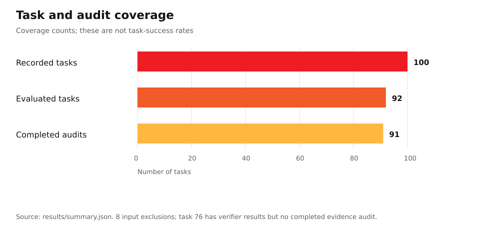
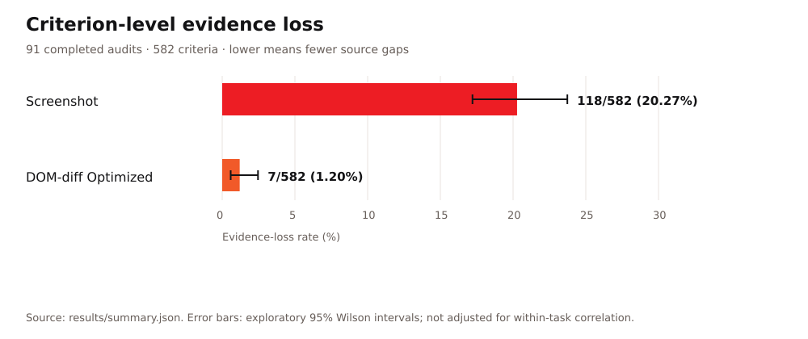

# w8-domdiff-bench: Browser Evidence and Evaluation Report

WootzApp · October 30, 2026

`w8-domdiff-bench` records browser-agent trajectories in Wootzapp Browser,
powered by `w8-core`, and compares screenshots with DOM-diff Optimized text.
Both representations share the task, executed actions, final answer, frozen
rubric and scoring controls. The [README](../README.md) introduces the system;
the [runbook](runbook.md) contains the commands.

Of 100 recorded tasks, 92 had usable, aligned evidence for evaluation; 8 were excluded because captures were missing/incomplete or failed URL alignment. Evidence-loss results cover 91 tasks because task 76’s audit failed validation.

Completed automated audits cover **582 criteria**, with **118 screenshot losses
(20.27%)** and **7 DOM losses (1.20%)**. These are paired
source-evidence measurements, not task-success or model-accuracy results.

## Foundations and baselines

WebVoyager introduced multimodal automatic evaluation for open-ended web tasks [[1]](#references). Our screenshot baseline follows the Universal Verifier's rubric-centered design: criterion-specific evidence selection, separate process and outcome judgments, and failure attribution [[2]](#references). WootzApp's contribution is the DOM-based adaptation, browser-native evidence capture, paired comparison protocol, and source-aware audit. The acting agent uses `gpt-5.6` to generate actions from compact text observations; screenshots are retained for inspection and screenshot-based verification.

WebArena provides screenshot, HTML DOM, and accessibility-tree observations and evaluates functional task completion in controlled websites [[4]](#references). These systems establish context for structured and visual browser evidence. This benchmark evaluates what paired recorded representations preserve under a shared rubric; it does not reproduce those benchmarks' task-success experiments. The [architecture guide](architecture.md) explains the browser stack and representation history.

## Browser capture and evaluation pipeline

The repository's [task recorder](../w8bench/task_recorder/) supplies `gpt-5.6` with DOM-based observations and executable `agent-browser` references. The harness validates each proposed action, executes it in `w8-core`, and records the resulting screenshot and structured browser state. DOM-diff Optimized organizes each captured state into readable content, tables, controls, relationships, and scroll context.

The [paired evaluation pipeline](../w8bench/verifier/) validates the prepared screenshot/DOM bundles, freezes a shared rubric, runs both verifiers, and audits criterion-level evidence availability. Evidence audit and adjudication use `gpt-5.6-sol`; no human-review status is inferred from those model outputs. Task data are available in the [dataset repository](https://huggingface.co/datasets/WootzappLab/browser-agent-tasks). Selected source artifacts and their checksums are listed in the results summary.


## Benchmark protocol and mathematical definitions

There are 92 evaluated task pairs, containing 589 rubric criteria.
The evidence-loss denominator contains only the 582 criteria from the 91
completed audits. An execution with $`N`$ actions supplies $`N+1`$ captured
states, including the initial state. State alignment is checked before scoring.

### Rubric scores and task-success rules

For task $`t`$, let $`s_{t,j}`$ be the final awarded points for rubric criterion $`j`$, after the verifier's scoring and rescoring stages, and let $`p_{t,j}`$ be its maximum points. The earned total, maximum total, and normalized rubric score are

```math
S_t=\sum_j s_{t,j},
\qquad
S_t^{\max}=\sum_j p_{t,j},
\qquad
r_t=\frac{S_t}{S_t^{\max}}\quad(S_t^{\max}>0).
```

The implementation sets the normalized score to zero when the maximum total is zero. For a valid rubric with a positive maximum total, a **strict full-score success** means earning every available point:

```math
\mathrm{Success}_{\mathrm{full}}(t)
=\mathbf{1}\{S_t=S_t^{\max}\}.
```

This defines the full-credit convention ($`x/x`$). The CLI also exposes distinct process and outcome rules. Let $`P_t`$ be the process pass flag at rubric threshold $`\tau`$, and let $`O_t`$ indicate that the outcome judge returned the Boolean `true`:

```math
P_t=\mathbf{1}\{r_t\ge\tau\},
\qquad
O_t=\mathbf{1}\{\texttt{output\_success}_t=\mathrm{true}\}.
```

The binary rules available through `--success` are

```math
\mathrm{Success}_{\mathrm{outcome}}(t)=O_t,
\qquad
\mathrm{Success}_{\mathrm{process}}(t)=P_t,
\qquad
\mathrm{Success}_{\mathrm{both}}(t)=P_t O_t.
```

The paired command currently fixes **`--success outcome`** and the threshold $`\tau=0.8`$, so its binary `score` follows the outcome judgment; `rubric_is_success` separately records whether at least 80% of rubric points were earned. A strict full-score summary uses the first rule above. The standalone verifier runners support all three CLI rules. These definitions apply separately to each representation of a task.

The [shared controls](../w8bench/verifier/common.py) also fix five evidence items per criterion, a screenshot keypoint threshold of 3, a minimum relevance threshold of 0, and one voting instance. The [screenshot runner](../w8bench/screenshot_verifier/runner.py) and [DOM runner](../w8bench/dom_model/runner.py) implement the binary rules. The [evaluation protocol](evaluation-protocol.md#success-rules) summarizes them, while saved run manifests establish the controls used by a particular evaluation. None of these success rules defines source-evidence loss.

### Paired source-evidence loss

Let $`\mathcal{C}`$ be the audited rubric criteria, $`M=|\mathcal{C}|`$, and $`\mathcal{I}_c`$ the concrete required values or states reviewed for criterion $`c`$. For required item $`i\in\mathcal{I}_c`$, let $`a_{c,i,S},a_{c,i,D}\in\{0,1\}`$ indicate its availability in screenshots ($`S`$) and DOM-diff Optimized ($`D`$), respectively, across the eligible ordered source states. Both representations use the same evidence requirements and review scope.

```math
\ell_{c,S}=\mathbf{1}\!\left\{\exists i\in\mathcal{I}_c:
a_{c,i,S}=0\ \land\ a_{c,i,D}=1\right\},
\qquad
\ell_{c,D}=\mathbf{1}\!\left\{\exists i\in\mathcal{I}_c:
a_{c,i,D}=0\ \land\ a_{c,i,S}=1\right\}.
```

Each indicator is binary: a criterion contributes at most one loss per representation, even if several required items are missing. Partial preservation still counts as loss when one specific required item is absent from that representation and present in the other. Items available in both or absent from both do not trigger paired loss. Evidence that a verifier overlooks or misinterprets is an interpretation error, separate from source availability.

For representation $`m`$, the loss count and percentage rate are

```math
L_m=\sum_{c\in\mathcal{C}}\ell_{c,m},
\qquad
\mathrm{ELR}_m=\frac{100L_m}{M},
\qquad m\in\{S,D\}.
```

All audited criteria remain in the denominator, including those without a gap. A criterion can lose different items in both representations, contributing to both marginal counts. Multiple criteria can depend on one capture omission. This metric measures differences between paired recorded sources; information omitted from both sources remains undetected.


### Current counts and relative reduction

```math
M=582,\qquad L_S=118,\qquad L_D=7,
```

```math
\mathrm{ELR}_S=100\frac{118}{582}\approx20.27\%,
\qquad
\mathrm{ELR}_D=100\frac{7}{582}\approx1.20\%.
```

DOM has $`100(118-7)/118=94.07\%`$ fewer criterion-level
losses in this cohort. This relative count difference does not establish
acting-agent improvement or absolute evidence completeness.

## Current representation size

| Representation | Artifact | Captured observations | Mean size |
| --- | --- | ---: | ---: |
| DOM-diff Optimized | `dom_model.txt` | 853 | **5.16 KiB** |
| Text-dense DOM | `dom_full.txt` | 853 | **47.56 KiB** |
| Full structured DOM | `dom.json` | 853 | **207.97 KiB** |

The means use all available state files in `recordings/`, with identical
853-file cohorts for these three representations. A KiB is 1,024 bytes.
These are serialized sizes, not tokenizer counts. Excluded tasks remain part
of recording-level size measurements when they contain complete state files.

## Evaluation coverage

| Coverage | Count |
| --- | ---: |
| Recorded tasks | 100 |
| Evaluated tasks | 92 |
| Completed evidence audits | 91 |
| Criteria scored by both verifiers | 589 |
| Criteria included in evidence-loss rates | 582 |

Recording outcomes are 81 successes, 7 agent failures and 12 execution errors.
Of the 92 evaluated tasks, 80 are recorded successes, 7 are agent failures and
5 have execution errors. A failure outcome is therefore not an input exclusion.

| Task | Reason |
| --- | --- |
| `task_05` | Initial URL differs between the task and captured state |
| `task_18` | No complete captured state sequence |
| `task_20` | No complete captured state sequence |
| `task_46` | No complete captured state sequence |
| `task_49` | No complete captured state sequence |
| `task_59` | No complete captured state sequence |
| `task_77` | No complete captured state sequence |
| `task_94` | No complete captured state sequence |

Task 76 has both verifier results, but its audit response failed validation.
Its 7 rubric criteria remain in scoring results and are excluded
from evidence-loss statistics. The eight input exclusions and this audit gap
are disclosed, not counted as zero-loss tasks.



## Evidence preservation

| Measure | Screenshot | DOM-diff Optimized |
| --- | ---: | ---: |
| Evidence losses | **118/582 (20.27%)** | **7/582 (1.20%)** |
| Verifier interpretation misses | 84/582 (14.43%) | 76/582 (13.06%) |

Screenshot loss has an exploratory 95% Wilson interval of
**17.21%–23.73%**; DOM loss has **0.58%–2.46%**.
These intervals assume independent criteria and do not adjust for within-task
correlation or automated-annotation error.



## URL sensitivity and paired comparison

Exact URL evidence counts only when required to establish page, record or
endpoint identity. The audit does not treat branding or an action-history URL
as a substitute for URL evidence within the representation. Browser screenshots
do not include the address bar, so this rule can affect the comparison.

The saved audits have no separately assigned primary loss categories. No
URL-excluded totals are asserted without those annotations.

| Screenshot loss only | DOM loss only | Loss in both | Neither |
| ---: | ---: | ---: | ---: |
| 114 | 3 | 4 | 461 |

The marginal counts overlap on **4 criteria**. Thus 118+7-4 gives
**121 distinct affected criteria across 74 tasks**. The
461 criteria with no confirmed source gap remain in the denominator.
Shared absence from both representations is outside this paired metric.

## Source-evidence loss by category

The [category guide](evidence-categories.md) defines possible evidence types.
The stored audit classification identifies which representation loses evidence;
it does not assign one of those primary categories. Category counts are not
inferred from criterion titles, task names or URL keywords.

## Website access blockers and unavailable content

Website blockers, execution errors and representation loss are different events.
A blocked page can still supply valid captured evidence and be evaluated.
The report does not assume that a failed task was blocked, or that a successful
task preserved every required fact.

### Analysis excluding the listed access-blocked tasks

No separately reviewed access-blocker subset is asserted for this cohort.
Only the capture/alignment exclusions and audit gap listed above affect
the reported coverage.

## Recorded execution failures

Twelve recordings ended with execution errors. Five retain usable aligned
evidence and are evaluated: **task 26, 27, 57, 87 and 92**. The other seven
are excluded for incomplete captures. Task 5 is separately excluded for initial
URL alignment, not because the agent reported failure.

Execution errors, agent failures and evidence loss are not interchangeable
and cannot be added into a single failure rate.

## Models and evaluation provenance

| Role | Model |
| --- | --- |
| Browser-action generation | `gpt-5.6` |
| Rubric generation and evidence judging, both verifiers | `gpt-5.2` |
| Action and validity judging, both verifiers | `gpt-5.6-terra` |
| Evidence audit and adjudication | `gpt-5.6-sol` |

Model identities, commands, rubric checksums and token usage are saved per task.
The evidence findings are automated judgments; human verification is not
established by these saved evaluation artifacts.

The [summary](../results/summary.json) lists each selected task and source path
under `evaluation/`. The run ID is `20261029T212045Z`. The
[Hugging Face audits](https://huggingface.co/datasets/WootzappLab/browser-agent-tasks/tree/a10226a46d3a9c3ee5f0f40b244163d2a6b50e75/evaluation) preserve the original
adjudications, citations, task IDs and frozen-rubric checksums. Check those
identities before combining artifacts from any downloaded collection.

## Source-evidence gaps by task and criterion

The table lists the **121 affected criteria**. Criterion indices are
zero-based. Text is shortened for display only; complete decisive evidence
and citations remain in the [Hugging Face audits](https://huggingface.co/datasets/WootzappLab/browser-agent-tasks/tree/a10226a46d3a9c3ee5f0f40b244163d2a6b50e75/evaluation).
Each task link below opens its source audit. Evidence is not inferred from
final answers.

| Task | Criterion | Screenshot loss | DOM loss | Saved finding and evidence |
| --- | --- | :---: | :---: | --- |
| [task_02](https://huggingface.co/datasets/WootzappLab/browser-agent-tasks/blob/a10226a46d3a9c3ee5f0f40b244163d2a6b50e75/evaluation/task_02/20261029T212045Z/evidence_audit.json) | **C0**: Navigate to Xbox.com and access the 'Best sellers' section | Yes | No | Screenshot: The DOM explicitly preserves the Xbox.com games URL and a visible “Best sellers” heading associated with game listings, including Minecraft. No screenshot preserves that section or an exact Xbox.com URL.<br>`dom_model4.txt` (L0001); `dom_model4.txt` (L0106); `dom_model4.txt` (L0111-L0112) |
| [task_02](https://huggingface.co/datasets/WootzappLab/browser-agent-tasks/blob/a10226a46d3a9c3ee5f0f40b244163d2a6b50e75/evaluation/task_02/20261029T212045Z/evidence_audit.json) | **C1**: Select a game listed under 'Best sellers' and open its Xbox.com product page | Yes | No | Screenshot: The DOM preserves Minecraft as an item under Best sellers and then preserves the exact matching Xbox.com product URL and title. Screenshots preserve only the destination product page, not the listing association or exact URL.<br>`dom_model4.txt` (L0106); `dom_model4.txt` (L0111-L0112); `dom_model5.txt` (L0001); `dom_model5.txt` (L0002) |
| [task_02](https://huggingface.co/datasets/WootzappLab/browser-agent-tasks/blob/a10226a46d3a9c3ee5f0f40b244163d2a6b50e75/evaluation/task_02/20261029T212045Z/evidence_audit.json) | **C2**: Report publisher, developer, and release date from the product page | Yes | Yes | Screenshot: The DOM preserves the exact Xbox.com product URL for the selected Minecraft page, while the screenshots do not display any browser URL.<br>`dom_model5.txt` (L0001); `dom_model5.txt` (L0002)<br>DOM: The screenshot explicitly associates all three metadata labels with their values, including “Published by” with “Microsoft Studios.” The DOM preserves developer and release date but omits the publisher value from the Published by field.<br>`screenshot9.png` (Bottom metadata row) |
| [task_03](https://huggingface.co/datasets/WootzappLab/browser-agent-tasks/blob/a10226a46d3a9c3ee5f0f40b244163d2a6b50e75/evaluation/task_03/20261029T212045Z/evidence_audit.json) | **C0**: Access Microsoft Careers and perform a search for 'Applied Scientist' in/near Redmond, Washington | Yes | No | Screenshot: The DOM explicitly records the Microsoft Careers page URL as https://careers.microsoft.com/v2/global/en/home.html, while the screenshots show branding and page content but no exact URL. Because this criterion expressly requires proving access to Microsoft Careers, the missing …<br>`dom_model0.txt` (L0001) |
| [task_04](https://huggingface.co/datasets/WootzappLab/browser-agent-tasks/blob/a10226a46d3a9c3ee5f0f40b244163d2a6b50e75/evaluation/task_04/20261029T212045Z/evidence_audit.json) | **C0**: Access dmns.org and attempt to reach Sturm Infinity Theater film listings | Yes | No | Screenshot: The DOM explicitly preserves both the dmns.org homepage URL and the resulting DMNS Films & Shows URL, while neither screenshot displays a URL. Exact URL evidence is decision-essential for proving website/page identity and cannot be replaced by visible branding.<br>`dom_model0.txt` (L0001); `dom_model1.txt` (L0001); `dom_model1.txt` (L0002) |
| [task_06](https://huggingface.co/datasets/WootzappLab/browser-agent-tasks/blob/a10226a46d3a9c3ee5f0f40b244163d2a6b50e75/evaluation/task_06/20261029T212045Z/evidence_audit.json) | **C0**: Access Search Engine Land without signing in and attempt to use it as the primary source | Yes | No | Screenshot: The DOM preserves the exact SEL homepage and candidate-article URLs, while the screenshots show only the searchengineland.com label and Cloudflare branding without either exact URL. Because this criterion requires proving direct access to the specified website, the missing exa…<br>`dom_model0.txt` (L0001); `dom_model6.txt` (L0001) |
| [task_07](https://huggingface.co/datasets/WootzappLab/browser-agent-tasks/blob/a10226a46d3a9c3ee5f0f40b244163d2a6b50e75/evaluation/task_07/20261029T212045Z/evidence_audit.json) | **C0**: Access Amazon India Grocery & Gourmet Foods bestsellers list (no sign-in) | Yes | No | Screenshot: The DOM preserves the exact Amazon India Grocery bestsellers URL, while the screenshot shows branding and category content but no URL. Exact URL evidence is required to prove the requested page identity.<br>`dom_model0.txt` (L0001) |
| [task_07](https://huggingface.co/datasets/WootzappLab/browser-agent-tasks/blob/a10226a46d3a9c3ee5f0f40b244163d2a6b50e75/evaluation/task_07/20261029T212045Z/evidence_audit.json) | **C1**: Verify the #2 Amazon India Grocery & Gourmet Foods bestseller item | Yes | No | Screenshot: The DOM preserves the exact Grocery bestsellers URL together with the explicit #2 Tata Salt entry. The screenshot preserves the rank-product association but not the URL proving that it is the requested Amazon India page.<br>`dom_model0.txt` (L0001); `dom_model0.txt` (L0091) |
| [task_07](https://huggingface.co/datasets/WootzappLab/browser-agent-tasks/blob/a10226a46d3a9c3ee5f0f40b244163d2a6b50e75/evaluation/task_07/20261029T212045Z/evidence_audit.json) | **C2**: Access AllRecipes and locate a recipe page (no sign-in) | Yes | No | Screenshot: The DOM identifies the blocked page as the AllRecipes salt-search URL and names www.allrecipes.com in the verification message. The screenshot shows only a generic Cloudflare widget without an AllRecipes identity or URL.<br>`dom_model1.txt` (L0001); `dom_model1.txt` (L0007) |
| [task_07](https://huggingface.co/datasets/WootzappLab/browser-agent-tasks/blob/a10226a46d3a9c3ee5f0f40b244163d2a6b50e75/evaluation/task_07/20261029T212045Z/evidence_audit.json) | **C3**: Find an AllRecipes recipe that uses the identified #2 bestseller ingredient | Yes | No | Screenshot: The DOM connects the #2 Tata Salt product to an AllRecipes salt-search state containing only a verification interstitial. The screenshots show Tata Salt and a later generic Cloudflare widget but cannot identify the blocked page as AllRecipes.<br>`dom_model0.txt` (L0091); `dom_model1.txt` (L0001); `dom_model1.txt` (L0007) |
| [task_07](https://huggingface.co/datasets/WootzappLab/browser-agent-tasks/blob/a10226a46d3a9c3ee5f0f40b244163d2a6b50e75/evaluation/task_07/20261029T212045Z/evidence_audit.json) | **C4**: Report the AllRecipes recipe title and full ingredient list | Yes | No | Screenshot: The DOM identifies the exact AllRecipes URL, the blocking title, a complete non-truncated minimal snapshot, and the JavaScript/cookies limitation. The screenshot shows only a generic Cloudflare widget without the site identity or detailed limitation.<br>`dom_model1.txt` (L0001); `dom_model1.txt` (L0002); `dom_model1.txt` (L0004); `dom_model1.txt` (L0007) |
| [task_08](https://huggingface.co/datasets/WootzappLab/browser-agent-tasks/blob/a10226a46d3a9c3ee5f0f40b244163d2a6b50e75/evaluation/task_08/20261029T212045Z/evidence_audit.json) | **C0**: Access Playwright GitHub repository and Releases page | Yes | No | Screenshot: The DOM explicitly records the exact Microsoft Playwright Releases URL, while the screenshots show GitHub branding and repository breadcrumbs but no browser URL. Because this criterion requires proving access to the specified website and page, branding is not a substitute for …<br>`dom_model1.txt` (L0001) |
| [task_08](https://huggingface.co/datasets/WootzappLab/browser-agent-tasks/blob/a10226a46d3a9c3ee5f0f40b244163d2a6b50e75/evaluation/task_08/20261029T212045Z/evidence_audit.json) | **C2**: Record release metadata (tag and publication date) | Yes | No | Screenshot: The DOM associates v1.64.1 with the absolute publication date Oct 14, 2026 and separately preserves the displayed time 14 Oct 11:51. Every screenshot shows only the relative phrase released this 2 weeks ago, so screenshots cannot establish the same publication-date conclusion.<br>`dom_model1.txt` (L0159); `dom_model2.txt` (L0039) |
| [task_08](https://huggingface.co/datasets/WootzappLab/browser-agent-tasks/blob/a10226a46d3a9c3ee5f0f40b244163d2a6b50e75/evaluation/task_08/20261029T212045Z/evidence_audit.json) | **C4**: Verify one reported change using official Playwright documentation | Yes | No | Screenshot: The DOM records the exact playwright.dev URL for the ElectronApplication.firstWindow documentation, while the screenshot shows Playwright branding and API content without an address bar. Because the criterion specifically requires official playwright.dev documentation, the mis…<br>`dom_model3.txt` (L0001) |
| [task_11](https://huggingface.co/datasets/WootzappLab/browser-agent-tasks/blob/a10226a46d3a9c3ee5f0f40b244163d2a6b50e75/evaluation/task_11/20261029T212045Z/evidence_audit.json) | **C0**: Use arXiv Advanced Search with required filters (cs.LG, last 30 days, exact title phrase, newest-first sort) | Yes | No | Screenshot: DOM explicitly records the browser-current date as “Thursday, October 29, 2026,” while the Time.is screenshot has that date obscured by the privacy dialog. Without the DOM, the screenshots cannot independently establish that the entered September 30–October 29 range was derive…<br>`dom_model1.txt` (L0072) |
| [task_12](https://huggingface.co/datasets/WootzappLab/browser-agent-tasks/blob/a10226a46d3a9c3ee5f0f40b244163d2a6b50e75/evaluation/task_12/20261029T212045Z/evidence_audit.json) | **C0**: Access the correct arXiv abstract page (1706.03762) | Yes | No | Screenshot: The DOM explicitly records the exact loaded URL as https://arxiv.org/abs/1706.03762, while neither screenshot includes browser URL evidence. Because this criterion requires proving the website/page identity, the visible arXiv branding, title, and citation identifier do not sub…<br>`dom_model0.txt` (L0001-L0002) |
| [task_13](https://huggingface.co/datasets/WootzappLab/browser-agent-tasks/blob/a10226a46d3a9c3ee5f0f40b244163d2a6b50e75/evaluation/task_13/20261029T212045Z/evidence_audit.json) | **C0**: Open Magnus Carlsen’s Chess.com player profile | Yes | No | Screenshot: The DOM records the exact Chess.com member-profile URL, while neither screenshot includes the browser address bar or otherwise displays that URL. Because this criterion requires proving website/page identity, the missing exact URL is screenshot evidence loss.<br>`dom_model1.txt` (L0001) |
| [task_14](https://huggingface.co/datasets/WootzappLab/browser-agent-tasks/blob/a10226a46d3a9c3ee5f0f40b244163d2a6b50e75/evaluation/task_14/20261029T212045Z/evidence_audit.json) | **C3**: Report exact post details (title, author, score, comment count) from the opened post | Yes | No | Screenshot: The DOM preserves an exact Google result snippet tying the Reddit post ID and URL to `412 Upvotes`, whereas the screenshots show only an approximate `412 to 413 upvotes` statement or a result before the exact snippet text became visible. Exact score evidence is decision-essent…<br>`dom_model19.txt` (L0024-L0028) |
| [task_16](https://huggingface.co/datasets/WootzappLab/browser-agent-tasks/blob/a10226a46d3a9c3ee5f0f40b244163d2a6b50e75/evaluation/task_16/20261029T212045Z/evidence_audit.json) | **C0**: Access the correct Hugging Face repository page (meta-llama/Llama-3.1-8B-Instruct) or clearly report an access blocker | Yes | No | Screenshot: The DOM preserves the exact repository URL, while neither screenshot includes the browser address bar or otherwise displays that exact URL. Because this criterion requires proving page identity, the visible repository header and Hugging Face branding do not substitute for URL …<br>`dom_model0.txt` (L0001) |
| [task_17](https://huggingface.co/datasets/WootzappLab/browser-agent-tasks/blob/a10226a46d3a9c3ee5f0f40b244163d2a6b50e75/evaluation/task_17/20261029T212045Z/evidence_audit.json) | **C0**: Access the Hugging Face SQuAD dataset page (rajpurkar/squad) | Yes | No | Screenshot: The DOM explicitly records the exact required page URL, while neither screenshot displays the browser URL. Because this criterion requires proving page identity, the visible Hugging Face branding and rajpurkar/squad header do not substitute for exact URL evidence.<br>`dom_model0.txt` (L0001-L0002) |
| [task_17](https://huggingface.co/datasets/WootzappLab/browser-agent-tasks/blob/a10226a46d3a9c3ee5f0f40b244163d2a6b50e75/evaluation/task_17/20261029T212045Z/evidence_audit.json) | **C3**: Record validation split name and row count exactly as shown in the Dataset Viewer (or document blocker) | No | Yes | DOM: The opened Dataset Viewer menu visibly associates the validation split with 10.6k rows. That decision-essential label-to-count relationship is not preserved by the DOM states or established by the shared action history.<br>`screenshot1.png` (opened Dataset Viewer split menu) |
| [task_19](https://huggingface.co/datasets/WootzappLab/browser-agent-tasks/blob/a10226a46d3a9c3ee5f0f40b244163d2a6b50e75/evaluation/task_19/20261029T212045Z/evidence_audit.json) | **C2**: Record the first three highlight bullets in displayed order | Yes | No | Screenshot: The DOM preserves three ordered highlight rows and supplies the complete third item, while every screenshot stops at the Highlights heading or shows only API metadata. Shared evidence plus screenshots therefore cannot verify the claimed wording and order.<br>`dom_model3.txt` (L0007-L0010); `dom_model3.txt` (L0086) |
| [task_22](https://huggingface.co/datasets/WootzappLab/browser-agent-tasks/blob/a10226a46d3a9c3ee5f0f40b244163d2a6b50e75/evaluation/task_22/20261029T212045Z/evidence_audit.json) | **C0**: Use Stack Overflow tag search for questions tagged both python and pandas | Yes | No | Screenshot: The DOM preserves the exact Stack Overflow combined-tag URL, while no screenshot displays the browser URL. Because this criterion requires establishing use of the specified website/page, branding alone does not replace URL evidence.<br>`dom_model0.txt` (L0001) |
| [task_24](https://huggingface.co/datasets/WootzappLab/browser-agent-tasks/blob/a10226a46d3a9c3ee5f0f40b244163d2a6b50e75/evaluation/task_24/20261029T212045Z/evidence_audit.json) | **C0**: Access Hacker News front page and identify the first 30 stories | Yes | No | Screenshot: The DOM explicitly records the exact page URL, https://news.ycombinator.com/, while none of the screenshots displays the URL. Because this criterion requires proving access to that specific front page, branding and page content are not substitutes for URL evidence.<br>`dom_model2.txt` (L0001-L0002) |
| [task_25](https://huggingface.co/datasets/WootzappLab/browser-agent-tasks/blob/a10226a46d3a9c3ee5f0f40b244163d2a6b50e75/evaluation/task_25/20261029T212045Z/evidence_audit.json) | **C0**: Use Algolia Hacker News search (no sign-in) and perform the query for 'LLM' | Yes | No | Screenshot: The DOM preserves the exact Algolia Hacker News URL, including the executed LLM query and final filters, while no screenshot displays the browser URL. Because this criterion requires proving website identity, Algolia branding in the screenshots is not a substitute for exact UR…<br>`dom_model6.txt` (L0001) |
| [task_26](https://huggingface.co/datasets/WootzappLab/browser-agent-tasks/blob/a10226a46d3a9c3ee5f0f40b244163d2a6b50e75/evaluation/task_26/20261029T212045Z/evidence_audit.json) | **C0**: Access Amazon search results for 'wireless mouse' (no sign-in) | Yes | No | Screenshot: The criterion requires proving that the accessed page is an Amazon search-results page. The DOM preserves the exact Amazon results URL, while no screenshot displays the browser URL; shared action-history URLs cannot replace modality-specific URL evidence for representation-los…<br>`dom_model3.txt` (L0001) |
| [task_27](https://huggingface.co/datasets/WootzappLab/browser-agent-tasks/blob/a10226a46d3a9c3ee5f0f40b244163d2a6b50e75/evaluation/task_27/20261029T212045Z/evidence_audit.json) | **C0**: Use eBay without signing in and without transactional actions | Yes | No | Screenshot: The DOM explicitly records the exact eBay URL, while no screenshot exposes an address bar or URL. Because this criterion requires establishing use of the specified platform, branding alone does not substitute for URL evidence.<br>`dom_model4.txt` (L0001-L0002) |
| [task_28](https://huggingface.co/datasets/WootzappLab/browser-agent-tasks/blob/a10226a46d3a9c3ee5f0f40b244163d2a6b50e75/evaluation/task_28/20261029T212045Z/evidence_audit.json) | **C0**: Access BBC News Technology section (no sign-in) | Yes | No | Screenshot: The DOM explicitly identifies the accessed page as https://www.bbc.com/technology, while no screenshot includes an address bar or exact URL. For page-identity evidence, BBC branding and a Technology heading do not substitute for the URL.<br>`dom_model5.txt` (L0001) |
| [task_28](https://huggingface.co/datasets/WootzappLab/browser-agent-tasks/blob/a10226a46d3a9c3ee5f0f40b244163d2a6b50e75/evaluation/task_28/20261029T212045Z/evidence_audit.json) | **C4**: Record newest technology headline #4 with displayed timestamp | Yes | No | Screenshot: The DOM pairs the fourth headline with “10 hrs ago” and, through the repeated preceding story across ordered scroll states, establishes its position after the third entry. The screenshots show the fourth headline but crop out its associated timestamp.<br>`dom_model5.txt` (L0055-L0056); `dom_model4.txt` (L0043-L0044) |
| [task_29](https://huggingface.co/datasets/WootzappLab/browser-agent-tasks/blob/a10226a46d3a9c3ee5f0f40b244163d2a6b50e75/evaluation/task_29/20261029T212045Z/evidence_audit.json) | **C0**: Access Coursera course search without signing in | Yes | No | Screenshot: The DOM preserves the exact Coursera Data Science browse URL, while no screenshot exposes the browser URL. Because this criterion requires proving the website/page accessed, Coursera branding is not a substitute for exact URL evidence.<br>`dom_model15.txt` (L0001) |
| [task_30](https://huggingface.co/datasets/WootzappLab/browser-agent-tasks/blob/a10226a46d3a9c3ee5f0f40b244163d2a6b50e75/evaluation/task_30/20261029T212045Z/evidence_audit.json) | **C0**: Access the specified Coursera course page without signing in/enrolling | Yes | No | Screenshot: The first DOM state records the exact loaded URL as https://www.coursera.org/learn/python-for-applied-data-science-ai and identifies the page as “Python for Data Science, AI & Development &#124; Coursera”; no screenshot displays a URL. Because this criterion requires establishing t…<br>`dom_model0.txt` (L0001-L0002) |
| [task_30](https://huggingface.co/datasets/WootzappLab/browser-agent-tasks/blob/a10226a46d3a9c3ee5f0f40b244163d2a6b50e75/evaluation/task_30/20261029T212045Z/evidence_audit.json) | **C3**: Record number of modules/weeks shown in the syllabus | Yes | No | Screenshot: The DOM contains a material internal conflict: the overview says “5 modules,” while the FAQ explicitly says the course consists of four modules and proceeds to enumerate Module 1 through Module 4. Screenshots show the five-module summary but never expose the conflicting FAQ an…<br>`dom_model4.txt` (L0012); `dom_model4.txt` (L0023); `dom_model4.txt` (L0023) |
| [task_31](https://huggingface.co/datasets/WootzappLab/browser-agent-tasks/blob/a10226a46d3a9c3ee5f0f40b244163d2a6b50e75/evaluation/task_31/20261029T212045Z/evidence_audit.json) | **C0**: Record the 1921 Physics Nobel table entry (name, country/countries, motivation) | Yes | Yes | Screenshot: The DOM supplies the exact Wikipedia page URL, while no screenshot displays an address bar or exact URL. Because the criterion specifically requires extraction from Wikipedia’s “List of Nobel laureates in Physics” page, branding and the visible title do not substitute for URL …<br>`dom_model2.txt` (L0001-L0002)<br>DOM: The screenshot visibly renders the motivation ending as “effect.” with no space before the period, whereas the DOM serialization renders “effect .”. That difference is decision-essential under the verbatim-extraction criterion because it changes whether the final answer merits…<br>`screenshot2.png` (1921 row, Citation column) |
| [task_31](https://huggingface.co/datasets/WootzappLab/browser-agent-tasks/blob/a10226a46d3a9c3ee5f0f40b244163d2a6b50e75/evaluation/task_31/20261029T212045Z/evidence_audit.json) | **C1**: Record the 1922 Physics Nobel table entry (name, country/countries, motivation) | Yes | No | Screenshot: The DOM explicitly records the exact Wikipedia page URL, which is absent from all screenshots. The criterion requires the entry to come from Wikipedia’s specified list page.<br>`dom_model2.txt` (L0001-L0002) |
| [task_31](https://huggingface.co/datasets/WootzappLab/browser-agent-tasks/blob/a10226a46d3a9c3ee5f0f40b244163d2a6b50e75/evaluation/task_31/20261029T212045Z/evidence_audit.json) | **C2**: Record the 1923 Physics Nobel table entry (name, country/countries, motivation) | Yes | Yes | Screenshot: The DOM contains the exact URL of Wikipedia’s “List of Nobel laureates in Physics” page, while the screenshots contain no URL display. The criterion expressly requires the entry from that page.<br>`dom_model2.txt` (L0001-L0002)<br>DOM: The screenshot visibly shows the 1923 motivation ending as “effect.” with adjacent punctuation, while the DOM serialization inserts a space as “effect .”. Under the verbatim requirement, that discrepancy changes whether the final answer can be confirmed for full credit.<br>`screenshot2.png` (1923 row, Citation column) |
| [task_32](https://huggingface.co/datasets/WootzappLab/browser-agent-tasks/blob/a10226a46d3a9c3ee5f0f40b244163d2a6b50e75/evaluation/task_32/20261029T212045Z/evidence_audit.json) | **C0**: Record formal definition fields from MDN (container-type) | Yes | No | Screenshot: The DOM explicitly preserves both decision-essential formal-definition label/value pairs, while neither screenshot displays the Formal definition table or those fields.<br>`dom_model1.txt` (L0006-L0009) |
| [task_32](https://huggingface.co/datasets/WootzappLab/browser-agent-tasks/blob/a10226a46d3a9c3ee5f0f40b244163d2a6b50e75/evaluation/task_32/20261029T212045Z/evidence_audit.json) | **C3**: Respect stated constraints and stopping condition | Yes | No | Screenshot: The DOM records the exact MDN container-type page URL, whereas the screenshots show branding, headings, and breadcrumbs but no exact URL. Exact URL evidence is decision-essential when proving page identity and branding is not a substitute.<br>`dom_model0.txt` (L0001-L0002); `dom_model1.txt` (L0001-L0002) |
| [task_33](https://huggingface.co/datasets/WootzappLab/browser-agent-tasks/blob/a10226a46d3a9c3ee5f0f40b244163d2a6b50e75/evaluation/task_33/20261029T212045Z/evidence_audit.json) | **C0**: Inspect latest Requests release on PyPI project page | Yes | No | Screenshot: The DOM preserves the exact Requests project URL, while no screenshot displays the URL. Exact URL evidence is decision-essential for proving page identity under the stated audit rule.<br>`dom_model0.txt` (L0001) |
| [task_33](https://huggingface.co/datasets/WootzappLab/browser-agent-tasks/blob/a10226a46d3a9c3ee5f0f40b244163d2a6b50e75/evaluation/task_33/20261029T212045Z/evidence_audit.json) | **C3**: Report Requires Python value for latest release | Yes | No | Screenshot: The DOM explicitly associates the metadata label “Requires” with the exact value “Python >=3.10.” The screenshots show only the descriptive statement “Python 3.10+” and a Requires heading whose value is below the image boundary.<br>`dom_model3.txt` (L0069); `dom_model3.txt` (L0070) |
| [task_33](https://huggingface.co/datasets/WootzappLab/browser-agent-tasks/blob/a10226a46d3a9c3ee5f0f40b244163d2a6b50e75/evaluation/task_33/20261029T212045Z/evidence_audit.json) | **C5**: Count number of files under 'Download files' for latest release | Yes | No | Screenshot: The DOM contains the complete release-files listing for requests 2.34.2: one source archive and one wheel. The screenshots show only the source row and wheel section heading, not the wheel row, so they cannot independently count the complete on-page list.<br>`dom_model1.txt` (L0009); `dom_model1.txt` (L0012); `dom_model1.txt` (L0034) |
| [task_33](https://huggingface.co/datasets/WootzappLab/browser-agent-tasks/blob/a10226a46d3a9c3ee5f0f40b244163d2a6b50e75/evaluation/task_33/20261029T212045Z/evidence_audit.json) | **C6**: Respect constraints (no sign-in, no download/install, no inference) | Yes | No | Screenshot: The DOM directly verifies the exact Requires metadata and both release-file rows, allowing all reported values to be established without inference and confirming that the count matches the on-page list. The screenshots omit the exact Requires value and second file row.<br>`dom_model3.txt` (L0067); `dom_model3.txt` (L0068); `dom_model3.txt` (L0069); `dom_model3.txt` (L0070); `dom_model1.txt` (L0009); `dom_model1.txt` (L0012) |
| [task_34](https://huggingface.co/datasets/WootzappLab/browser-agent-tasks/blob/a10226a46d3a9c3ee5f0f40b244163d2a6b50e75/evaluation/task_34/20261029T212045Z/evidence_audit.json) | **C0**: Access Rails gem page on RubyGems (no sign-in, no install/download) | Yes | No | Screenshot: The DOM records the exact RubyGems Rails listing URL, while neither screenshot displays a URL. Because this criterion requires proving the website/page identity, RubyGems branding and page content cannot substitute for the missing exact URL.<br>`dom_model0.txt` (L0001-L0002) |
| [task_34](https://huggingface.co/datasets/WootzappLab/browser-agent-tasks/blob/a10226a46d3a9c3ee5f0f40b244163d2a6b50e75/evaluation/task_34/20261029T212045Z/evidence_audit.json) | **C2**: Record latest version metadata (version, release date, required Ruby, license) | Yes | No | Screenshot: The DOM explicitly contains “License: MIT,” a required metadata field that is outside the visible area of both screenshots. The screenshots establish the other three fields but cannot verify the license claim.<br>`dom_model0.txt` (L0052-L0053) |
| [task_35](https://huggingface.co/datasets/WootzappLab/browser-agent-tasks/blob/a10226a46d3a9c3ee5f0f40b244163d2a6b50e75/evaluation/task_35/20261029T212045Z/evidence_audit.json) | **C0**: Access the official Python image Tags page on Docker Hub without signing in | Yes | No | Screenshot: The DOM preserves the exact official Docker Hub URL, while none of the screenshots shows an address bar or exact URL. Because this criterion requires proving website/page identity, branding is not a substitute for URL evidence.<br>`dom_model0.txt` (L0001) |
| [task_35](https://huggingface.co/datasets/WootzappLab/browser-agent-tasks/blob/a10226a46d3a9c3ee5f0f40b244163d2a6b50e75/evaluation/task_35/20261029T212045Z/evidence_audit.json) | **C2**: Report the three most recently updated exact-prefix '3.12-slim*' tags with requested displayed fields (or report inability/insufficiency) | Yes | No | Screenshot: The DOM explicitly preserves the Linux/amd64 row and 41.26 MB size for the third tag, 3.12-slim. In screenshot5.png that card is cropped after its Linux/386 row, so all screenshots together cannot establish the third reported Linux/amd64 size. The DOM trajectory also preserves…<br>`dom_model5.txt` (L0022); `dom_model5.txt` (L0034); `dom_model3.txt` (L0030) |
| [task_35](https://huggingface.co/datasets/WootzappLab/browser-agent-tasks/blob/a10226a46d3a9c3ee5f0f40b244163d2a6b50e75/evaluation/task_35/20261029T212045Z/evidence_audit.json) | **C3**: Handle missing Linux/amd64 size correctly as 'unavailable' and avoid substituting other architectures/OS sizes | Yes | No | Screenshot: The latest DOM explicitly associates the third tag's table with a Linux/amd64 compressed size of 41.26 MB, while screenshot5.png crops the 3.12-slim card after the Linux/386 row. Thus screenshots cannot establish that the reported value came from the correct architecture, wher…<br>`dom_model5.txt` (L0022); `dom_model5.txt` (L0034) |
| [task_36](https://huggingface.co/datasets/WootzappLab/browser-agent-tasks/blob/a10226a46d3a9c3ee5f0f40b244163d2a6b50e75/evaluation/task_36/20261029T212045Z/evidence_audit.json) | **C0**: Record Bookworm curl package version | Yes | No | Screenshot: The DOM preserves the exact Bookworm curl page URL, while neither screenshot displays the exact URL. Exact URL evidence is decision-essential to proving the specified page identity.<br>`dom_model0.txt` (L0001) |
| [task_36](https://huggingface.co/datasets/WootzappLab/browser-agent-tasks/blob/a10226a46d3a9c3ee5f0f40b244163d2a6b50e75/evaluation/task_36/20261029T212045Z/evidence_audit.json) | **C1**: List every architecture in the 'Download curl' table | Yes | No | Screenshot: The DOM preserves the exact Bookworm curl page URL alongside the complete architecture table. The screenshots preserve all architecture rows but do not display the exact URL needed to prove that the table belongs to the specified page.<br>`dom_model1.txt` (L0001) |
| [task_36](https://huggingface.co/datasets/WootzappLab/browser-agent-tasks/blob/a10226a46d3a9c3ee5f0f40b244163d2a6b50e75/evaluation/task_36/20261029T212045Z/evidence_audit.json) | **C2**: List all required dependencies under 'Depends' with version constraints | Yes | No | Screenshot: The DOM preserves the exact Bookworm curl URL together with the dependency section. The screenshots preserve the dependency names, constraints, relationship legend, and section boundary, but not the exact page URL.<br>`dom_model0.txt` (L0001) |
| [task_36](https://huggingface.co/datasets/WootzappLab/browser-agent-tasks/blob/a10226a46d3a9c3ee5f0f40b244163d2a6b50e75/evaluation/task_36/20261029T212045Z/evidence_audit.json) | **C3**: Respect task constraints (no download/install; remain on Bookworm page; stop after recording required info) | Yes | No | Screenshot: Both DOM states preserve the exact Bookworm curl page URL before and after the sole scroll. Neither screenshot displays that exact URL, which is decision-essential to proving compliance with the requirement to remain on the specified page.<br>`dom_model0.txt` (L0001); `dom_model1.txt` (L0001) |
| [task_37](https://huggingface.co/datasets/WootzappLab/browser-agent-tasks/blob/a10226a46d3a9c3ee5f0f40b244163d2a6b50e75/evaluation/task_37/20261029T212045Z/evidence_audit.json) | **C0**: Access the Homebrew Formulae page for ffmpeg | Yes | No | Screenshot: The DOM records the exact required page URL, while none of the screenshots displays a browser URL. For a criterion requiring website/page identity, branding and formula-specific content do not substitute for exact URL evidence.<br>`dom_model0.txt` (L0001-L0002) |
| [task_37](https://huggingface.co/datasets/WootzappLab/browser-agent-tasks/blob/a10226a46d3a9c3ee5f0f40b244163d2a6b50e75/evaluation/task_37/20261029T212045Z/evidence_audit.json) | **C4**: Report bottle availability for macOS Apple Silicon exactly as displayed | Yes | Yes | Screenshot: The DOM explicitly associates golden gate, tahoe, and sequoia with checkmark statuses under macOS on Apple Silicon, whereas the screenshots render each status glyph only as a hollow square and cannot establish the exact status.<br>`dom_model1.txt` (L0007-L0010)<br>DOM: The screenshot visibly preserves the displayed release-label capitalization as Golden Gate, Tahoe, and Sequoia, while the DOM extraction lowercases all three labels.<br>`screenshot1.png` (Bottle table, macOS on Apple Silicon group) |
| [task_37](https://huggingface.co/datasets/WootzappLab/browser-agent-tasks/blob/a10226a46d3a9c3ee5f0f40b244163d2a6b50e75/evaluation/task_37/20261029T212045Z/evidence_audit.json) | **C5**: Report bottle availability for Linux exactly as displayed | Yes | No | Screenshot: The DOM explicitly associates both Linux architecture entries with checkmark statuses, while screenshots show only hollow square placeholders and cannot establish the exact status glyphs.<br>`dom_model1.txt` (L0011-L0012) |
| [task_38](https://huggingface.co/datasets/WootzappLab/browser-agent-tasks/blob/a10226a46d3a9c3ee5f0f40b244163d2a6b50e75/evaluation/task_38/20261029T212045Z/evidence_audit.json) | **C0**: Access GitLab Runner releases page and identify first non-prerelease release | Yes | No | Screenshot: The DOM explicitly records the exact GitLab Runner releases-index URL and the exact opened-release URL, while no screenshot includes an address bar or otherwise displays either exact URL. Because this criterion requires establishing the specified page identity, breadcrumbs and…<br>`dom_model0.txt` (L0001); `dom_model1.txt` (L0001) |
| [task_39](https://huggingface.co/datasets/WootzappLab/browser-agent-tasks/blob/a10226a46d3a9c3ee5f0f40b244163d2a6b50e75/evaluation/task_39/20261029T212045Z/evidence_audit.json) | **C0**: Report meaning and default for .spec.strategy.rollingUpdate.maxUnavailable | Yes | No | Screenshot: The criterion requires proof that the field description comes from kubernetes.io. The DOM records the exact Kubernetes Deployment documentation URL, while no screenshot displays an exact URL; Kubernetes branding cannot substitute for URL evidence.<br>`dom_model2.txt` (L0001) |
| [task_39](https://huggingface.co/datasets/WootzappLab/browser-agent-tasks/blob/a10226a46d3a9c3ee5f0f40b244163d2a6b50e75/evaluation/task_39/20261029T212045Z/evidence_audit.json) | **C1**: Report meaning and default for .spec.strategy.rollingUpdate.maxSurge | Yes | No | Screenshot: The criterion requires proof that the field description comes from kubernetes.io. The DOM records the exact Kubernetes Deployment documentation URL, while no screenshot displays an exact URL; Kubernetes branding cannot substitute for URL evidence.<br>`dom_model2.txt` (L0001) |
| [task_39](https://huggingface.co/datasets/WootzappLab/browser-agent-tasks/blob/a10226a46d3a9c3ee5f0f40b244163d2a6b50e75/evaluation/task_39/20261029T212045Z/evidence_audit.json) | **C2**: Report meaning and default for .spec.progressDeadlineSeconds | Yes | No | Screenshot: The criterion requires proof that the description comes from kubernetes.io. The DOM records the exact Deployment documentation URL, while the screenshot does not display an exact URL; Kubernetes branding cannot replace URL evidence.<br>`dom_model3.txt` (L0001) |
| [task_40](https://huggingface.co/datasets/WootzappLab/browser-agent-tasks/blob/a10226a46d3a9c3ee5f0f40b244163d2a6b50e75/evaluation/task_40/20261029T212045Z/evidence_audit.json) | **C0**: Use OpenStreetMap search and open the correct object page (or clearly report access blockers) | Yes | No | Screenshot: The DOM preserves the exact OpenStreetMap object-page URL, while neither screenshot displays the browser URL. Because this criterion requires proving navigation on openstreetmap.org, branding cannot substitute for URL evidence.<br>`dom_model1.txt` (L0001-L0001) |
| [task_41](https://huggingface.co/datasets/WootzappLab/browser-agent-tasks/blob/a10226a46d3a9c3ee5f0f40b244163d2a6b50e75/evaluation/task_41/20261029T212045Z/evidence_audit.json) | **C0**: Use RFC Editor record for RFC 9110 | Yes | No | Screenshot: The DOM explicitly preserves the exact RFC Editor info-record URL, while neither screenshot displays the URL. Because this criterion requires proving the authoritative website/page identity, RFC Editor branding and the RFC heading are not substitutes for exact URL evidence.<br>`dom_model1.txt` (L0001) |
| [task_41](https://huggingface.co/datasets/WootzappLab/browser-agent-tasks/blob/a10226a46d3a9c3ee5f0f40b244163d2a6b50e75/evaluation/task_41/20261029T212045Z/evidence_audit.json) | **C1**: Report RFC 9110 core metadata | Yes | No | Screenshot: The DOM explicitly supplies the decision-essential publication value “June 2022,” whereas the screenshots show the title, authors, and status but not that publication value.<br>`dom_model1.txt` (L0091) |
| [task_42](https://huggingface.co/datasets/WootzappLab/browser-agent-tasks/blob/a10226a46d3a9c3ee5f0f40b244163d2a6b50e75/evaluation/task_42/20261029T212045Z/evidence_audit.json) | **C0**: Access IANA Root Zone Database and open the .museum delegation record | Yes | No | Screenshot: The DOM explicitly records the exact requested IANA delegation-record URL, while the screenshots show IANA branding and .museum content but no browser URL. For this page-identity criterion, branding cannot substitute for exact URL evidence.<br>`dom_model0.txt` (L0001) |
| [task_43](https://huggingface.co/datasets/WootzappLab/browser-agent-tasks/blob/a10226a46d3a9c3ee5f0f40b244163d2a6b50e75/evaluation/task_43/20261029T212045Z/evidence_audit.json) | **C0**: Use CVE.org CNA record for CVE-2021-44228 | Yes | No | Screenshot: The DOM preserves the exact CVE.org record URL, while none of the screenshots displays an address bar or exact URL. Because this criterion requires proving use of the CVE.org page, visible branding and record content do not substitute for exact URL evidence in the representati…<br>`dom_model0.txt` (L0001) |
| [task_43](https://huggingface.co/datasets/WootzappLab/browser-agent-tasks/blob/a10226a46d3a9c3ee5f0f40b244163d2a6b50e75/evaluation/task_43/20261029T212045Z/evidence_audit.json) | **C8**: Respect constraints and stopping condition | Yes | No | Screenshot: The ordered DOM states explicitly retain the exact CVE.org record URL before and after scrolling, whereas the screenshots show branding and page content without an exact URL. For the page-identity component of remaining on CVE.org, branding cannot replace URL evidence in the r…<br>`dom_model1.txt` (L0001); `dom_model2.txt` (L0001) |
| [task_44](https://huggingface.co/datasets/WootzappLab/browser-agent-tasks/blob/a10226a46d3a9c3ee5f0f40b244163d2a6b50e75/evaluation/task_44/20261029T212045Z/evidence_audit.json) | **C2**: Keep geographic region worldwide | No | Yes | DOM: The screenshots explicitly show the World radio control selected and the other region choices unselected, while the DOM states only list the available region labels without checked-state evidence. The absence of geographic parameters from the final query cannot by itself prove…<br>`screenshot7.png` (Basic Options, Geographic Region) |
| [task_44](https://huggingface.co/datasets/WootzappLab/browser-agent-tasks/blob/a10226a46d3a9c3ee5f0f40b244163d2a6b50e75/evaluation/task_44/20261029T212045Z/evidence_audit.json) | **C5**: Report second result: magnitude, place, and UTC event time | Yes | No | Screenshot: The screenshot truncates the second result's place as “110 km ENE of Barcelona, P...”, while the DOM preserves the decision-essential full place “110 km ENE of Barcelona, Philippines” with the same magnitude and UTC time.<br>`dom_model10.txt` (L0018) |
| [task_44](https://huggingface.co/datasets/WootzappLab/browser-agent-tasks/blob/a10226a46d3a9c3ee5f0f40b244163d2a6b50e75/evaluation/task_44/20261029T212045Z/evidence_audit.json) | **C6**: Report third result: magnitude, place, and UTC event time (if available) | Yes | No | Screenshot: The screenshot truncates the third result's place as “82 km NE of Kiunga, Papua ...”, while the DOM preserves “82 km NE of Kiunga, Papua New Guinea” together with magnitude 5.7 and the UTC time.<br>`dom_model10.txt` (L0023) |
| [task_45](https://huggingface.co/datasets/WootzappLab/browser-agent-tasks/blob/a10226a46d3a9c3ee5f0f40b244163d2a6b50e75/evaluation/task_45/20261029T212045Z/evidence_audit.json) | **C0**: Use the National Weather Service forecast for Downtown Seattle and identify the first displayed daytime period | Yes | No | Screenshot: The DOM explicitly preserves the exact NWS MapClick URL for the Downtown Seattle point forecast, while neither screenshot includes browser URL evidence. Because this criterion requires establishing the website/page identity, visible NWS branding and the Downtown Seattle headin…<br>`dom_model1.txt` (L0001) |
| [task_47](https://huggingface.co/datasets/WootzappLab/browser-agent-tasks/blob/a10226a46d3a9c3ee5f0f40b244163d2a6b50e75/evaluation/task_47/20261029T212045Z/evidence_audit.json) | **C0**: Access the official Federal Register API using the specified query | Yes | No | Screenshot: The DOM preserves the exact current page-one URL for the official Federal Register API endpoint, including every specified parameter: term=artificial intelligence, publication-date bounds, order=newest, and per_page=3. The screenshots do not show the current URL; they only sho…<br>`dom_model0.txt` (L0001) |
| [task_48](https://huggingface.co/datasets/WootzappLab/browser-agent-tasks/blob/a10226a46d3a9c3ee5f0f40b244163d2a6b50e75/evaluation/task_48/20261029T212045Z/evidence_audit.json) | **C0**: Navigate to Tesco PLC filing history and apply the 'Accounts' category filter via the page UI | Yes | No | Screenshot: The DOM preserves the exact Tesco PLC filing-history URL, while none of the screenshots shows an address bar or otherwise preserves that exact URL. Because this criterion requires proving navigation to the specified page, branding and company-number text are not substitutes fo…<br>`dom_model2.txt` (L0001-L0002) |
| [task_50](https://huggingface.co/datasets/WootzappLab/browser-agent-tasks/blob/a10226a46d3a9c3ee5f0f40b244163d2a6b50e75/evaluation/task_50/20261029T212045Z/evidence_audit.json) | **C0**: Use only the official World Bank API response at the supplied URL (2020–2026, IND/BRA/NGA, SP.POP.TOTL) or clearly report access failure | Yes | No | Screenshot: The DOM explicitly preserves the exact supplied World Bank API URL, while none of the screenshots displays an address bar or URL. Because this criterion requires establishing use of the supplied official endpoint, shared action URLs and the visible API-like JSON do not replace…<br>`dom_model0.txt` (L0001) |
| [task_51](https://huggingface.co/datasets/WootzappLab/browser-agent-tasks/blob/a10226a46d3a9c3ee5f0f40b244163d2a6b50e75/evaluation/task_51/20261029T212045Z/evidence_audit.json) | **C0**: Use the exact specified Europeana record (90402/SK_A_2344) for The Milkmaid | Yes | No | Screenshot: The DOM explicitly preserves the exact Europeana URL containing record path 90402/SK_A_2344, while none of the screenshots displays the URL or full record code. For a criterion requiring page identity, the shared action-history URL cannot replace URL evidence missing from scre…<br>`dom_model3.txt` (L0001-L0002) |
| [task_51](https://huggingface.co/datasets/WootzappLab/browser-agent-tasks/blob/a10226a46d3a9c3ee5f0f40b244163d2a6b50e75/evaluation/task_51/20261029T212045Z/evidence_audit.json) | **C6**: Record identifier from the Europeana record | No | Yes | DOM: The screenshot shows that the displayed Identifier contains a semicolon between the handle URL and SK-A-2344. The DOM instead supplies a space-separated combined string and separate components, so it cannot establish the exact rendered identifier formatting or the same exactne…<br>`screenshot3.png` (Identifier row) |
| [task_52](https://huggingface.co/datasets/WootzappLab/browser-agent-tasks/blob/a10226a46d3a9c3ee5f0f40b244163d2a6b50e75/evaluation/task_52/20261029T212045Z/evidence_audit.json) | **C0**: Use the specified Smithsonian object record (Apollo 11 Command Module Columbia) | Yes | No | Screenshot: The DOM explicitly preserves the exact specified record URL, while none of the screenshots displays the URL. Because this criterion requires proving page identity, branding, title, breadcrumb, and inventory number do not substitute for exact URL evidence.<br>`dom_model0.txt` (L0001-L0002) |
| [task_52](https://huggingface.co/datasets/WootzappLab/browser-agent-tasks/blob/a10226a46d3a9c3ee5f0f40b244163d2a6b50e75/evaluation/task_52/20261029T212045Z/evidence_audit.json) | **C4**: Record complete Primary Materials field | Yes | No | Screenshot: The DOM contains the explicit complete Primary Materials field, “Aluminum alloy, Stainless steel, Titanium,” but that field and value are absent from all screenshots.<br>`dom_model2.txt` (L0025) |
| [task_53](https://huggingface.co/datasets/WootzappLab/browser-agent-tasks/blob/a10226a46d3a9c3ee5f0f40b244163d2a6b50e75/evaluation/task_53/20261029T212045Z/evidence_audit.json) | **C0**: Open the Open Library page resolved from ISBN 9780141439518 | Yes | No | Screenshot: The DOM records the exact Open Library verification URL, including the resolved edition destination `/books/OL37076991M`, while neither screenshot displays an address bar or URL. Because this criterion requires establishing the identity of the ISBN-resolved Open Library destin…<br>`dom_model1.txt` (L0001-L0002) |
| [task_55](https://huggingface.co/datasets/WootzappLab/browser-agent-tasks/blob/a10226a46d3a9c3ee5f0f40b244163d2a6b50e75/evaluation/task_55/20261029T212045Z/evidence_audit.json) | **C0**: Use the specified Internet Archive item (prideprejudice00aust) | Yes | No | Screenshot: The DOM contains the exact item URL, while neither screenshot displays the browser URL. Because this criterion requires proving page identity, the visible on-page identifier does not eliminate the loss of exact URL evidence.<br>`dom_model0.txt` (L0001) |
| [task_55](https://huggingface.co/datasets/WootzappLab/browser-agent-tasks/blob/a10226a46d3a9c3ee5f0f40b244163d2a6b50e75/evaluation/task_55/20261029T212045Z/evidence_audit.json) | **C2**: Report publisher | Yes | No | Screenshot: The DOM explicitly associates the Publisher field with “London : George Allen,” but neither screenshot includes that field or value.<br>`dom_model0.txt` (L0048) |
| [task_55](https://huggingface.co/datasets/WootzappLab/browser-agent-tasks/blob/a10226a46d3a9c3ee5f0f40b244163d2a6b50e75/evaluation/task_55/20261029T212045Z/evidence_audit.json) | **C3**: Report language | Yes | No | Screenshot: The DOM explicitly labels the language as English, whereas neither screenshot shows the Language field or its value.<br>`dom_model0.txt` (L0048) |
| [task_55](https://huggingface.co/datasets/WootzappLab/browser-agent-tasks/blob/a10226a46d3a9c3ee5f0f40b244163d2a6b50e75/evaluation/task_55/20261029T212045Z/evidence_audit.json) | **C4**: List all displayed Topics | Yes | No | Screenshot: The complete, untruncated DOM explicitly displays the Topics field as “Family , Courtship,” while no Topics label or entries appear in either screenshot.<br>`dom_model0.txt` (L0048); `dom_model0.txt` (L0004) |
| [task_56](https://huggingface.co/datasets/WootzappLab/browser-agent-tasks/blob/a10226a46d3a9c3ee5f0f40b244163d2a6b50e75/evaluation/task_56/20261029T212045Z/evidence_audit.json) | **C0**: Run PubMed search using Title field for exact phrase | Yes | No | Screenshot: The criterion expressly requires using PubMed. The DOM preserves the exact PubMed results URL, while no screenshot shows an address bar or exact URL; PubMed branding cannot substitute for URL evidence under the identity rule.<br>`dom_model2.txt` (L0001) |
| [task_57](https://huggingface.co/datasets/WootzappLab/browser-agent-tasks/blob/a10226a46d3a9c3ee5f0f40b244163d2a6b50e75/evaluation/task_57/20261029T212045Z/evidence_audit.json) | **C0**: Run ClinicalTrials.gov search for 'type 2 diabetes' | Yes | No | Screenshot: The DOM preserves the exact ClinicalTrials.gov results URL, including the requested condition, while no screenshot exposes an address bar or exact URL. Because this criterion requires proving website identity, branding is not a substitute for URL evidence.<br>`dom_model10.txt` (L0001-L0001) |
| [task_58](https://huggingface.co/datasets/WootzappLab/browser-agent-tasks/blob/a10226a46d3a9c3ee5f0f40b244163d2a6b50e75/evaluation/task_58/20261029T212045Z/evidence_audit.json) | **C0**: Open the exact Open Food Facts product record for barcode 3017620422003 | Yes | No | Screenshot: The DOM contains the exact Open Food Facts product URL, while no screenshot displays the browser URL. Because this criterion requires proving exact page identity, the visible barcode and branding do not replace URL evidence for representation-loss auditing.<br>`dom_model0.txt` (L0001) |
| [task_58](https://huggingface.co/datasets/WootzappLab/browser-agent-tasks/blob/a10226a46d3a9c3ee5f0f40b244163d2a6b50e75/evaluation/task_58/20261029T212045Z/evidence_audit.json) | **C6**: Report complete displayed English ingredients text | Yes | No | Screenshot: The DOM’s ingredients card explicitly declares two ingredients and lists exactly “sugar, palm oil,” with an ingredients media label. No screenshot shows this card or the palm-oil item, so screenshot evidence cannot establish completeness.<br>`dom_model4.txt` (L0020); `dom_model4.txt` (L0022); `dom_model4.txt` (L0023); `dom_model4.txt` (L0057) |
| [task_60](https://huggingface.co/datasets/WootzappLab/browser-agent-tasks/blob/a10226a46d3a9c3ee5f0f40b244163d2a6b50e75/evaluation/task_60/20261029T212045Z/evidence_audit.json) | **C0**: Use the correct MusicBrainz scope (Daft Punk artist page → Official release groups → Album section only) | Yes | No | Screenshot: The DOM records the exact official Daft Punk artist URL, while no screenshot displays that URL. Because this criterion requires proving the specific official artist record, branding and artist text are not substitutes for exact URL evidence.<br>`dom_model0.txt` (L0001) |
| [task_61](https://huggingface.co/datasets/WootzappLab/browser-agent-tasks/blob/a10226a46d3a9c3ee5f0f40b244163d2a6b50e75/evaluation/task_61/20261029T212045Z/evidence_audit.json) | **C0**: Access and use the official npm Registry JSON at the specified URL | Yes | No | Screenshot: The DOM explicitly records the exact required page URL, https://registry.npmjs.org/typescript/latest, while neither screenshot displays an address bar or that exact endpoint URL. The visible tarball URL is a different URL and cannot substitute for page-identity evidence.<br>`dom_model0.txt` (L0001) |
| [task_62](https://huggingface.co/datasets/WootzappLab/browser-agent-tasks/blob/a10226a46d3a9c3ee5f0f40b244163d2a6b50e75/evaluation/task_62/20261029T212045Z/evidence_audit.json) | **C0**: Use Serde crate landing page on crates.io | Yes | No | Screenshot: The DOM explicitly preserves the exact page URL, https://crates.io/crates/serde, while no screenshot displays an address bar or that exact URL. Because this criterion requires proving the website/page identity, branding and page content are not substitutes for URL evidence.<br>`dom_model0.txt` (L0001-L0002) |
| [task_63](https://huggingface.co/datasets/WootzappLab/browser-agent-tasks/blob/a10226a46d3a9c3ee5f0f40b244163d2a6b50e75/evaluation/task_63/20261029T212045Z/evidence_audit.json) | **C0**: Access the RCSB PDB 1TUP Structure Summary page (or clearly report inability) | Yes | No | Screenshot: The DOM explicitly records the exact page URL, while neither screenshot shows an address bar or the exact URL. Because this criterion requires proving page identity, the visible RCSB branding, selected tab, and 1TUP header do not substitute for URL evidence in the representati…<br>`dom_model0.txt` (L0001) |
| [task_64](https://huggingface.co/datasets/WootzappLab/browser-agent-tasks/blob/a10226a46d3a9c3ee5f0f40b244163d2a6b50e75/evaluation/task_64/20261029T212045Z/evidence_audit.json) | **C0**: Use the Data Protection Act 2018 on legislation.gov.uk in Original (As enacted) and open Introductory Text | Yes | No | Screenshot: The DOM preserves the exact legislation.gov.uk URL for the as-enacted Introduction page, while the screenshots do not show an address bar or exact URL. Because this criterion requires proving the website and page identity, branding and action-history URLs do not replace screen…<br>`dom_model3.txt` (L0001) |
| [task_64](https://huggingface.co/datasets/WootzappLab/browser-agent-tasks/blob/a10226a46d3a9c3ee5f0f40b244163d2a6b50e75/evaluation/task_64/20261029T212045Z/evidence_audit.json) | **C2**: Record complete long title exactly as displayed | Yes | No | Screenshot: The DOM contains the complete long title verbatim, including the clauses cut off below the bottom of the final screenshot. The screenshots therefore cannot establish completeness or the exact ending.<br>`dom_model3.txt` (L0051) |
| [task_64](https://huggingface.co/datasets/WootzappLab/browser-agent-tasks/blob/a10226a46d3a9c3ee5f0f40b244163d2a6b50e75/evaluation/task_64/20261029T212045Z/evidence_audit.json) | **C3**: Record Royal Assent date exactly as displayed | Yes | No | Screenshot: The DOM explicitly preserves the Royal Assent date with its brackets and ordinal formatting, while no supplied screenshot reaches the date line.<br>`dom_model3.txt` (L0052) |
| [task_65](https://huggingface.co/datasets/WootzappLab/browser-agent-tasks/blob/a10226a46d3a9c3ee5f0f40b244163d2a6b50e75/evaluation/task_65/20261029T212045Z/evidence_audit.json) | **C0**: Use/access the supplied official TfL StopPoint response for HUBKGX | Yes | No | Screenshot: The DOM explicitly records the exact official endpoint URL, `https://api.tfl.gov.uk/StopPoint/HUBKGX`, while none of the screenshots displays the browser URL. Because this criterion requires establishing use of the supplied official page, the missing exact URL is screenshot ev…<br>`dom_model0.txt` (L0001) |
| [task_66](https://huggingface.co/datasets/WootzappLab/browser-agent-tasks/blob/a10226a46d3a9c3ee5f0f40b244163d2a6b50e75/evaluation/task_66/20261029T212045Z/evidence_audit.json) | **C0**: Access the MathWorld Fibonacci Number page (or clearly report inaccessibility) | Yes | No | Screenshot: The DOM explicitly preserves the exact required URL, while neither screenshot displays a browser address bar or otherwise shows that URL. Exact URL evidence is decision-essential for proving the specified page identity under the audit rule.<br>`dom_model1.txt` (L0001-L0002) |
| [task_67](https://huggingface.co/datasets/WootzappLab/browser-agent-tasks/blob/a10226a46d3a9c3ee5f0f40b244163d2a6b50e75/evaluation/task_67/20261029T212045Z/evidence_audit.json) | **C0**: Access the specified NIST Chemistry WebBook record for water (C7732185) | Yes | No | Screenshot: The DOM preserves the exact specified URL, including ID=C7732185, while neither screenshot displays an address bar or the record identifier. Visible NIST branding, the Water heading, and the matching CAS number do not substitute for exact URL evidence.<br>`dom_model0.txt` (L0001-L0002) |
| [task_68](https://huggingface.co/datasets/WootzappLab/browser-agent-tasks/blob/a10226a46d3a9c3ee5f0f40b244163d2a6b50e75/evaluation/task_68/20261029T212045Z/evidence_audit.json) | **C0**: Access the official NHTSA vPIC JSON response for the specified VIN | Yes | No | Screenshot: The DOM preserves the exact official NHTSA vPIC endpoint URL, while neither screenshot displays the URL. Because this criterion requires proving access to the official page, the missing URL is decision-essential screenshot evidence loss.<br>`dom_model0.txt` (L0001) |
| [task_68](https://huggingface.co/datasets/WootzappLab/browser-agent-tasks/blob/a10226a46d3a9c3ee5f0f40b244163d2a6b50e75/evaluation/task_68/20261029T212045Z/evidence_audit.json) | **C1**: Use only the official NHTSA vPIC response for the specified VIN (no third-party decoder / no different VIN) | Yes | No | Screenshot: The DOM explicitly associates the response with the official NHTSA vPIC URL. The screenshots show the correct VIN and no competing source, but omit the exact URL required to establish official-source identity.<br>`dom_model0.txt` (L0001); `dom_model0.txt` (L0007) |
| [task_70](https://huggingface.co/datasets/WootzappLab/browser-agent-tasks/blob/a10226a46d3a9c3ee5f0f40b244163d2a6b50e75/evaluation/task_70/20261029T212045Z/evidence_audit.json) | **C0**: Use only the supplied Unicode Unihan record for U+4E00 (or report access failure) | Yes | No | Screenshot: The DOM preserves the exact supplied-record URL, while no screenshot displays the browser URL. Exact URL evidence is required here to establish page identity.<br>`dom_model0.txt` (L0001-L0002) |
| [task_70](https://huggingface.co/datasets/WootzappLab/browser-agent-tasks/blob/a10226a46d3a9c3ee5f0f40b244163d2a6b50e75/evaluation/task_70/20261029T212045Z/evidence_audit.json) | **C1**: Report code-point identity fields: displayed glyph and decimal value | Yes | No | Screenshot: The DOM explicitly preserves both required identity values, including the glyph 一, whereas the screenshot glyph pane renders an unreadable box-like mark.<br>`dom_model0.txt` (L0014-L0016) |
| [task_70](https://huggingface.co/datasets/WootzappLab/browser-agent-tasks/blob/a10226a46d3a9c3ee5f0f40b244163d2a6b50e75/evaluation/task_70/20261029T212045Z/evidence_audit.json) | **C5**: Report Mandarin reading (as labeled in record) | Yes | No | Screenshot: The DOM explicitly contains the required labeled field kMandarin &#124; yī, while no screenshot shows that row. The visible kHanyuPinyin row is a different field.<br>`dom_model2.txt` (L0112-L0114) |
| [task_70](https://huggingface.co/datasets/WootzappLab/browser-agent-tasks/blob/a10226a46d3a9c3ee5f0f40b244163d2a6b50e75/evaluation/task_70/20261029T212045Z/evidence_audit.json) | **C7**: Report Korean reading (as labeled in record) | Yes | No | Screenshot: The DOM explicitly preserves kKorean &#124; IL. In the screenshot, the kKorean row is clipped at the bottom and its complete value is not reliably legible.<br>`dom_model2.txt` (L0112-L0114) |
| [task_71](https://huggingface.co/datasets/WootzappLab/browser-agent-tasks/blob/a10226a46d3a9c3ee5f0f40b244163d2a6b50e75/evaluation/task_71/20261029T212045Z/evidence_audit.json) | **C0**: Access and use the CelesTrak SATCAT record for CATNR 25544 | Yes | No | Screenshot: The DOM explicitly preserves the exact CelesTrak SATCAT URL for CATNR=25544, while neither screenshot displays a URL or CelesTrak branding. Because source/page identity is decision-essential here, the shared-plus-screenshot evidence cannot represent the same explicit URL evide…<br>`dom_model1.txt` (L0001) |
| [task_72](https://huggingface.co/datasets/WootzappLab/browser-agent-tasks/blob/a10226a46d3a9c3ee5f0f40b244163d2a6b50e75/evaluation/task_72/20261029T212045Z/evidence_audit.json) | **C0**: Access and use only the official GOV.UK bank-holidays JSON response | Yes | No | Screenshot: The DOM explicitly preserves the exact official endpoint URL, while neither screenshot displays the browser URL. Because this criterion requires proving official page identity, the JSON schema and shared action-history URL do not substitute for screenshot URL evidence.<br>`dom_model0.txt` (L0001) |
| [task_73](https://huggingface.co/datasets/WootzappLab/browser-agent-tasks/blob/a10226a46d3a9c3ee5f0f40b244163d2a6b50e75/evaluation/task_73/20261029T212045Z/evidence_audit.json) | **C0**: Use the specified Wikimedia Pageviews API endpoint/response (or report access failure) | Yes | No | Screenshot: The DOM explicitly records the exact required Wikimedia Pageviews API URL, including project, access, agent, article, granularity, and date range. None of the screenshots displays the browser URL or endpoint, so the screenshots cannot independently establish the exact page ide…<br>`dom_model0.txt` (L0001) |
| [task_74](https://huggingface.co/datasets/WootzappLab/browser-agent-tasks/blob/a10226a46d3a9c3ee5f0f40b244163d2a6b50e75/evaluation/task_74/20261029T212045Z/evidence_audit.json) | **C0**: Use the correct O*NET Summary Report for occupation code 15-1252.00 | Yes | No | Screenshot: The DOM explicitly records the exact required Summary Report URL, while no screenshot displays a browser URL. For a criterion requiring page identity, visible branding and title/code do not substitute for exact URL evidence.<br>`dom_model0.txt` (L0001); `dom_model6.txt` (L0001) |
| [task_75](https://huggingface.co/datasets/WootzappLab/browser-agent-tasks/blob/a10226a46d3a9c3ee5f0f40b244163d2a6b50e75/evaluation/task_75/20261029T212045Z/evidence_audit.json) | **C0**: Use the exact-card response from the specified Scryfall API URL | Yes | No | Screenshot: The DOM explicitly preserves the required page URL, `https://api.scryfall.com/cards/named?exact=Black%20Lotus`, while none of the screenshots displays that exact URL. Because this criterion requires proving the exact endpoint identity, the action-history URL and visible Scryfa…<br>`dom_model0.txt` (L0001) |
| [task_79](https://huggingface.co/datasets/WootzappLab/browser-agent-tasks/blob/a10226a46d3a9c3ee5f0f40b244163d2a6b50e75/evaluation/task_79/20261029T212045Z/evidence_audit.json) | **C0**: Use only the supplied Jolpica/Ergast JSON and the specified elements (single race + single winner result) | Yes | No | Screenshot: The DOM explicitly records the exact supplied page URL, including the `?format=json` query, while no screenshot displays the browser URL. Because this criterion requires establishing that the supplied Jolpica/Ergast page was the source, the exact DOM URL is decision-essential …<br>`dom_model0.txt` (L0001) |
| [task_80](https://huggingface.co/datasets/WootzappLab/browser-agent-tasks/blob/a10226a46d3a9c3ee5f0f40b244163d2a6b50e75/evaluation/task_80/20261029T212045Z/evidence_audit.json) | **C0**: Use the specified UniProtKB entry (P04637) | Yes | No | Screenshot: The DOM explicitly records the exact UniProtKB entry URL, while no screenshot includes the browser address or exact URL. Because this criterion requires proving page identity, the visible UniProt branding and P04637 header are not substitutes for URL evidence.<br>`dom_model3.txt` (L0001) |
| [task_81](https://huggingface.co/datasets/WootzappLab/browser-agent-tasks/blob/a10226a46d3a9c3ee5f0f40b244163d2a6b50e75/evaluation/task_81/20261029T212045Z/evidence_audit.json) | **C3**: Report UK and US hyphenation | Yes | No | Screenshot: The DOM explicitly preserves the required hyphenation character in both values: “Hyphenation UK: al‧gorithm , US: al‧go‧rithm,” while both screenshots render those character positions as missing-glyph boxes. Therefore the screenshots cannot verify the exact displayed mark requ…<br>`dom_model0.txt` (L0092); `dom_model1.txt` (L0057) |
| [task_82](https://huggingface.co/datasets/WootzappLab/browser-agent-tasks/blob/a10226a46d3a9c3ee5f0f40b244163d2a6b50e75/evaluation/task_82/20261029T212045Z/evidence_audit.json) | **C0**: Use only the specified public Lichess game page (Z01xx8LK), or report if inaccessible | Yes | No | Screenshot: The DOM explicitly preserves the exact page URL https://lichess.org/game/Z01xx8LK, while none of the screenshots includes the browser URL or game ID. Exact URL evidence is decision-essential for proving the specified page identity and cannot be replaced by Lichess branding.<br>`dom_model0.txt` (L0001) |
| [task_85](https://huggingface.co/datasets/WootzappLab/browser-agent-tasks/blob/a10226a46d3a9c3ee5f0f40b244163d2a6b50e75/evaluation/task_85/20261029T212045Z/evidence_audit.json) | **C0**: Use only the supplied NASA/JPL SBDB response for 99942 Apophis | Yes | No | Screenshot: The DOM preserves the exact SBDB API URL identifying the supplied page as the JPL query for sstr=99942 with phys-par=1, while neither screenshot includes the browser URL. The visible NASA/JPL signature does not substitute for exact URL evidence when page identity is required.<br>`dom_model0.txt` (L0001) |
| [task_87](https://huggingface.co/datasets/WootzappLab/browser-agent-tasks/blob/a10226a46d3a9c3ee5f0f40b244163d2a6b50e75/evaluation/task_87/20261029T212045Z/evidence_audit.json) | **C0**: Access the correct USGS monitoring-location page (USGS-01646500) and locate the Continuous Data section | Yes | No | Screenshot: The DOM contains the exact monitoring-location URL for USGS-01646500 with the Continuous Data fragment, while the screenshot has no visible address bar or exact URL. Because this criterion requires proving page identity, the screenshot’s branding and station header cannot subs…<br>`dom_model0.txt` (L0001) |
| [task_88](https://huggingface.co/datasets/WootzappLab/browser-agent-tasks/blob/a10226a46d3a9c3ee5f0f40b244163d2a6b50e75/evaluation/task_88/20261029T212045Z/evidence_audit.json) | **C0**: Filter to season-1 episode records only (TVMaze show 82 episodes response) | Yes | No | Screenshot: The DOM explicitly identifies the page as the exact supplied endpoint, `https://api.tvmaze.com/shows/82/episodes`. The screenshots show episode JSON and links to the show resource, but do not display that exact page URL. Because this criterion requires identifying the supplied…<br>`dom_model0.txt` (L0001) |
| [task_91](https://huggingface.co/datasets/WootzappLab/browser-agent-tasks/blob/a10226a46d3a9c3ee5f0f40b244163d2a6b50e75/evaluation/task_91/20261029T212045Z/evidence_audit.json) | **C0**: Resolve block hash via Blockstream block-height endpoint | Yes | No | Screenshot: The DOM explicitly associates the returned hash with the exact required block-height URL, while screenshot0.png shows only the bare hash and no URL. Because proving use of the specific endpoint is decision-essential, the missing URL is screenshot evidence loss.<br>`dom_model0.txt` (L0001); `dom_model0.txt` (L0006-L0007) |
| [task_91](https://huggingface.co/datasets/WootzappLab/browser-agent-tasks/blob/a10226a46d3a9c3ee5f0f40b244163d2a6b50e75/evaluation/task_91/20261029T212045Z/evidence_audit.json) | **C1**: Fetch exact block record using /api/block/{hash} | Yes | No | Screenshot: The DOM preserves the exact /api/block/{hash} response-page URL and the matching JSON record. screenshot1.png preserves the JSON record but not the URL. Because this criterion requires proving construction and use of that exact endpoint, the absent URL is screenshot evidence l…<br>`dom_model1.txt` (L0001); `dom_model1.txt` (L0006-L0007) |
| [task_92](https://huggingface.co/datasets/WootzappLab/browser-agent-tasks/blob/a10226a46d3a9c3ee5f0f40b244163d2a6b50e75/evaluation/task_92/20261029T212045Z/evidence_audit.json) | **C0**: Use the specified Office of the Clerk vote-details page for House Roll Call 369 (2021) | Yes | No | Screenshot: The DOM preserves the exact required Clerk vote-details URL, while neither screenshot displays that URL. Under the page-identity rule, branding and visible roll-call content do not substitute for exact URL evidence.<br>`dom_model0.txt` (L0001) |
| [task_93](https://huggingface.co/datasets/WootzappLab/browser-agent-tasks/blob/a10226a46d3a9c3ee5f0f40b244163d2a6b50e75/evaluation/task_93/20261029T212045Z/evidence_audit.json) | **C0**: Use the correct Oyez case page (Brown I) | Yes | No | Screenshot: The DOM explicitly preserves the exact Oyez Brown I URL, while none of the screenshots displays a browser address bar or exact URL.<br>`dom_model2.txt` (L0001); `dom_model2.txt` (L0002) |
| [task_93](https://huggingface.co/datasets/WootzappLab/browser-agent-tasks/blob/a10226a46d3a9c3ee5f0f40b244163d2a6b50e75/evaluation/task_93/20261029T212045Z/evidence_audit.json) | **C6**: Conclusion card: one-line holding under majority-opinion label | Yes | No | Screenshot: The DOM preserves the complete one-line holding immediately after the majority-opinion label, including the ending clipped below the boundary of the final screenshot.<br>`dom_model2.txt` (L0029); `dom_model2.txt` (L0030) |
| [task_96](https://huggingface.co/datasets/WootzappLab/browser-agent-tasks/blob/a10226a46d3a9c3ee5f0f40b244163d2a6b50e75/evaluation/task_96/20261029T212045Z/evidence_audit.json) | **C0**: Access DailyMed and search for LIPITOR | Yes | No | Screenshot: The DOM preserves the exact DailyMed search-results URL, while no screenshot displays an address bar or exact URL. Because this criterion requires proving that DailyMed was accessed, branding alone does not replace URL evidence.<br>`dom_model2.txt` (L0001) |
| [task_96](https://huggingface.co/datasets/WootzappLab/browser-agent-tasks/blob/a10226a46d3a9c3ee5f0f40b244163d2a6b50e75/evaluation/task_96/20261029T212045Z/evidence_audit.json) | **C1**: Select the correct non-repackaged LIPITOR label (Viatris Specialty LLC) or report unavailability | Yes | No | Screenshot: The DOM preserves the exact setid URL of the selected label page, while the screenshots do not show any URL. This criterion requires proving that the correct label page was opened; the shared action-history URL cannot substitute for screenshot URL evidence.<br>`dom_model3.txt` (L0001); `dom_model3.txt` (L0030); `dom_model3.txt` (L0053) |
| [task_96](https://huggingface.co/datasets/WootzappLab/browser-agent-tasks/blob/a10226a46d3a9c3ee5f0f40b244163d2a6b50e75/evaluation/task_96/20261029T212045Z/evidence_audit.json) | **C3**: Record Initial U.S. Approval year | Yes | No | Screenshot: The selected-label DOM explicitly states “Initial U.S. Approval: 1996,” but none of the supplied screenshots displays that field or year. The screenshots therefore cannot verify the reported year.<br>`dom_model3.txt` (L0070); `dom_model4.txt` (L0045) |
| [task_97](https://huggingface.co/datasets/WootzappLab/browser-agent-tasks/blob/a10226a46d3a9c3ee5f0f40b244163d2a6b50e75/evaluation/task_97/20261029T212045Z/evidence_audit.json) | **C0**: Access Google Public DNS and attempt MX lookup for example.com | Yes | No | Screenshot: The DOM exposes the exact current Google Public DNS MX-query URL, while none of the screenshots shows the browser location/current-page URL. Branding and the separate direct-resolution hyperlink do not substitute for current-page URL evidence.<br>`dom_model7.txt` (L0001) |
| [task_99](https://huggingface.co/datasets/WootzappLab/browser-agent-tasks/blob/a10226a46d3a9c3ee5f0f40b244163d2a6b50e75/evaluation/task_99/20261029T212045Z/evidence_audit.json) | **C0**: Use only the specified CPSC recall object (RecallID=10000) from the supplied endpoint | Yes | No | Screenshot: The DOM explicitly preserves the exact supplied endpoint URL and associates it with the returned RecallID 10000 object, while neither screenshot displays the browser URL. Shared action-history URLs do not replace screenshot URL evidence for representation-loss auditing.<br>`dom_model0.txt` (L0001); `dom_model0.txt` (L0007) |

## Coverage gaps

Eight tasks have no valid prepared pair; task 76 has no completed evidence
audit. These gaps prevent claims of complete 100-task evidence-audit coverage.

## Scope and limitations

The tasks cover public-web research and extraction. They do not establish
performance on all websites, authenticated workflows, transactions or visually
intensive interaction. Public pages can change or block automation.

DOM text can lose visual form, control states and label/value links; screenshots
can omit viewport content or exact values. These sources are captured
sequentially and can differ on changing pages. The paired metric cannot detect
facts missing from both sources. Preflight validates file consistency, not the
truth of every automated judgment. See the
[capture boundaries](architecture.md#verification-and-boundaries).

## References

\[1\] Hongliang He, Wenlin Yao, Kaixin Ma, Wenhao Yu, Yong Dai, Hongming Zhang, Zhenzhong Lan, and Dong Yu. [WebVoyager: Building an End-to-End Web Agent with Large Multimodal Models](https://arxiv.org/abs/2401.13919). *arXiv:2401.13919*, 2024. doi: 10.48550/arXiv.2401.13919.

\[2\] Corby Rosset, Pratyusha Sharma, Andrew Zhao, Miguel Gonzalez-Fernandez, and Ahmed Awadallah. [The Art of Building Verifiers for Computer Use Agents](https://arxiv.org/abs/2604.06240). *arXiv:2604.06240*, 2026. doi: 10.48550/arXiv.2604.06240. [Official code and data](https://github.com/microsoft/fara).

\[3\] WootzApp. [w8-domdiff-bench benchmark data and criterion-level audit records](https://huggingface.co/datasets/WootzappLab/browser-agent-tasks), 2026. Evaluation: 92 tasks, 91 completed evidence audits, 582 audited criteria. [Machine-readable summary](../results/summary.json) and [results index](../results/README.md).

\[4\] Shuyan Zhou, Frank F. Xu, Hao Zhu, Xuhui Zhou, Robert Lo, Abishek Sridhar, Xianyi Cheng, Tianyue Ou, Yonatan Bisk, Daniel Fried, Uri Alon, and Graham Neubig. [WebArena: A Realistic Web Environment for Building Autonomous Agents](https://arxiv.org/abs/2307.13854). *arXiv:2307.13854*, 2023. doi: 10.48550/arXiv.2307.13854.
