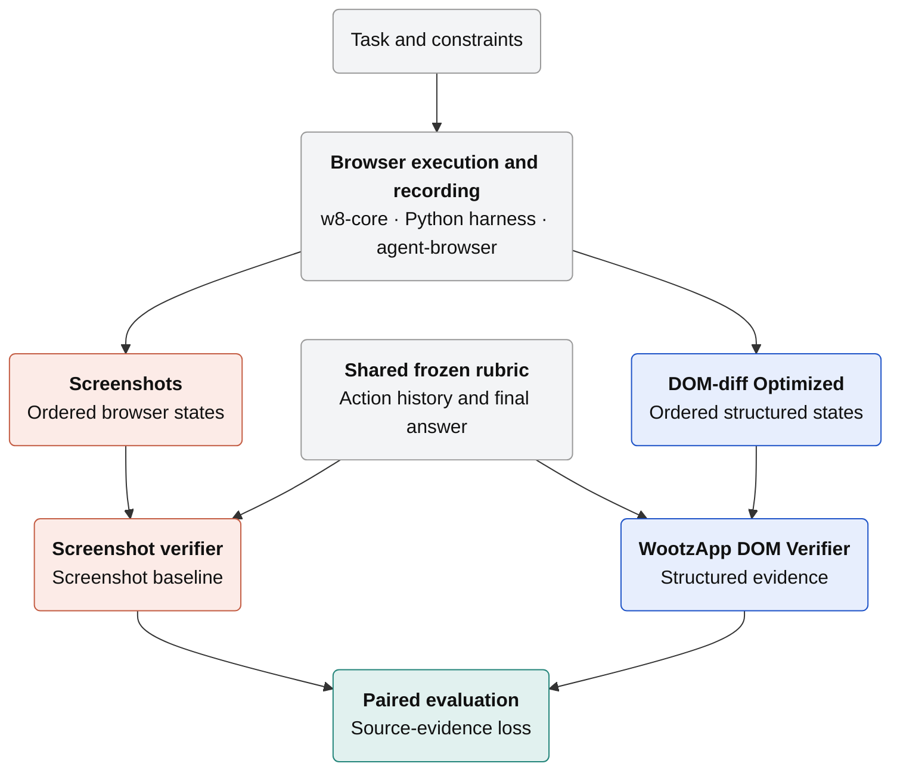
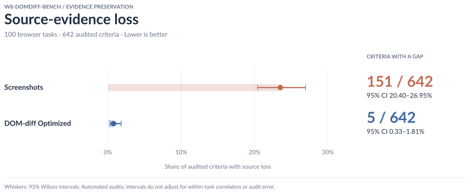
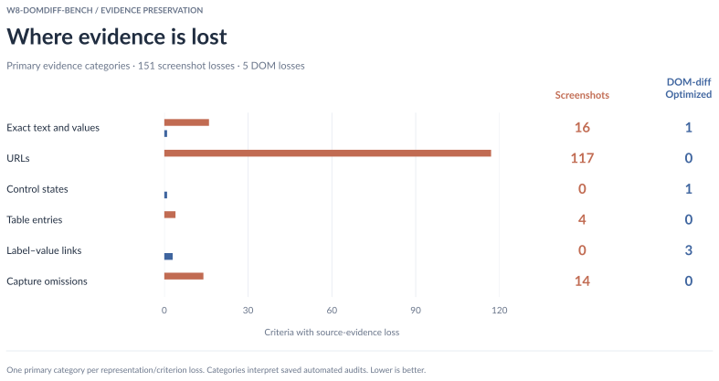

# `w8-domdiff-bench`: Browser Evidence Infrastructure for Agent Development

WootzApp

Technical report October 22, 2026

##### Abstract

Across 100 paired tasks and 642 audited rubric criteria, source-evidence
loss affects **151 screenshot criteria (95% Wilson CI 20.40–26.95%)** and
**5 DOM-diff Optimized criteria (95% CI 0.33–1.81%)**. The observed rates
are 23.52% and 0.78%, respectively. Automated audits separately identify
113 screenshot verifier misses (95% CI 14.85–20.74%) and 97 DOM verifier
misses (95% CI 12.55–18.09%); the paired verifier-miss comparison does not
establish a difference at the 0.05 level (exact McNemar p = 0.1982).
We built `w8-core`, our custom Chromium-based browser infrastructure,
DOM-diff Optimized, a compact structured representation of captured page
states, and `w8-domdiff-bench`, a paired evaluation suite for browser-agent
evidence. The suite addresses a practical problem: verification cannot
recover criterion-relevant information that the recorded trajectory failed
to preserve. Both verifiers receive the same task inputs, action history,
final answer, frozen rubric, and scoring controls. These results describe
source preservation and verifier findings in the selected runs. The
criterion-level intervals do not adjust for correlation within tasks or
automated-audit error; they are exploratory rather than evidence of
acting-agent improvement.

### 1 Introduction

Browser-agent verification is constrained by the evidence retained during
execution. A required field may appear only after scrolling, a filter state
may be visually ambiguous, or an exact value may fall outside the captured
viewport. If the recorded trajectory omits criterion-relevant evidence,
downstream verification cannot recover it. A useful evaluation system must
therefore make evidence preservation measurable.

We built three components to make evidence preservation operational.
`w8-core` records screenshots, structured page state, and action-tool
observations within our Chromium-based browser infrastructure. DOM-diff
Optimized converts each captured state into compact, structured text while
preserving page content, controls, relationships, and scroll context.
`w8-domdiff-bench` pairs screenshot and DOM evidence from the same
trajectory, scores both against one frozen rubric, and audits source
availability directly.

Our screenshot baseline is the screenshot verifier [[2]](#references). We retain
its rubric-based verification design, including criterion-specific relevance
selection, process and outcome scoring, and failure analysis. Our
contribution is the DOM-based adaptation, the browser-native evidence
pipeline, the paired comparison protocol, and the source-aware audit. The
acting agent receives compact text observations; screenshots are retained
for inspection and screenshot-based verification.

Across the latest selected runs for 100 tasks, automated audits identify
151/642 screenshot source losses (95% Wilson CI 20.40–26.95%) and 5/642
DOM-diff Optimized losses (95% CI 0.33–1.81%). Source loss and verifier
error are distinct: the same audits identify 113/642 screenshot verifier
misses (95% CI 14.85–20.74%) and 97/642 DOM verifier misses (95% CI
12.55–18.09%). A verifier miss can involve available evidence or rubric
application and need not change the final score. The paired miss comparison
is inconclusive at the 0.05 level (p = 0.1982). The source-loss counts
motivate treating evidence capture and representation design as components
of browser-agent evaluation; they do not measure agent success.

### 2 Foundations and Baselines

Screenshot-based evaluation preserves the rendered page and is applicable to
visually grounded tasks, but extracting exact values and associating them
with rubric requirements remains a multimodal reasoning problem. WebVoyager
introduced a multimodal automatic evaluation protocol for open-ended web
tasks [[1]](#references). The screenshot verifier uses a rubric-centered design
with process and outcome judgments, failure attribution, and
criterion-specific evidence selection [[2]](#references); we use it as the
screenshot-based baseline.

Structured browser observations are also established in browser-agent
research. WebArena exposes screenshots, HTML DOM, and accessibility-tree
observations and evaluates functional completion in controlled websites
[[4]](#references). These systems establish the value of combining rendered and
structured browser evidence; our system focuses on browser-native capture,
compact per-state representation, and paired measurement of source-evidence
loss.

### 3 Inside the WootzApp Browser Stack

#### 3.1 Building DOM-diff Optimized

We developed the browser evidence pipeline in stages, beginning with detailed
structured capture, adding action-relative change tracking, and then
replacing verbose diff artifacts with a compact representation of individual
browser states. Later work moved selection into Chromium and addressed
omissions discovered during evidence review. Table 1 summarizes the
engineering decisions behind this progression.

| Stage | Limitation addressed | Change and capability enabled |
| --- | --- | --- |
| Detailed DOM capture | Trajectory review required structured page state beyond the rendered frame. | Recorded text, attributes, element relationships, styles, accessibility data, and layout geometry for inspection. |
| DOM-diff | Detailed snapshots did not directly identify what changed after an action. | Compared pre-action and post-action states to associate actions with changes in page content and controls. |
| DOM-diff Optimized | Before/after captures repeated large amounts of unchanged content. | Reorganized each captured state into content, tables, media descriptions, controls, and scroll regions; separate diff files were no longer required. In a historical sample of 650 states, optimized text averaged 4.84 KiB, versus 44.88 KiB for detailed readable text and 191.32 KiB for structured snapshots. |
| Browser-native processing and preservation refinements | Re-reading the live page could diverge from the recorded snapshot, while selection could omit nested text, labels, control state, duplicate context, or post-scroll visibility. | Moved selection and grouping into Chromium on the captured snapshot, then refined nested-text selection, contextual deduplication, author labels, control-state capture, and visibility calculations. |
| Subtree-text-limit removal | The former 500-character subtree limit could truncate relevant nested content. | Removed the subtree-text limit to preserve relevant nested content. |

**Table 1:** Evolution of WootzApp's browser evidence pipeline. DOM-diff
tracked changes between states; DOM-diff Optimized describes individual
captured browser states. Storage figures are average stored sizes for the
documented 650-state sample and are separate from the final source-loss
evaluation.

#### 3.2 From Agent Actions to Recorded Evidence

At each step, the acting model receives compact page text, interactive
control references, task memory, and recent action outcomes. The Python
harness validates the proposed action and executes it through
`agent-browser` in the same browser tab. The resulting page becomes the next
recorded state. Browser node identifiers remain separate from executable
control references.

Each recorded state retains a screenshot, structured page evidence, readable
text, and action-tool observations. Rejected proposals are recorded
separately from executed actions.



**Figure 1:** Architecture of `w8-domdiff-bench`. An execution with $`N`$
actions yields $`N+1`$ recorded states: the initial state and one state after
each action. Screenshot and DOM-diff Optimized evidence remain separate,
while both verifiers receive the same frozen rubric, action history, and
final answer.

### 4 Benchmark Protocol

| Setting | Evaluation configuration |
| --- | --- |
| Dataset | WootzApp browser-agent task dataset. |
| Tasks | Tasks 1–100; one selected final record per task. |
| Audited criteria | 642 rubric criteria; completed automated audits for all 100 tasks. |
| Selected runs | Latest timestamped run per task; October 21–22, 2026. |
| Models | `gpt-5.2` evidence/rubric judge and rubric generation; `o4-mini` action/validity judge; `gpt-5.6-sol` automated evidence audit/adjudication. |
| Comparison controls | Shared task inputs, executed actions, final answer, and frozen rubric, with screenshot and DOM records aligned by action step. |
| Evidence-loss metric | Defined in Section 4.2; saved automated audits review the ordered source states. |

**Table 2:** Essential settings for the final evaluation [[3]](#references).

#### 4.1 Task Success

For task $`t`$, the verifier assigns scores to the rubric criteria and sums
them to obtain $`S_t`$. Let $`S_t^{\max}`$ denote the full available rubric
score. The binary task verdict is

```math
\mathrm{Success}(t)=
\begin{cases}
1, & S_t=S_t^{\max},\\
0, & S_t < S_t^{\max}.
\end{cases}
```

A task therefore succeeds only when it receives the full available score
$`(x/x)`$; any lower total is classified as failure. This task-success
definition is separate from the evidence-loss metric, which measures missing
source evidence rather than agent performance or verifier accuracy.

#### 4.2 Measuring Evidence Preservation

We measure *paired source-evidence loss*: at least one required evidence item
is absent from one recorded representation but available in the other. Let
$`\mathcal{C}`$ be the audited rubric criteria, with $`M=|\mathcal{C}|`$, and
let $`\mathcal{I}_c`$ be the concrete required values or states reviewed for
criterion $`c`$. For item $`i\in\mathcal{I}_c`$, let
$`a_{c,i,S},a_{c,i,D}\in\{0,1\}`$ indicate availability in screenshots
$`(S)`$ and DOM-diff Optimized $`(D)`$, respectively, across the eligible
ordered source states. The same evidence requirements and review scope apply
to both representations [[3]](#references).

```math
\ell_{c,S}=\mathbf{1}\!\left\{\exists i\in\mathcal{I}_c:
a_{c,i,S}=0\ \land\ a_{c,i,D}=1\right\},
\qquad
\ell_{c,D}=\mathbf{1}\!\left\{\exists i\in\mathcal{I}_c:
a_{c,i,D}=0\ \land\ a_{c,i,S}=1\right\}.
```

Each indicator is binary, so a criterion contributes at most one loss per
representation even when several required items are missing. A partially
preserved criterion counts as loss when at least one specific required item
is absent from that representation and present in the other. Evidence that
is present but overlooked or misinterpreted does not count. An item absent
from both representations, or available in both, does not trigger loss. All
audited criteria remain in the denominator, and the rate for representation
$`m`$ is

```math
\mathrm{ELR}_{m}
=\frac{100}{M}\sum_{c\in\mathcal{C}}\ell_{c,m},
\qquad m\in\{S,D\}.
```

For criteria requiring exact website, record, or endpoint identity, the
audit requires the URL in the representation itself. Branding and URLs in
the shared action history do not substitute for a URL absent from a
screenshot. This explicit identity rule accounts for many of the screenshot
losses below; a representation gap need not imply that the verifier's final
score is wrong.

This metric measures evidence gaps between paired recorded representations.
It does not measure absolute information loss against the live webpage,
because evidence omitted from both representations is not detected. Rates
are normalized by all audited criteria and do not measure task success or
verifier accuracy.

### 5 Benchmark Results

#### 5.1 Counts, Confidence Intervals, and Paired Findings

The latest selected runs contain **642 audited criteria across 100 tasks**.
All tasks have completed automated audits. Counts and 95% Wilson confidence
intervals lead the comparison; observed rates follow.

| Finding | Representation | Count / audited criteria | 95% CI | Observed rate |
| --- | --- | ---: | --- | ---: |
| Source-evidence loss | Screenshots | **151/642** | **20.40–26.95%** | 23.52% |
| Source-evidence loss | DOM-diff Optimized | **5/642** | **0.33–1.81%** | 0.78% |
| Verifier miss | Screenshots | **113/642** | **14.85–20.74%** | 17.60% |
| Verifier miss | DOM-diff Optimized | **97/642** | **12.55–18.09%** | 15.11% |

The two measures answer different questions. Source-evidence loss identifies
required information missing from one representation and preserved in the
other. A verifier miss identifies overlooked or misused evidence, an
unacknowledged limitation, or a misapplied criterion, even if the score is
unchanged. The saved audit judgments are automated, not a new manual review
of the original screenshots or DOM states.

| Finding | Screenshot only | DOM only | Both | Neither | Two-sided exact McNemar p |
| --- | ---: | ---: | ---: | ---: | ---: |
| Source-evidence loss | 149 | 3 | 2 | 488 | 2.051 × 10⁻⁴⁰ |
| Verifier miss | 76 | 60 | 37 | 469 | 0.1982 |

The paired test uses discordant criterion pairs, not independent samples
from the two representations. The two criteria with loss in both
representations each lose different required items. Common findings are
already included in both marginal counts. There are 154 unique criteria
with source loss and 173 with a verifier miss; 55 have both, yielding 272
reported criteria across 97 tasks.

These criterion-level intervals and tests assume independent criterion
pairs. They do not adjust for correlation among criteria within a task,
repeated model runs, or automated-audit error. Treat them as exploratory
benchmark statistics. The source-loss asymmetry is large in these records;
the verifier-miss comparison does not establish a difference at the 0.05
level. As secondary point estimates, DOM has 96.7% fewer source-loss findings
and 14.2% fewer verifier-miss findings than screenshots. Neither percentage
measures acting-agent improvement.



**Figure 2:** Source-evidence loss with absolute counts and 95% Wilson
intervals over all 642 audited criteria. Lower is better. Intervals do not
account for within-task correlation or automated-audit uncertainty.

#### 5.2 Where Evidence Is Lost

Each confirmed representation/criterion loss receives one primary evidence
category from the saved adjudication's explanation and decisive evidence.
Categories describe the missing item rather than the kind of verifier
finding. [Category annotations](evidence_categories.json) record the
rationale and a hash of each saved finding so changed findings require
review before export. These annotations interpret automated findings;
the original source states were not independently reviewed for this export.

| **Category** | **Screenshots** | **DOM-diff Optimized** |
| :--- | :---: | :---: |
| Exact text and values | 16 | 1 |
| URLs | 117 | 0 |
| Control states | 0 | 1 |
| Table entries | 4 | 0 |
| Label–value links | 0 | 3 |
| Capture omissions | 14 | 0 |
| **Total** | **151** | **5** |

**Table 3:** Primary source-gap categories. Each representation/criterion
loss appears once; a criterion with losses in both representations can have
different categories for the two missing items. These counts do not include
verifier-only misses.

URL gaps dominate the screenshot findings under the exact-identity rule in
Section 4.2. They include endpoints, record URLs, and associations between a
blocker or response and its source page. Capture omissions describe missing
records, list boundaries, regions, or substantial field descriptions.
Label–value links describe disconnected labels and their values; table
entries describe missing rows or row-level associations.

The [criterion-level audit table](missed_evidence_table.md) contains all
272 criteria with confirmed findings, including the 154 with source loss.
It keeps the six evidence categories separate from the adjudicated verifier
miss/loss flags. The [generated statistics](benchmark_statistics.json)
include counts, intervals, paired tests, category totals, model provenance,
and the selected run paths. Detailed links resolve into the local
`evaluation/` artifacts, which are excluded from Git; regenerate the report
after downloading or producing those runs.



**Figure 3:** Confirmed source-evidence losses by primary category for each
representation, using the same counts as Table 3. Lower is better.

#### 5.3 Preserving the Details Agents Need

DOM-diff Optimized organizes captured browser content into structured
evidence that can be inspected directly. The examples below show how it
preserves exact dates, additional ranked-list entries, and endpoint URLs
missing from the corresponding screenshot records.

| Information preserved | DOM-diff Optimized | Screenshot record |
| --- | --- | --- |
| Exact release date | The exact release date is explicit. | Only a relative release date is visible. |
| Complete ranked list | Structured states preserve ranks 1–30. | Captured frames cover ranks 1–29. |
| Exact endpoint URL | The exact endpoint URL is explicit in the structured header. | The exact endpoint is not visible in the captured frames. |

**Table 4:** Preserved information from Tasks 19, 24, and 75 [[3]](#references).

Preserving these details gives developers explicit values and list entries
to inspect when reviewing agent answers and diagnosing failures. Each example
connects the agent's output to the supporting browser state.

### 6 Capabilities and Boundaries

DOM-diff Optimized cannot independently establish every visual property.
Color, typography, spacing, geometry, clipping, z-order, responsive layout,
image content, canvas state, video, and uncaptured cross-origin or shadow-DOM
content may require screenshots or additional instrumentation. Conversely,
screenshots can omit off-viewport content or render exact text and symbols
ambiguously. The two representations are complementary rather than
interchangeable.

Capture is sequential rather than atomic. DOM state, screenshots, and
action-tool observations can diverge on rapidly changing pages.
Viewport-based capture also means scrolling remains part of evidence
collection, and visibility tolerances are not identical to pixel cropping.

The evaluation covers 100 browser research and extraction tasks and 642
rubric criteria. Findings are automated audit/adjudication judgments; the
reported intervals do not capture annotation error or within-task
correlation. It does not establish performance on all websites,
authenticated workflows, transactions, or visually intensive interaction.
Criterion-level audit labels can also bundle multiple facts, and judgments
about evidence availability and relationships remain a source of annotation
uncertainty.

For model development, the practical value is diagnostic. Source gaps
identify capture and representation work, while paired trajectories provide
inspectable records for reviewing agent behavior and candidate training
data. These uses are enabled by the system, but this report does not measure
downstream training gains or acting-agent improvement.

### 7 Building on `w8-domdiff-bench`

WootzApp built `w8-core`, DOM-diff Optimized, and `w8-domdiff-bench` to make
browser-agent evidence capture inspectable. In the selected 100-task
evaluation, source loss affects 151/642 screenshot criteria (95% Wilson CI
20.40–26.95%) and 5/642 DOM criteria (95% CI 0.33–1.81%). The suite provides
a controlled, auditable foundation for
evaluating browser evidence, refining observations, and reviewing
trajectories while keeping confirmed source gaps separate from evidence that
was present in the recording.

**Availability.** The project repository is
[`https://github.com/wootzapp/w8-domdiff-bench`](https://github.com/wootzapp/w8-domdiff-bench).
The task dataset is
[`https://huggingface.co/datasets/WootzappLab/browser-agent-tasks`](https://huggingface.co/datasets/WootzappLab/browser-agent-tasks).
Operational setup, evaluation metadata, and artifact conventions are
maintained in the repository.

### 8 Browser Setup Overview

The browser is built locally from official Chromium source. Building and
patching are separate, visible steps:

1. Fetch, configure, and build official Chromium `152.0.7948.0`.
2. Clone `wootzapp-browser` and apply its `src/` overlay to that checkout.
3. Rebuild the patched source.
4. Package it as the local `w8-core:domdiff-bench` image.

The complete and authoritative procedure is the
[runbook](runbook.md#browser-build).
It covers prerequisites, source download, compilation, Docker image creation,
runtime configuration, noVNC access, task execution, recorded files, and
troubleshooting.

### References

\[1\] Hongliang He, Wenlin Yao, Kaixin Ma, Wenhao Yu, Yong Dai, Hongming Zhang,
Zhenzhong Lan, and Dong Yu. WebVoyager: Building an end-to-end web agent with
large multimodal models. *arXiv preprint arXiv:2401.13919*, 2024. doi:
10.48550/arXiv.2401.13919. URL
[`https://arxiv.org/abs/2401.13919`](https://arxiv.org/abs/2401.13919).

\[2\] Corby Rosset, Pratyusha Sharma, Andrew Zhao, Miguel Gonzalez-Fernandez, and
Ahmed Awadallah. The art of building verifiers for computer use agents. *arXiv
preprint arXiv:2604.06240*, 2026. doi: 10.48550/arXiv.2604.06240. URL
[`https://arxiv.org/abs/2604.06240`](https://arxiv.org/abs/2604.06240).

\[3\] WootzApp. w8-domdiff-bench: Tasks 1–100 paired evaluation results. Evaluation
results and [criterion-level audit records](missed_evidence_table.md),
October 21–22, 2026. See the [generated statistics](benchmark_statistics.json)
for selected runs and model provenance and the
[category annotations](evidence_categories.json) for category rationale.

\[4\] Shuyan Zhou, Frank F. Xu, Hao Zhu, Xuhui Zhou, Robert Lo, Abishek Sridhar,
Xianyi Cheng, Tianyue Ou, Yonatan Bisk, Daniel Fried, Uri Alon, and Graham
Neubig. WebArena: A realistic web environment for building autonomous agents.
*arXiv preprint arXiv:2307.13854*, 2023. doi: 10.48550/arXiv.2307.13854. URL
[`https://arxiv.org/abs/2307.13854`](https://arxiv.org/abs/2307.13854).
