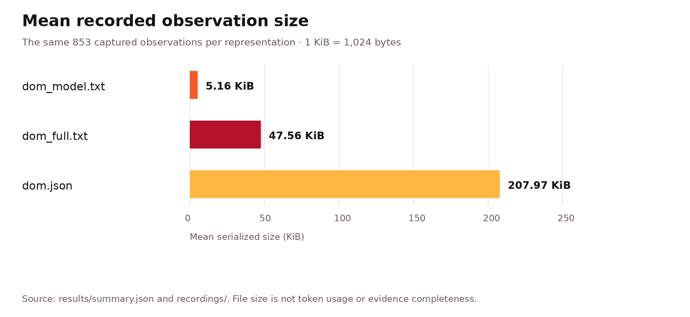
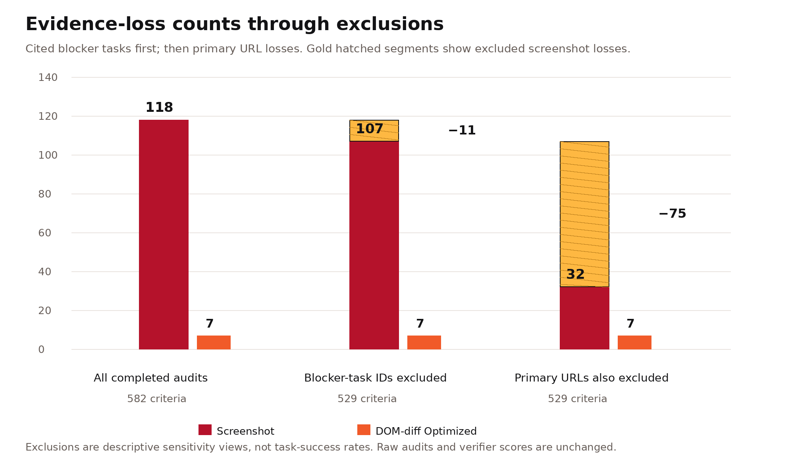
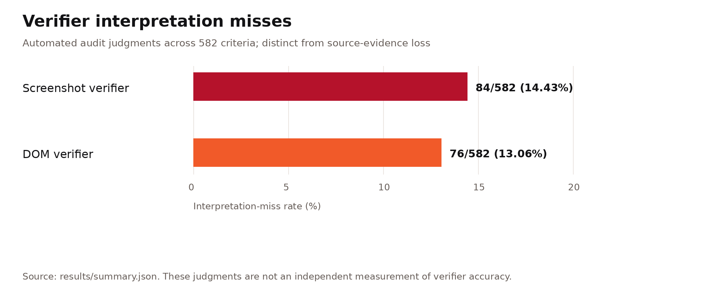

# w8-domdiff-bench: Browser Evidence and Evaluation Report

WootzApp · October 30, 2026

`w8-domdiff-bench` is WootzApp's framework for recording browser-agent trajectories and evaluating the evidence they preserve. Its `w8-core` recorder captures screenshots and DOM-diff Optimized text from the same execution, while its paired verifiers compare both representations against one frozen rubric. This report documents the repository's capture pipeline, evaluation method, and results for 100 browser tasks. The [README](../README.md) introduces the project, the [runbook](runbook.md) explains how to run it, and the [results index](../results/README.md) links its evaluation artifacts.

Both representations share the same task, executed action history, and final answer. The evaluation covers **92 task pairs and 589 scored criteria**; completed evidence audits cover **91 tasks and 582 criteria**, with **118 screenshot losses and 7 DOM losses**. Evidence-audit and adjudication findings were generated by `gpt-5.6-sol`. These counts measure paired source-evidence availability; task-success rules and representation sizes are defined below.

## Foundations and baselines

WebVoyager introduced multimodal automatic evaluation for open-ended web tasks [[1]](#references). Our screenshot baseline follows the Universal Verifier's rubric-centered design: criterion-specific evidence selection, separate process and outcome judgments, and failure attribution [[2]](#references). WootzApp's contribution is the DOM-based adaptation, browser-native evidence capture, paired comparison protocol, and source-aware audit. The acting agent uses `gpt-5.6` to generate actions from compact text observations; screenshots are retained for inspection and screenshot-based verification.

WebArena provides screenshot, HTML DOM, and accessibility-tree observations and evaluates functional task completion in controlled websites [[4]](#references). These systems establish context for structured and visual browser evidence. This benchmark evaluates what paired recorded representations preserve under a shared rubric; it does not reproduce those benchmarks' task-success experiments. The [architecture guide](architecture.md) explains the browser stack and representation history.

## Browser capture and evaluation pipeline

The repository's [task recorder](../w8bench/task_recorder/) supplies `gpt-5.6` with DOM-based observations and executable `agent-browser` references. The harness validates each proposed action, executes it in `w8-core`, and records the resulting screenshot and structured browser state. DOM-diff Optimized organizes each captured state into readable content, tables, controls, relationships, and scroll context.

The [paired evaluation pipeline](../w8bench/verifier/) validates the prepared screenshot/DOM bundles, freezes a shared rubric, runs both verifiers, and audits criterion-level evidence availability. The audit/adjudication uses `gpt-5.6-sol`; internal WootzApp review is a separate verification role. The [published dataset](https://huggingface.co/datasets/WootzappLab/browser-agent-tasks) hosts the trajectories and supporting artifacts used by this repository; the tables below report the resulting benchmark findings.

## Benchmark protocol and mathematical definitions

Of 100 recorded tasks, 92 had usable, aligned evidence for evaluation; 8 were excluded because captures were missing/incomplete or failed URL alignment. Evidence-loss results cover 91 tasks because task 76’s audit failed validation. Both verifiers scored **589 criteria**; the loss denominator is the **582 criteria** in completed audits [[3]](#references). Screenshots and DOM states are aligned by action step, and both verifiers receive the same task inputs, executed actions, final answer, frozen rubric, and scoring controls. An execution with $`N`$ actions normally yields $`N+1`$ recorded states: the initial state and one state after each executed action.

### Rubric scores and task-success rules

For task $`t`$, let $`s_{t,j}`$ be the final awarded points for rubric criterion $`j`$, after the verifier's scoring and rescoring stages, and let $`p_{t,j}`$ be its maximum points. The earned total, maximum total, and normalized rubric score are

```math
S_t=\sum_j s_{t,j},
\qquad
S_t^{\max}=\sum_j p_{t,j},
\qquad
r_t=\frac{S_t}{S_t^{\max}}\quad(S_t^{\max}>0).
```

The implementation sets the normalized score to zero when the maximum total is zero. For a valid rubric with a positive maximum total, a **strict full-score success** means earning every available point:

```math
\mathrm{Success}_{\mathrm{full}}(t)
=\mathbf{1}\{S_t=S_t^{\max}\}.
```

This defines the full-credit convention ($`x/x`$). The CLI also exposes distinct process and outcome rules. Let $`P_t`$ be the process pass flag at rubric threshold $`\tau`$, and let $`O_t`$ indicate that the outcome judge returned the Boolean `true`:

```math
P_t=\mathbf{1}\{r_t\ge\tau\},
\qquad
O_t=\mathbf{1}\{\texttt{output\_success}_t=\mathrm{true}\}.
```

The binary rules available through `--success` are

```math
\mathrm{Success}_{\mathrm{outcome}}(t)=O_t,
\qquad
\mathrm{Success}_{\mathrm{process}}(t)=P_t,
\qquad
\mathrm{Success}_{\mathrm{both}}(t)=P_t O_t.
```

The paired command currently fixes **`--success outcome`** and the threshold $`\tau=0.8`$, so its binary `score` follows the outcome judgment; `rubric_is_success` separately records whether at least 80% of rubric points were earned. A strict full-score summary uses the first rule above. The standalone verifier runners support all three CLI rules. These definitions apply separately to each representation of a task.

The [shared controls](../w8bench/verifier/common.py) also fix five evidence items per criterion, a screenshot keypoint threshold of 3, a minimum relevance threshold of 0, and one voting instance. The [screenshot runner](../w8bench/screenshot_verifier/runner.py) and [DOM runner](../w8bench/dom_model/runner.py) implement the binary rules. The [evaluation protocol](evaluation-protocol.md#success-rules) summarizes them, while saved run manifests establish the controls used by a particular evaluation. None of these success rules defines source-evidence loss.

### Paired source-evidence loss

Let $`\mathcal{C}`$ be the audited rubric criteria, $`M=|\mathcal{C}|`$, and $`\mathcal{I}_c`$ the concrete required values or states reviewed for criterion $`c`$. For required item $`i\in\mathcal{I}_c`$, let $`a_{c,i,S},a_{c,i,D}\in\{0,1\}`$ indicate its availability in screenshots ($`S`$) and DOM-diff Optimized ($`D`$), respectively, across the eligible ordered source states. Both representations use the same evidence requirements and review scope.

```math
\ell_{c,S}=\mathbf{1}\!\left\{\exists i\in\mathcal{I}_c:
a_{c,i,S}=0\ \land\ a_{c,i,D}=1\right\},
\qquad
\ell_{c,D}=\mathbf{1}\!\left\{\exists i\in\mathcal{I}_c:
a_{c,i,D}=0\ \land\ a_{c,i,S}=1\right\}.
```

Each indicator is binary: a criterion contributes at most one loss per representation, even if several required items are missing. Partial preservation still counts as loss when one specific required item is absent from that representation and present in the other. Items available in both or absent from both do not trigger paired loss. Evidence that a verifier overlooks or misinterprets is an interpretation error, separate from source availability.

For representation $`m`$, the loss count and percentage rate are

```math
L_m=\sum_{c\in\mathcal{C}}\ell_{c,m},
\qquad
\mathrm{ELR}_m=\frac{100L_m}{M},
\qquad m\in\{S,D\}.
```

All audited criteria remain in the denominator, including those without a gap. A criterion can lose different items in both representations, contributing to both marginal counts. Multiple criteria can depend on one capture omission. This metric measures differences between paired recorded sources; information omitted from both sources remains undetected.

### Current counts and relative reduction

The saved evaluation findings give

```math
M=582,
\qquad
L_S=\sum_{c\in\mathcal{C}}\ell_{c,S}=118,
\qquad
L_D=\sum_{c\in\mathcal{C}}\ell_{c,D}=7.
```

Therefore,

```math
\mathrm{ELR}_S=\frac{118}{582}\times100\approx20.27\%,
\qquad
\mathrm{ELR}_D=\frac{7}{582}\times100\approx1.20\%.
```

For a shared denominator and $`L_S>0`$, the relative reduction is

```math
\mathrm{Relative\ reduction}
=\frac{\mathrm{ELR}_S-\mathrm{ELR}_D}{\mathrm{ELR}_S}\times100
=\frac{L_S-L_D}{L_S}\times100
=\frac{118-7}{118}\times100
\approx94.07\%.
```

Excluding primary URL-category losses retains all 582 criteria and gives

```math
L_S^{\mathrm{nonURL}}=118-85=33,
\qquad
L_D^{\mathrm{nonURL}}=7-0=7,
```

```math
\mathrm{ELR}_S^{\mathrm{nonURL}}=\frac{33}{582}\times100\approx5.67\%,
\qquad
\mathrm{ELR}_D^{\mathrm{nonURL}}=\frac{7}{582}\times100\approx1.20\%,
```

```math
\mathrm{Relative\ reduction}_{\mathrm{nonURL}}
=\frac{33-7}{33}\times100
\approx78.79\%.
```

These are relative reductions in criterion-level source-loss counts. Task-success rates, verifier accuracy, and acting-agent improvement require their own measurements. The [URL sensitivity analysis](#url-sensitivity-and-paired-comparison) explains the identity rule, overlapping findings, and alternatives that remove entire criteria.

## Current representation size

The model-facing `dom_model.txt` files average **5.16 KiB** per captured observation. All three means below use the same **853 recorded states**, including states retained in tasks excluded from scoring.

| Representation | Artifact | Captured observations | Mean kB | Mean KiB |
| --- | --- | ---: | ---: | ---: |
| DOM-diff Optimized | `dom_model.txt` — compact model-facing text | 853 | 5.28 | **5.16** |
| Text-dense DOM | `dom_full.txt` — detailed readable text | 853 | 48.70 | **47.56** |
| Full DOM | `dom.json` — structured snapshot | 853 | 212.96 | **207.97** |

The text-dense representation exposes detailed DOM information as readable text; the full DOM snapshot retains structured node data. DOM-diff Optimized groups selected content and controls into compact observations for model input. Sizes are serialized bytes: 1 kB = 1,000 bytes and 1 KiB = 1,024 bytes. Token counts depend on the tokenizer. This size comparison does not measure task success or evidence preservation. Full snapshots remain subject to the [capture boundaries](architecture.md#verification-and-boundaries).



## Evidence preservation across 100 tasks

Of 100 recorded tasks, 92 had usable, aligned evidence for evaluation; 8 were excluded because captures were missing/incomplete or failed URL alignment. Evidence-loss results cover 91 tasks because task 76’s audit failed validation.

The completed audits identify **118 screenshot losses and 7 DOM losses** across **582 criteria**. The table retains the full comparison and the sensitivity calculation excluding primary URL-category losses. The next section explains when a missing URL counts as evidence loss.

**Table 1.** Evidence-loss rates across the audited dataset

| Analysis | Screenshot: count, 95% CI, rate | DOM: count, 95% CI, rate | Common to both: count and rate |
|---|---|---|---|
| All source-evidence loss categories | **118/582**; 95% CI **17.21–23.73%** (rate 20.27%) | **7/582**; 95% CI **0.58–2.46%** (rate 1.20%) | 4/582 (0.69%) |
| URL loss category excluded; all audited criteria retained | **33/582**; 95% CI **4.07–7.86%** (rate 5.67%) | **7/582**; 95% CI **0.58–2.46%** (rate 1.20%) | 1/582 (0.17%) |

*Both rows retain all 582 audited criteria; the URL exclusion changes the numerator only.*


**Figure 1.** Evidence-loss rates for all completed audits and the subset excluding the nine cited blocker-task IDs, with and without primary URL losses. Wilson intervals assume independent criteria; they do not adjust for within-task correlation or annotation error.

These counts measure evidence availability, not task success or answer correctness. A common loss concerns the same task/criterion and is already included in both marginal counts; each representation loses a different required item. The report first examines URL sensitivity and categories, then website blockers, execution failures, and evaluation provenance.

## URL sensitivity and paired comparison

The screenshot capture mechanism cannot access the browser’s address/search bar, so screenshots do not capture the current page URL shown there.

An absent URL is **not automatically marked missing for every screenshot, task, or criterion**. It is counted where the rubric makes exact website, page, record, or endpoint identity important and the audit finds that screenshots lack the required URL while DOM preserves it. Under the saved identity rule, visible branding and URLs in shared action history do not substitute for URL evidence within the representation itself.

Primary URL categories account for **85/118 screenshot losses (72.03%)** and **0/7 DOM losses**. Excluding that category leaves **33 screenshot losses and 7 DOM losses**, with all 582 audited criteria retained.

The exclusion is applied separately to each representation’s loss. In [task_02 C2](https://huggingface.co/datasets/WootzappLab/browser-agent-tasks/blob/8f9301ddad1c18b675c5b2df1c364bbbeff8f0a6/evaluation/task_02/20261029T212045Z/evidence_audit.json), screenshots have a URL gap while DOM has a publisher label–value gap. Removing the screenshot URL finding preserves the DOM finding, changing that criterion from “both” to “DOM only.” The non-URL findings affect **39 criteria across 25 tasks**.

**Table 2.** Paired evidence-loss outcomes across the audited dataset

| Analysis | Screenshot only | DOM only | Both | Neither |
|---|---|---|---|---|
| All source-evidence loss categories | 114 | 3 | 4 | 461 |
| URL loss category excluded; all 582 criteria retained | 32 | 6 | 1 | 543 |

*Each row partitions the same 582 criteria.*

Intervals use the [95% Wilson score method](https://www.itl.nist.gov/div898/handbook/prc/section2/prc241.htm). Treat these criterion-level statistics as exploratory because criteria within a task can be correlated.

DOM has **94.07% fewer losses** across all categories and **78.79% fewer non-URL losses**. Relative percentages can change sharply when counts are small. These calculations do not measure what would happen if URLs were added to screenshots or a different rubric were used. Secondary URL gaps in findings assigned another primary category are not removed: task_02 C0 and C1 retain their content/relationship gaps.

### Alternative: exclude entire criteria with URL findings

Removing the 85 criteria with a primary URL finding leaves **497 criteria**. This also removes the DOM findings on task_02 C2 and task_31 C0/C2, leaving **4 DOM losses**. It differs from removing URL losses only from the numerator.

**Table 3.** Evidence-loss rates after excluding entire criteria with primary URL findings

| Analysis | Screenshot: count, 95% CI, rate | DOM: count, 95% CI, rate | Common to both: count and rate |
|---|---|---|---|
| Criteria with a primary URL finding removed | **33/497**; 95% CI **4.77–9.18%** (rate 6.64%) | **4/497**; 95% CI **0.31–2.05%** (rate 0.80%) | 1/497 (0.20%) |

The paired counts are **32 screenshot only, 3 DOM only, 1 both, and 461 neither**, with two-sided exact McNemar **p = 4.177e-07**. DOM has **87.88% fewer losses** in this subset. Its 36 affected criteria span 24 tasks. This is a descriptive subset selected using observed loss categories, not an independent experiment.

## Source-evidence loss by category

The category breakdown shows which required information each representation loses. The [category guide](evidence-categories.md) defines the six categories and boundary rules. Each confirmed representation/criterion loss receives one primary category in the [annotation table](../results/evidence_categories.tsv), with a rationale and source-finding hash. These are report annotations of the saved adjudications, not new verifier decisions or changes to the audit flags.

**Table 4.** Evidence losses by category across completed audits

| Category | Screenshots | DOM |
|---|---:|---:|
| Exact text and values | 20 | 4 |
| URLs | 85 | 0 |
| Control states | 0 | 1 |
| Table entries | 7 | 0 |
| Label–value links | 1 | 2 |
| Capture omissions | 5 | 0 |
| **All categories** | **118** | **7** |
| **Non-URL subtotal** | **33** | **7** |

*Counts cover 91 completed audits and 582 criteria. The 125 representation/criterion losses affect 121 distinct criteria because four criteria lose different items in both representations.*


**Figure 2.** The five non-URL categories share a count scale. The panels retain 582 and 529 audited criteria, respectively. URL losses are omitted so the smaller categories remain readable.

### Repeated capture gaps and mathematical notation

**Task_35: one cropped row affects two criteria.** The [C2/C3 findings](https://huggingface.co/datasets/WootzappLab/browser-agent-tasks/blob/8f9301ddad1c18b675c5b2df1c364bbbeff8f0a6/evaluation/task_35/20261029T212045Z/evidence_audit.json) identify the missing Linux/amd64 size row for the third Docker tag. The omission affects both the reported value and proof of using the correct architecture. These are two criterion-level losses from one capture limitation, not two independent capture failures.

**Task_37 C4: exact glyphs and labels can favour different representations.** The [saved finding](https://huggingface.co/datasets/WootzappLab/browser-agent-tasks/blob/8f9301ddad1c18b675c5b2df1c364bbbeff8f0a6/evaluation/task_37/20261029T212045Z/evidence_audit.json) records screenshot availability glyphs rendered as hollow boxes, while DOM retains checkmarks. Screenshots preserve “Golden Gate,” “Tahoe,” and “Sequoia” capitalization, while DOM lowercases those labels. This is a loss on both sides under an exact-display criterion. It supports distinguishing symbol fidelity from label fidelity, without claiming that either representation always preserves visual notation better.

## Website access blockers and unavailable content

Website restrictions can prevent access even when both representations retain the blocking page. The nine observations below are explicitly cited from the current recordings. Some tasks later completed or used a permitted alternative; this is not a list of nine failed tasks or an exhaustive blocker count.

**Table 5.** Website access blockers and unavailable content

| Task | Requested information | Why blocked | Evidence |
|---|---|---|---|
| task_01 | reddit ranking | Reddit network-security block at the initial page; the final answer later reports a weekly top post. | [Recorded DOM, line 7](https://huggingface.co/datasets/WootzappLab/browser-agent-tasks/blob/8f9301ddad1c18b675c5b2df1c364bbbeff8f0a6/recordings/task1-reddit-ranking-20261029T152819Z/steps/step_001/dom_model.txt#L7) |
| task_06 | article metadata lookup | Search Engine Land security interstitial; the final answer later reports an article. | [Recorded DOM, line 9](https://huggingface.co/datasets/WootzappLab/browser-agent-tasks/blob/8f9301ddad1c18b675c5b2df1c364bbbeff8f0a6/recordings/task6-article-metadata-lookup-20261029T153837Z/steps/step_001/dom_model.txt#L9) |
| task_07 | cross-site recipe lookup | AllRecipes JavaScript/cookies security check prevented recipe extraction. | [Recorded DOM, line 7](https://huggingface.co/datasets/WootzappLab/browser-agent-tasks/blob/8f9301ddad1c18b675c5b2df1c364bbbeff8f0a6/recordings/task7-cross-site-recipe-lookup-20261029T154022Z/steps/step_002/dom_model.txt#L7) |
| task_14 | reddit post lookup | Initial Reddit network-security block; the final answer later uses a search snippet. | [Recorded DOM, line 7](https://huggingface.co/datasets/WootzappLab/browser-agent-tasks/blob/8f9301ddad1c18b675c5b2df1c364bbbeff8f0a6/recordings/task14-reddit-post-lookup-20261029T155021Z/steps/step_001/dom_model.txt#L7) |
| task_15 | reddit community comparison | Initial Reddit network-security block; the final answer uses other public sources. | [Recorded DOM, line 7](https://huggingface.co/datasets/WootzappLab/browser-agent-tasks/blob/8f9301ddad1c18b675c5b2df1c364bbbeff8f0a6/recordings/task15-reddit-community-comparison-20261029T155607Z/steps/step_001/dom_model.txt#L7) |
| task_22 | stackoverflow search | Mandatory Stack Overflow CAPTCHA prevented the requested filtered result extraction. | [Recorded DOM, line 55](https://huggingface.co/datasets/WootzappLab/browser-agent-tasks/blob/8f9301ddad1c18b675c5b2df1c364bbbeff8f0a6/recordings/task22-stackoverflow-search-20261029T160425Z/steps/step_006/dom_model.txt#L55) |
| task_53 | book-edition resolution | Open Library human-verification gate prevented edition-field extraction. | [Recorded DOM, line 33](https://huggingface.co/datasets/WootzappLab/browser-agent-tasks/blob/8f9301ddad1c18b675c5b2df1c364bbbeff8f0a6/recordings/task53-book-edition-resolution-20261029T165412Z/steps/step_001/dom_model.txt#L33) |
| task_56 | biomedical literature filtering | A reCAPTCHA browser-check page was captured; the final run also records an action error. | [Recorded DOM, line 2](https://huggingface.co/datasets/WootzappLab/browser-agent-tasks/blob/8f9301ddad1c18b675c5b2df1c364bbbeff8f0a6/recordings/task56-biomedical-literature-filtering-20261029T170753Z/steps/step_016/dom_model.txt#L2) |
| task_92 | legislative roll-call inspection | A security-verification page was captured; the final run also records a tab-synchronization error. | [Recorded DOM, line 9](https://huggingface.co/datasets/WootzappLab/browser-agent-tasks/blob/8f9301ddad1c18b675c5b2df1c364bbbeff8f0a6/recordings/task92-legislative-roll-call-inspection-20261029T191007Z/steps/step_002/dom_model.txt#L9) |

*These nine cited task IDs define the sensitivity exclusion set in Tables 6–9. A transient blocker and a completed task can coexist.*

A blocker and a source gap describe different things. For task_07, a security check prevents recipe extraction, while missing screenshot URL identity is a separate evidence finding. The current records do not support reusing the former 12-task blocker set unchanged.

### Analysis excluding the listed access-blocked tasks

Excluding the nine cited task IDs removes **53 criteria**, leaving **82 audited tasks and 529 criteria**. It removes **11 screenshot losses**: 10 primary URL losses and one exact-value loss. No DOM losses are removed. All these tasks remain in the primary 91-task analysis.

The task IDs are `task_01`, `task_06`, `task_07`, `task_14`, `task_15`, `task_22`, `task_53`, `task_56`, `task_92`. The exclusion removes only these cited task IDs; it does not establish that every remaining task was free of blockers. The same adjudications, category rules and Wilson assumptions apply.

**Table 6.** Evidence-loss rates excluding the listed blocker-task IDs

| Analysis | Screenshot: count, 95% CI, rate | DOM: count, 95% CI, rate | Common to both: count and rate |
|---|---|---|---|
| Listed blocker-task IDs excluded; all categories | **107/529**; 95% CI **17.02–23.86%** (rate 20.23%) | **7/529**; 95% CI **0.64–2.71%** (rate 1.32%) | 4/529 (0.76%) |
| Listed blocker-task IDs and URL category excluded | **32/529**; 95% CI **4.32–8.41%** (rate 6.05%) | **7/529**; 95% CI **0.64–2.71%** (rate 1.32%) | 1/529 (0.19%) |

*Both rows retain all 529 criteria in the 82-task subset.*

**Table 7.** Paired evidence-loss outcomes excluding the listed blocker-task IDs

| Analysis | Screenshot only | DOM only | Both | Neither |
|---|---|---|---|---|
| All source-evidence loss categories | 103 | 3 | 4 | 419 |
| URL loss category excluded | 31 | 6 | 1 | 491 |

DOM has **93.46% fewer losses** across all categories and **78.12% fewer non-URL losses** in this subset.



**Figure 3.** Screenshot losses fall from 118 to 107 to 32; DOM losses stay at 7. Excluding cited task IDs changes the denominator from 582 to 529; excluding their remaining 75 primary URL losses keeps all 529 criteria.

#### Alternative: exclude entire criteria with URL findings

Removing the 75 criteria with a primary URL loss from the blocker-excluded subset leaves **454 criteria**. It also removes three DOM findings on the same criteria, leaving four DOM losses.

**Table 8.** Evidence-loss rates excluding blocker-task IDs and entire primary-URL criteria

| Analysis | Screenshot: count, 95% CI, rate | DOM: count, 95% CI, rate | Common to both: count and rate |
|---|---|---|---|
| Listed blocker-task IDs and entire primary-URL criteria excluded | **32/454**; 95% CI **5.04–9.78%** (rate 7.05%) | **4/454**; 95% CI **0.34–2.24%** (rate 0.88%) | 1/454 (0.22%) |

The paired counts are **31 screenshot only, 3 DOM only, 1 both, and 419 neither**, with two-sided exact McNemar **p = 7.660e-07**. DOM has **87.50% fewer losses** in this subset. Its 35 affected criteria span 23 tasks. This is a descriptive subset selected using observed loss categories, not an independent experiment.

#### Source-evidence loss by category

**Table 9.** Evidence losses by category excluding the listed blocker-task IDs

| Category | Screenshots | DOM |
|---|---:|---:|
| Exact text and values | 19 | 4 |
| URLs | 75 | 0 |
| Control states | 0 | 1 |
| Table entries | 7 | 0 |
| Label–value links | 1 | 2 |
| Capture omissions | 5 | 0 |
| **All categories** | **107** | **7** |
| **Non-URL subtotal** | **32** | **7** |

*The same six categories are applied to all 529 audited criteria in the 82-task subset. Its 114 representation/criterion losses affect 110 distinct criteria.*

## Recorded execution failures

The current recordings contain **12 manifest-recorded execution errors across 100 tasks (12%)**, alongside **81 successes and 7 agent failures**. Raw `final.json` records encode all 19 unsuccessful outcomes as `failure`; the manifest distinguishes the 12 execution errors. These are collection outcomes, not verifier scores.

**Table 10.** Recorded execution failures by reason

| Tasks | Recorded reason |
|---|---|
| [task_18](https://huggingface.co/datasets/WootzappLab/browser-agent-tasks/blob/8f9301ddad1c18b675c5b2df1c364bbbeff8f0a6/recordings/task18-github-issue-search-20261029T160048Z/final.json), [task_20](https://huggingface.co/datasets/WootzappLab/browser-agent-tasks/blob/8f9301ddad1c18b675c5b2df1c364bbbeff8f0a6/recordings/task20-github-code-search-20261029T160246Z/final.json), [task_46](https://huggingface.co/datasets/WootzappLab/browser-agent-tasks/blob/8f9301ddad1c18b675c5b2df1c364bbbeff8f0a6/recordings/task46-park-operational-status-20261029T164822Z/final.json), [task_49](https://huggingface.co/datasets/WootzappLab/browser-agent-tasks/blob/8f9301ddad1c18b675c5b2df1c364bbbeff8f0a6/recordings/task49-economic-time-series-extraction-20261029T165027Z/final.json), [task_77](https://huggingface.co/datasets/WootzappLab/browser-agent-tasks/blob/8f9301ddad1c18b675c5b2df1c364bbbeff8f0a6/recordings/task77-patent-record-inspection-20261029T175222Z/final.json) | Initial page navigation timed out. |
| [task_26](https://huggingface.co/datasets/WootzappLab/browser-agent-tasks/blob/8f9301ddad1c18b675c5b2df1c364bbbeff8f0a6/recordings/task26-shopping-constraint-satisfaction-20261029T161024Z/final.json), [task_57](https://huggingface.co/datasets/WootzappLab/browser-agent-tasks/blob/8f9301ddad1c18b675c5b2df1c364bbbeff8f0a6/recordings/task57-clinical-trial-filtering-20261029T171010Z/final.json) | Structured snapshot capture timed out after two attempts. |
| [task_27](https://huggingface.co/datasets/WootzappLab/browser-agent-tasks/blob/8f9301ddad1c18b675c5b2df1c364bbbeff8f0a6/recordings/task27-shopping-constraint-satisfaction-20261029T161444Z/final.json) | Structured capture returned zero nodes for a non-empty document after three attempts. |
| [task_59](https://huggingface.co/datasets/WootzappLab/browser-agent-tasks/blob/8f9301ddad1c18b675c5b2df1c364bbbeff8f0a6/recordings/task59-software-product-requirements-20261029T171837Z/final.json) | The agent-browser accessibility snapshot timed out on CDP DOM.enable. |
| [task_87](https://huggingface.co/datasets/WootzappLab/browser-agent-tasks/blob/8f9301ddad1c18b675c5b2df1c364bbbeff8f0a6/recordings/task87-river-monitoring-20261029T185940Z/final.json) | agent-browser connection timed out after 90 seconds. |
| [task_92](https://huggingface.co/datasets/WootzappLab/browser-agent-tasks/blob/8f9301ddad1c18b675c5b2df1c364bbbeff8f0a6/recordings/task92-legislative-roll-call-inspection-20261029T191007Z/final.json) | The active tab matched multiple CDP targets; capture refused an ambiguous page. |
| [task_94](https://huggingface.co/datasets/WootzappLab/browser-agent-tasks/blob/8f9301ddad1c18b675c5b2df1c364bbbeff8f0a6/recordings/task94-eu-regulation-metadata-20261029T191138Z/final.json) | Model-DOM capture timed out after two attempts. |

*The seven reason groups account for all 12 manifest-recorded execution errors. Source links open the current raw final-answer records, including errors without a prepared trajectory.*

Five error recordings retain usable aligned evidence and are evaluated: **task_26, task_27, task_57, task_87 and task_92**. Seven lack a complete captured state sequence. Task_05 is separately excluded for initial URL mismatch, not for its reported outcome. Execution errors, website blockers and source losses overlap and must not be added into one failure rate.

## Models and evaluation provenance

The benchmark uses separate models for browser actions, trajectory verification and evidence auditing. Internal WootzApp review is a separate project verification role; the current saved model outputs do not attest that this human-review step has been completed for every finding.

**Table 11.** Model configuration and reviewers

| Role | Model or reviewer |
|---|---|
| Acting agent: browser-action generation | `gpt-5.6` |
| Screenshot verification: evidence/rubric judge | `gpt-5.2` |
| Screenshot verification: action/validity judge | `gpt-5.6-terra` |
| DOM verification: evidence/rubric judge | `gpt-5.2` |
| DOM verification: action/validity judge | `gpt-5.6-terra` |
| Rubric generation | `gpt-5.2` |
| Automated evidence audit/adjudication | `gpt-5.6-sol` |
| Internal evidence-review role | Internal WootzApp employees; completion is not recorded in these audit files. |

*Action generation, evidence judging, action/validity judging, report category annotation and human verification are separate roles.*

Each evaluation manifest records the models and controls associated with its results. Both verifier results are checked against the same frozen rubric. The [category annotation table](../results/evidence_categories.tsv) records Codex report classifications of the existing decisive evidence and citations; those labels do not change audit decisions or scores.

Example provenance: [run manifest](https://huggingface.co/datasets/WootzappLab/browser-agent-tasks/blob/8f9301ddad1c18b675c5b2df1c364bbbeff8f0a6/evaluation/task_01/20261029T212045Z/run_manifest.json), [rubric metrics](https://huggingface.co/datasets/WootzappLab/browser-agent-tasks/blob/8f9301ddad1c18b675c5b2df1c364bbbeff8f0a6/evaluation/task_01/20261029T212045Z/rubric_generation_metrics.json), [screenshot metrics](https://huggingface.co/datasets/WootzappLab/browser-agent-tasks/blob/8f9301ddad1c18b675c5b2df1c364bbbeff8f0a6/evaluation/task_01/20261029T212045Z/screenshot_verifier/run_metrics.json) and [DOM metrics](https://huggingface.co/datasets/WootzappLab/browser-agent-tasks/blob/8f9301ddad1c18b675c5b2df1c364bbbeff8f0a6/evaluation/task_01/20261029T212045Z/dom_model/run_metrics.json). The selected run is `20261029T212045Z`; [summary.json](../results/summary.json) lists task identities and source checksums.

**Planned ablation study:** vary the verification and rubric-generation models and DOM representations while controlling task sets, paired trajectories, frozen rubrics and audit protocol. Cross-model and cross-DOM ablations have not been performed here; pooled results from different configurations would not constitute a controlled ablation.

## Source-evidence gaps by task and criterion

The detailed table consolidates the saved audits, with one row for each confirmed task/criterion loss in screenshots, DOM, or both. Criterion IDs (`C0`, `C1`, …) use the zero-based `criterion_index` from the audit.

The table contains **121 affected criteria across 74 tasks**. The **461 criteria without confirmed paired loss** remain in the 582-criterion denominator. Findings come from the final saved adjudications, not from final answers alone. Categories are separate report annotations; the complete decisive evidence and original citations are retained in the linked audits.

### Files needed from the evaluation directory

- `task_*/<run-id>/evidence_audit.json` is the primary source: `criteria[*].adjudication` contains confirmed source-loss findings, decisive evidence and citations. Example: [task_02 audit](https://huggingface.co/datasets/WootzappLab/browser-agent-tasks/blob/8f9301ddad1c18b675c5b2df1c364bbbeff8f0a6/evaluation/task_02/20261029T212045Z/evidence_audit.json).
- `task_*/<run-id>/frozen_rubric.json` supplies criterion wording, order and requirements. Example: [task_02 rubric](https://huggingface.co/datasets/WootzappLab/browser-agent-tasks/blob/8f9301ddad1c18b675c5b2df1c364bbbeff8f0a6/evaluation/task_02/20261029T212045Z/frozen_rubric.json).
- `task_*/<run-id>/dom_model/result.json` and `screenshot_verifier/result.json` contain saved verifier results for rubric and audit consistency checks.
- `task_*/<run-id>/run_manifest.json` establishes run status and provenance; `comparison.json` cross-checks criterion order. Example: [manifest](https://huggingface.co/datasets/WootzappLab/browser-agent-tasks/blob/8f9301ddad1c18b675c5b2df1c364bbbeff8f0a6/evaluation/task_02/20261029T212045Z/run_manifest.json) and [comparison](https://huggingface.co/datasets/WootzappLab/browser-agent-tasks/blob/8f9301ddad1c18b675c5b2df1c364bbbeff8f0a6/evaluation/task_02/20261029T212045Z/comparison.json).
- `evidence_audit_error.json`, where present, records validation errors. Invalid responses are not confirmed findings.
- [evidence_categories.tsv](../results/evidence_categories.tsv) records the category, rationale and source-finding hash for each of the 125 representation/criterion losses.

### How to read the six columns

- **Task / criterion:** task alias and exact frozen-rubric criterion. The evidence link identifies the selected run.
- **Category:** the primary gap type. A criterion with losses on both sides can have a different category on each side.
- **Labels:** `SCREENSHOT_EVIDENCE_MISSING`, `DOM_EVIDENCE_MISSING`, or `BOTH_EVIDENCE_INCOMPLETE`, derived from confirmed loss flags.
- **Findings:** which representation loses decision-essential evidence preserved in the other.
- **Pointer to evidence file:** the linked audit, source filename and location. The audit retains the exact quotations.

**Table 12.** Confirmed evidence gaps by task and criterion

| Task | Criterion | Category | Labels | Findings | Pointer to evidence file |
|---|---|---|---|---|---|
| task_02 | **C0** — Navigate to Xbox.com and access the 'Best sellers' section | Capture omissions | `SCREENSHOT_EVIDENCE_MISSING` | Screenshot evidence loss | [Screenshot evidence loss](https://huggingface.co/datasets/WootzappLab/browser-agent-tasks/blob/8f9301ddad1c18b675c5b2df1c364bbbeff8f0a6/evaluation/task_02/20261029T212045Z/evidence_audit.json)<br>Screenshot: The DOM explicitly preserves the Xbox.com games URL and a visible “Best sellers” heading associated with game listings, including Minecraft. No screenshot preserves that section or an exact Xbox.com URL.<br>Cited evidence: `dom_model4.txt` (L0001); `dom_model4.txt` (L0106); `dom_model4.txt` (L0111-L0112) |
| task_02 | **C1** — Select a game listed under 'Best sellers' and open its Xbox.com product page | Label–value links | `SCREENSHOT_EVIDENCE_MISSING` | Screenshot evidence loss | [Screenshot evidence loss](https://huggingface.co/datasets/WootzappLab/browser-agent-tasks/blob/8f9301ddad1c18b675c5b2df1c364bbbeff8f0a6/evaluation/task_02/20261029T212045Z/evidence_audit.json)<br>Screenshot: The DOM preserves Minecraft as an item under Best sellers and then preserves the exact matching Xbox.com product URL and title. Screenshots preserve only the destination product page, not the listing association or exact URL.<br>Cited evidence: `dom_model4.txt` (L0106); `dom_model4.txt` (L0111-L0112); `dom_model5.txt` (L0001); `dom_model5.txt` (L0002) |
| task_02 | **C2** — Report publisher, developer, and release date from the product page | Screenshot: URLs<br>DOM: Label–value links | `BOTH_EVIDENCE_INCOMPLETE` | Screenshot evidence loss<br>DOM evidence loss | [Screenshot evidence loss](https://huggingface.co/datasets/WootzappLab/browser-agent-tasks/blob/8f9301ddad1c18b675c5b2df1c364bbbeff8f0a6/evaluation/task_02/20261029T212045Z/evidence_audit.json)<br>Screenshot: The DOM preserves the exact Xbox.com product URL for the selected Minecraft page, while the screenshots do not display any browser URL.<br>Cited evidence: `dom_model5.txt` (L0001); `dom_model5.txt` (L0002)<br>[DOM evidence loss](https://huggingface.co/datasets/WootzappLab/browser-agent-tasks/blob/8f9301ddad1c18b675c5b2df1c364bbbeff8f0a6/evaluation/task_02/20261029T212045Z/evidence_audit.json)<br>DOM: The screenshot explicitly associates all three metadata labels with their values, including “Published by” with “Microsoft Studios.” The DOM preserves developer and release date but omits the publisher value from the Published by field.<br>Cited evidence: `screenshot9.png` (Bottom metadata row) |
| task_03 | **C0** — Access Microsoft Careers and perform a search for 'Applied Scientist' in/near Redmond, Washington | URLs | `SCREENSHOT_EVIDENCE_MISSING` | Screenshot evidence loss | [Screenshot evidence loss](https://huggingface.co/datasets/WootzappLab/browser-agent-tasks/blob/8f9301ddad1c18b675c5b2df1c364bbbeff8f0a6/evaluation/task_03/20261029T212045Z/evidence_audit.json)<br>Screenshot: The DOM explicitly records the Microsoft Careers page URL as https://careers.microsoft.com/v2/global/en/home.html, while the screenshots show branding and page content but no exact URL. Because this criterion expressly requires proving access to Microsoft Careers, the missing URL is decision-essential screenshot evidence loss.<br>Cited evidence: `dom_model0.txt` (L0001) |
| task_04 | **C0** — Access dmns.org and attempt to reach Sturm Infinity Theater film listings | URLs | `SCREENSHOT_EVIDENCE_MISSING` | Screenshot evidence loss | [Screenshot evidence loss](https://huggingface.co/datasets/WootzappLab/browser-agent-tasks/blob/8f9301ddad1c18b675c5b2df1c364bbbeff8f0a6/evaluation/task_04/20261029T212045Z/evidence_audit.json)<br>Screenshot: The DOM explicitly preserves both the dmns.org homepage URL and the resulting DMNS Films & Shows URL, while neither screenshot displays a URL. Exact URL evidence is decision-essential for proving website/page identity and cannot be replaced by visible branding.<br>Cited evidence: `dom_model0.txt` (L0001); `dom_model1.txt` (L0001); `dom_model1.txt` (L0002) |
| task_06 | **C0** — Access Search Engine Land without signing in and attempt to use it as the primary source | URLs | `SCREENSHOT_EVIDENCE_MISSING` | Screenshot evidence loss | [Screenshot evidence loss](https://huggingface.co/datasets/WootzappLab/browser-agent-tasks/blob/8f9301ddad1c18b675c5b2df1c364bbbeff8f0a6/evaluation/task_06/20261029T212045Z/evidence_audit.json)<br>Screenshot: The DOM preserves the exact SEL homepage and candidate-article URLs, while the screenshots show only the searchengineland.com label and Cloudflare branding without either exact URL. Because this criterion requires proving direct access to the specified website, the missing exact URL is screenshot evidence loss.<br>Cited evidence: `dom_model0.txt` (L0001); `dom_model6.txt` (L0001) |
| task_07 | **C0** — Access Amazon India Grocery & Gourmet Foods bestsellers list (no sign-in) | URLs | `SCREENSHOT_EVIDENCE_MISSING` | Screenshot evidence loss | [Screenshot evidence loss](https://huggingface.co/datasets/WootzappLab/browser-agent-tasks/blob/8f9301ddad1c18b675c5b2df1c364bbbeff8f0a6/evaluation/task_07/20261029T212045Z/evidence_audit.json)<br>Screenshot: The DOM preserves the exact Amazon India Grocery bestsellers URL, while the screenshot shows branding and category content but no URL. Exact URL evidence is required to prove the requested page identity.<br>Cited evidence: `dom_model0.txt` (L0001) |
| task_07 | **C1** — Verify the #2 Amazon India Grocery & Gourmet Foods bestseller item | URLs | `SCREENSHOT_EVIDENCE_MISSING` | Screenshot evidence loss | [Screenshot evidence loss](https://huggingface.co/datasets/WootzappLab/browser-agent-tasks/blob/8f9301ddad1c18b675c5b2df1c364bbbeff8f0a6/evaluation/task_07/20261029T212045Z/evidence_audit.json)<br>Screenshot: The DOM preserves the exact Grocery bestsellers URL together with the explicit #2 Tata Salt entry. The screenshot preserves the rank-product association but not the URL proving that it is the requested Amazon India page.<br>Cited evidence: `dom_model0.txt` (L0001); `dom_model0.txt` (L0091) |
| task_07 | **C2** — Access AllRecipes and locate a recipe page (no sign-in) | URLs | `SCREENSHOT_EVIDENCE_MISSING` | Screenshot evidence loss | [Screenshot evidence loss](https://huggingface.co/datasets/WootzappLab/browser-agent-tasks/blob/8f9301ddad1c18b675c5b2df1c364bbbeff8f0a6/evaluation/task_07/20261029T212045Z/evidence_audit.json)<br>Screenshot: The DOM identifies the blocked page as the AllRecipes salt-search URL and names www.allrecipes.com in the verification message. The screenshot shows only a generic Cloudflare widget without an AllRecipes identity or URL.<br>Cited evidence: `dom_model1.txt` (L0001); `dom_model1.txt` (L0007) |
| task_07 | **C3** — Find an AllRecipes recipe that uses the identified #2 bestseller ingredient | URLs | `SCREENSHOT_EVIDENCE_MISSING` | Screenshot evidence loss | [Screenshot evidence loss](https://huggingface.co/datasets/WootzappLab/browser-agent-tasks/blob/8f9301ddad1c18b675c5b2df1c364bbbeff8f0a6/evaluation/task_07/20261029T212045Z/evidence_audit.json)<br>Screenshot: The DOM connects the #2 Tata Salt product to an AllRecipes salt-search state containing only a verification interstitial. The screenshots show Tata Salt and a later generic Cloudflare widget but cannot identify the blocked page as AllRecipes.<br>Cited evidence: `dom_model0.txt` (L0091); `dom_model1.txt` (L0001); `dom_model1.txt` (L0007) |
| task_07 | **C4** — Report the AllRecipes recipe title and full ingredient list | URLs | `SCREENSHOT_EVIDENCE_MISSING` | Screenshot evidence loss | [Screenshot evidence loss](https://huggingface.co/datasets/WootzappLab/browser-agent-tasks/blob/8f9301ddad1c18b675c5b2df1c364bbbeff8f0a6/evaluation/task_07/20261029T212045Z/evidence_audit.json)<br>Screenshot: The DOM identifies the exact AllRecipes URL, the blocking title, a complete non-truncated minimal snapshot, and the JavaScript/cookies limitation. The screenshot shows only a generic Cloudflare widget without the site identity or detailed limitation.<br>Cited evidence: `dom_model1.txt` (L0001); `dom_model1.txt` (L0002); `dom_model1.txt` (L0004); `dom_model1.txt` (L0007) |
| task_08 | **C0** — Access Playwright GitHub repository and Releases page | URLs | `SCREENSHOT_EVIDENCE_MISSING` | Screenshot evidence loss | [Screenshot evidence loss](https://huggingface.co/datasets/WootzappLab/browser-agent-tasks/blob/8f9301ddad1c18b675c5b2df1c364bbbeff8f0a6/evaluation/task_08/20261029T212045Z/evidence_audit.json)<br>Screenshot: The DOM explicitly records the exact Microsoft Playwright Releases URL, while the screenshots show GitHub branding and repository breadcrumbs but no browser URL. Because this criterion requires proving access to the specified website and page, branding is not a substitute for exact URL evidence.<br>Cited evidence: `dom_model1.txt` (L0001) |
| task_08 | **C2** — Record release metadata (tag and publication date) | Exact text and values | `SCREENSHOT_EVIDENCE_MISSING` | Screenshot evidence loss | [Screenshot evidence loss](https://huggingface.co/datasets/WootzappLab/browser-agent-tasks/blob/8f9301ddad1c18b675c5b2df1c364bbbeff8f0a6/evaluation/task_08/20261029T212045Z/evidence_audit.json)<br>Screenshot: The DOM associates v1.64.1 with the absolute publication date Oct 14, 2026 and separately preserves the displayed time 14 Oct 11:51. Every screenshot shows only the relative phrase released this 2 weeks ago, so screenshots cannot establish the same publication-date conclusion.<br>Cited evidence: `dom_model1.txt` (L0159); `dom_model2.txt` (L0039) |
| task_08 | **C4** — Verify one reported change using official Playwright documentation | URLs | `SCREENSHOT_EVIDENCE_MISSING` | Screenshot evidence loss | [Screenshot evidence loss](https://huggingface.co/datasets/WootzappLab/browser-agent-tasks/blob/8f9301ddad1c18b675c5b2df1c364bbbeff8f0a6/evaluation/task_08/20261029T212045Z/evidence_audit.json)<br>Screenshot: The DOM records the exact playwright.dev URL for the ElectronApplication.firstWindow documentation, while the screenshot shows Playwright branding and API content without an address bar. Because the criterion specifically requires official playwright.dev documentation, the missing exact URL is screenshot evidence loss even though the page branding is visible.<br>Cited evidence: `dom_model3.txt` (L0001) |
| task_11 | **C0** — Use arXiv Advanced Search with required filters (cs.LG, last 30 days, exact title phrase, newest-first sort) | Exact text and values | `SCREENSHOT_EVIDENCE_MISSING` | Screenshot evidence loss | [Screenshot evidence loss](https://huggingface.co/datasets/WootzappLab/browser-agent-tasks/blob/8f9301ddad1c18b675c5b2df1c364bbbeff8f0a6/evaluation/task_11/20261029T212045Z/evidence_audit.json)<br>Screenshot: DOM explicitly records the browser-current date as “Thursday, October 29, 2026,” while the Time.is screenshot has that date obscured by the privacy dialog. Without the DOM, the screenshots cannot independently establish that the entered September 30–October 29 range was derived from the browser date.<br>Cited evidence: `dom_model1.txt` (L0072) |
| task_12 | **C0** — Access the correct arXiv abstract page (1706.03762) | URLs | `SCREENSHOT_EVIDENCE_MISSING` | Screenshot evidence loss | [Screenshot evidence loss](https://huggingface.co/datasets/WootzappLab/browser-agent-tasks/blob/8f9301ddad1c18b675c5b2df1c364bbbeff8f0a6/evaluation/task_12/20261029T212045Z/evidence_audit.json)<br>Screenshot: The DOM explicitly records the exact loaded URL as https://arxiv.org/abs/1706.03762, while neither screenshot includes browser URL evidence. Because this criterion requires proving the website/page identity, the visible arXiv branding, title, and citation identifier do not substitute for the absent exact URL.<br>Cited evidence: `dom_model0.txt` (L0001-L0002) |
| task_13 | **C0** — Open Magnus Carlsen’s Chess.com player profile | URLs | `SCREENSHOT_EVIDENCE_MISSING` | Screenshot evidence loss | [Screenshot evidence loss](https://huggingface.co/datasets/WootzappLab/browser-agent-tasks/blob/8f9301ddad1c18b675c5b2df1c364bbbeff8f0a6/evaluation/task_13/20261029T212045Z/evidence_audit.json)<br>Screenshot: The DOM records the exact Chess.com member-profile URL, while neither screenshot includes the browser address bar or otherwise displays that URL. Because this criterion requires proving website/page identity, the missing exact URL is screenshot evidence loss.<br>Cited evidence: `dom_model1.txt` (L0001) |
| task_14 | **C3** — Report exact post details (title, author, score, comment count) from the opened post | Exact text and values | `SCREENSHOT_EVIDENCE_MISSING` | Screenshot evidence loss | [Screenshot evidence loss](https://huggingface.co/datasets/WootzappLab/browser-agent-tasks/blob/8f9301ddad1c18b675c5b2df1c364bbbeff8f0a6/evaluation/task_14/20261029T212045Z/evidence_audit.json)<br>Screenshot: The DOM preserves an exact Google result snippet tying the Reddit post ID and URL to `412 Upvotes`, whereas the screenshots show only an approximate `412 to 413 upvotes` statement or a result before the exact snippet text became visible. Exact score evidence is decision-essential for this criterion.<br>Cited evidence: `dom_model19.txt` (L0024-L0028) |
| task_16 | **C0** — Access the correct Hugging Face repository page (meta-llama/Llama-3.1-8B-Instruct) or clearly report an access blocker | URLs | `SCREENSHOT_EVIDENCE_MISSING` | Screenshot evidence loss | [Screenshot evidence loss](https://huggingface.co/datasets/WootzappLab/browser-agent-tasks/blob/8f9301ddad1c18b675c5b2df1c364bbbeff8f0a6/evaluation/task_16/20261029T212045Z/evidence_audit.json)<br>Screenshot: The DOM preserves the exact repository URL, while neither screenshot includes the browser address bar or otherwise displays that exact URL. Because this criterion requires proving page identity, the visible repository header and Hugging Face branding do not substitute for URL evidence under the governing rule.<br>Cited evidence: `dom_model0.txt` (L0001) |
| task_17 | **C0** — Access the Hugging Face SQuAD dataset page (rajpurkar/squad) | URLs | `SCREENSHOT_EVIDENCE_MISSING` | Screenshot evidence loss | [Screenshot evidence loss](https://huggingface.co/datasets/WootzappLab/browser-agent-tasks/blob/8f9301ddad1c18b675c5b2df1c364bbbeff8f0a6/evaluation/task_17/20261029T212045Z/evidence_audit.json)<br>Screenshot: The DOM explicitly records the exact required page URL, while neither screenshot displays the browser URL. Because this criterion requires proving page identity, the visible Hugging Face branding and rajpurkar/squad header do not substitute for exact URL evidence.<br>Cited evidence: `dom_model0.txt` (L0001-L0002) |
| task_17 | **C3** — Record validation split name and row count exactly as shown in the Dataset Viewer (or document blocker) | Label–value links | `DOM_EVIDENCE_MISSING` | DOM evidence loss | [DOM evidence loss](https://huggingface.co/datasets/WootzappLab/browser-agent-tasks/blob/8f9301ddad1c18b675c5b2df1c364bbbeff8f0a6/evaluation/task_17/20261029T212045Z/evidence_audit.json)<br>DOM: The opened Dataset Viewer menu visibly associates the validation split with 10.6k rows. That decision-essential label-to-count relationship is not preserved by the DOM states or established by the shared action history.<br>Cited evidence: `screenshot1.png` (opened Dataset Viewer split menu) |
| task_19 | **C2** — Record the first three highlight bullets in displayed order | Capture omissions | `SCREENSHOT_EVIDENCE_MISSING` | Screenshot evidence loss | [Screenshot evidence loss](https://huggingface.co/datasets/WootzappLab/browser-agent-tasks/blob/8f9301ddad1c18b675c5b2df1c364bbbeff8f0a6/evaluation/task_19/20261029T212045Z/evidence_audit.json)<br>Screenshot: The DOM preserves three ordered highlight rows and supplies the complete third item, while every screenshot stops at the Highlights heading or shows only API metadata. Shared evidence plus screenshots therefore cannot verify the claimed wording and order.<br>Cited evidence: `dom_model3.txt` (L0007-L0010); `dom_model3.txt` (L0086) |
| task_22 | **C0** — Use Stack Overflow tag search for questions tagged both python and pandas | URLs | `SCREENSHOT_EVIDENCE_MISSING` | Screenshot evidence loss | [Screenshot evidence loss](https://huggingface.co/datasets/WootzappLab/browser-agent-tasks/blob/8f9301ddad1c18b675c5b2df1c364bbbeff8f0a6/evaluation/task_22/20261029T212045Z/evidence_audit.json)<br>Screenshot: The DOM preserves the exact Stack Overflow combined-tag URL, while no screenshot displays the browser URL. Because this criterion requires establishing use of the specified website/page, branding alone does not replace URL evidence.<br>Cited evidence: `dom_model0.txt` (L0001) |
| task_24 | **C0** — Access Hacker News front page and identify the first 30 stories | URLs | `SCREENSHOT_EVIDENCE_MISSING` | Screenshot evidence loss | [Screenshot evidence loss](https://huggingface.co/datasets/WootzappLab/browser-agent-tasks/blob/8f9301ddad1c18b675c5b2df1c364bbbeff8f0a6/evaluation/task_24/20261029T212045Z/evidence_audit.json)<br>Screenshot: The DOM explicitly records the exact page URL, https://news.ycombinator.com/, while none of the screenshots displays the URL. Because this criterion requires proving access to that specific front page, branding and page content are not substitutes for URL evidence.<br>Cited evidence: `dom_model2.txt` (L0001-L0002) |
| task_25 | **C0** — Use Algolia Hacker News search (no sign-in) and perform the query for 'LLM' | URLs | `SCREENSHOT_EVIDENCE_MISSING` | Screenshot evidence loss | [Screenshot evidence loss](https://huggingface.co/datasets/WootzappLab/browser-agent-tasks/blob/8f9301ddad1c18b675c5b2df1c364bbbeff8f0a6/evaluation/task_25/20261029T212045Z/evidence_audit.json)<br>Screenshot: The DOM preserves the exact Algolia Hacker News URL, including the executed LLM query and final filters, while no screenshot displays the browser URL. Because this criterion requires proving website identity, Algolia branding in the screenshots is not a substitute for exact URL evidence.<br>Cited evidence: `dom_model6.txt` (L0001) |
| task_26 | **C0** — Access Amazon search results for 'wireless mouse' (no sign-in) | URLs | `SCREENSHOT_EVIDENCE_MISSING` | Screenshot evidence loss | [Screenshot evidence loss](https://huggingface.co/datasets/WootzappLab/browser-agent-tasks/blob/8f9301ddad1c18b675c5b2df1c364bbbeff8f0a6/evaluation/task_26/20261029T212045Z/evidence_audit.json)<br>Screenshot: The criterion requires proving that the accessed page is an Amazon search-results page. The DOM preserves the exact Amazon results URL, while no screenshot displays the browser URL; shared action-history URLs cannot replace modality-specific URL evidence for representation-loss auditing.<br>Cited evidence: `dom_model3.txt` (L0001) |
| task_27 | **C0** — Use eBay without signing in and without transactional actions | URLs | `SCREENSHOT_EVIDENCE_MISSING` | Screenshot evidence loss | [Screenshot evidence loss](https://huggingface.co/datasets/WootzappLab/browser-agent-tasks/blob/8f9301ddad1c18b675c5b2df1c364bbbeff8f0a6/evaluation/task_27/20261029T212045Z/evidence_audit.json)<br>Screenshot: The DOM explicitly records the exact eBay URL, while no screenshot exposes an address bar or URL. Because this criterion requires establishing use of the specified platform, branding alone does not substitute for URL evidence.<br>Cited evidence: `dom_model4.txt` (L0001-L0002) |
| task_28 | **C0** — Access BBC News Technology section (no sign-in) | URLs | `SCREENSHOT_EVIDENCE_MISSING` | Screenshot evidence loss | [Screenshot evidence loss](https://huggingface.co/datasets/WootzappLab/browser-agent-tasks/blob/8f9301ddad1c18b675c5b2df1c364bbbeff8f0a6/evaluation/task_28/20261029T212045Z/evidence_audit.json)<br>Screenshot: The DOM explicitly identifies the accessed page as https://www.bbc.com/technology, while no screenshot includes an address bar or exact URL. For page-identity evidence, BBC branding and a Technology heading do not substitute for the URL.<br>Cited evidence: `dom_model5.txt` (L0001) |
| task_28 | **C4** — Record newest technology headline #4 with displayed timestamp | Exact text and values | `SCREENSHOT_EVIDENCE_MISSING` | Screenshot evidence loss | [Screenshot evidence loss](https://huggingface.co/datasets/WootzappLab/browser-agent-tasks/blob/8f9301ddad1c18b675c5b2df1c364bbbeff8f0a6/evaluation/task_28/20261029T212045Z/evidence_audit.json)<br>Screenshot: The DOM pairs the fourth headline with “10 hrs ago” and, through the repeated preceding story across ordered scroll states, establishes its position after the third entry. The screenshots show the fourth headline but crop out its associated timestamp.<br>Cited evidence: `dom_model5.txt` (L0055-L0056); `dom_model4.txt` (L0043-L0044) |
| task_29 | **C0** — Access Coursera course search without signing in | URLs | `SCREENSHOT_EVIDENCE_MISSING` | Screenshot evidence loss | [Screenshot evidence loss](https://huggingface.co/datasets/WootzappLab/browser-agent-tasks/blob/8f9301ddad1c18b675c5b2df1c364bbbeff8f0a6/evaluation/task_29/20261029T212045Z/evidence_audit.json)<br>Screenshot: The DOM preserves the exact Coursera Data Science browse URL, while no screenshot exposes the browser URL. Because this criterion requires proving the website/page accessed, Coursera branding is not a substitute for exact URL evidence.<br>Cited evidence: `dom_model15.txt` (L0001) |
| task_30 | **C0** — Access the specified Coursera course page without signing in/enrolling | URLs | `SCREENSHOT_EVIDENCE_MISSING` | Screenshot evidence loss | [Screenshot evidence loss](https://huggingface.co/datasets/WootzappLab/browser-agent-tasks/blob/8f9301ddad1c18b675c5b2df1c364bbbeff8f0a6/evaluation/task_30/20261029T212045Z/evidence_audit.json)<br>Screenshot: The first DOM state records the exact loaded URL as https://www.coursera.org/learn/python-for-applied-data-science-ai and identifies the page as “Python for Data Science, AI & Development &#124; Coursera”; no screenshot displays a URL. Because this criterion requires establishing the specified page or its redirect, the missing URL is decision-essential page-identity evidence.<br>Cited evidence: `dom_model0.txt` (L0001-L0002) |
| task_30 | **C3** — Record number of modules/weeks shown in the syllabus | Capture omissions | `SCREENSHOT_EVIDENCE_MISSING` | Screenshot evidence loss | [Screenshot evidence loss](https://huggingface.co/datasets/WootzappLab/browser-agent-tasks/blob/8f9301ddad1c18b675c5b2df1c364bbbeff8f0a6/evaluation/task_30/20261029T212045Z/evidence_audit.json)<br>Screenshot: The DOM contains a material internal conflict: the overview says “5 modules,” while the FAQ explicitly says the course consists of four modules and proceeds to enumerate Module 1 through Module 4. Screenshots show the five-module summary but never expose the conflicting FAQ answer, so they cannot support the same qualified conclusion or score.<br>Cited evidence: `dom_model4.txt` (L0012); `dom_model4.txt` (L0023); `dom_model4.txt` (L0023) |
| task_31 | **C0** — Record the 1921 Physics Nobel table entry (name, country/countries, motivation) | Screenshot: URLs<br>DOM: Exact text and values | `BOTH_EVIDENCE_INCOMPLETE` | Screenshot evidence loss<br>DOM evidence loss | [Screenshot evidence loss](https://huggingface.co/datasets/WootzappLab/browser-agent-tasks/blob/8f9301ddad1c18b675c5b2df1c364bbbeff8f0a6/evaluation/task_31/20261029T212045Z/evidence_audit.json)<br>Screenshot: The DOM supplies the exact Wikipedia page URL, while no screenshot displays an address bar or exact URL. Because the criterion specifically requires extraction from Wikipedia’s “List of Nobel laureates in Physics” page, branding and the visible title do not substitute for URL evidence.<br>Cited evidence: `dom_model2.txt` (L0001-L0002)<br>[DOM evidence loss](https://huggingface.co/datasets/WootzappLab/browser-agent-tasks/blob/8f9301ddad1c18b675c5b2df1c364bbbeff8f0a6/evaluation/task_31/20261029T212045Z/evidence_audit.json)<br>DOM: The screenshot visibly renders the motivation ending as “effect.” with no space before the period, whereas the DOM serialization renders “effect .”. That difference is decision-essential under the verbatim-extraction criterion because it changes whether the final answer merits full or partial credit.<br>Cited evidence: `screenshot2.png` (1921 row, Citation column) |
| task_31 | **C1** — Record the 1922 Physics Nobel table entry (name, country/countries, motivation) | URLs | `SCREENSHOT_EVIDENCE_MISSING` | Screenshot evidence loss | [Screenshot evidence loss](https://huggingface.co/datasets/WootzappLab/browser-agent-tasks/blob/8f9301ddad1c18b675c5b2df1c364bbbeff8f0a6/evaluation/task_31/20261029T212045Z/evidence_audit.json)<br>Screenshot: The DOM explicitly records the exact Wikipedia page URL, which is absent from all screenshots. The criterion requires the entry to come from Wikipedia’s specified list page.<br>Cited evidence: `dom_model2.txt` (L0001-L0002) |
| task_31 | **C2** — Record the 1923 Physics Nobel table entry (name, country/countries, motivation) | Screenshot: URLs<br>DOM: Exact text and values | `BOTH_EVIDENCE_INCOMPLETE` | Screenshot evidence loss<br>DOM evidence loss | [Screenshot evidence loss](https://huggingface.co/datasets/WootzappLab/browser-agent-tasks/blob/8f9301ddad1c18b675c5b2df1c364bbbeff8f0a6/evaluation/task_31/20261029T212045Z/evidence_audit.json)<br>Screenshot: The DOM contains the exact URL of Wikipedia’s “List of Nobel laureates in Physics” page, while the screenshots contain no URL display. The criterion expressly requires the entry from that page.<br>Cited evidence: `dom_model2.txt` (L0001-L0002)<br>[DOM evidence loss](https://huggingface.co/datasets/WootzappLab/browser-agent-tasks/blob/8f9301ddad1c18b675c5b2df1c364bbbeff8f0a6/evaluation/task_31/20261029T212045Z/evidence_audit.json)<br>DOM: The screenshot visibly shows the 1923 motivation ending as “effect.” with adjacent punctuation, while the DOM serialization inserts a space as “effect .”. Under the verbatim requirement, that discrepancy changes whether the final answer can be confirmed for full credit.<br>Cited evidence: `screenshot2.png` (1923 row, Citation column) |
| task_32 | **C0** — Record formal definition fields from MDN (container-type) | Table entries | `SCREENSHOT_EVIDENCE_MISSING` | Screenshot evidence loss | [Screenshot evidence loss](https://huggingface.co/datasets/WootzappLab/browser-agent-tasks/blob/8f9301ddad1c18b675c5b2df1c364bbbeff8f0a6/evaluation/task_32/20261029T212045Z/evidence_audit.json)<br>Screenshot: The DOM explicitly preserves both decision-essential formal-definition label/value pairs, while neither screenshot displays the Formal definition table or those fields.<br>Cited evidence: `dom_model1.txt` (L0006-L0009) |
| task_32 | **C3** — Respect stated constraints and stopping condition | URLs | `SCREENSHOT_EVIDENCE_MISSING` | Screenshot evidence loss | [Screenshot evidence loss](https://huggingface.co/datasets/WootzappLab/browser-agent-tasks/blob/8f9301ddad1c18b675c5b2df1c364bbbeff8f0a6/evaluation/task_32/20261029T212045Z/evidence_audit.json)<br>Screenshot: The DOM records the exact MDN container-type page URL, whereas the screenshots show branding, headings, and breadcrumbs but no exact URL. Exact URL evidence is decision-essential when proving page identity and branding is not a substitute.<br>Cited evidence: `dom_model0.txt` (L0001-L0002); `dom_model1.txt` (L0001-L0002) |
| task_33 | **C0** — Inspect latest Requests release on PyPI project page | URLs | `SCREENSHOT_EVIDENCE_MISSING` | Screenshot evidence loss | [Screenshot evidence loss](https://huggingface.co/datasets/WootzappLab/browser-agent-tasks/blob/8f9301ddad1c18b675c5b2df1c364bbbeff8f0a6/evaluation/task_33/20261029T212045Z/evidence_audit.json)<br>Screenshot: The DOM preserves the exact Requests project URL, while no screenshot displays the URL. Exact URL evidence is decision-essential for proving page identity under the stated audit rule.<br>Cited evidence: `dom_model0.txt` (L0001) |
| task_33 | **C3** — Report Requires Python value for latest release | Exact text and values | `SCREENSHOT_EVIDENCE_MISSING` | Screenshot evidence loss | [Screenshot evidence loss](https://huggingface.co/datasets/WootzappLab/browser-agent-tasks/blob/8f9301ddad1c18b675c5b2df1c364bbbeff8f0a6/evaluation/task_33/20261029T212045Z/evidence_audit.json)<br>Screenshot: The DOM explicitly associates the metadata label “Requires” with the exact value “Python >=3.10.” The screenshots show only the descriptive statement “Python 3.10+” and a Requires heading whose value is below the image boundary.<br>Cited evidence: `dom_model3.txt` (L0069); `dom_model3.txt` (L0070) |
| task_33 | **C5** — Count number of files under 'Download files' for latest release | Table entries | `SCREENSHOT_EVIDENCE_MISSING` | Screenshot evidence loss | [Screenshot evidence loss](https://huggingface.co/datasets/WootzappLab/browser-agent-tasks/blob/8f9301ddad1c18b675c5b2df1c364bbbeff8f0a6/evaluation/task_33/20261029T212045Z/evidence_audit.json)<br>Screenshot: The DOM contains the complete release-files listing for requests 2.34.2: one source archive and one wheel. The screenshots show only the source row and wheel section heading, not the wheel row, so they cannot independently count the complete on-page list.<br>Cited evidence: `dom_model1.txt` (L0009); `dom_model1.txt` (L0012); `dom_model1.txt` (L0034) |
| task_33 | **C6** — Respect constraints (no sign-in, no download/install, no inference) | Table entries | `SCREENSHOT_EVIDENCE_MISSING` | Screenshot evidence loss | [Screenshot evidence loss](https://huggingface.co/datasets/WootzappLab/browser-agent-tasks/blob/8f9301ddad1c18b675c5b2df1c364bbbeff8f0a6/evaluation/task_33/20261029T212045Z/evidence_audit.json)<br>Screenshot: The DOM directly verifies the exact Requires metadata and both release-file rows, allowing all reported values to be established without inference and confirming that the count matches the on-page list. The screenshots omit the exact Requires value and second file row.<br>Cited evidence: `dom_model3.txt` (L0067); `dom_model3.txt` (L0068); `dom_model3.txt` (L0069); `dom_model3.txt` (L0070); `dom_model1.txt` (L0009); `dom_model1.txt` (L0012) |
| task_34 | **C0** — Access Rails gem page on RubyGems (no sign-in, no install/download) | URLs | `SCREENSHOT_EVIDENCE_MISSING` | Screenshot evidence loss | [Screenshot evidence loss](https://huggingface.co/datasets/WootzappLab/browser-agent-tasks/blob/8f9301ddad1c18b675c5b2df1c364bbbeff8f0a6/evaluation/task_34/20261029T212045Z/evidence_audit.json)<br>Screenshot: The DOM records the exact RubyGems Rails listing URL, while neither screenshot displays a URL. Because this criterion requires proving the website/page identity, RubyGems branding and page content cannot substitute for the missing exact URL.<br>Cited evidence: `dom_model0.txt` (L0001-L0002) |
| task_34 | **C2** — Record latest version metadata (version, release date, required Ruby, license) | Exact text and values | `SCREENSHOT_EVIDENCE_MISSING` | Screenshot evidence loss | [Screenshot evidence loss](https://huggingface.co/datasets/WootzappLab/browser-agent-tasks/blob/8f9301ddad1c18b675c5b2df1c364bbbeff8f0a6/evaluation/task_34/20261029T212045Z/evidence_audit.json)<br>Screenshot: The DOM explicitly contains “License: MIT,” a required metadata field that is outside the visible area of both screenshots. The screenshots establish the other three fields but cannot verify the license claim.<br>Cited evidence: `dom_model0.txt` (L0052-L0053) |
| task_35 | **C0** — Access the official Python image Tags page on Docker Hub without signing in | URLs | `SCREENSHOT_EVIDENCE_MISSING` | Screenshot evidence loss | [Screenshot evidence loss](https://huggingface.co/datasets/WootzappLab/browser-agent-tasks/blob/8f9301ddad1c18b675c5b2df1c364bbbeff8f0a6/evaluation/task_35/20261029T212045Z/evidence_audit.json)<br>Screenshot: The DOM preserves the exact official Docker Hub URL, while none of the screenshots shows an address bar or exact URL. Because this criterion requires proving website/page identity, branding is not a substitute for URL evidence.<br>Cited evidence: `dom_model0.txt` (L0001) |
| task_35 | **C2** — Report the three most recently updated exact-prefix '3.12-slim*' tags with requested displayed fields (or report inability/insufficiency) | Table entries | `SCREENSHOT_EVIDENCE_MISSING` | Screenshot evidence loss | [Screenshot evidence loss](https://huggingface.co/datasets/WootzappLab/browser-agent-tasks/blob/8f9301ddad1c18b675c5b2df1c364bbbeff8f0a6/evaluation/task_35/20261029T212045Z/evidence_audit.json)<br>Screenshot: The DOM explicitly preserves the Linux/amd64 row and 41.26 MB size for the third tag, 3.12-slim. In screenshot5.png that card is cropped after its Linux/386 row, so all screenshots together cannot establish the third reported Linux/amd64 size. The DOM trajectory also preserves the claimed trixie absolute timestamp.<br>Cited evidence: `dom_model5.txt` (L0022); `dom_model5.txt` (L0034); `dom_model3.txt` (L0030) |
| task_35 | **C3** — Handle missing Linux/amd64 size correctly as 'unavailable' and avoid substituting other architectures/OS sizes | Table entries | `SCREENSHOT_EVIDENCE_MISSING` | Screenshot evidence loss | [Screenshot evidence loss](https://huggingface.co/datasets/WootzappLab/browser-agent-tasks/blob/8f9301ddad1c18b675c5b2df1c364bbbeff8f0a6/evaluation/task_35/20261029T212045Z/evidence_audit.json)<br>Screenshot: The latest DOM explicitly associates the third tag's table with a Linux/amd64 compressed size of 41.26 MB, while screenshot5.png crops the 3.12-slim card after the Linux/386 row. Thus screenshots cannot establish that the reported value came from the correct architecture, whereas the DOM can.<br>Cited evidence: `dom_model5.txt` (L0022); `dom_model5.txt` (L0034) |
| task_36 | **C0** — Record Bookworm curl package version | URLs | `SCREENSHOT_EVIDENCE_MISSING` | Screenshot evidence loss | [Screenshot evidence loss](https://huggingface.co/datasets/WootzappLab/browser-agent-tasks/blob/8f9301ddad1c18b675c5b2df1c364bbbeff8f0a6/evaluation/task_36/20261029T212045Z/evidence_audit.json)<br>Screenshot: The DOM preserves the exact Bookworm curl page URL, while neither screenshot displays the exact URL. Exact URL evidence is decision-essential to proving the specified page identity.<br>Cited evidence: `dom_model0.txt` (L0001) |
| task_36 | **C1** — List every architecture in the 'Download curl' table | URLs | `SCREENSHOT_EVIDENCE_MISSING` | Screenshot evidence loss | [Screenshot evidence loss](https://huggingface.co/datasets/WootzappLab/browser-agent-tasks/blob/8f9301ddad1c18b675c5b2df1c364bbbeff8f0a6/evaluation/task_36/20261029T212045Z/evidence_audit.json)<br>Screenshot: The DOM preserves the exact Bookworm curl page URL alongside the complete architecture table. The screenshots preserve all architecture rows but do not display the exact URL needed to prove that the table belongs to the specified page.<br>Cited evidence: `dom_model1.txt` (L0001) |
| task_36 | **C2** — List all required dependencies under 'Depends' with version constraints | URLs | `SCREENSHOT_EVIDENCE_MISSING` | Screenshot evidence loss | [Screenshot evidence loss](https://huggingface.co/datasets/WootzappLab/browser-agent-tasks/blob/8f9301ddad1c18b675c5b2df1c364bbbeff8f0a6/evaluation/task_36/20261029T212045Z/evidence_audit.json)<br>Screenshot: The DOM preserves the exact Bookworm curl URL together with the dependency section. The screenshots preserve the dependency names, constraints, relationship legend, and section boundary, but not the exact page URL.<br>Cited evidence: `dom_model0.txt` (L0001) |
| task_36 | **C3** — Respect task constraints (no download/install; remain on Bookworm page; stop after recording required info) | URLs | `SCREENSHOT_EVIDENCE_MISSING` | Screenshot evidence loss | [Screenshot evidence loss](https://huggingface.co/datasets/WootzappLab/browser-agent-tasks/blob/8f9301ddad1c18b675c5b2df1c364bbbeff8f0a6/evaluation/task_36/20261029T212045Z/evidence_audit.json)<br>Screenshot: Both DOM states preserve the exact Bookworm curl page URL before and after the sole scroll. Neither screenshot displays that exact URL, which is decision-essential to proving compliance with the requirement to remain on the specified page.<br>Cited evidence: `dom_model0.txt` (L0001); `dom_model1.txt` (L0001) |
| task_37 | **C0** — Access the Homebrew Formulae page for ffmpeg | URLs | `SCREENSHOT_EVIDENCE_MISSING` | Screenshot evidence loss | [Screenshot evidence loss](https://huggingface.co/datasets/WootzappLab/browser-agent-tasks/blob/8f9301ddad1c18b675c5b2df1c364bbbeff8f0a6/evaluation/task_37/20261029T212045Z/evidence_audit.json)<br>Screenshot: The DOM records the exact required page URL, while none of the screenshots displays a browser URL. For a criterion requiring website/page identity, branding and formula-specific content do not substitute for exact URL evidence.<br>Cited evidence: `dom_model0.txt` (L0001-L0002) |
| task_37 | **C4** — Report bottle availability for macOS Apple Silicon exactly as displayed | Screenshot: Exact text and values<br>DOM: Exact text and values | `BOTH_EVIDENCE_INCOMPLETE` | Screenshot evidence loss<br>DOM evidence loss | [Screenshot evidence loss](https://huggingface.co/datasets/WootzappLab/browser-agent-tasks/blob/8f9301ddad1c18b675c5b2df1c364bbbeff8f0a6/evaluation/task_37/20261029T212045Z/evidence_audit.json)<br>Screenshot: The DOM explicitly associates golden gate, tahoe, and sequoia with checkmark statuses under macOS on Apple Silicon, whereas the screenshots render each status glyph only as a hollow square and cannot establish the exact status.<br>Cited evidence: `dom_model1.txt` (L0007-L0010)<br>[DOM evidence loss](https://huggingface.co/datasets/WootzappLab/browser-agent-tasks/blob/8f9301ddad1c18b675c5b2df1c364bbbeff8f0a6/evaluation/task_37/20261029T212045Z/evidence_audit.json)<br>DOM: The screenshot visibly preserves the displayed release-label capitalization as Golden Gate, Tahoe, and Sequoia, while the DOM extraction lowercases all three labels.<br>Cited evidence: `screenshot1.png` (Bottle table, macOS on Apple Silicon group) |
| task_37 | **C5** — Report bottle availability for Linux exactly as displayed | Exact text and values | `SCREENSHOT_EVIDENCE_MISSING` | Screenshot evidence loss | [Screenshot evidence loss](https://huggingface.co/datasets/WootzappLab/browser-agent-tasks/blob/8f9301ddad1c18b675c5b2df1c364bbbeff8f0a6/evaluation/task_37/20261029T212045Z/evidence_audit.json)<br>Screenshot: The DOM explicitly associates both Linux architecture entries with checkmark statuses, while screenshots show only hollow square placeholders and cannot establish the exact status glyphs.<br>Cited evidence: `dom_model1.txt` (L0011-L0012) |
| task_38 | **C0** — Access GitLab Runner releases page and identify first non-prerelease release | URLs | `SCREENSHOT_EVIDENCE_MISSING` | Screenshot evidence loss | [Screenshot evidence loss](https://huggingface.co/datasets/WootzappLab/browser-agent-tasks/blob/8f9301ddad1c18b675c5b2df1c364bbbeff8f0a6/evaluation/task_38/20261029T212045Z/evidence_audit.json)<br>Screenshot: The DOM explicitly records the exact GitLab Runner releases-index URL and the exact opened-release URL, while no screenshot includes an address bar or otherwise displays either exact URL. Because this criterion requires establishing the specified page identity, breadcrumbs and branding are not substitutes for URL evidence.<br>Cited evidence: `dom_model0.txt` (L0001); `dom_model1.txt` (L0001) |
| task_39 | **C0** — Report meaning and default for .spec.strategy.rollingUpdate.maxUnavailable | URLs | `SCREENSHOT_EVIDENCE_MISSING` | Screenshot evidence loss | [Screenshot evidence loss](https://huggingface.co/datasets/WootzappLab/browser-agent-tasks/blob/8f9301ddad1c18b675c5b2df1c364bbbeff8f0a6/evaluation/task_39/20261029T212045Z/evidence_audit.json)<br>Screenshot: The criterion requires proof that the field description comes from kubernetes.io. The DOM records the exact Kubernetes Deployment documentation URL, while no screenshot displays an exact URL; Kubernetes branding cannot substitute for URL evidence.<br>Cited evidence: `dom_model2.txt` (L0001) |
| task_39 | **C1** — Report meaning and default for .spec.strategy.rollingUpdate.maxSurge | URLs | `SCREENSHOT_EVIDENCE_MISSING` | Screenshot evidence loss | [Screenshot evidence loss](https://huggingface.co/datasets/WootzappLab/browser-agent-tasks/blob/8f9301ddad1c18b675c5b2df1c364bbbeff8f0a6/evaluation/task_39/20261029T212045Z/evidence_audit.json)<br>Screenshot: The criterion requires proof that the field description comes from kubernetes.io. The DOM records the exact Kubernetes Deployment documentation URL, while no screenshot displays an exact URL; Kubernetes branding cannot substitute for URL evidence.<br>Cited evidence: `dom_model2.txt` (L0001) |
| task_39 | **C2** — Report meaning and default for .spec.progressDeadlineSeconds | URLs | `SCREENSHOT_EVIDENCE_MISSING` | Screenshot evidence loss | [Screenshot evidence loss](https://huggingface.co/datasets/WootzappLab/browser-agent-tasks/blob/8f9301ddad1c18b675c5b2df1c364bbbeff8f0a6/evaluation/task_39/20261029T212045Z/evidence_audit.json)<br>Screenshot: The criterion requires proof that the description comes from kubernetes.io. The DOM records the exact Deployment documentation URL, while the screenshot does not display an exact URL; Kubernetes branding cannot replace URL evidence.<br>Cited evidence: `dom_model3.txt` (L0001) |
| task_40 | **C0** — Use OpenStreetMap search and open the correct object page (or clearly report access blockers) | URLs | `SCREENSHOT_EVIDENCE_MISSING` | Screenshot evidence loss | [Screenshot evidence loss](https://huggingface.co/datasets/WootzappLab/browser-agent-tasks/blob/8f9301ddad1c18b675c5b2df1c364bbbeff8f0a6/evaluation/task_40/20261029T212045Z/evidence_audit.json)<br>Screenshot: The DOM preserves the exact OpenStreetMap object-page URL, while neither screenshot displays the browser URL. Because this criterion requires proving navigation on openstreetmap.org, branding cannot substitute for URL evidence.<br>Cited evidence: `dom_model1.txt` (L0001-L0001) |
| task_41 | **C0** — Use RFC Editor record for RFC 9110 | URLs | `SCREENSHOT_EVIDENCE_MISSING` | Screenshot evidence loss | [Screenshot evidence loss](https://huggingface.co/datasets/WootzappLab/browser-agent-tasks/blob/8f9301ddad1c18b675c5b2df1c364bbbeff8f0a6/evaluation/task_41/20261029T212045Z/evidence_audit.json)<br>Screenshot: The DOM explicitly preserves the exact RFC Editor info-record URL, while neither screenshot displays the URL. Because this criterion requires proving the authoritative website/page identity, RFC Editor branding and the RFC heading are not substitutes for exact URL evidence.<br>Cited evidence: `dom_model1.txt` (L0001) |
| task_41 | **C1** — Report RFC 9110 core metadata | Exact text and values | `SCREENSHOT_EVIDENCE_MISSING` | Screenshot evidence loss | [Screenshot evidence loss](https://huggingface.co/datasets/WootzappLab/browser-agent-tasks/blob/8f9301ddad1c18b675c5b2df1c364bbbeff8f0a6/evaluation/task_41/20261029T212045Z/evidence_audit.json)<br>Screenshot: The DOM explicitly supplies the decision-essential publication value “June 2022,” whereas the screenshots show the title, authors, and status but not that publication value.<br>Cited evidence: `dom_model1.txt` (L0091) |
| task_42 | **C0** — Access IANA Root Zone Database and open the .museum delegation record | URLs | `SCREENSHOT_EVIDENCE_MISSING` | Screenshot evidence loss | [Screenshot evidence loss](https://huggingface.co/datasets/WootzappLab/browser-agent-tasks/blob/8f9301ddad1c18b675c5b2df1c364bbbeff8f0a6/evaluation/task_42/20261029T212045Z/evidence_audit.json)<br>Screenshot: The DOM explicitly records the exact requested IANA delegation-record URL, while the screenshots show IANA branding and .museum content but no browser URL. For this page-identity criterion, branding cannot substitute for exact URL evidence.<br>Cited evidence: `dom_model0.txt` (L0001) |
| task_43 | **C0** — Use CVE.org CNA record for CVE-2021-44228 | URLs | `SCREENSHOT_EVIDENCE_MISSING` | Screenshot evidence loss | [Screenshot evidence loss](https://huggingface.co/datasets/WootzappLab/browser-agent-tasks/blob/8f9301ddad1c18b675c5b2df1c364bbbeff8f0a6/evaluation/task_43/20261029T212045Z/evidence_audit.json)<br>Screenshot: The DOM preserves the exact CVE.org record URL, while none of the screenshots displays an address bar or exact URL. Because this criterion requires proving use of the CVE.org page, visible branding and record content do not substitute for exact URL evidence in the representation-loss comparison.<br>Cited evidence: `dom_model0.txt` (L0001) |
| task_43 | **C8** — Respect constraints and stopping condition | URLs | `SCREENSHOT_EVIDENCE_MISSING` | Screenshot evidence loss | [Screenshot evidence loss](https://huggingface.co/datasets/WootzappLab/browser-agent-tasks/blob/8f9301ddad1c18b675c5b2df1c364bbbeff8f0a6/evaluation/task_43/20261029T212045Z/evidence_audit.json)<br>Screenshot: The ordered DOM states explicitly retain the exact CVE.org record URL before and after scrolling, whereas the screenshots show branding and page content without an exact URL. For the page-identity component of remaining on CVE.org, branding cannot replace URL evidence in the representation-loss comparison.<br>Cited evidence: `dom_model1.txt` (L0001); `dom_model2.txt` (L0001) |
| task_44 | **C2** — Keep geographic region worldwide | Control states | `DOM_EVIDENCE_MISSING` | DOM evidence loss | [DOM evidence loss](https://huggingface.co/datasets/WootzappLab/browser-agent-tasks/blob/8f9301ddad1c18b675c5b2df1c364bbbeff8f0a6/evaluation/task_44/20261029T212045Z/evidence_audit.json)<br>DOM: The screenshots explicitly show the World radio control selected and the other region choices unselected, while the DOM states only list the available region labels without checked-state evidence. The absence of geographic parameters from the final query cannot by itself prove an omission under the audit rule.<br>Cited evidence: `screenshot7.png` (Basic Options, Geographic Region) |
| task_44 | **C5** — Report second result: magnitude, place, and UTC event time | Exact text and values | `SCREENSHOT_EVIDENCE_MISSING` | Screenshot evidence loss | [Screenshot evidence loss](https://huggingface.co/datasets/WootzappLab/browser-agent-tasks/blob/8f9301ddad1c18b675c5b2df1c364bbbeff8f0a6/evaluation/task_44/20261029T212045Z/evidence_audit.json)<br>Screenshot: The screenshot truncates the second result's place as “110 km ENE of Barcelona, P...”, while the DOM preserves the decision-essential full place “110 km ENE of Barcelona, Philippines” with the same magnitude and UTC time.<br>Cited evidence: `dom_model10.txt` (L0018) |
| task_44 | **C6** — Report third result: magnitude, place, and UTC event time (if available) | Exact text and values | `SCREENSHOT_EVIDENCE_MISSING` | Screenshot evidence loss | [Screenshot evidence loss](https://huggingface.co/datasets/WootzappLab/browser-agent-tasks/blob/8f9301ddad1c18b675c5b2df1c364bbbeff8f0a6/evaluation/task_44/20261029T212045Z/evidence_audit.json)<br>Screenshot: The screenshot truncates the third result's place as “82 km NE of Kiunga, Papua ...”, while the DOM preserves “82 km NE of Kiunga, Papua New Guinea” together with magnitude 5.7 and the UTC time.<br>Cited evidence: `dom_model10.txt` (L0023) |
| task_45 | **C0** — Use the National Weather Service forecast for Downtown Seattle and identify the first displayed daytime period | URLs | `SCREENSHOT_EVIDENCE_MISSING` | Screenshot evidence loss | [Screenshot evidence loss](https://huggingface.co/datasets/WootzappLab/browser-agent-tasks/blob/8f9301ddad1c18b675c5b2df1c364bbbeff8f0a6/evaluation/task_45/20261029T212045Z/evidence_audit.json)<br>Screenshot: The DOM explicitly preserves the exact NWS MapClick URL for the Downtown Seattle point forecast, while neither screenshot includes browser URL evidence. Because this criterion requires establishing the website/page identity, visible NWS branding and the Downtown Seattle heading do not substitute for the missing exact URL.<br>Cited evidence: `dom_model1.txt` (L0001) |
| task_47 | **C0** — Access the official Federal Register API using the specified query | URLs | `SCREENSHOT_EVIDENCE_MISSING` | Screenshot evidence loss | [Screenshot evidence loss](https://huggingface.co/datasets/WootzappLab/browser-agent-tasks/blob/8f9301ddad1c18b675c5b2df1c364bbbeff8f0a6/evaluation/task_47/20261029T212045Z/evidence_audit.json)<br>Screenshot: The DOM preserves the exact current page-one URL for the official Federal Register API endpoint, including every specified parameter: term=artificial intelligence, publication-date bounds, order=newest, and per_page=3. The screenshots do not show the current URL; they only show a response-body next_page_url for page 2. Because this criterion requires establishing the specified official API URL, the missing current URL is decision-essential representation loss under the URL rule.<br>Cited evidence: `dom_model0.txt` (L0001) |
| task_48 | **C0** — Navigate to Tesco PLC filing history and apply the 'Accounts' category filter via the page UI | URLs | `SCREENSHOT_EVIDENCE_MISSING` | Screenshot evidence loss | [Screenshot evidence loss](https://huggingface.co/datasets/WootzappLab/browser-agent-tasks/blob/8f9301ddad1c18b675c5b2df1c364bbbeff8f0a6/evaluation/task_48/20261029T212045Z/evidence_audit.json)<br>Screenshot: The DOM preserves the exact Tesco PLC filing-history URL, while none of the screenshots shows an address bar or otherwise preserves that exact URL. Because this criterion requires proving navigation to the specified page, branding and company-number text are not substitutes for URL evidence.<br>Cited evidence: `dom_model2.txt` (L0001-L0002) |
| task_50 | **C0** — Use only the official World Bank API response at the supplied URL (2020–2026, IND/BRA/NGA, SP.POP.TOTL) or clearly report access failure | URLs | `SCREENSHOT_EVIDENCE_MISSING` | Screenshot evidence loss | [Screenshot evidence loss](https://huggingface.co/datasets/WootzappLab/browser-agent-tasks/blob/8f9301ddad1c18b675c5b2df1c364bbbeff8f0a6/evaluation/task_50/20261029T212045Z/evidence_audit.json)<br>Screenshot: The DOM explicitly preserves the exact supplied World Bank API URL, while none of the screenshots displays an address bar or URL. Because this criterion requires establishing use of the supplied official endpoint, shared action URLs and the visible API-like JSON do not replace modality-specific URL evidence.<br>Cited evidence: `dom_model0.txt` (L0001) |
| task_51 | **C0** — Use the exact specified Europeana record (90402/SK_A_2344) for The Milkmaid | URLs | `SCREENSHOT_EVIDENCE_MISSING` | Screenshot evidence loss | [Screenshot evidence loss](https://huggingface.co/datasets/WootzappLab/browser-agent-tasks/blob/8f9301ddad1c18b675c5b2df1c364bbbeff8f0a6/evaluation/task_51/20261029T212045Z/evidence_audit.json)<br>Screenshot: The DOM explicitly preserves the exact Europeana URL containing record path 90402/SK_A_2344, while none of the screenshots displays the URL or full record code. For a criterion requiring page identity, the shared action-history URL cannot replace URL evidence missing from screenshots.<br>Cited evidence: `dom_model3.txt` (L0001-L0002) |
| task_51 | **C6** — Record identifier from the Europeana record | Exact text and values | `DOM_EVIDENCE_MISSING` | DOM evidence loss | [DOM evidence loss](https://huggingface.co/datasets/WootzappLab/browser-agent-tasks/blob/8f9301ddad1c18b675c5b2df1c364bbbeff8f0a6/evaluation/task_51/20261029T212045Z/evidence_audit.json)<br>DOM: The screenshot shows that the displayed Identifier contains a semicolon between the handle URL and SK-A-2344. The DOM instead supplies a space-separated combined string and separate components, so it cannot establish the exact rendered identifier formatting or the same exactness assessment.<br>Cited evidence: `screenshot3.png` (Identifier row) |
| task_52 | **C0** — Use the specified Smithsonian object record (Apollo 11 Command Module Columbia) | URLs | `SCREENSHOT_EVIDENCE_MISSING` | Screenshot evidence loss | [Screenshot evidence loss](https://huggingface.co/datasets/WootzappLab/browser-agent-tasks/blob/8f9301ddad1c18b675c5b2df1c364bbbeff8f0a6/evaluation/task_52/20261029T212045Z/evidence_audit.json)<br>Screenshot: The DOM explicitly preserves the exact specified record URL, while none of the screenshots displays the URL. Because this criterion requires proving page identity, branding, title, breadcrumb, and inventory number do not substitute for exact URL evidence.<br>Cited evidence: `dom_model0.txt` (L0001-L0002) |
| task_52 | **C4** — Record complete Primary Materials field | Exact text and values | `SCREENSHOT_EVIDENCE_MISSING` | Screenshot evidence loss | [Screenshot evidence loss](https://huggingface.co/datasets/WootzappLab/browser-agent-tasks/blob/8f9301ddad1c18b675c5b2df1c364bbbeff8f0a6/evaluation/task_52/20261029T212045Z/evidence_audit.json)<br>Screenshot: The DOM contains the explicit complete Primary Materials field, “Aluminum alloy, Stainless steel, Titanium,” but that field and value are absent from all screenshots.<br>Cited evidence: `dom_model2.txt` (L0025) |
| task_53 | **C0** — Open the Open Library page resolved from ISBN 9780141439518 | URLs | `SCREENSHOT_EVIDENCE_MISSING` | Screenshot evidence loss | [Screenshot evidence loss](https://huggingface.co/datasets/WootzappLab/browser-agent-tasks/blob/8f9301ddad1c18b675c5b2df1c364bbbeff8f0a6/evaluation/task_53/20261029T212045Z/evidence_audit.json)<br>Screenshot: The DOM records the exact Open Library verification URL, including the resolved edition destination `/books/OL37076991M`, while neither screenshot displays an address bar or URL. Because this criterion requires establishing the identity of the ISBN-resolved Open Library destination, branding alone cannot substitute for that URL evidence.<br>Cited evidence: `dom_model1.txt` (L0001-L0002) |
| task_55 | **C0** — Use the specified Internet Archive item (prideprejudice00aust) | URLs | `SCREENSHOT_EVIDENCE_MISSING` | Screenshot evidence loss | [Screenshot evidence loss](https://huggingface.co/datasets/WootzappLab/browser-agent-tasks/blob/8f9301ddad1c18b675c5b2df1c364bbbeff8f0a6/evaluation/task_55/20261029T212045Z/evidence_audit.json)<br>Screenshot: The DOM contains the exact item URL, while neither screenshot displays the browser URL. Because this criterion requires proving page identity, the visible on-page identifier does not eliminate the loss of exact URL evidence.<br>Cited evidence: `dom_model0.txt` (L0001) |
| task_55 | **C2** — Report publisher | Exact text and values | `SCREENSHOT_EVIDENCE_MISSING` | Screenshot evidence loss | [Screenshot evidence loss](https://huggingface.co/datasets/WootzappLab/browser-agent-tasks/blob/8f9301ddad1c18b675c5b2df1c364bbbeff8f0a6/evaluation/task_55/20261029T212045Z/evidence_audit.json)<br>Screenshot: The DOM explicitly associates the Publisher field with “London : George Allen,” but neither screenshot includes that field or value.<br>Cited evidence: `dom_model0.txt` (L0048) |
| task_55 | **C3** — Report language | Exact text and values | `SCREENSHOT_EVIDENCE_MISSING` | Screenshot evidence loss | [Screenshot evidence loss](https://huggingface.co/datasets/WootzappLab/browser-agent-tasks/blob/8f9301ddad1c18b675c5b2df1c364bbbeff8f0a6/evaluation/task_55/20261029T212045Z/evidence_audit.json)<br>Screenshot: The DOM explicitly labels the language as English, whereas neither screenshot shows the Language field or its value.<br>Cited evidence: `dom_model0.txt` (L0048) |
| task_55 | **C4** — List all displayed Topics | Capture omissions | `SCREENSHOT_EVIDENCE_MISSING` | Screenshot evidence loss | [Screenshot evidence loss](https://huggingface.co/datasets/WootzappLab/browser-agent-tasks/blob/8f9301ddad1c18b675c5b2df1c364bbbeff8f0a6/evaluation/task_55/20261029T212045Z/evidence_audit.json)<br>Screenshot: The complete, untruncated DOM explicitly displays the Topics field as “Family , Courtship,” while no Topics label or entries appear in either screenshot.<br>Cited evidence: `dom_model0.txt` (L0048); `dom_model0.txt` (L0004) |
| task_56 | **C0** — Run PubMed search using Title field for exact phrase | URLs | `SCREENSHOT_EVIDENCE_MISSING` | Screenshot evidence loss | [Screenshot evidence loss](https://huggingface.co/datasets/WootzappLab/browser-agent-tasks/blob/8f9301ddad1c18b675c5b2df1c364bbbeff8f0a6/evaluation/task_56/20261029T212045Z/evidence_audit.json)<br>Screenshot: The criterion expressly requires using PubMed. The DOM preserves the exact PubMed results URL, while no screenshot shows an address bar or exact URL; PubMed branding cannot substitute for URL evidence under the identity rule.<br>Cited evidence: `dom_model2.txt` (L0001) |
| task_57 | **C0** — Run ClinicalTrials.gov search for 'type 2 diabetes' | URLs | `SCREENSHOT_EVIDENCE_MISSING` | Screenshot evidence loss | [Screenshot evidence loss](https://huggingface.co/datasets/WootzappLab/browser-agent-tasks/blob/8f9301ddad1c18b675c5b2df1c364bbbeff8f0a6/evaluation/task_57/20261029T212045Z/evidence_audit.json)<br>Screenshot: The DOM preserves the exact ClinicalTrials.gov results URL, including the requested condition, while no screenshot exposes an address bar or exact URL. Because this criterion requires proving website identity, branding is not a substitute for URL evidence.<br>Cited evidence: `dom_model10.txt` (L0001-L0001) |
| task_58 | **C0** — Open the exact Open Food Facts product record for barcode 3017620422003 | URLs | `SCREENSHOT_EVIDENCE_MISSING` | Screenshot evidence loss | [Screenshot evidence loss](https://huggingface.co/datasets/WootzappLab/browser-agent-tasks/blob/8f9301ddad1c18b675c5b2df1c364bbbeff8f0a6/evaluation/task_58/20261029T212045Z/evidence_audit.json)<br>Screenshot: The DOM contains the exact Open Food Facts product URL, while no screenshot displays the browser URL. Because this criterion requires proving exact page identity, the visible barcode and branding do not replace URL evidence for representation-loss auditing.<br>Cited evidence: `dom_model0.txt` (L0001) |
| task_58 | **C6** — Report complete displayed English ingredients text | Capture omissions | `SCREENSHOT_EVIDENCE_MISSING` | Screenshot evidence loss | [Screenshot evidence loss](https://huggingface.co/datasets/WootzappLab/browser-agent-tasks/blob/8f9301ddad1c18b675c5b2df1c364bbbeff8f0a6/evaluation/task_58/20261029T212045Z/evidence_audit.json)<br>Screenshot: The DOM’s ingredients card explicitly declares two ingredients and lists exactly “sugar, palm oil,” with an ingredients media label. No screenshot shows this card or the palm-oil item, so screenshot evidence cannot establish completeness.<br>Cited evidence: `dom_model4.txt` (L0020); `dom_model4.txt` (L0022); `dom_model4.txt` (L0023); `dom_model4.txt` (L0057) |
| task_60 | **C0** — Use the correct MusicBrainz scope (Daft Punk artist page → Official release groups → Album section only) | URLs | `SCREENSHOT_EVIDENCE_MISSING` | Screenshot evidence loss | [Screenshot evidence loss](https://huggingface.co/datasets/WootzappLab/browser-agent-tasks/blob/8f9301ddad1c18b675c5b2df1c364bbbeff8f0a6/evaluation/task_60/20261029T212045Z/evidence_audit.json)<br>Screenshot: The DOM records the exact official Daft Punk artist URL, while no screenshot displays that URL. Because this criterion requires proving the specific official artist record, branding and artist text are not substitutes for exact URL evidence.<br>Cited evidence: `dom_model0.txt` (L0001) |
| task_61 | **C0** — Access and use the official npm Registry JSON at the specified URL | URLs | `SCREENSHOT_EVIDENCE_MISSING` | Screenshot evidence loss | [Screenshot evidence loss](https://huggingface.co/datasets/WootzappLab/browser-agent-tasks/blob/8f9301ddad1c18b675c5b2df1c364bbbeff8f0a6/evaluation/task_61/20261029T212045Z/evidence_audit.json)<br>Screenshot: The DOM explicitly records the exact required page URL, https://registry.npmjs.org/typescript/latest, while neither screenshot displays an address bar or that exact endpoint URL. The visible tarball URL is a different URL and cannot substitute for page-identity evidence.<br>Cited evidence: `dom_model0.txt` (L0001) |
| task_62 | **C0** — Use Serde crate landing page on crates.io | URLs | `SCREENSHOT_EVIDENCE_MISSING` | Screenshot evidence loss | [Screenshot evidence loss](https://huggingface.co/datasets/WootzappLab/browser-agent-tasks/blob/8f9301ddad1c18b675c5b2df1c364bbbeff8f0a6/evaluation/task_62/20261029T212045Z/evidence_audit.json)<br>Screenshot: The DOM explicitly preserves the exact page URL, https://crates.io/crates/serde, while no screenshot displays an address bar or that exact URL. Because this criterion requires proving the website/page identity, branding and page content are not substitutes for URL evidence.<br>Cited evidence: `dom_model0.txt` (L0001-L0002) |
| task_63 | **C0** — Access the RCSB PDB 1TUP Structure Summary page (or clearly report inability) | URLs | `SCREENSHOT_EVIDENCE_MISSING` | Screenshot evidence loss | [Screenshot evidence loss](https://huggingface.co/datasets/WootzappLab/browser-agent-tasks/blob/8f9301ddad1c18b675c5b2df1c364bbbeff8f0a6/evaluation/task_63/20261029T212045Z/evidence_audit.json)<br>Screenshot: The DOM explicitly records the exact page URL, while neither screenshot shows an address bar or the exact URL. Because this criterion requires proving page identity, the visible RCSB branding, selected tab, and 1TUP header do not substitute for URL evidence in the representation-loss comparison.<br>Cited evidence: `dom_model0.txt` (L0001) |
| task_64 | **C0** — Use the Data Protection Act 2018 on legislation.gov.uk in Original (As enacted) and open Introductory Text | URLs | `SCREENSHOT_EVIDENCE_MISSING` | Screenshot evidence loss | [Screenshot evidence loss](https://huggingface.co/datasets/WootzappLab/browser-agent-tasks/blob/8f9301ddad1c18b675c5b2df1c364bbbeff8f0a6/evaluation/task_64/20261029T212045Z/evidence_audit.json)<br>Screenshot: The DOM preserves the exact legislation.gov.uk URL for the as-enacted Introduction page, while the screenshots do not show an address bar or exact URL. Because this criterion requires proving the website and page identity, branding and action-history URLs do not replace screenshot URL evidence.<br>Cited evidence: `dom_model3.txt` (L0001) |
| task_64 | **C2** — Record complete long title exactly as displayed | Exact text and values | `SCREENSHOT_EVIDENCE_MISSING` | Screenshot evidence loss | [Screenshot evidence loss](https://huggingface.co/datasets/WootzappLab/browser-agent-tasks/blob/8f9301ddad1c18b675c5b2df1c364bbbeff8f0a6/evaluation/task_64/20261029T212045Z/evidence_audit.json)<br>Screenshot: The DOM contains the complete long title verbatim, including the clauses cut off below the bottom of the final screenshot. The screenshots therefore cannot establish completeness or the exact ending.<br>Cited evidence: `dom_model3.txt` (L0051) |
| task_64 | **C3** — Record Royal Assent date exactly as displayed | Exact text and values | `SCREENSHOT_EVIDENCE_MISSING` | Screenshot evidence loss | [Screenshot evidence loss](https://huggingface.co/datasets/WootzappLab/browser-agent-tasks/blob/8f9301ddad1c18b675c5b2df1c364bbbeff8f0a6/evaluation/task_64/20261029T212045Z/evidence_audit.json)<br>Screenshot: The DOM explicitly preserves the Royal Assent date with its brackets and ordinal formatting, while no supplied screenshot reaches the date line.<br>Cited evidence: `dom_model3.txt` (L0052) |
| task_65 | **C0** — Use/access the supplied official TfL StopPoint response for HUBKGX | URLs | `SCREENSHOT_EVIDENCE_MISSING` | Screenshot evidence loss | [Screenshot evidence loss](https://huggingface.co/datasets/WootzappLab/browser-agent-tasks/blob/8f9301ddad1c18b675c5b2df1c364bbbeff8f0a6/evaluation/task_65/20261029T212045Z/evidence_audit.json)<br>Screenshot: The DOM explicitly records the exact official endpoint URL, `https://api.tfl.gov.uk/StopPoint/HUBKGX`, while none of the screenshots displays the browser URL. Because this criterion requires establishing use of the supplied official page, the missing exact URL is screenshot evidence loss even though HUBKGX and TfL entity strings are visible in the page body.<br>Cited evidence: `dom_model0.txt` (L0001) |
| task_66 | **C0** — Access the MathWorld Fibonacci Number page (or clearly report inaccessibility) | URLs | `SCREENSHOT_EVIDENCE_MISSING` | Screenshot evidence loss | [Screenshot evidence loss](https://huggingface.co/datasets/WootzappLab/browser-agent-tasks/blob/8f9301ddad1c18b675c5b2df1c364bbbeff8f0a6/evaluation/task_66/20261029T212045Z/evidence_audit.json)<br>Screenshot: The DOM explicitly preserves the exact required URL, while neither screenshot displays a browser address bar or otherwise shows that URL. Exact URL evidence is decision-essential for proving the specified page identity under the audit rule.<br>Cited evidence: `dom_model1.txt` (L0001-L0002) |
| task_67 | **C0** — Access the specified NIST Chemistry WebBook record for water (C7732185) | URLs | `SCREENSHOT_EVIDENCE_MISSING` | Screenshot evidence loss | [Screenshot evidence loss](https://huggingface.co/datasets/WootzappLab/browser-agent-tasks/blob/8f9301ddad1c18b675c5b2df1c364bbbeff8f0a6/evaluation/task_67/20261029T212045Z/evidence_audit.json)<br>Screenshot: The DOM preserves the exact specified URL, including ID=C7732185, while neither screenshot displays an address bar or the record identifier. Visible NIST branding, the Water heading, and the matching CAS number do not substitute for exact URL evidence.<br>Cited evidence: `dom_model0.txt` (L0001-L0002) |
| task_68 | **C0** — Access the official NHTSA vPIC JSON response for the specified VIN | URLs | `SCREENSHOT_EVIDENCE_MISSING` | Screenshot evidence loss | [Screenshot evidence loss](https://huggingface.co/datasets/WootzappLab/browser-agent-tasks/blob/8f9301ddad1c18b675c5b2df1c364bbbeff8f0a6/evaluation/task_68/20261029T212045Z/evidence_audit.json)<br>Screenshot: The DOM preserves the exact official NHTSA vPIC endpoint URL, while neither screenshot displays the URL. Because this criterion requires proving access to the official page, the missing URL is decision-essential screenshot evidence loss.<br>Cited evidence: `dom_model0.txt` (L0001) |
| task_68 | **C1** — Use only the official NHTSA vPIC response for the specified VIN (no third-party decoder / no different VIN) | URLs | `SCREENSHOT_EVIDENCE_MISSING` | Screenshot evidence loss | [Screenshot evidence loss](https://huggingface.co/datasets/WootzappLab/browser-agent-tasks/blob/8f9301ddad1c18b675c5b2df1c364bbbeff8f0a6/evaluation/task_68/20261029T212045Z/evidence_audit.json)<br>Screenshot: The DOM explicitly associates the response with the official NHTSA vPIC URL. The screenshots show the correct VIN and no competing source, but omit the exact URL required to establish official-source identity.<br>Cited evidence: `dom_model0.txt` (L0001); `dom_model0.txt` (L0007) |
| task_70 | **C0** — Use only the supplied Unicode Unihan record for U+4E00 (or report access failure) | URLs | `SCREENSHOT_EVIDENCE_MISSING` | Screenshot evidence loss | [Screenshot evidence loss](https://huggingface.co/datasets/WootzappLab/browser-agent-tasks/blob/8f9301ddad1c18b675c5b2df1c364bbbeff8f0a6/evaluation/task_70/20261029T212045Z/evidence_audit.json)<br>Screenshot: The DOM preserves the exact supplied-record URL, while no screenshot displays the browser URL. Exact URL evidence is required here to establish page identity.<br>Cited evidence: `dom_model0.txt` (L0001-L0002) |
| task_70 | **C1** — Report code-point identity fields: displayed glyph and decimal value | Exact text and values | `SCREENSHOT_EVIDENCE_MISSING` | Screenshot evidence loss | [Screenshot evidence loss](https://huggingface.co/datasets/WootzappLab/browser-agent-tasks/blob/8f9301ddad1c18b675c5b2df1c364bbbeff8f0a6/evaluation/task_70/20261029T212045Z/evidence_audit.json)<br>Screenshot: The DOM explicitly preserves both required identity values, including the glyph 一, whereas the screenshot glyph pane renders an unreadable box-like mark.<br>Cited evidence: `dom_model0.txt` (L0014-L0016) |
| task_70 | **C5** — Report Mandarin reading (as labeled in record) | Table entries | `SCREENSHOT_EVIDENCE_MISSING` | Screenshot evidence loss | [Screenshot evidence loss](https://huggingface.co/datasets/WootzappLab/browser-agent-tasks/blob/8f9301ddad1c18b675c5b2df1c364bbbeff8f0a6/evaluation/task_70/20261029T212045Z/evidence_audit.json)<br>Screenshot: The DOM explicitly contains the required labeled field kMandarin &#124; yī, while no screenshot shows that row. The visible kHanyuPinyin row is a different field.<br>Cited evidence: `dom_model2.txt` (L0112-L0114) |
| task_70 | **C7** — Report Korean reading (as labeled in record) | Table entries | `SCREENSHOT_EVIDENCE_MISSING` | Screenshot evidence loss | [Screenshot evidence loss](https://huggingface.co/datasets/WootzappLab/browser-agent-tasks/blob/8f9301ddad1c18b675c5b2df1c364bbbeff8f0a6/evaluation/task_70/20261029T212045Z/evidence_audit.json)<br>Screenshot: The DOM explicitly preserves kKorean &#124; IL. In the screenshot, the kKorean row is clipped at the bottom and its complete value is not reliably legible.<br>Cited evidence: `dom_model2.txt` (L0112-L0114) |
| task_71 | **C0** — Access and use the CelesTrak SATCAT record for CATNR 25544 | URLs | `SCREENSHOT_EVIDENCE_MISSING` | Screenshot evidence loss | [Screenshot evidence loss](https://huggingface.co/datasets/WootzappLab/browser-agent-tasks/blob/8f9301ddad1c18b675c5b2df1c364bbbeff8f0a6/evaluation/task_71/20261029T212045Z/evidence_audit.json)<br>Screenshot: The DOM explicitly preserves the exact CelesTrak SATCAT URL for CATNR=25544, while neither screenshot displays a URL or CelesTrak branding. Because source/page identity is decision-essential here, the shared-plus-screenshot evidence cannot represent the same explicit URL evidence.<br>Cited evidence: `dom_model1.txt` (L0001) |
| task_72 | **C0** — Access and use only the official GOV.UK bank-holidays JSON response | URLs | `SCREENSHOT_EVIDENCE_MISSING` | Screenshot evidence loss | [Screenshot evidence loss](https://huggingface.co/datasets/WootzappLab/browser-agent-tasks/blob/8f9301ddad1c18b675c5b2df1c364bbbeff8f0a6/evaluation/task_72/20261029T212045Z/evidence_audit.json)<br>Screenshot: The DOM explicitly preserves the exact official endpoint URL, while neither screenshot displays the browser URL. Because this criterion requires proving official page identity, the JSON schema and shared action-history URL do not substitute for screenshot URL evidence.<br>Cited evidence: `dom_model0.txt` (L0001) |
| task_73 | **C0** — Use the specified Wikimedia Pageviews API endpoint/response (or report access failure) | URLs | `SCREENSHOT_EVIDENCE_MISSING` | Screenshot evidence loss | [Screenshot evidence loss](https://huggingface.co/datasets/WootzappLab/browser-agent-tasks/blob/8f9301ddad1c18b675c5b2df1c364bbbeff8f0a6/evaluation/task_73/20261029T212045Z/evidence_audit.json)<br>Screenshot: The DOM explicitly records the exact required Wikimedia Pageviews API URL, including project, access, agent, article, granularity, and date range. None of the screenshots displays the browser URL or endpoint, so the screenshots cannot independently establish the exact page identity required by this criterion.<br>Cited evidence: `dom_model0.txt` (L0001) |
| task_74 | **C0** — Use the correct O*NET Summary Report for occupation code 15-1252.00 | URLs | `SCREENSHOT_EVIDENCE_MISSING` | Screenshot evidence loss | [Screenshot evidence loss](https://huggingface.co/datasets/WootzappLab/browser-agent-tasks/blob/8f9301ddad1c18b675c5b2df1c364bbbeff8f0a6/evaluation/task_74/20261029T212045Z/evidence_audit.json)<br>Screenshot: The DOM explicitly records the exact required Summary Report URL, while no screenshot displays a browser URL. For a criterion requiring page identity, visible branding and title/code do not substitute for exact URL evidence.<br>Cited evidence: `dom_model0.txt` (L0001); `dom_model6.txt` (L0001) |
| task_75 | **C0** — Use the exact-card response from the specified Scryfall API URL | URLs | `SCREENSHOT_EVIDENCE_MISSING` | Screenshot evidence loss | [Screenshot evidence loss](https://huggingface.co/datasets/WootzappLab/browser-agent-tasks/blob/8f9301ddad1c18b675c5b2df1c364bbbeff8f0a6/evaluation/task_75/20261029T212045Z/evidence_audit.json)<br>Screenshot: The DOM explicitly preserves the required page URL, `https://api.scryfall.com/cards/named?exact=Black%20Lotus`, while none of the screenshots displays that exact URL. Because this criterion requires proving the exact endpoint identity, the action-history URL and visible Scryfall branding/card JSON do not eliminate this representation loss.<br>Cited evidence: `dom_model0.txt` (L0001) |
| task_79 | **C0** — Use only the supplied Jolpica/Ergast JSON and the specified elements (single race + single winner result) | URLs | `SCREENSHOT_EVIDENCE_MISSING` | Screenshot evidence loss | [Screenshot evidence loss](https://huggingface.co/datasets/WootzappLab/browser-agent-tasks/blob/8f9301ddad1c18b675c5b2df1c364bbbeff8f0a6/evaluation/task_79/20261029T212045Z/evidence_audit.json)<br>Screenshot: The DOM explicitly records the exact supplied page URL, including the `?format=json` query, while no screenshot displays the browser URL. Because this criterion requires establishing that the supplied Jolpica/Ergast page was the source, the exact DOM URL is decision-essential identity evidence lost from screenshots.<br>Cited evidence: `dom_model0.txt` (L0001) |
| task_80 | **C0** — Use the specified UniProtKB entry (P04637) | URLs | `SCREENSHOT_EVIDENCE_MISSING` | Screenshot evidence loss | [Screenshot evidence loss](https://huggingface.co/datasets/WootzappLab/browser-agent-tasks/blob/8f9301ddad1c18b675c5b2df1c364bbbeff8f0a6/evaluation/task_80/20261029T212045Z/evidence_audit.json)<br>Screenshot: The DOM explicitly records the exact UniProtKB entry URL, while no screenshot includes the browser address or exact URL. Because this criterion requires proving page identity, the visible UniProt branding and P04637 header are not substitutes for URL evidence.<br>Cited evidence: `dom_model3.txt` (L0001) |
| task_81 | **C3** — Report UK and US hyphenation | Exact text and values | `SCREENSHOT_EVIDENCE_MISSING` | Screenshot evidence loss | [Screenshot evidence loss](https://huggingface.co/datasets/WootzappLab/browser-agent-tasks/blob/8f9301ddad1c18b675c5b2df1c364bbbeff8f0a6/evaluation/task_81/20261029T212045Z/evidence_audit.json)<br>Screenshot: The DOM explicitly preserves the required hyphenation character in both values: “Hyphenation UK: al‧gorithm , US: al‧go‧rithm,” while both screenshots render those character positions as missing-glyph boxes. Therefore the screenshots cannot verify the exact displayed mark required for full credit.<br>Cited evidence: `dom_model0.txt` (L0092); `dom_model1.txt` (L0057) |
| task_82 | **C0** — Use only the specified public Lichess game page (Z01xx8LK), or report if inaccessible | URLs | `SCREENSHOT_EVIDENCE_MISSING` | Screenshot evidence loss | [Screenshot evidence loss](https://huggingface.co/datasets/WootzappLab/browser-agent-tasks/blob/8f9301ddad1c18b675c5b2df1c364bbbeff8f0a6/evaluation/task_82/20261029T212045Z/evidence_audit.json)<br>Screenshot: The DOM explicitly preserves the exact page URL https://lichess.org/game/Z01xx8LK, while none of the screenshots includes the browser URL or game ID. Exact URL evidence is decision-essential for proving the specified page identity and cannot be replaced by Lichess branding.<br>Cited evidence: `dom_model0.txt` (L0001) |
| task_85 | **C0** — Use only the supplied NASA/JPL SBDB response for 99942 Apophis | URLs | `SCREENSHOT_EVIDENCE_MISSING` | Screenshot evidence loss | [Screenshot evidence loss](https://huggingface.co/datasets/WootzappLab/browser-agent-tasks/blob/8f9301ddad1c18b675c5b2df1c364bbbeff8f0a6/evaluation/task_85/20261029T212045Z/evidence_audit.json)<br>Screenshot: The DOM preserves the exact SBDB API URL identifying the supplied page as the JPL query for sstr=99942 with phys-par=1, while neither screenshot includes the browser URL. The visible NASA/JPL signature does not substitute for exact URL evidence when page identity is required.<br>Cited evidence: `dom_model0.txt` (L0001) |
| task_87 | **C0** — Access the correct USGS monitoring-location page (USGS-01646500) and locate the Continuous Data section | URLs | `SCREENSHOT_EVIDENCE_MISSING` | Screenshot evidence loss | [Screenshot evidence loss](https://huggingface.co/datasets/WootzappLab/browser-agent-tasks/blob/8f9301ddad1c18b675c5b2df1c364bbbeff8f0a6/evaluation/task_87/20261029T212045Z/evidence_audit.json)<br>Screenshot: The DOM contains the exact monitoring-location URL for USGS-01646500 with the Continuous Data fragment, while the screenshot has no visible address bar or exact URL. Because this criterion requires proving page identity, the screenshot’s branding and station header cannot substitute for URL evidence.<br>Cited evidence: `dom_model0.txt` (L0001) |
| task_88 | **C0** — Filter to season-1 episode records only (TVMaze show 82 episodes response) | URLs | `SCREENSHOT_EVIDENCE_MISSING` | Screenshot evidence loss | [Screenshot evidence loss](https://huggingface.co/datasets/WootzappLab/browser-agent-tasks/blob/8f9301ddad1c18b675c5b2df1c364bbbeff8f0a6/evaluation/task_88/20261029T212045Z/evidence_audit.json)<br>Screenshot: The DOM explicitly identifies the page as the exact supplied endpoint, `https://api.tvmaze.com/shows/82/episodes`. The screenshots show episode JSON and links to the show resource, but do not display that exact page URL. Because this criterion requires identifying the supplied TVMaze show-82 episodes response, the missing endpoint URL is decision-essential screenshot evidence loss.<br>Cited evidence: `dom_model0.txt` (L0001) |
| task_91 | **C0** — Resolve block hash via Blockstream block-height endpoint | URLs | `SCREENSHOT_EVIDENCE_MISSING` | Screenshot evidence loss | [Screenshot evidence loss](https://huggingface.co/datasets/WootzappLab/browser-agent-tasks/blob/8f9301ddad1c18b675c5b2df1c364bbbeff8f0a6/evaluation/task_91/20261029T212045Z/evidence_audit.json)<br>Screenshot: The DOM explicitly associates the returned hash with the exact required block-height URL, while screenshot0.png shows only the bare hash and no URL. Because proving use of the specific endpoint is decision-essential, the missing URL is screenshot evidence loss.<br>Cited evidence: `dom_model0.txt` (L0001); `dom_model0.txt` (L0006-L0007) |
| task_91 | **C1** — Fetch exact block record using /api/block/{hash} | URLs | `SCREENSHOT_EVIDENCE_MISSING` | Screenshot evidence loss | [Screenshot evidence loss](https://huggingface.co/datasets/WootzappLab/browser-agent-tasks/blob/8f9301ddad1c18b675c5b2df1c364bbbeff8f0a6/evaluation/task_91/20261029T212045Z/evidence_audit.json)<br>Screenshot: The DOM preserves the exact /api/block/{hash} response-page URL and the matching JSON record. screenshot1.png preserves the JSON record but not the URL. Because this criterion requires proving construction and use of that exact endpoint, the absent URL is screenshot evidence loss even though shared action history also records a successful visit.<br>Cited evidence: `dom_model1.txt` (L0001); `dom_model1.txt` (L0006-L0007) |
| task_92 | **C0** — Use the specified Office of the Clerk vote-details page for House Roll Call 369 (2021) | URLs | `SCREENSHOT_EVIDENCE_MISSING` | Screenshot evidence loss | [Screenshot evidence loss](https://huggingface.co/datasets/WootzappLab/browser-agent-tasks/blob/8f9301ddad1c18b675c5b2df1c364bbbeff8f0a6/evaluation/task_92/20261029T212045Z/evidence_audit.json)<br>Screenshot: The DOM preserves the exact required Clerk vote-details URL, while neither screenshot displays that URL. Under the page-identity rule, branding and visible roll-call content do not substitute for exact URL evidence.<br>Cited evidence: `dom_model0.txt` (L0001) |
| task_93 | **C0** — Use the correct Oyez case page (Brown I) | URLs | `SCREENSHOT_EVIDENCE_MISSING` | Screenshot evidence loss | [Screenshot evidence loss](https://huggingface.co/datasets/WootzappLab/browser-agent-tasks/blob/8f9301ddad1c18b675c5b2df1c364bbbeff8f0a6/evaluation/task_93/20261029T212045Z/evidence_audit.json)<br>Screenshot: The DOM explicitly preserves the exact Oyez Brown I URL, while none of the screenshots displays a browser address bar or exact URL.<br>Cited evidence: `dom_model2.txt` (L0001); `dom_model2.txt` (L0002) |
| task_93 | **C6** — Conclusion card: one-line holding under majority-opinion label | Exact text and values | `SCREENSHOT_EVIDENCE_MISSING` | Screenshot evidence loss | [Screenshot evidence loss](https://huggingface.co/datasets/WootzappLab/browser-agent-tasks/blob/8f9301ddad1c18b675c5b2df1c364bbbeff8f0a6/evaluation/task_93/20261029T212045Z/evidence_audit.json)<br>Screenshot: The DOM preserves the complete one-line holding immediately after the majority-opinion label, including the ending clipped below the boundary of the final screenshot.<br>Cited evidence: `dom_model2.txt` (L0029); `dom_model2.txt` (L0030) |
| task_96 | **C0** — Access DailyMed and search for LIPITOR | URLs | `SCREENSHOT_EVIDENCE_MISSING` | Screenshot evidence loss | [Screenshot evidence loss](https://huggingface.co/datasets/WootzappLab/browser-agent-tasks/blob/8f9301ddad1c18b675c5b2df1c364bbbeff8f0a6/evaluation/task_96/20261029T212045Z/evidence_audit.json)<br>Screenshot: The DOM preserves the exact DailyMed search-results URL, while no screenshot displays an address bar or exact URL. Because this criterion requires proving that DailyMed was accessed, branding alone does not replace URL evidence.<br>Cited evidence: `dom_model2.txt` (L0001) |
| task_96 | **C1** — Select the correct non-repackaged LIPITOR label (Viatris Specialty LLC) or report unavailability | URLs | `SCREENSHOT_EVIDENCE_MISSING` | Screenshot evidence loss | [Screenshot evidence loss](https://huggingface.co/datasets/WootzappLab/browser-agent-tasks/blob/8f9301ddad1c18b675c5b2df1c364bbbeff8f0a6/evaluation/task_96/20261029T212045Z/evidence_audit.json)<br>Screenshot: The DOM preserves the exact setid URL of the selected label page, while the screenshots do not show any URL. This criterion requires proving that the correct label page was opened; the shared action-history URL cannot substitute for screenshot URL evidence.<br>Cited evidence: `dom_model3.txt` (L0001); `dom_model3.txt` (L0030); `dom_model3.txt` (L0053) |
| task_96 | **C3** — Record Initial U.S. Approval year | Exact text and values | `SCREENSHOT_EVIDENCE_MISSING` | Screenshot evidence loss | [Screenshot evidence loss](https://huggingface.co/datasets/WootzappLab/browser-agent-tasks/blob/8f9301ddad1c18b675c5b2df1c364bbbeff8f0a6/evaluation/task_96/20261029T212045Z/evidence_audit.json)<br>Screenshot: The selected-label DOM explicitly states “Initial U.S. Approval: 1996,” but none of the supplied screenshots displays that field or year. The screenshots therefore cannot verify the reported year.<br>Cited evidence: `dom_model3.txt` (L0070); `dom_model4.txt` (L0045) |
| task_97 | **C0** — Access Google Public DNS and attempt MX lookup for example.com | URLs | `SCREENSHOT_EVIDENCE_MISSING` | Screenshot evidence loss | [Screenshot evidence loss](https://huggingface.co/datasets/WootzappLab/browser-agent-tasks/blob/8f9301ddad1c18b675c5b2df1c364bbbeff8f0a6/evaluation/task_97/20261029T212045Z/evidence_audit.json)<br>Screenshot: The DOM exposes the exact current Google Public DNS MX-query URL, while none of the screenshots shows the browser location/current-page URL. Branding and the separate direct-resolution hyperlink do not substitute for current-page URL evidence.<br>Cited evidence: `dom_model7.txt` (L0001) |
| task_99 | **C0** — Use only the specified CPSC recall object (RecallID=10000) from the supplied endpoint | URLs | `SCREENSHOT_EVIDENCE_MISSING` | Screenshot evidence loss | [Screenshot evidence loss](https://huggingface.co/datasets/WootzappLab/browser-agent-tasks/blob/8f9301ddad1c18b675c5b2df1c364bbbeff8f0a6/evaluation/task_99/20261029T212045Z/evidence_audit.json)<br>Screenshot: The DOM explicitly preserves the exact supplied endpoint URL and associates it with the returned RecallID 10000 object, while neither screenshot displays the browser URL. Shared action-history URLs do not replace screenshot URL evidence for representation-loss auditing.<br>Cited evidence: `dom_model0.txt` (L0001); `dom_model0.txt` (L0007) |

*Only the 121 affected criteria are shown; all 582 completed-audit criteria remain in the full-analysis denominator.*

## Coverage gaps

Of 100 recorded tasks, 92 had usable, aligned evidence for evaluation; 8 were excluded because captures were missing/incomplete or failed URL alignment. Evidence-loss results cover 91 tasks because task 76’s audit failed validation.

Both verifiers scored 589 criteria across 92 tasks. Task_76’s seven criteria have verifier scores but no validated audit, so evidence-loss results cover 582 criteria rather than 589.

| Task | Reason no valid prepared pair |
|---|---|
| task_05 | Initial URL differs between the task and captured state |
| task_18 | No complete captured state sequence |
| task_20 | No complete captured state sequence |
| task_46 | No complete captured state sequence |
| task_49 | No complete captured state sequence |
| task_59 | No complete captured state sequence |
| task_77 | No complete captured state sequence |
| task_94 | No complete captured state sequence |


Verifier interpretation misses are separate from missing source evidence: **84/582 (14.43%)** for the screenshot verifier and **76/582 (13.06%)** for the DOM verifier. These automated audit judgments are not an independent measurement of verifier accuracy.



## Scope and limitations

The evaluated tasks cover public-web research and extraction. These results do not establish performance across all websites, authenticated workflows, transactions, or visually intensive interaction. Public pages can change or block automation after recording.

DOM text can lose visual form, control state, and label–value relationships; screenshots can omit off-viewport content and exact values. DOM state, screenshots, and action-tool observations are captured sequentially and can diverge on rapidly changing pages. The [architecture guide](architecture.md#verification-and-boundaries) describes these capture boundaries.

The findings come from model-generated audits; report category annotations and internal human verification are separate review steps. Criterion-level confidence intervals and paired tests do not account for within-task correlation or annotation error, and the paired metric cannot detect items absent from both representations. The system supports evidence inspection and diagnosis; downstream training gains and acting-agent improvement have not been measured here.

## References

\[1\] Hongliang He, Wenlin Yao, Kaixin Ma, Wenhao Yu, Yong Dai, Hongming Zhang, Zhenzhong Lan, and Dong Yu. [WebVoyager: Building an End-to-End Web Agent with Large Multimodal Models](https://arxiv.org/abs/2401.13919). *arXiv:2401.13919*, 2024. doi: 10.48550/arXiv.2401.13919.

\[2\] Corby Rosset, Pratyusha Sharma, Andrew Zhao, Miguel Gonzalez-Fernandez, and Ahmed Awadallah. [The Art of Building Verifiers for Computer Use Agents](https://arxiv.org/abs/2604.06240). *arXiv:2604.06240*, 2026. doi: 10.48550/arXiv.2604.06240. [Official code and data](https://github.com/microsoft/fara).

\[3\] WootzApp. [w8-domdiff-bench benchmark data and criterion-level audit records](https://huggingface.co/datasets/WootzappLab/browser-agent-tasks), 2026. Evaluation: 100 recordings, 92 evaluated tasks, 91 completed audits and 582 audited criteria. [Machine-readable summary](../results/summary.json) and [results index](../results/README.md).

\[4\] Shuyan Zhou, Frank F. Xu, Hao Zhu, Xuhui Zhou, Robert Lo, Abishek Sridhar, Xianyi Cheng, Tianyue Ou, Yonatan Bisk, Daniel Fried, Uri Alon, and Graham Neubig. [WebArena: A Realistic Web Environment for Building Autonomous Agents](https://arxiv.org/abs/2307.13854). *arXiv:2307.13854*, 2023. doi: 10.48550/arXiv.2307.13854.
